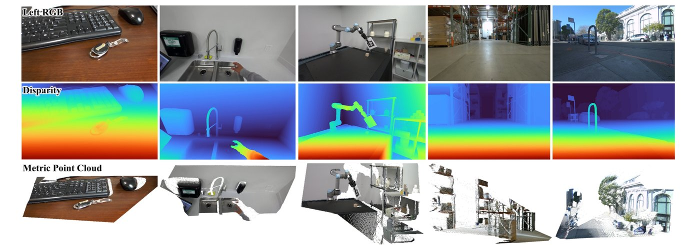
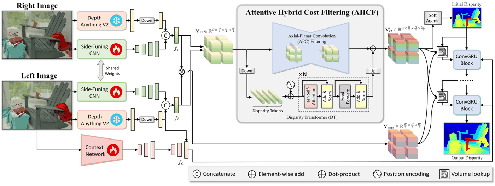
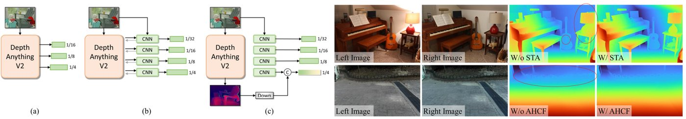
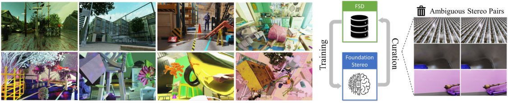
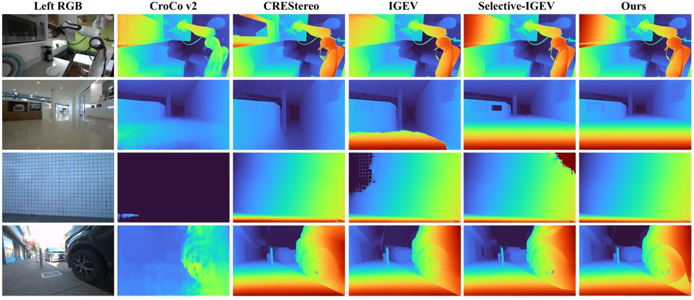

> FoundationPose를 만든 NVIDIA 팀(1저자 Bowen Wen)이 stereo matching에서 fine-tuning 없는 zero-shot 일반화를 실현한 FoundationStereo(CVPR 2025 Best Paper Nomination)를 리뷰한다. 1M 쌍의 합성 데이터셋(FSD), DepthAnythingV2 prior를 stereo에 적응시키는 STA, cost volume을 disparity 축 self-attention으로 필터링하는 AHCF가 핵심이다.

## 논문 정보

| 항목 | 내용 |
| --- | --- |
| 제목 | [FoundationStereo: Zero-Shot Stereo Matching](https://arxiv.org/abs/2501.09898) |
| 저자 | Bowen Wen, Matthew Trepte, Joseph Aribido, Jan Kautz, Orazio Gallo, Stan Birchfield |
| 소속 / 연도 | NVIDIA, 2025 (arXiv:2501.09898, CVPR 2025 Best Paper Nomination) |
| 분야 | Stereo Matching / Depth Estimation |
| 코드 | [GitHub](https://github.com/NVlabs/FoundationStereo) |

## 1. Introduction

반세기 전 첫 stereo matching 알고리즘 이후 긴 발전이 있었고, 최근 stereo 알고리즘들은 학습 데이터셋의 확산과 딥러닝 구조의 발전 덕에 가장 어려운 benchmark들을 거의 포화시키는 수준에 이르렀다. 그러나 경쟁력 있는 결과를 얻으려면 여전히 **대상 도메인 데이터셋에 fine-tuning하는 것이 표준**이다. scaling law를 통해 다른 컴퓨터 비전 문제들에서 zero-shot 일반화가 입증된 지금, 무엇이 stereo matching의 비슷한 일반화를 막고 있는가?

선도적인 stereo 네트워크들은 unary feature로 cost volume을 만들고 3D CNN으로 filtering하며, refinement 기반 방법들은 GRU 같은 recurrent 모듈로 disparity map을 반복 정제한다. 도메인별 fine-tuning 설정의 benchmark에서는 성공적이지만, 비국소(non-local) 정보를 모으지 못해 더 큰 데이터셋으로 효과적으로 확장되지 못한다. transformer 구조를 unary feature 추출에 도입한 방법들은 반대로 cost volume과 반복 정제가 주는 특화 구조가 없어 높은 정확도를 얻지 못한다. cross-domain 일반화를 탐구한 기존 연구들도 구조나 학습 데이터의 부족으로 대상 도메인 fine-tuning 결과에 필적하지 못했고, 대부분 4만 쌍 규모의 작은 Scene Flow에서 실험되어 기성(off-the-shelf) 해법이 되지 못했다.

*[Figure 1] 실내외, textureless·반사·반투명·얇은 구조 물체, 복잡한 조명, 다양한 시점·거리에 일반화되는 zero-shot 예측(RGB, disparity, metric point cloud)*

이를 해결하기 위해 제안하는 **FoundationStereo**는 도메인별 fine-tuning 없이 강한 zero-shot 일반화를 달성하는 stereo depth estimation의 대형 foundation model이다. 다양성과 photorealism이 높은 100만 쌍 규모 합성 데이터셋으로 학습하며, domain randomization 생성 과정에서 불가피하게 생기는 모호한 샘플을 제거하는 자동 self-curation pipeline으로 데이터 품질과 모델 강건성을 반복적으로 개선한다. sim-to-real 간극을 줄이기 위해 실제 monocular 이미지로 학습된 DepthAnythingV2의 인터넷 규모 prior를 stereo 설정에 적응시키는 side-tuning feature backbone을 제안한다. 이 풍부한 monocular prior가 담긴 4D cost volume을 효과적으로 활용하기 위해 **Attentive Hybrid Cost Filtering(AHCF)** 을 제안하는데, 표준 3D convolution을 공간·disparity 방향의 두 3D convolution으로 분리해 receptive field를 키우는 **Axial-Planar Convolution(APC)** filtering과, cost volume의 disparity 공간 전체에 self-attention을 수행해 장거리 문맥을 제공하는 **Disparity Transformer(DT)** 로 구성된다.

기여를 요약하면 다음과 같다.

- 대상 도메인에 fine-tuning한 기존 연구에 필적하거나 더 나은 zero-shot stereo matching 모델. in-the-wild 데이터에서는 기존 방법을 크게 능가
- 다양성과 photorealism이 높은 1M 규모 합성 stereo 데이터셋(FSD)과, 나쁜 샘플을 걸러내는 self-curation pipeline
- ViT 기반 monocular depth estimation 모델을 stereo 설정에 적응시키는 Side-Tuning Adapter(STA)
- 3D Axial-Planar Convolution(APC) hourglass와 disparity 차원 전체에 self-attention하는 Disparity Transformer(DT)로 이뤄진 AHCF

## 2. Related Work

**Deep Stereo Matching.** cost volume aggregation 방법은 unary feature로 cost volume을 만들고 3D CNN으로 filtering하지만 메모리 소모가 커서 고해상도에 직접 적용하기 어렵다. RAFT에서 영감을 받은 반복 정제 방법들은 비싼 4D volume 구축·filtering을 우회해 disparity를 recurrent하게 정제하며 다양한 disparity 범위에 잘 일반화되지만, recurrent 업데이트가 느리고 장거리 문맥 추론이 없다. 최근에는 cost filtering과 반복 정제의 강점을 결합하는 연구와, unary feature 추출에 transformer를 도입하는 연구가 있다. 도메인 불변 feature 학습으로 cross-domain 일반화를 노리는 연구들은 주로 Scene Flow 학습에 집중했다. 동시기 연구는 monocular prior로 강화한 correlation volume으로 주목할 만한 zero-shot 일반화를 이뤘다. 그러나 scaling law로 뒷받침되는 vision foundation model 수준의 일반화는 stereo matching에서 아직 실현되지 못했다.

**Stereo Matching Training Data.** KITTI 12/15는 주행 장면 수백 쌍, DrivingStereo는 18만 쌍까지 늘렸지만 LiDAR의 sparse한 ground-truth disparity가 조밀·정확한 학습을 막는다. Middlebury와 ETH3D는 주행 밖 실내외를 다루지만 수가 적고, Booster는 투명 물체 중심, InStereo2K는 structured light로 더 조밀한 2천 쌍을 제공한다. 실세계 수집의 데이터 부족·불완전한 ground truth·확장성 한계 때문에 합성 데이터(Scene Flow, Sintel, CREStereo, IRS, TartanAir, FallingThings, Virtual KITTI 2 등)가 널리 쓰인다. Table 1은 제안 데이터셋 FSD를 기존 합성 데이터셋과 비교한다. FSD는 가장 큰 규모, 다양한 3D asset, 다양하게 랜덤화된 카메라 파라미터, 렌더링·공간 배치의 높은 충실도를 갖춘다.

| 속성 | Sintel | Sceneflow | CREStereo | IRS | TartanAir | FallingThings | UnrealStereo4K | Spring | FSD (Ours) |
| --- | --- | --- | --- | --- | --- | --- | --- | --- | --- |
| Flying Objects | ✗ | ✓ | ✓ | ✗ | ✗ | ✗ | ✗ | ✗ | ✓ |
| Indoor | ✗ | ✗ | ✗ | ✓ | ✓ | ✓ | ✓ | ✗ | ✓ |
| Outdoor | ✗ | ✓ | ✗ | ✗ | ✓ | ✓ | ✓ | ✗ | ✓ |
| Driving | ✗ | ✓ | ✗ | ✗ | ✗ | ✗ | ✗ | ✗ | ✓ |
| Movie | ✓ | ✓ | ✗ | ✗ | ✗ | ✗ | ✗ | ✓ | ✗ |
| Simulator | Blender | Blender | Blender | Unreal Engine | Unreal Engine | Unreal Engine | Unreal Engine | Blender | NVIDIA Omniverse |
| Rendering Realism | High | Low | High | High | High | High | High | High | High |
| Scenes | 10 | 9 | 0 | 4 | 18 | 3 | 8 | 47 | 12 |
| Layout Realism | Medium | Low | Low | High | High | Medium | High | High | High |
| Stereo Pairs | 1K† | 40K† | 200K | 103K† | 306K† | 62K | 7.7K | 6K† | 1000K |
| Resolution | $$1024 \times 436$$ | $$960 \times 540$$ | $$1920 \times 1080$$ | $$960 \times 540$$ | $$640 \times 480$$ | $$960 \times 540$$ | $$3840 \times 2160$$ | $$1920 \times 1080$$ | $$1280 \times 720$$ |
| Reflections | ✗ | ✗ | ✓ | ✓ | ✓ | ✓ | ✓ | ✗ | ✓ |
| Camera Params | Constant | Constant | Constant | Constant | Constant | Constant | Constant | Constant baseline, varying intrinsics | Varying baseline and intrinsics |

*[Table 1] stereo 학습용 합성 데이터셋 비교(†는 비디오 시퀀스의 유사 frame이 많아 다양성이 줄어든 경우)*

**Vision Foundation Models.** CLIP은 대규모 이미지-텍스트 쌍 학습으로 zero-shot 분류를 열었고, DINO 계열은 자기지도 dense 표현 학습, SAM 계열은 다양한 prompt 기반 분할의 다재다능함을 보였다. 3D에서는 DUSt3R·MASt3R가 uncalibrated·unposed 카메라로부터의 일반화 가능한 dense 3D reconstruction framework를, FoundationPose가 novel object 6D pose estimation·tracking의 통합 framework를 제시했다. 이 연구와 가장 가까운 것은 monocular depth estimation과 multi-view stereo에서 강한 일반화를 보인 연구들(DepthAnything 계열 등)이다. 이들은 scaling law 아래 foundation model이 도메인별 fine-tuning 없이 강건한 응용을 지원하는 방향으로 진화하고 있음을 보여준다.

## 3. Approach

전체 네트워크 구조는 Figure 2와 같다.

*[Figure 2] STA로 monocular prior를 적응시켜 만든 hybrid cost volume을 APC hourglass와 Disparity Transformer로 filtering하고 ConvGRU로 반복 정제하는 전체 구조*

### 3.1 Monocular Foundation Model Adaptation

주로 합성 데이터로 학습되는 stereo 네트워크의 sim-to-real 간극을 줄이기 위해, 인터넷 규모 실제 데이터로 학습된 monocular depth estimation의 최근 발전을 활용한다. CNN 네트워크로 ViT 기반 monocular depth 네트워크를 stereo 설정에 적응시켜 CNN과 ViT 구조의 강점을 함께 얻는다.

*[Figure 3] STA 모듈의 세 가지 설계 선택지(왼쪽)와 STA·AHCF 모듈의 효과(오른쪽)*

CNN과 ViT를 결합하는 여러 설계를 탐구했다(Figure 3 왼쪽). (a)는 CNN feature 없이 고정된 DepthAnythingV2의 DPT head feature pyramid를 그대로 쓰고, (b)는 ViT-Adapter처럼 CNN과 ViT 사이에 feature를 교환하며, (c)는 DepthAnythingV2 최종 출력 head 직전의 feature에 stride 4의 $$4 \times 4$$ convolution을 적용해 다운스케일한 뒤 같은 수준의 CNN feature와 이어붙여 1/4 스케일 hybrid feature를 만든다. side CNN 네트워크가 ViT feature를 stereo matching 태스크에 적응시키도록 학습되는 구조다. 단순한데도 (c)가 다른 선택지를 크게 앞서는 것으로 나타나(4.5절) (c)를 STA 모듈의 기본 설계로 채택한다.

형식적으로, 좌우 이미지 $$I_l, I_r \in \mathbb{R}^{H \times W \times 3}$$ 에 대해 STA 안의 CNN 모듈로 EdgeNeXt-S를 써서 다층 pyramid feature를 추출하고, 1/4 수준 feature에 DepthAnythingV2 feature를 결합한다: $$f_l^{(i)}, f_r^{(i)} \in \mathbb{R}^{C_i \times \frac{H}{i} \times \frac{W}{i}}$$, $$i \in \{4, 8, 16, 32\}$$. EdgeNeXt-S는 메모리 효율 때문에 선택했고 더 큰 CNN backbone은 추가 이득이 없었다. DepthAnythingV2에 넣을 때는 pretrain된 patch 크기와 맞도록 이미지를 14로 나눠떨어지게 resize한다. STA 가중치는 $$I_l, I_r$$ 에 공유된다.

비슷하게 STA로 context feature도 추출하는데, 이때 CNN 모듈은 residual block과 downsampling layer의 연속으로 설계되어 여러 스케일의 context feature $$f_c^{(i)} \in \mathbb{R}^{C_i \times \frac{H}{i} \times \frac{W}{i}}$$, $$i \in \{4, 8, 16\}$$ 를 만든다. $$f_c$$ 는 ConvGRU 블록의 hidden state 초기화와 매 반복의 입력에 참여해, 점진적으로 정제되는 문맥 정보로 반복 과정을 유도한다.

Figure 3은 epipolar line을 따라가는 순진한 대응 탐색으로는 다루기 어려운 모호한 영역을 풍부한 monocular prior가 안정적으로 예측하게 해 줌을 보여준다. scale ambiguity가 있는 DepthAnythingV2의 depth 출력 자체가 아니라, 두 stereo 이미지에서 추출해 cost filtering으로 비교되는 **latent feature를 기하 prior로** 쓴다.

### 3.2 Attentive Hybrid Cost Filtering

**Hybrid Cost Volume Construction.** 앞 단계의 1/4 스케일 unary feature $$f_l^{(4)}, f_r^{(4)}$$ 로 group-wise correlation과 concatenation을 결합해 cost volume $$\mathbf{V_C} \in \mathbb{R}^{C \times \frac{D}{4} \times \frac{H}{4} \times \frac{W}{4}}$$ 를 만든다.

$$
\mathbf{V_{\text{gwc}}}(g, d, h, w) = \left\langle \widehat{f}_{l,g}^{(4)}(h, w),\; \widehat{f}_{r,g}^{(4)}(h, w-d) \right\rangle
$$

$$
\mathbf{V_{\text{cat}}}(d, h, w) = \left[ \text{Conv}(f_l^{(4)})(h, w),\; \text{Conv}(f_r^{(4)})(h, w-d) \right]
$$

$$
\mathbf{V_C}(d, h, w) = \left[ \mathbf{V_{\text{gwc}}}(d, h, w),\; \mathbf{V_{\text{cat}}}(d, h, w) \right]
$$

여기서 $$\widehat{f}$$ 는 학습 안정성을 위한 $$L_2$$ 정규화 feature, $$\langle \cdot, \cdot \rangle$$ 는 내적, $$g \in \{1, \ldots, G\}$$ 는 feature를 균등하게 나눈 총 $$G = 8$$ 개 group의 인덱스, $$d \in \{1, \ldots, \frac{D}{4}\}$$ 는 disparity 인덱스, $$[\cdot, \cdot]$$ 는 채널 차원 concatenation이다. group-wise correlation $$\mathbf{V_{\text{gwc}}}$$ 는 group마다 다양한 유사도 측정 feature를 주는 전통적 correlation 기반 matching cost의 강점을 취하고, $$\mathbf{V_{\text{cat}}}$$ 는 shifted disparity에서 좌우 feature를 이어붙여 풍부한 monocular prior를 포함한 unary feature를 보존한다. 메모리를 줄이기 위해 concatenation 전에 kernel 크기 1의 convolution(좌우 공유)으로 unary feature 차원을 14로 줄인다.

**Axial-Planar Convolution (APC) Filtering.** cost volume filtering에는 downsampling 블록 3개, upsampling 블록 3개와 residual 연결로 이뤄진 3D convolution hourglass 네트워크를 쓴다. $$3 \times 3 \times 3$$ 3D convolution은 작은 disparity에는 통하지만, disparity 차원이 초기 disparity 예측의 확률 분포를 modeling해야 하는 고해상도·대형 disparity에서는 부족하다. 그렇다고 kernel을 키우면 메모리가 감당이 안 된다($$5 \times 5 \times 5$$ 만 해도 80GB GPU에서 불가능한 수준). 그래서 하나의 3D convolution을 공간 차원(kernel $$K_s \times K_s \times 1$$)과 disparity 차원($$1 \times 1 \times K_d$$)의 두 convolution으로 분리한 **Axial-Planar Convolution**을 개발했다(각각 BatchNorm과 ReLU가 따른다). APC는 Separable Convolution의 3D 버전으로 볼 수 있는데, 표현력을 희생하는 채널 group 분할 없이 공간·disparity 차원만 분리한다는 차이가 있다. cost volume 안에 feature 비교가 고유하게 encoding된 disparity 차원을 특별히 다루는 것이다. hourglass의 down/upsampling layer를 제외한 모든 곳에 APC를 쓴다.

**Disparity Transformer (DT).** 기존 연구들이 unary feature 추출에 transformer를 도입했지만, 대응 정보를 담는 핵심 단계인 cost filtering은 간과되어 왔다. DT는 4D cost volume 안의 장거리 문맥 추론을 강화한다. $$\mathbf{V_C}$$ 에 stride 4의 $$4 \times 4 \times 4$$ 3D convolution을 적용해 축소하고, volume을 disparity 길이의 token sequence batch로 reshape한 뒤 position encoding을 더해 4개의 transformer encoder 블록에 넣는다. multi-head self-attention은 FlashAttention으로 수행한다.

$$
\mathbf{Q_0} = \text{PE}\left( \mathbf{R}\left( \text{Conv}_{4 \times 4 \times 4}(\mathbf{V_C}) \right) \right) \in \mathbb{R}^{\left( \frac{H}{16} \times \frac{W}{16} \right) \times C \times \frac{D}{16}}
$$

$$
\text{MultiHead}(\mathbf{Q}, \mathbf{K}, \mathbf{V}) = [\text{head}_1, \ldots, \text{head}_h] \mathbf{W}_O, \quad \text{head}_i = \text{FlashAttention}(\mathbf{Q}_i, \mathbf{K}_i, \mathbf{V}_i)
$$

$$
\mathbf{Q_1} = \text{Norm}\left( \text{MultiHead}(\mathbf{Q_0}, \mathbf{Q_0}, \mathbf{Q_0}) + \mathbf{Q_0} \right), \qquad \mathbf{Q_2} = \text{Norm}\left( \text{FFN}(\mathbf{Q_1}) + \mathbf{Q_1} \right)
$$

여기서 $$\mathbf{R}(\cdot)$$ 는 reshape, $$\text{PE}(\cdot)$$ 는 position encoding, $$\mathbf{W}_O$$ 는 선형 가중치, head 수는 $$h = 4$$ 다. DT 출력은 trilinear interpolation으로 $$\mathbf{V_C}$$ 와 같은 크기로 upsampling되어 hourglass 출력과 더해진다(Figure 2).

**Initial Disparity Prediction.** filtering된 volume $$\mathbf{V_C'}$$ 에 soft-argmin을 적용해 초기 disparity를 만든다.

$$
d_0 = \sum_{d=0}^{\frac{D}{4}-1} d \cdot \text{Softmax}(\mathbf{V_C'})(d)
$$

여기서 $$d_0$$ 는 원본 해상도의 1/4 스케일이다. disparity 축의 softmax 확률로 가중 평균한 기댓값을 취하는 미분 가능한 argmin이다.

### 3.3 Iterative Refinement

$$d_0$$ 에서 시작해 GRU 업데이트로 disparity를 점진적으로 정제하면 지역 최적을 피하고 수렴이 빨라진다. $$k$$ 번째 업데이트는 다음과 같다.

$$
\mathbf{V}_{\text{corr}}(w', h, w) = \left\langle f_l^{(4)}(h, w),\; f_r^{(4)}(h, w') \right\rangle
$$

$$
\mathbf{F_V}(h, w) = [\mathbf{V_C'}(d_k, h, w),\; \mathbf{V}_{\text{corr}}(w - d_k, h, w)]
$$

$$
x_k = [\text{Conv}_v(\mathbf{F_V}),\; \text{Conv}_d(d_k),\; d_k,\; c]
$$

$$
z_k = \sigma\left( \text{Conv}_z([h_{k-1}, x_k]) \right), \qquad r_k = \sigma\left( \text{Conv}_r([h_{k-1}, x_k]) \right)
$$

$$
\hat{h}_k = \tanh\left( \text{Conv}_h([r_k \odot h_{k-1},\; x_k]) \right)
$$

$$
h_k = (1 - z_k) \odot h_{k-1} + z_k \odot \hat{h}_k, \qquad d_{k+1} = d_k + \text{Conv}_\Delta(h_k)
$$

여기서 $$\odot$$ 는 원소별 곱, $$\sigma$$ 는 sigmoid, $$\mathbf{V}_{\text{corr}} \in \mathbb{R}^{\frac{W}{4} \times \frac{H}{4} \times \frac{W}{4}}$$ 는 좌우 feature의 pair-wise correlation volume이다. $$\mathbf{F_V}$$ 는 최신 disparity $$d_k$$ 위치에서 filtering된 volume과 correlation volume을 조회(lookup)한 feature이고, $$z_k, r_k$$ 는 GRU의 update/reset gate, $$h_k$$ 는 hidden state다. $$c = \text{ReLU}(f_c)$$ 는 왼쪽 이미지의 context feature로, STA로 적응된 monocular prior를 담아 정제 과정을 유도한다.

각 반복에서 3개 수준의 GRU 블록으로 coarse-to-fine hidden state 업데이트를 수행하며, 초기 hidden state는 context feature에서 $$h_0^{(i)} = \tanh(f_c^{(i)})$$, $$i \in \{4, 8, 16\}$$ 으로 만든다. 각 수준에서 attention 기반 선택 메커니즘으로 서로 다른 주파수의 정보를 포착한다. 마지막으로 $$d_k$$ 를 convex sampling으로 전체 해상도로 upsampling한다.

### 3.4 Loss Function

모델은 다음 목적함수로 학습한다.

$$
\mathcal{L} = \left\lvert d_0 - \overline{d} \right\rvert_{\text{smooth}} + \sum_{k=1}^{K} \gamma^{K-k} \left\| d_k - \overline{d} \right\|_1
$$

여기서 $$\overline{d}$$ 는 ground-truth disparity, $$\lvert \cdot \rvert_{\text{smooth}}$$ 는 smooth $$L_1$$ loss, $$k$$ 는 반복 번호, $$\gamma = 0.9$$ 다. 뒤쪽 반복일수록 지수적으로 커지는 가중치로 반복 정제된 disparity를 supervision한다.

### 3.5 Synthetic Training Dataset

NVIDIA Omniverse로 대규모 합성 학습 데이터셋 **FSD(FoundationStereo Dataset)** 를 만들었다. 반사, 저texture 표면, 심한 occlusion 같은 stereo matching의 핵심 난제를 반영하고, 무작위 stereo baseline·초점거리·카메라 시점·조명·물체 배치 등 domain randomization으로 다양성을 키웠다. 동시에 풍부한 texture의 고품질 3D asset과 path tracing 렌더링으로 렌더링·배치의 사실성을 높였다. Figure 4는 구조화된 실내외 장면과 다양한 기하·texture의 flying object 샘플을 보여준다.

*[Figure 4] FSD의 구조화된 장면·flying object 샘플(왼쪽)과 반복 self-curation 과정 및 감지된 모호 샘플(오른쪽)*

**Iterative Self-Curation.** 합성 데이터는 이론상 무한히 만들 수 있지만, 특히 flying object가 있는 덜 구조화된 장면에서는 모호한 샘플이 불가피하게 생겨 학습을 혼란시킨다. 이를 제거하기 위해 자동 반복 self-curation 전략을 설계했다. 먼저 FSD로 FoundationStereo 초기 버전을 학습한 뒤 FSD 자체에서 평가해, BP-2가 60%보다 큰 샘플을 모호 샘플로 간주하고 새로 생성한 샘플로 교체한다. 학습과 curation을 번갈아(이 논문에서는 2회) 반복하며 FSD와 FoundationStereo를 함께 업데이트한다.

## 4. Experiments

### 4.1 Implementation Details

PyTorch로 구현했다. foundation model은 FSD에 Scene Flow, Sintel, CREStereo, FallingThings, InStereo2K, Virtual KITTI 2를 섞은 데이터셋으로 학습한다. AdamW로 20만 스텝, 총 batch 128을 NVIDIA A100 32장에 분산해 학습하고, learning rate는 1e-4에서 시작해 학습의 0.8 지점에서 0.1배 감쇠한다. 이미지는 320×736으로 무작위 crop하고, 학습 중 GRU 22회 반복을 쓴다. 이하 zero-shot 추론은 같은 foundation model로 정제 32회 반복, 최대 disparity 416을 쓴다.

### 4.2 Benchmark Datasets and Metric

**Datasets.** 합성 데이터셋 Scene Flow(FlyingThings3D·Driving·Monkaa)와 실세계 4개 데이터셋을 쓴다. Middlebury는 structured light로 얻은 고품질 ground truth의 실내 stereo 쌍(별도 언급 없으면 half 해상도·비가림 영역 평가), ETH3D는 실내외 grayscale 쌍, KITTI 2012/2015는 LiDAR 유래의 sparse ground truth가 있는 실제 주행 장면이다.

**Metrics.** EPE는 픽셀 평균 disparity 오차, BP-X는 disparity 오차가 X픽셀보다 큰 픽셀 비율, D1은 오차가 3픽셀보다 크면서 ground truth의 5%보다 큰 픽셀 비율이다.

### 4.3 Zero-Shot Generalization Comparison

**Benchmark Evaluation.** Table 2는 실세계 4개 데이터셋에서의 zero-shot 일반화 정량 비교다. Scene Flow만으로 학습해도 vision foundation model의 풍부한 monocular prior를 적응시킨 효과 덕에 모든 데이터셋에서 비교 방법들을 일관되게 앞선다. 나아가 실용 응용에서 요구되듯 대상 도메인을 제외한 어떤 데이터셋으로든 학습을 허용하는 더 현실적인 설정에서도 평가했다.

| Methods | Middlebury BP-2 | ETH3D BP-1 | KITTI-12 D1 | KITTI-15 D1 |
| --- | --- | --- | --- | --- |
| CREStereo++ | 14.8 | 4.4 | 4.7 | 5.2 |
| DSMNet | 13.8 | 6.2 | 6.2 | 6.5 |
| Mask-CFNet | 13.7 | 5.7 | 4.8 | 5.8 |
| HVT-RAFT | 10.4 | 3.0 | 3.7 | 5.2 |
| RAFT-Stereo | 12.6 | 3.3 | 4.7 | 5.5 |
| Selective-IGEV | 9.2 | 5.7 | 4.5 | 5.6 |
| IGEV | 8.8 | 4.0 | 5.2 | 5.7 |
| Former-RAFT-DAM | 8.1 | 3.3 | 3.9 | 5.1 |
| IGEV++ | 7.8 | 4.1 | 5.1 | 5.9 |
| NMRF | 7.5 | 3.8 | 4.2 | 5.1 |
| Ours (Scene Flow) | **5.5** | **1.8** | **3.2** | **4.9** |
| Selective-IGEV* | 7.5 | 3.4 | 3.2 | 4.5 |
| Ours | **1.1** | **0.5** | **2.3** | **2.8** |

*[Table 2] 4개 공개 데이터셋에서의 zero-shot 일반화 결과(굵게 최고). 위 블록은 Scene Flow만으로 학습, 아래 블록(\*)은 대상 4개 도메인을 제외한 임의 데이터셋 학습 허용*

**In-the-Wild Generalization.** 공개 checkpoint를 낸 최근 방법들(CroCo v2, CREStereo, IGEV, Selective-IGEV)과 in-the-wild 이미지에서 비교했다. 비교 방법들은 실세계 benchmark 4개를 학습에 썼지만 이 논문의 고정 foundation model은 쓰지 않았다. Figure 5는 DROID 로봇 장면과 자체 촬영 실내외를 포함한 다양한 시나리오의 정성 비교다.

*[Figure 5] in-the-wild 이미지에서의 zero-shot 추론 정성 비교(각 비교 방법은 공개 release 중 최고 성능 checkpoint 사용)*

### 4.4 In-Domain Comparison

Table 3은 Scene Flow의 공식 train/test 분할을 따르는 in-domain 비교다. in-domain 학습이 이 연구의 초점이 아님에도 이전 최고 EPE를 큰 차이로 낮춰 모델 설계의 효과를 보여준다.

| Method | LEAStereo | GANet | ACVNet | IGEV-Stereo | NMRF | MoCha-Stereo | Selective-IGEV | Ours |
| --- | --- | --- | --- | --- | --- | --- | --- | --- |
| EPE | 0.78 | 0.84 | 0.48 | 0.47 | 0.45 | 0.41 | 0.44 | **0.34** |

*[Table 3] Scene Flow train/test 분할에서의 비교(굵게 최고)*

Table 4는 ETH3D leaderboard(테스트셋) 비교다. 두 설정으로 평가했는데, 첫째로 기본 학습 데이터셋과 ETH3D 학습셋을 섞어 5만 스텝 fine-tuning한 모델은 이전 최고 방법의 오차율을 절반 이하로 줄이며 제출 시점 leaderboard 1위에 올랐다. in-domain fine-tuning이 필요할 때 foundation model의 전이 능력이 크다는 뜻이다. 둘째로 ETH3D 데이터를 전혀 쓰지 않은 foundation model의 zero-shot 추론도 in-domain 학습을 한 선도 방법들과 대등하거나 더 나은 결과를 낸다. fine-tuning 모델은 Middlebury leaderboard에서도 1위를 기록했다.

| Method | Zero-Shot | BP-0.5 | BP-1.0 | EPE |
| --- | --- | --- | --- | --- |
| GMStereo | ✗ | 5.94 | 1.83 | 0.19 |
| HITNet | ✗ | 7.83 | 2.79 | 0.20 |
| EAI-Stereo | ✗ | 5.21 | 2.31 | 0.21 |
| RAFT-Stereo | ✗ | 7.04 | 2.44 | 0.18 |
| CREStereo | ✗ | 3.58 | 0.98 | 0.13 |
| IGEV-Stereo | ✗ | 3.52 | 1.12 | 0.14 |
| CroCo-Stereo | ✗ | 3.27 | 0.99 | 0.14 |
| MoCha-Stereo | ✗ | 3.20 | 1.41 | 0.13 |
| Selective-IGEV | ✗ | 3.06 | 1.23 | 0.12 |
| Ours (finetuned) | ✗ | **1.26** | **0.26** | **0.09** |
| Ours | ✓ | 2.31 | 1.52 | 0.13 |

*[Table 4] ETH3D leaderboard(테스트셋) 결과(굵게 최고). 마지막 행만 zero-shot 추론, 나머지는 ETH3D 학습셋으로 fine-tuning*

### 4.5 Ablation Study

모델·데이터셋의 설계 선택을 검증한다. 별도 언급 없으면 실험 규모를 위해 FSD의 무작위 10만 개 부분집합으로 학습하고, ground truth 품질이 높은 Middlebury 학습셋에서 zero-shot 일반화를 평가한다. 강한 일반화의 foundation model을 만드는 것이 목적이므로 성능을 위해 모델 크기를 일부러 제한하지 않는다.

**STA Design Choices.** Table 5에서 monocular prior 적응에 쓸 vision foundation model들을 비교한다. DINOv2는 대응 매칭에서 유망했지만 태스크 관련성이 낮고 고정밀 픽셀 대응을 추론하기엔 해상도가 제한되어 DepthAnythingV2만 못하다. Figure 3의 설계 중에서는 단순한 (c)가 크게 앞서는데, 최종 출력 head 직전 feature가 고해상도의 세밀한 semantic·기하 prior를 보존해 이후 cost volume 구축·filtering에 적합하기 때문으로 본다. ViT를 unfreeze하면 pretrain된 monocular prior가 훼손되어 성능이 떨어진다.

| Row | Variations | BP-2 |
| --- | --- | --- |
| 1 | DINOv2-L | 2.46 |
| 2 | DepthAnythingV2-S | 2.22 |
| 3 | DepthAnythingV2-B | 2.11 |
| 4 | DepthAnythingV2-L | 1.97 |
| 5 | STA (a) | 6.48 |
| 6 | STA (b) | 2.22 |
| 7 | STA (c) | 1.97 |
| 8 | Unfreeze ViT | 3.94 |
| 9 | Freeze ViT | 1.97 |

*[Table 5] STA 모듈 ablation. (a-c)는 Figure 3의 설계 선택지. 원문은 full model 채택 선택지(4·7·9행)를 초록으로 표시*

**AHCF Design Choices.** Table 6에서 DT 모듈은 position embedding(RoPE vs Cosine), transformer를 적용할 feature 스케일(1/32 vs 1/16), 전체 cost volume vs disparity 차원만의 attention, hourglass 대비 DT 배치(직렬 전/후 vs 병렬)를 비교한다. RoPE는 token 사이 상대 거리를 encoding해 가변 길이에 유리하지만 4D cost volume의 disparity 크기가 일정해서인지 cosine embedding을 넘지 못한다. 이론상 receptive field가 더 큰 full volume attention은 4D cost volume의 극도로 큰 공간 탓에 다루기 어려워, disparity 차원만의 attention이 더 효과적이다. APC는 disparity kernel 크기를 17까지 키울수록 이득이 커지다 포화된다.

| Row | Variations | BP-2 |
| --- | --- | --- |
| 1 | RoPE | 2.19 |
| 2 | Cosine | 1.97 |
| 3 | 1/32 | 2.06 |
| 4 | 1/16 | 1.97 |
| 5 | Full | 2.25 |
| 6 | Disparity | 1.97 |
| 7 | Pre-hourglass | 2.06 |
| 8 | Post-hourglass | 2.20 |
| 9 | Parallel | 1.97 |

*[Table 6 왼쪽] DT 부분 ablation(2·4·6·9행 채택)*

| Row | Variations | BP-2 |
| --- | --- | --- |
| 10 | (3,3,1), (1,1,5) | 2.10 |
| 11 | (3,3,1), (1,1,9) | 2.06 |
| 12 | (3,3,1), (1,1,13) | 2.01 |
| 13 | (3,3,1), (1,1,17) | 1.97 |
| 14 | (3,3,1), (1,1,21) | 1.98 |
| 15 | (7,7,1), (1,1,17) | 1.99 |

*[Table 6 오른쪽] APC kernel 크기 ablation(괄호의 마지막 차원이 disparity, 13행 채택)*

**Effects of Proposed Modules.** Table 7 왼쪽처럼 STA는 모호한 영역에서 실제 이미지로의 일반화를 크게 높이고, DT와 APC는 공간·disparity 차원에서 cost volume feature를 효과적으로 모아 disparity 초기화와 GRU 업데이트의 volume 조회 문맥을 개선한다.

| Row | STA | APC | DT | BP-2 |
| --- | --- | --- | --- | --- |
| 1 | | | | 2.48 |
| 2 | ✓ | | | 2.21 |
| 3 | ✓ | ✓ | | 2.16 |
| 4 | ✓ | | ✓ | 2.05 |
| 5 | ✓ | ✓ | ✓ | 1.97 |

*[Table 7 왼쪽] 제안 모듈들의 효과(5행 채택)*

**Effects of FoundationStereo Dataset.** 4.1절의 foundation model 학습에서 기존 공개 데이터셋에 FSD를 포함하는지의 효과가 Table 7 오른쪽이다.

| Row | FSD | BP-2 |
| --- | --- | --- |
| 1 | ✗ | 2.34 |
| 2 | ✓ | 1.15 |

*[Table 7 오른쪽] foundation model 학습 시 FSD 포함 여부의 효과(2행 채택)*

## 5. Conclusion

fine-tuning 없이 다양한 도메인에 강한 zero-shot 일반화를 달성하는 stereo depth estimation foundation model인 FoundationStereo를 소개했다. 이런 foundation model이 실용 응용에서 stereo 추정 모델의 폭넓은 채택을 촉진할 것으로 본다. 뛰어난 일반화에도 한계가 있다. 첫째, 아직 효율이 최적화되지 않아 NVIDIA A100에서 375×1242 이미지에 0.7초가 걸린다. 다른 vision foundation model에 적용된 distillation·pruning 기법의 적용이 향후 과제다. 둘째, FSD의 투명 물체 수가 제한적이라, 학습 시 완전 투명 물체의 다양성을 키우면 강건성을 더 높일 수 있다.
