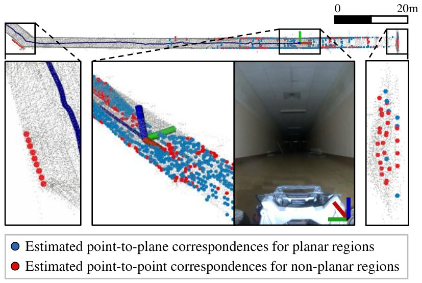
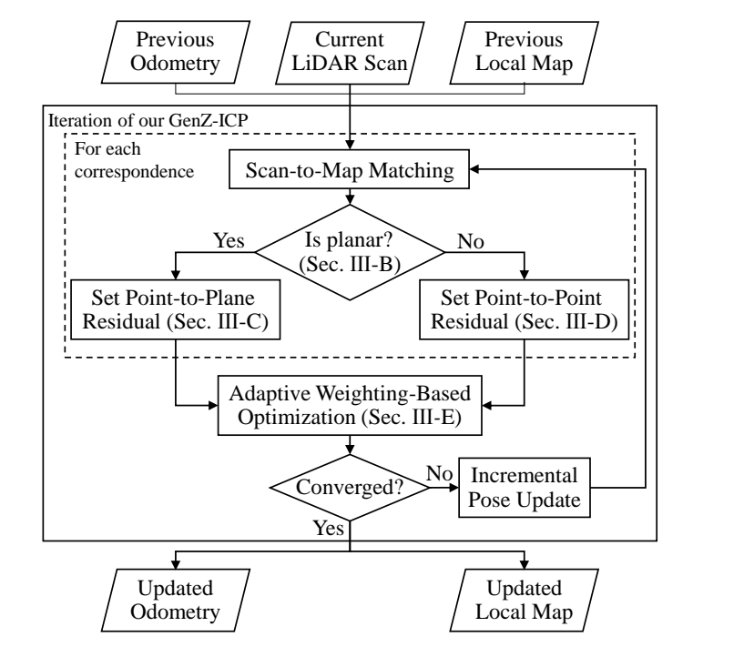
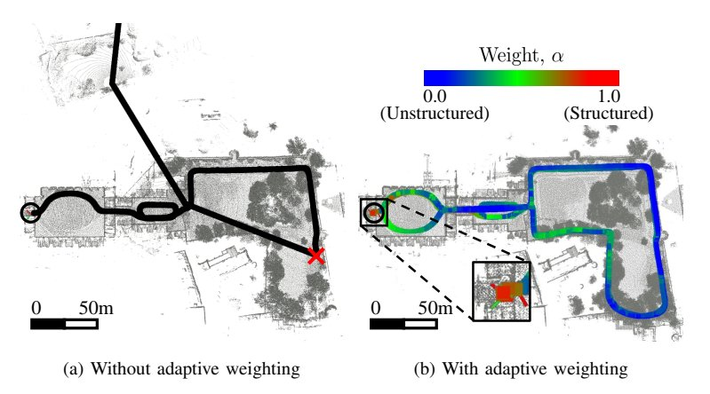
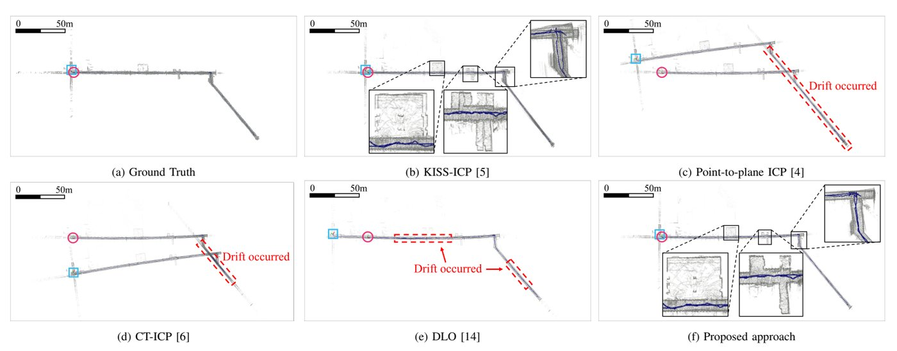
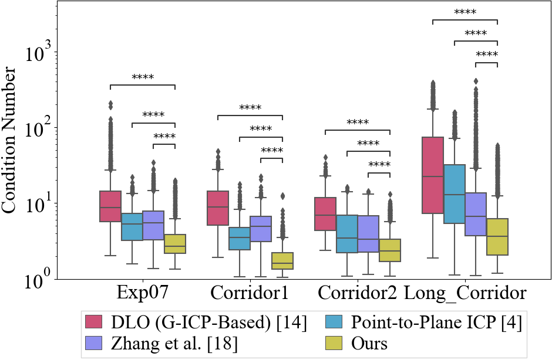

> 긴 복도처럼 기하 정보가 퇴화(degenerate)하는 환경에서 LiDAR odometry가 무너지는 이유를 "단일 error metric 의존"으로 진단하고, point-to-plane과 point-to-point를 주변 기하에 따라 적응적으로 섞어 해결한 GenZ-ICP(IEEE RA-L 2025)를 리뷰한다. C++/ROS 코드가 공개되어 있어 바로 써볼 수 있는 실용적인 odometry다.

## 논문 정보

| 항목 | 내용 |
| --- | --- |
| 제목 | [GenZ-ICP: Generalizable and Degeneracy-Robust LiDAR Odometry Using an Adaptive Weighting](https://arxiv.org/abs/2411.06766) |
| 저자 | Daehan Lee, Hyungtae Lim, Soohee Han |
| 소속 / 연도 | POSTECH, MIT LIDS, 2025 (arXiv:2411.06766, IEEE RA-L vol.10 no.1) |
| 분야 | LiDAR Odometry / SLAM |
| 코드 | [GitHub](https://github.com/cocel-postech/genz-icp) |

## I. Introduction

LiDAR 기반 odometry는 고정밀 거리 측정을 활용하고 조명 변화에 강해 널리 연구되어 왔다. LiDAR odometry는 ICP를 위해 point-to-point, point-to-plane 같은 다양한 error metric을 쓰는데, 각각 강점과 약점이 있다. 그러나 기존 LiDAR(-inertial) odometry 시스템들은 보통 **단일 error metric에 의존**해, 주변의 기하적 특성에 따라 성능이 요동친다. 예를 들어 point-to-point error metric은 다양한 환경에서 잘 동작하지만 표면 normal 같은 구조적 기하 feature를 쓰지 않아 구조화된 환경에서 덜 정확하고, 반대로 point-to-plane error metric은 noisy한 3D 정보가 normal 추정에 영향을 주는 비구조화 환경에서 덜 정밀해진다. Generalized-ICP(G-ICP)는 두 metric을 확률적 framework로 통합하지만 모든 주변을 국소 평면으로 가정하므로, 주변 기하에 따라 상당한 근사 오차가 생겨 성능이 떨어질 수 있다.

*[Figure 1] SubT-MRS 데이터셋 Long_Corridor 시퀀스에서 GenZ-ICP의 LiDAR mapping 결과*

이 연구는 단일 error metric 의존의 단점을 해결하는 새로운 ICP 방법 **GenZ-ICP**를 제안한다. point-to-plane과 point-to-point error metric을 다시 검토해 상호보완적으로 강점을 활용하고, 주변의 기하적 특성을 반영하는 **adaptive weight**로 다양한 환경에 대한 적응력을 높인다. LiDAR odometry의 주요 degeneracy 사례는 복도류 구조에서 나타나는 단방향 degeneracy이므로, 이 연구도 복도류 degeneracy 사례에 집중한다.

세 가지 핵심 주장을 내세운다.

1. 일반 환경에서 state-of-the-art LiDAR odometry와 대등한 성능
2. 긴 복도 같은 퇴화 환경에서 단일 error metric에 의존하는 state-of-the-art 대비 우월한 성능
3. 최적화 과정에서 수학적으로 ill-posed한 문제를 방지해, 복도류 degeneracy에서 최적화 열화에 대한 회복력 확보

## II. Related Work

LiDAR odometry는 연속된 LiDAR scan의 registration으로 로봇 pose를 추정한다. 수십 년간 다양한 error metric이 제안됐고, 특히 point-to-point와 point-to-plane의 상대적 우위는 주변 기하에 따라 성능이 달라지므로 여전히 논쟁거리다. 도시처럼 구조화된 환경에서는 point-to-point가 구조적 기하 feature를 못 써서 덜 정확하고, 숲처럼 비구조화된 환경에서는 noisy한 3D 정보에서 추정된 신뢰할 수 없는 normal 때문에 point-to-plane이 덜 정밀하다. 두 metric을 통합한 G-ICP나 voxelized GICP(VGICP)도 있지만, G-ICP 계열은 모든 주변을 국소 평면으로 가정하는 plane-to-plane metric으로 동작해 근사 오차 전파로 성능이 저하될 수 있다.

state-of-the-art LiDAR(-inertial) odometry 대부분은 세 metric 중 하나에 의존한다. DLO는 FastGICP+NanoFLANN을 결합한 NanoGICP로 keyframe 기반 scan-to-map matching을 하고, CT-ICP는 point-to-plane metric에 motion un-distortion을 통합했으며, Fast-LIO2는 point-to-plane을 direct matching·ikd-Tree와 함께 쓴다. LOCUS 2.0은 G-ICP 계열 metric에 point cloud normal로 공분산 계산을 근사하고, KISS-ICP는 adaptive threshold와 robust kernel로 point-to-point를, MAD-ICP는 kd-tree를 전 연산에 적용하며 point-to-plane을 쓴다. 이들은 일반 환경에서 뛰어나지만 긴 복도나 터널 같은 퇴화 환경에서는 degeneracy 문제로 성능이 심각하게 저하될 수 있다.

degeneracy를 수치로 표현·감지하는 방법들도 제안됐다. Zhang et al.은 최적화 Hessian의 최소 고유값을 degeneracy factor로 쓰고 degeneracy 발생 시 잘 제약된 방향으로만 해를 투영하는 solution remapping을 도입했다. LION은 Hessian 이동 부분의 condition number(observability metric)로 자기 평가를 수행해, 관측 불가능하면 바퀴 encoder·시각/열-관성 odometry를 쓰는 HeRO로 전환한다. AdaLIO는 voxel화된 점 수와 점유 voxel 거리로 복도 같은 좁은 실내를 감지해 적응형 파라미터 설정을 적용한다. 이외에 주변 기하 분석으로 degeneracy 완화에 도움이 되는 점을 뽑는 sampling 기반 기법들이 있는데, X-ICP는 부분적으로 localization 가능한 경우 퇴화 방향의 scan 점을 재샘플링해 제약 최적화를 수행하고, 불가능하면 IMU·관절 encoder 기반 leg odometry에 의존한다. 경험적으로 sampling 기반 + 제약 최적화 조합은 outlier에 취약해 부정확한 제약을 만들 수 있다(IV-C절). 이들과 달리 GenZ-ICP는 **최적화 중 ill-posed 문제 자체를 방지**해 degeneracy를 최소화한다.

## III. GenZ-ICP

제안하는 방법은 Figure 2의 LiDAR odometry 시스템에 적용된다. 세 가지 핵심 구성으로 이뤄진다. (a) 평면성 분류, (b) point-to-plane·point-to-point residual 설정, (c) adaptive weighting 기반 최적화.

*[Figure 2] correspondence마다 평면성을 판정해 point-to-plane/point-to-point residual을 설정하고 adaptive weighting 최적화로 pose를 갱신하는 시스템 flowchart*

### III-A. Problem Definition

ICP 문제는 LiDAR frame $$\mathrm{L}$$ 의 source point cloud $$\mathbf{P}^{\mathrm{L}}$$ 을 map frame $$\mathrm{M}$$ 의 target point cloud $$\mathbf{Q}^{\mathrm{M}}$$ 에 가장 잘 정렬하는 rigid 변환 $$\mathbf{T}^{\mathrm{M}}_{\mathrm{L}} \in \mathrm{SE}(3)$$ 을 추정하는 것이다. 대응을 만들기 위해 $$\mathbf{P}^{\mathrm{L}}$$ 은 이전 추정 pose로 $$\mathrm{M}$$ 에 변환해 두고, $$i$$ 번째 대응 쌍의 residual $$\mathbf{e}_i$$ 로 비용 함수를 구성한다. 최적 정렬은 ICP의 $$n$$ 번째 반복에서 추정되는 상대 pose $$\hat{\boldsymbol{\Delta}}$$ 로 pose를 증분 갱신하며 계산된다(이하 $$n$$ 생략). 상대 pose는 다음 최적화로 추정한다.

$$
\hat{\mathbf{R}}, \hat{\mathbf{t}} = \underset{\mathbf{R} \in \mathrm{SO}(3),\, \mathbf{t} \in \mathbb{R}^3}{\operatorname{argmin}} \sum_{i=1}^{N} \| \mathbf{e}_i \|^2
$$

여기서 $$\hat{\mathbf{R}} \in \mathrm{SO}(3)$$ 과 $$\hat{\mathbf{t}} \in \mathbb{R}^3$$ 은 $$\hat{\boldsymbol{\Delta}}$$ 의 회전·이동, $$N$$ 은 대응 쌍 수, $$\| \cdot \|$$ 은 $$L_2$$ norm이다.

residual은 보통 point-to-point, point-to-plane, G-ICP 중 하나로 계산되지만, 앞서 설명한 대로 단일 metric은 주변 기하에 따라 성능을 떨어뜨린다. 그래서 대응 쌍을 평면성에 따라 두 그룹으로 분류해 point-to-plane residual $$\mathbf{e}_{\text{pl},j}$$ 과 point-to-point residual $$\mathbf{e}_{\text{po},k}$$ 를 계산하고(III-B절), 최적화 문제를 다음처럼 재정식화한다.

$$
\hat{\mathbf{R}}, \hat{\mathbf{t}} = \underset{\mathbf{R} \in \mathrm{SO}(3),\, \mathbf{t} \in \mathbb{R}^3}{\operatorname{argmin}}\; \alpha \sum_{j=1}^{N_{\text{pl}}} \| \mathbf{e}_{\text{pl},j} \|^2 + (1 - \alpha) \sum_{k=1}^{N_{\text{po}}} \| \mathbf{e}_{\text{po},k} \|^2
$$

여기서 $$\alpha \in [0, 1]$$ 은 adaptive weight, $$N_{\text{pl}}, N_{\text{po}}$$ 는 각각 point-to-plane, point-to-point가 적용되는 대응 쌍 수다($$N = N_{\text{pl}} + N_{\text{po}}$$). $$\alpha$$ 는 두 수의 비율에 따라 변한다(III-E절).

### III-B. Classifying Planar and Non-Planar Structures

비평면 대응에 point-to-plane을 적용하면 내재된 오차가 비용 함수로 전파된다. 신뢰할 수 있는 normal 추정을 위해, 각 대응의 이웃 점 분포를 이용해 평면성 기준으로 대응을 두 부류로 나눈다. 이웃 점이 부족하면 normal이 부정확할 수 있으므로, 이웃 점 수가 threshold $$\tau_{\text{num}}$$ 미만이면 비평면으로 간주해 normal이 필요 없는 point-to-point를 적용한다.

이웃 점 수가 $$\tau_{\text{num}}$$ 이상이면 국소 표면 변화량(local surface variation) $$\frac{\lambda_3}{\lambda_1 + \lambda_2 + \lambda_3}$$ 으로 분포를 분석한다. $$\lambda_1 > \lambda_2 > \lambda_3$$ 은 이웃 점들의 주성분 분석에서 나온 내림차순 고유값이다. 이 값이 낮으면 평평하고 일관된 표면, 높으면 굽었거나 불규칙한 표면을 뜻한다. 평면성 판정 Boolean 함수 $$\psi(\cdot)$$ 를 다음처럼 정의한다.

$$
\psi(\lambda_1, \lambda_2, \lambda_3) = \begin{cases} 1, & \text{if } \frac{\lambda_3}{\lambda_1 + \lambda_2 + \lambda_3} < \tau_{\text{planar}} \\ 0, & \text{otherwise} \end{cases}
$$

국소 표면 변화량이 threshold $$\tau_{\text{planar}}$$ 보다 작으면 충분히 평면이라 보고 point-to-plane을, 아니면 비평면으로 point-to-point를 적용한다.

### III-C. Setting Point-to-Plane Residual and Jacobian

평면 대응 쌍에는 분류 단계에서 신뢰할 수 있는 normal $$\mathbf{n}$$ 이 추정되어 있다. 변환된 source 점 $$\mathbf{R}\mathbf{p} + \mathbf{t}$$ 와 target 점 $$\mathbf{q}$$ 의 차이를 normal에 내적해 residual을 계산한다.

$$
\mathbf{e}_{\text{pl}} = (\mathbf{R}\mathbf{p} + \mathbf{t} - \mathbf{q}) \cdot \mathbf{n} \in \mathbb{R}
$$

선형화를 위해 작은 각 근사 $$\mathbf{R} \approx [\mathbf{r}]_\times + \mathbf{I}_3$$ 를 쓰면

$$
\mathbf{e}_{\text{pl}} \approx (([\mathbf{r}]_\times + \mathbf{I}_3)\mathbf{p} + \mathbf{t} - \mathbf{q}) \cdot \mathbf{n} = \mathbf{r} \cdot (\mathbf{p} \times \mathbf{n}) + \mathbf{t} \cdot \mathbf{n} + (\mathbf{p} - \mathbf{q}) \cdot \mathbf{n}
$$

여기서 $$[\cdot]_\times$$ 는 3D 벡터를 skew-symmetric 행렬로 바꾸는 연산자이고 $$\mathbf{r}$$ 은 회전의 소각 벡터다. 상태를 $$\boldsymbol{\Delta} = [\mathbf{t}^{\mathrm{T}}\; \mathbf{r}^{\mathrm{T}}]^{\mathrm{T}} \in \mathbb{R}^6$$ 로 두면 Jacobian은

$$
\mathbf{J}_{\text{pl}} = \frac{\partial \mathbf{e}_{\text{pl}}}{\partial \boldsymbol{\Delta}} = \begin{bmatrix} \mathbf{n}^{\mathrm{T}} & (\mathbf{p} \times \mathbf{n})^{\mathrm{T}} \end{bmatrix} \in \mathbb{R}^{1 \times 6}
$$

이고, 선형화된 residual은 $$\mathbf{e}_{\text{pl}} \approx \mathbf{J}_{\text{pl}} \boldsymbol{\Delta} + \bar{\mathbf{e}}_{\text{pl}}$$, $$\bar{\mathbf{e}}_{\text{pl}} = (\mathbf{p} - \mathbf{q}) \cdot \mathbf{n} \in \mathbb{R}$$ 이다.

### III-D. Setting Point-to-Point Residual and Jacobian

비평면 대응 쌍에는 변환된 source 점과 target 점의 차이 그대로를 residual로 쓴다.

$$
\mathbf{e}_{\text{po}} = \mathbf{R}\mathbf{p} + \mathbf{t} - \mathbf{q} \in \mathbb{R}^3
$$

같은 방식으로 회전 선형화와 skew-symmetric 행렬의 성질을 쓰면

$$
\mathbf{e}_{\text{po}} \approx ([\mathbf{r}]_\times + \mathbf{I}_3)\mathbf{p} + \mathbf{t} - \mathbf{q} = -[\mathbf{p}]_\times \mathbf{r} + \mathbf{t} + \mathbf{p} - \mathbf{q}
$$

이고, Jacobian은

$$
\mathbf{J}_{\text{po}} = \frac{\partial \mathbf{e}_{\text{po}}}{\partial \boldsymbol{\Delta}} = \begin{bmatrix} \mathbf{I}_3 & -[\mathbf{p}]_\times \end{bmatrix} \in \mathbb{R}^{3 \times 6}
$$

이며, 선형화된 residual은 $$\mathbf{e}_{\text{po}} \approx \mathbf{J}_{\text{po}} \boldsymbol{\Delta} + \bar{\mathbf{e}}_{\text{po}}$$, $$\bar{\mathbf{e}}_{\text{po}} = \mathbf{p} - \mathbf{q} \in \mathbb{R}^3$$ 이다.

### III-E. Adaptive Weighting-Based Optimization

선형화된 두 residual을 비용 함수에 넣으면, 최적화는 선형 최소제곱 문제로 재정식화된다.

$$
\hat{\boldsymbol{\Delta}} = \underset{\boldsymbol{\Delta} \in \mathbb{R}^6}{\operatorname{argmin}} \| \mathbf{A} \boldsymbol{\Delta} + \mathbf{b} \|^2
$$

$$
\mathbf{A} = \alpha \sum_{j=1}^{N_{\text{pl}}} \mathbf{J}_{\text{pl},j}^{\mathrm{T}} \mathbf{J}_{\text{pl},j} + (1 - \alpha) \sum_{k=1}^{N_{\text{po}}} \mathbf{J}_{\text{po},k}^{\mathrm{T}} \mathbf{J}_{\text{po},k} \in \mathbb{R}^{6 \times 6}
$$

$$
\mathbf{b} = \alpha \sum_{j=1}^{N_{\text{pl}}} \mathbf{J}_{\text{pl},j}^{\mathrm{T}} \bar{\mathbf{e}}_{\text{pl},j} + (1 - \alpha) \sum_{k=1}^{N_{\text{po}}} \mathbf{J}_{\text{po},k}^{\mathrm{T}} \bar{\mathbf{e}}_{\text{po},k} \in \mathbb{R}^6
$$

adaptive weight $$\alpha$$ 는 **평면 대응 쌍의 비율**로 계산한다.

$$
\alpha = \frac{N_{\text{pl}}}{N_{\text{pl}} + N_{\text{po}}}
$$

즉 비용 함수가 point-to-plane과 point-to-point를 적응적으로 통합한다. adaptive weighting 없이 단순 결합하면($$\alpha = 0.5$$) 주변의 기하 변화를 반영하지 못해 부정확해지는데, Figure 3(a)처럼 odometry가 발산하기도 한다. 반면 제안 방법은 구조화 ↔ 비구조화 환경 전환에서 $$\alpha$$ 를 적응적으로 조정해 기하 변화에 강건하다(Figure 3(b)). 마지막으로 위 최소제곱을 풀어 $$\hat{\boldsymbol{\Delta}}$$ 를 얻고, 충분히 작아질 때까지 증분 pose 갱신을 반복한다.

*[Figure 3] Newer College short experiment에서 adaptive weighting 없이($$\alpha = 0.5$$) 발산한 경우(a)와, $$\alpha$$ color map으로 표현된 적응 결과(b). 창 없는 좁은 복도(확대 박스)일수록 $$\alpha$$ 가 1에 가깝다*

### III-F. Why Adaptive Weight?: Numerical Analyses from the Degeneracy Perspective

adaptive weight가 왜 degeneracy에 강한지 condition number로 분석한다. 선형계 $$\mathbf{C}\mathbf{x} = \mathbf{d}$$ 의 condition number는 $$\mathbf{C}^{\mathrm{T}}\mathbf{C}$$ 의 최대·최소 고유값 비의 제곱근 $$\sqrt{\lambda_{\text{max}} / \lambda_{\text{min}}}$$ 으로 정의되며, 높을수록 시스템이 불안정하고 ill-conditioned임을 뜻한다. 여기서 $$\mathbf{C}$$ 는 위의 $$\mathbf{A}$$ 에 해당한다. 긴 복도의 degeneracy는 주로 pose의 이동 부분에서 발생하므로, $$\mathbf{A}$$ 의 이동 부분

$$
\bar{\mathbf{A}} = \begin{bmatrix} \mathbf{I}_3 & \mathbf{0}_3 \end{bmatrix} \mathbf{A} \begin{bmatrix} \mathbf{I}_3 \\ \mathbf{0}_3 \end{bmatrix} \in \mathbb{R}^{3 \times 3}
$$

의 condition number로 degeneracy를 평가하는 observability metric을 적용한다.

복도 한가운데서 point-to-plane ICP를 수행하면, normal 벡터가 바닥·천장·벽에서 나온 두 축에만 몰려 복도 방향의 pose가 모호해진다. 이 불균형을 해소해 줄 수 있는, 이동 방향에 직교하는 평면의 normal들은 멀리서 관측되면 point cloud의 희소성 때문에 신뢰할 수 없어 반복 중 기각되기 일쑤다. 결과적으로 복도 방향 고유값이 작아져 condition number가 급증하고 pose drift가 생긴다.

반면 adaptive weighting은 비평면 영역의 희소하고 noisy한 점들에 point-to-point를 적용해 이 문제를 우회한다. point-to-point ICP는 Hessian의 이동 부분이 항등행렬이라 **condition number가 항상 1**이다. 즉 수치적으로 안정된 최적화가 가능해 추정이 가장 가까운 최소제곱 해로 수렴한다. 이 해가 전역 최소는 아닐 수 있지만, ill-posed 상황에서 pose 발산을 막아 point-to-plane ICP에서 흔한 큰 pose drift를 줄인다. 두 metric을 적응적으로 쓰는 GenZ-ICP는 낮은 condition number를 유지해 퇴화 환경의 최적화 열화에 강하다(IV-D절).

## IV. Experimental Evaluation

### IV-A. Experimental Setup

데이터셋을 일반 환경과 복도류 퇴화 환경으로 나눠 평가했다. 일반 환경은 숲 같은 비구조화·건물 같은 구조화 환경을 포함한 Newer College, 도시의 MulRan과 KITTI odometry를 쓴다. 퇴화 환경은 HILTI SLAM Challenge 2022의 HILTI-Oxford Exp07 Long Corridor, Ground-Challenge의 Corridor1·Corridor2, ICCV 2023 SLAM Challenge에 쓰인 SubT-MRS Long_Corridor를 쓴다. 퇴화 환경에서는 degeneracy 문제를 겨냥한 방법들(Zhang et al., X-ICP)과도 비교하고, error metric의 영향을 공정하게 보기 위해 같은 LiDAR odometry framework(KISS-ICP) 안에서 point-to-point ICP, point-to-plane ICP, GenZ-ICP를 비교한다. Zhang et al.과 X-ICP는 코드가 공개되어 있지 않아 논문 기반으로 재구현해 같은 framework에 적용했고(비localizable 상황에서는 등속 모델 사용), Zhang et al.은 error metric이 명시되지 않아 point-to-plane을 적용했다.

긴 시퀀스인 Newer College·MulRan·KITTI는 loop closing이 있는 완전한 SLAM 시스템과의 공정한 비교를 위해 relative pose error(RPE)로, 짧은 퇴화 환경 시퀀스는 RPE와 absolute pose error(APE)로 평가한다. HILTI-Oxford는 mm 수준 기준점의 APE로 점수를 내는 HILTI SLAM Challenge 평가 시스템만 쓸 수 있다.

### IV-B. Comparison With State-of-the-Art Systems in General Environments

첫 실험은 일반 환경에서 state-of-the-art와 대등하다는 첫 번째 주장을 뒷받침한다. Newer College에서는 short experiment에서 loop closing을 갖춘 완전한 SLAM인 CT-ICP보다도 나았고, long experiment에서는 loop closing의 전체 궤적 보정 덕에 CT-ICP가 크게 앞섰으며 GenZ-ICP는 2위였다.

| 구분 | Method | short experiment | long experiment |
| --- | --- | --- | --- |
| SLAM | MULLS | 0.82 | 1.23 |
| | CT-ICP | 0.48 | **0.58** |
| Odometry | F-LOAM | 2.02 | Div. |
| | KISS-ICP | 0.51 | 0.96 |
| | MAD-ICP | 0.86 | 0.96 |
| | Ours | **0.46** | 0.94 |

*[Table 1] Newer College 데이터셋의 상대 이동 오차(%). 굵게 최고(원문의 회색 차선 표시는 HTML 소스에 없어 생략). Div.는 발산*

MulRan에서는 KAIST·Sejong 시퀀스에서 전 방법 중 최고, 나머지 두 시퀀스에서 KISS-ICP에 이은 2위를 기록했다.

| Method | KAIST | DCC | Riverside | Sejong |
| --- | --- | --- | --- | --- |
| SuMa | 5.59 | 5.20 | 13.86 | Div. |
| MULLS | 2.94 | 2.96 | 5.42 | 5.93 |
| F-LOAM | 3.43 | 3.83 | 5.47 | 7.87 |
| KISS-ICP | 2.28 | **2.34** | **2.89** | 4.69 |
| MAD-ICP | 2.47 | 2.42 | 3.24 | 5.69 |
| Ours | **2.27** | 2.39 | 3.01 | **4.62** |

*[Table 2] MulRan 데이터셋의 상대 이동 오차(%). 굵게 최고, Div.는 발산*

KITTI odometry에서는 KISS-ICP에 이은 2위로, loop closing을 포함한 완전한 SLAM 시스템들도 능가했다.

| 구분 | Method | Seq. 00-10 |
| --- | --- | --- |
| SLAM | SuMa++ | 0.70 |
| | MULLS | 0.52 |
| | CT-ICP | 0.53 |
| Odometry | Generalized-ICP | 1.10 |
| | IMLS-SLAM | 0.55 |
| | SuMa | 0.80 |
| | MULLS | 0.55 |
| | F-LOAM | 0.84 |
| | VGICP | 2.25 |
| | KISS-ICP | **0.50** |
| | MAD-ICP | 0.82 |
| | Ours | 0.51 |

*[Table 3] KITTI odometry 데이터셋의 상대 이동 오차(%). 굵게 최고*

### IV-C. Comparison With State-of-the-Art Systems in Corridor Scenarios

두 번째 실험은 복도류 퇴화 시나리오에서의 우월성 주장을 뒷받침한다. 서로 다른 error metric을 쓰는 최신 방법(KISS-ICP, CT-ICP, DLO)과 degeneracy 대응 방법(Zhang et al., X-ICP)을 비교했다.

HILTI-Oxford Exp07에서 GenZ-ICP는 단일 metric 방법들을 능가하고 degeneracy 대응 방법들보다도 정확한 최고 점수를 기록했다. X-ICP는 제약 최적화 중 부정확한 재샘플링 점들 때문에 심한 성능 저하를 보였다.

| Method | < 1cm | < 3cm | < 6cm | < 10cm | ≥ 10cm | Score |
| --- | --- | --- | --- | --- | --- | --- |
| KISS-ICP | 0 | 0 | 0 | 0 | 6 | 0.00 |
| CT-ICP | 0 | 0 | 0 | 3 | 2 | 5.00 |
| DLO | 0 | 1 | 0 | 2 | 3 | 13.33 |
| Zhang et al. | 0 | 1 | 2 | 2 | 1 | 23.33 |
| X-ICP | 0 | 0 | 0 | 0 | 6 | 0.00 |
| Ours | 1 | 1 | 1 | 1 | 2 | 33.33 |

*[Table 4] HILTI-Oxford Exp07(복도)의 HILTI SLAM Challenge 기준 mm 수준 기준점 APE 점수*

Ground-Challenge의 Corridor1(지그재그 이동)·Corridor2(직진 이동)는 SubT-MRS Long_Corridor보다 짧아 어떤 시스템도 pose drift는 없었고, RPE 차이는 크지 않지만 APE에서 의미 있는 차이가 났다. 직진이라 degeneracy에 더 취약한 Corridor2에서는 point-to-plane의 CT-ICP와 G-ICP 계열의 DLO가 Corridor1보다 상대적으로 성능이 떨어졌고, 원래 IMU·관절 encoder로 사전 motion을 예측하던 X-ICP는 등속 모델로 제한된 LiDAR odometry 설정에서 성능이 저하됐다.

| Sequence | Method | APE Mean | APE Max | APE RMSE | APE Stdev. | RPE Mean | RPE Max | RPE RMSE | RPE Stdev. |
| --- | --- | --- | --- | --- | --- | --- | --- | --- | --- |
| Corridor1 (zigzag) | KISS-ICP | 1.70 | 4.76 | 2.17 | 1.35 | 0.12 | 0.59 | 0.15 | 0.09 |
| | CT-ICP | 0.44 | 1.05 | 0.54 | 0.30 | 0.05 | **0.23** | **0.06** | **0.04** |
| | DLO | 0.34 | 1.04 | 0.45 | 0.30 | 0.05 | 0.55 | 0.08 | 0.06 |
| | Zhang et al. | 0.22 | 0.67 | 0.28 | 0.17 | 0.05 | 0.26 | **0.06** | **0.04** |
| | X-ICP | 0.94 | 9.45 | 2.05 | 1.83 | 0.05 | 0.47 | 0.07 | 0.05 |
| | Ours | **0.19** | **0.49** | **0.24** | **0.14** | **0.04** | **0.23** | **0.06** | **0.04** |
| Corridor2 (straight forward) | KISS-ICP | 0.54 | 1.34 | 0.68 | 0.41 | 0.14 | 0.46 | 0.16 | 0.08 |
| | CT-ICP | 1.04 | 2.36 | 1.30 | 0.78 | **0.12** | 0.35 | **0.14** | **0.06** |
| | DLO | 0.72 | 1.72 | 0.93 | 0.59 | **0.12** | **0.34** | **0.14** | 0.07 |
| | Zhang et al. | 0.21 | 0.60 | 0.28 | 0.18 | **0.12** | 0.36 | **0.14** | **0.06** |
| | X-ICP | 5.85 | 9.69 | 6.92 | 3.70 | 0.13 | 0.37 | 0.15 | 0.07 |
| | Ours | **0.18** | **0.41** | **0.20** | **0.09** | **0.12** | 0.36 | **0.14** | 0.07 |

*[Table 5] Ground-Challenge Corridor1·Corridor2의 이동 성분 APE·RPE(m, EVO 평가). 굵게 최고*

SubT-MRS Long_Corridor에서는 CT-ICP·DLO·point-to-plane ICP가 복도 한가운데서 pose drift를 일으키며 큰 최대 오차를 보였다(RPE 최댓값이 크면 degeneracy로 drift가 발생했다는 뜻). point-to-point ICP에 해당하는 KISS-ICP는 퇴화 방향에 point-to-point residual을 만들어 drift가 줄었지만, normal 같은 주변 기하 정보를 못 쓰므로 APE가 높아 일부 drift를 보였다(Figure 4(b)). Zhang et al.의 방법은 point-to-plane 단독보다는 낫지만 여전히 완전히 강건하지 못했는데, degeneracy를 감지해도 퇴화 방향을 사전 정보에만 의존할 뿐 최적화의 ill-posed 문제 자체를 방지하지 않기 때문이다. X-ICP는 재샘플링 점 안의 outlier가 만든 부정확한 제약 때문에 발산했다. 반면 GenZ-ICP는 drift를 방지하며 가장 정확한 결과를 보였다(Figure 4(f)).

| Method | APE Mean | APE Max | APE RMSE | APE Stdev. | RPE Mean | RPE Max | RPE RMSE | RPE Stdev. |
| --- | --- | --- | --- | --- | --- | --- | --- | --- |
| KISS-ICP | 6.83 | 19.05 | 8.72 | 5.41 | 0.10 | 0.94 | 0.14 | 0.10 |
| CT-ICP | 44.18 | 60.14 | 45.66 | 11.55 | 0.19 | 7.15 | 0.68 | 0.65 |
| DLO | 7.69 | 27.99 | 9.09 | 4.86 | 0.26 | 22.74 | 1.32 | 1.29 |
| Point-to-point ICP | 6.83 | 19.05 | 8.72 | 5.41 | 0.10 | 0.94 | 0.14 | 0.10 |
| Point-to-plane ICP | 32.84 | 40.88 | 33.16 | 4.55 | 0.13 | 12.50 | 0.68 | 0.67 |
| Zhang et al. | 19.43 | 29.87 | 20.05 | 4.97 | 0.14 | 4.56 | 0.38 | 0.36 |
| X-ICP | Div. | Div. | Div. | Div. | Div. | Div. | Div. | Div. |
| Ours | **1.69** | **4.32** | **1.99** | **1.04** | **0.06** | **0.73** | **0.09** | **0.07** |

*[Table 6] SubT-MRS Long_Corridor의 이동 성분 APE·RPE(m, EVO 평가). 굵게 최고, Div.는 발산*

*[Figure 4] SubT-MRS Long_Corridor의 정성 결과. point-to-point(b)는 drift는 적지만 부정확한 map, point-to-plane·G-ICP 계열(c·d·e)은 degeneracy로 도착 지점이 크게 어긋나는 pose drift, 제안 방법(f)은 가장 정확한 결과*

요약하면, 단일 error metric 의존 방법들은 퇴화 환경에서 성능이 저하되고, degeneracy 대응 방법 중 X-ICP는 재샘플링에 outlier가 섞이면 불안정하며, Zhang et al.과 X-ICP처럼 퇴화 방향을 사전 정보에 의존하는 방법은 motion 예측이 부정확하면 성능이 떨어진다(IMU·encoder 같은 추가 센서가 있을 때 효과적). GenZ-ICP는 이런 조건 없이 복도류 퇴화 시나리오에서 degeneracy에 강건한 성능을 보였다.

### IV-D. Quantitative Analysis Using Condition Number in Degenerative Scenes

세 번째 실험은 최적화의 ill-posed 문제를 방지한다는 세 번째 주장을 뒷받침한다. DLO, point-to-plane ICP, Zhang et al.과 condition number를 전 시퀀스에서 비교했다(point-to-point ICP는 condition number가 항상 1이라 제외).

*[Figure 5] 복도 시나리오별 condition number box plot(\*\*\*\*는 paired t-test p-value < 10⁻⁴). 제안 방법이 전 시퀀스에서 가장 낮다*

Figure 5처럼 네 방법 모두 Long_Corridor에서 다른 두 시퀀스보다 높은 condition number를 보였다. 복도가 길수록 degeneracy 값이 커져 문제가 생기기 쉽다는 뜻이다. point-to-plane ICP와 DLO는 Long_Corridor에서 큰 condition number를 보이며 pose drift를 일으켰고(Figure 4(c)·(e)), Zhang et al.도 degeneracy 발생 시 잘 제약된 방향으로 해를 투영할 뿐 ill-posed 문제를 방지하지 않아 높은 condition number와 부정확한 결과를 보였다. 반면 제안 방법은 전 시퀀스에서 가장 낮은 condition number를 유지해, 복도류 degeneracy에서 최적화 열화에 대한 회복력을 보였다.

## V. Conclusion

단일 error metric 의존의 단점을 해결하기 위해 point-to-plane과 point-to-point error metric을 재검토하고, 두 metric의 강점을 상호보완적으로 활용하는 새로운 ICP 방법 GenZ-ICP를 제안했다. 주변의 기하적 특성에 따라 adaptive weight를 조정해 다양한 환경에서 적응적으로 동작하며, 퇴화 시나리오에서 state-of-the-art를 능가하는 강건한 pose 추정을 보였다. 모든 주장은 실험으로 검증됐다. 향후 연구로는 GenZ-ICP를 LiDAR-inertial odometry framework에 적용해 공격적인 움직임에 대한 강건성을 높이는 것을 계획한다.
