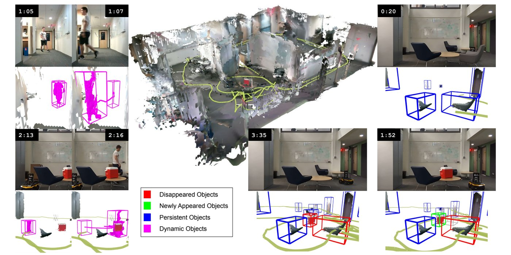
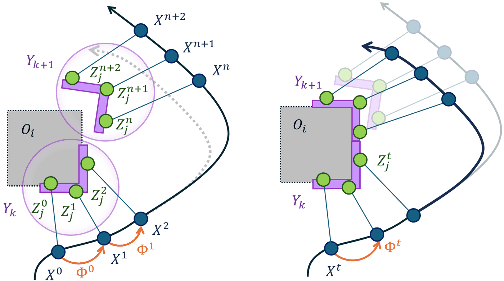
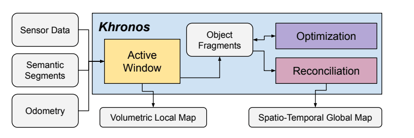
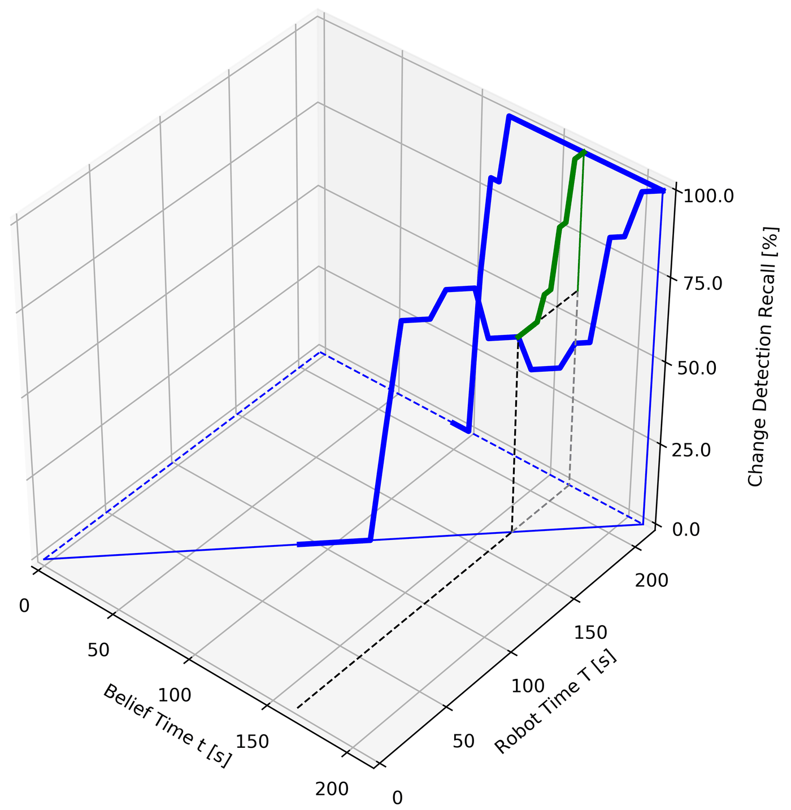
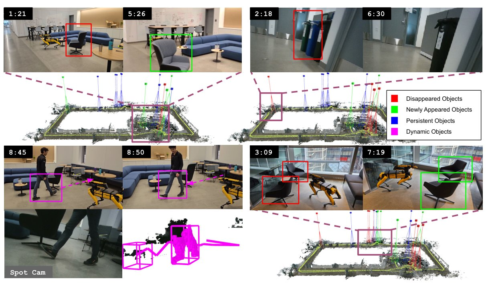

> 눈앞에서 움직이는 사람(단기 dynamics)과 안 보는 사이 옮겨진 가구(장기 변화)를 하나의 확률적 factorization으로 통합해, "모든 시점의 scene 상태"를 담는 4D map을 실시간으로 만드는 MIT SPARK Lab의 Khronos(RSS 2024)를 리뷰한다. 얼마 전 리뷰한 Living Scenes가 다룬 장기 변화 문제를 SLAM 백엔드(pose graph, GTSAM의 GNC)까지 포함한 온라인 시스템으로 확장한 그림이다.

## 논문 정보

| 항목 | 내용 |
| --- | --- |
| 제목 | [Khronos: A Unified Approach for Spatio-Temporal Metric-Semantic SLAM in Dynamic Environments](https://arxiv.org/abs/2402.13817) |
| 저자 | Lukas Schmid, Marcus Abate, Yun Chang, Luca Carlone |
| 소속 / 연도 | MIT SPARK Lab, 2024 (arXiv:2402.13817, RSS 2024) |
| 분야 | Spatio-Temporal SLAM / Dynamic Scene Understanding |
| 코드 | [GitHub](https://github.com/MIT-SPARK/Khronos) |

## I. Introduction

사람이 있는 환경에서 로봇이 안전하고 효과적으로 동작하려면 주변 세계에 대한 충분한 이해가 필요하다. 이런 공유 공간은 사람·로봇·다른 개체가 끊임없이 움직이고 상호작용하며 scene을 바꾸는 고도로 동적인 환경이다. 이런 상황에서는 한 시점의 snapshot에 대한 world model만으로는 부족하고, 과거 시점의 scene 상태를 추론하며 여러 관측에 걸쳐 scene이 어떻게 변했는지 파악할 수 있어야 한다. 가사·서비스 로봇부터 산업 건설, 작업장 모니터링까지, 긴 시간에 걸친 추론이 필요한 응용에 필수적인 능력이다.

metric-semantic SLAM은 semantic 주석이 달린 기하 표현을 실시간으로 구축하게 해 준다. 기하는 안전한 주행과 manipulation에, semantic은 인간 지시의 수행과 인간이 이해하기 쉬운 환경 모델 제공에 중요하다. 실시간으로 이런 dense 표현을 만들기 위해 보통은 세계가 정적이라 가정하고 noisy한 기하·semantic 측정의 강건한 융합에 집중하는데, 이 가정은 로봇이 동작할 수 있는 환경과 임무의 일반성을 제한한다. 한편 동적 환경 SLAM 연구는 시야 안에서 움직이는 개체에도 불구하고 localization과 상태 추정을 개선하는 데 인상적인 능력을 보였지만, 대부분 **단기 dynamics**(카메라 앞에서 지금 움직이는 사람·물체)에 집중해 왔고, 로봇이 안 보는 사이 scene이 크게 바뀌는(가구 재배치 등) **장기 변화 감지** 연구와는 단절되어 있었다. 실제 환경은 단기·장기 변화를 모두 겪는데, 둘을 함께 추론하는 통합 접근이 없었다. 게다가 다른 사람·로봇과 함께 일하려면 제한된 정보·계산 자원으로 동작 중에 온라인으로 이 이해를 구축해야 한다.

*[Figure 1] 모든 시점의 scene 상태를 담는 Khronos spatio-temporal map의 예. 단기 dynamics(왼쪽, 자홍색)와 세 시점의 장기 변화(오른쪽: 사라진 물체 빨강, 새로 나타난 물체 초록, 지속 물체 파랑)*

이를 위해 로봇이 scene을 탐색하며 **모든 시점의 dense metric-semantic 모델을 증분적으로** 구축하는 **Spatio-temporal Metric-semantic SLAM(SMS)** 문제를 도입하고, 이를 풀기 위한 통합 framework를 제시한다. 중심 아이디어는 시공간 국소 일관성(spatio-temporal local consistency)에 기반한 새로운 factorization으로, 센서 noise·상태 추정 오차·동적 물체·장기 변화에서 오는 오차들을 분리(disentangle)할 수 있게 한다. 이 통찰을 구현한 **Khronos**는 scene의 spatio-temporal map을 실시간으로 만드는 최초의 metric-semantic 시스템이다. 기여는 다음과 같다.

- 로봇이 주변 환경과 그 시간적 진화에 대한 dense metric-semantic 이해를 구축하는 SMS 문제의 정식화
- 단기·장기 dynamics에 대한 기존 해석들을 통합하는 렌즈가 되는 SMS 문제의 새로운 factorization
- 비동기 local mapping과 deformable 전역 변화 감지 알고리즘으로 구성된 최초의 spatio-temporal metric-semantic 인식 시스템 Khronos. 구현과 데이터셋 공개

## II. Related Works

**Metric-semantic SLAM.** voxel 기반 방법들은 noisy한 detection을 map에 증분 융합하지만 고정된 격자 구조 탓에 상태 추정 drift에 취약하다. object 수준 SLAM과 landmark 기반 방법들은 상태 추정을 정제하며 물체의 semantic 정보를 유지한다. dense map의 전역 일관성을 위해 surfel, mesh, submap 기반 표현이 제안됐고, 최근에는 NeRF·Gaussian Splatting 기반 mapping도 나왔지만 강력한 컴퓨터가 필요해 실시간 로봇 운용에는 부적합한 경우가 많다. 이들은 대체로 세계가 정적이라는 단순화 가정을 둔다.

**Dynamic SLAM.** 크게 두 갈래다. sparse SLAM 방법들은 주로 동적 물체를 SLAM 문제에서 제거해 상태 추정 성능을 높이고, 좋은 motion prior가 있으면 차·사람 같은 동적 개체를 추정 문제에 통합하기도 한다. simultaneous tracking and reconstruction 접근은 카메라 앞에서 움직이는 단일·다수 rigid 물체의 dense 모델을 만들지만 table-top scene에 제한되는 경우가 많다. Dynablox 계열은 더 큰 scene에서 motion detection과 dense 배경 reconstruction을 동시에 수행하지만, 정적 배경 대비 증분적 움직임의 tracking에 의존해 장기 변화에는 일반화가 어렵다.

**Change Detection.** 장기 변화 식별은 전통적으로 변화 전후의 정적 scene 관측을 비교하는 multi-session 시나리오로 다뤄졌다. Bore et al.은 필터링된 확률적 motion model로 일반 장기 동적 물체를 추적했다. 최근에는 온라인 장기 일관성 mapping이 등장했는데, Panoptic Mapping은 전경 물체와 배경 클래스의 semantic 일관성으로 변화하는 scene의 volumetric map을 유지하고, 후속 연구는 국소 registration·volumetric descriptor·neural object model로 확장했다. POCD와 POV-SLAM은 factor graph 정식화로 물체 수준 장기 변화를 추적·재구성하는 object-aware SLAM을 제안했다.

**Spatio-temporal Mapping.** 단기와 장기 dynamics를 결합한 연구는 상대적으로 드물다. Changing-SLAM은 Bayesian filtering으로 단기 dynamics를, data association으로 장기 변화를 감지해 상태 추정 강건성을 높이지만, 감지된 동적 점들을 SLAM 문제에서 제거할 뿐 scene의 풍부한 표현과 진화의 이해를 구축하지는 않는다. 이에 비해 Khronos는 로봇 pose와 모든 시점의 명시적 dense semantic 표현을 함께 최적화하며 spatio-temporal metric-semantic map을 실시간 생성하는 최초의 방법이다.

## III. Problem Statement

SMS 문제를 정의하기 위해 물체 $$O_i \in \mathcal{O}$$ 로 구성된 scene을 생각한다. 배경 전체도 정적 물체 $$O_{BG} \in \mathcal{O}$$ 로 표현한다. 시각 $$t$$ 에서 물체 $$i$$ 의 상태는

$$
O_i^t = \{\Omega_i^t,\ T_{WO_i}^t,\ L_i\}
$$

로, $$\Omega_i^t$$ 는 표면, $$T_{WO_i}^t$$ 는 세계 좌표계 $$W$$ 기준 pose, $$L_i$$ 는 semantic label이다($$t = 0, 1, \ldots, T$$ 는 이산 시각, $$O_{BG}$$ 는 모든 시각에 일정). 로봇 pose는 $$X = \{X^t\}$$, $$X^t = T_{WR}^t$$ 로 표기한다. 매 시각 로봇은 부피 $$V^t$$ 를 관측해 측정 $$Z_j^t$$ 를 얻는다.

$$
Z_j^t = \{\Omega_j^t,\ T_{RZ_j}^t,\ L_j^t\}, \qquad Z_j^t \sim O_i^t \oplus \eta_O \ \text{ if } O_i^t \in V^t
$$

여기서 $$\Omega_j^t$$ 는 RGBD 카메라 등에서 온 표면 측정, $$T_{RZ_j}^t$$ 는 로봇 frame $$R$$ 기준 물체 표면의 pose, $$L_j^t$$ 는 관측된 semantic label이다. $$\oplus\, \eta_O$$ 는 표면 측정 부정확성, 누락·환각 측정, noisy semantic까지 포함한 모든 측정 noise를 요약한 연산이다. 시각 관측 외에 로봇은 odometry 측정도 얻는다.

$$
\Phi^t \sim \left( X^{t-1} \right)^{-1} X^t \boxplus \eta_\Phi
$$

여기서 $$\boxplus$$ 는 $$SE(3)$$ 위의 덧셈이다. SMS 문제의 목표는 실시간으로, 즉 매 현재 시각 $$T$$ 에서 모든 이전 시각 $$t \leq T$$ 의 scene 상태를 추정하는 것이고, 각 $$T$$ 에 대한 MAP 추정 문제로 쓸 수 있다.

$$
O^\star, X^\star = \operatorname*{argmax}_{O, X} \mathbb{P}(O, X \mid Z, \Phi)
$$

## IV. Fragments and Factorization

위 MAP 추정은 계산이 어렵다. 물체 수와 속성이 변할 수 있어 미지수가 측정보다 훨씬 많고, 센서 noise·불완전한 상태 추정·움직이고 변하는 scene 사이의 결합이 모든 변수를 강하게 상호의존적으로 만든다. 그래서 모든 관측을 메모리에 유지해야 하고 문제가 시공간에 대해 잘 확장되지 않는다. 직관적으로, 현재 측정과 map 믿음(belief)의 불일치가 센서 noise 때문인지, 잘못된 상태 추정 때문인지, 지금 움직이는 물체 때문인지, 시간이 지나며 scene이 변한 것인지 구분해야 하는 어려움이다.

이를 극복하기 위해 **시공간 국소 일관성**이라는 핵심 아이디어에 기반한 factorization을 제안한다. 형식적으로 다음을 가정한다.

$$
\left\lVert \left( \prod_{t'=t-\tau}^{t} \Phi^{t'} \right) \boxminus \left( T_{WR}^{t-\tau} \right)^{-1} T_{WR}^{t} \right\rVert < \epsilon_s \quad \forall t,\ \forall \tau < \delta
$$

$$
\left\lVert O_i^t \ominus O_i^{t-\tau} \right\rVert < \epsilon_t \quad \forall t,\ \forall \tau < \delta
$$

여기서 $$\boxminus, \ominus$$ 는 각각 $$SE(3)$$·물체 상태 위의 차이 연산, $$\epsilon_s, \epsilon_t$$ 는 작은 상수, $$\delta$$ 는 짧은 시간 구간이다. 즉 상태 추정 오차(위 식)와 scene 변화(아래 식) 모두 시간이 지나면 커질 수 있어도 **짧은 구간 $$\delta$$ 안에서는 작다**는 가정이다.

중심 아이디어는 잠재 변수 $$Y$$, 즉 **object fragment**를 도입해 문제의 의존 관계를 분리하는 것이다. 각 fragment는 짧은 시간 조각 동안 수집된 국소 일관 표면 측정들로 구성한 물체의 부분 view로 생각할 수 있다. $$Y$$ 는 국소 일관성이 각 $$Y_k$$ 의 관측 안에서 성립하도록 하는 관측 $$Z$$ 의 **최소 분할**로 정의한다. 실용적으로는 각 $$O_i$$ 를 연속 관측 사이 간격이 $$\delta$$ 미만인 timestamp 시퀀스들(fragment)로 쪼개는 것이다(Figure 2 왼쪽). fragment의 속성은 로봇 frame에서 $$Y_k = \{\Omega_k,\ T_{RY_k},\ L_k\}$$ 로 정의한다.

*[Figure 2] 물체 $$O_i$$ 의 관측 $$Z_j^t$$ 들이 국소 일관성에 따라 fragment $$Y_k$$ 로 묶이는 구조(왼쪽)와, fragment가 알려지면 물체별 추정이 분리되는 구조(오른쪽)*

관측 $$Z$$ 는 로봇 frame에 있는데 목표는 $$O$$ 를 $$W$$ 에서 추정하는 것이라, $$X$$ 가 두 frame을 잇는 강한 전역 결합이 생긴다. fragment $$Y$$ 가 물체 $$O$$ 를 완전히 결정하므로 다음처럼 쓸 수 있다.

$$
\mathbb{P}(O, X, Y \mid Z, \Phi) = \mathbb{P}(O, X \mid Y, \Phi)\, \mathbb{P}(Y \mid Z, \Phi)
$$

각 $$Y_k$$ 는 서로 겹치지 않는 측정 집합에만 의존하므로 조건부 독립으로 가정할 수 있고, 각 $$Y_k$$ 는 자신의 시간 창에 속하는 측정 부분집합 $$\bar{Z}_k \subseteq Z$$, $$\bar{\Phi}_k \subseteq \Phi$$ 에만 의존하므로 첫 번째 핵심 분해를 얻는다.

$$
\mathbb{P}(O, X, Y \mid Z, \Phi) = \underbrace{\mathbb{P}(O, X \mid Y, \Phi)}_{\text{전역 추정}} \prod_k \underbrace{\mathbb{P}(Y_k \mid \bar{Z}_k, \bar{\Phi}_k)}_{\text{국소 추정}}
$$

이 정식화는 센서 noise의 영향을 국소 추정 항에 격리한다. 그러나 전역 부분에는 여전히 공간·시간 불일치의 결합이 남는다. fragment pose $$T_{WY_k} = X \cdot T_{RY_k}$$ 를 알면 전역 추정을 $$\mathbb{P}(O \mid X, Y)\, \mathbb{P}(X \mid Y, \Phi)$$ 로 쓸 수 있고, 한 물체 $$O_i$$ 의 모든 정보는 해당 fragment들 $$\bar{Y}_i \subseteq Y$$ 에 담기므로, fragment를 물체로 잇는 association $$A_i: Y_k \mapsto \bar{Y}_i$$ 를 알면 물체별로 분리된다(Figure 2 오른쪽). 최종적으로 다음을 얻는다.

$$
\mathbb{P}(O, X, Y, A \mid Z, \Phi) = \underbrace{\prod_i \mathbb{P}(O_i \mid \bar{Y}_i, X)}_{\text{Fragment reconciliation}}\; \underbrace{\mathbb{P}(X, A \mid Y, \Phi)}_{\text{SLAM}}\; \underbrace{\prod_k \mathbb{P}(Y_k \mid \bar{Z}_k, \bar{\Phi}_k)}_{\text{국소 추정}}
$$

즉 최소한의 가정만으로 원래 문제의 대리(surrogate)로 최적화할 잘 구조화된 문제를 얻었다. 더 중요한 것은 이 틀이 기존 해석들을 자연스럽게 낳는다는 점이다. 첫째, 연속적 움직임의 관측으로 특징지어지는 **단기 dynamics는 국소 부분**에, 급격한 변화의 관측으로 특징지어지는 **장기 dynamics는 전역 부분**에 담긴다. 둘째, 관측에 기반한 물체 modeling($$\exists Y_k^t$$)과 관측하지 않는 동안 무슨 일이 있었는지의 추론($$\nexists Y_k^t$$)이 명확히 구분된다. 셋째, semantic 일관성이 자연스럽게 강제된다.

## V. Khronos

Khronos는 위 factorization의 세 항에 대응하는 세 구성요소, **active window**(국소 추정), **global optimization**(SLAM), **reconciliation**(fragment 조정)으로 문제를 푼다.

*[Figure 3] odometry와 semantic·RGBD 입력에서 active window가 국소 표현과 object fragment를 추정하고, 전역 최적화가 로봇 pose와 association을 추정하며, reconciliation이 spatio-temporal map을 만드는 구성*

### V-A. Local Estimation via an Active Window

active window의 목표는 국소 일관성이 만족되도록 관측 $$Z, \Phi$$ 로부터 fragment $$Y_k$$ 를 증분 추정하는 것이다.

**Reconstruction.** 먼저 정적 배경을 재구성한다. 정식화는 어떤 표면 표현에도 성립하지만, 구현은 mesh로 정적 표면 $$\Omega_{BG}$$ 를 modeling한다. 로봇 주변에 volumetric map을 증분 할당하고 projective TSDF fusion으로 $$\Omega_{BG}$$ 를 추정한다. 그 다음 매 frame의 raw RGBD 데이터에서 후보 관측 $$Z$$ 를 얻는데, 두 가지 단서를 쓴다. 첫째는 입력 frame의 semantic mask, 둘째는 기하적 motion detection이다. 이전에 관측된 자유 공간에 떨어지는 점은 동적이라는 motion 단서로 volumetric local map을 확장하되, 짧은 시간 창 $$\delta$$ 만 고려하므로 Dynablox의 Occupancy·Sensor Sparsity·State Estimation 항은 뺀다. mask마다 측정 $$Z_j^t$$ 를 할당하며, $$\Omega_j^t$$ 는 mask 안 3D 점 집합, $$T_{RZ_j}$$ 는 센서로의 변환, $$L_z$$ 는 closed-set이면 정수, open-set이면 feature 벡터다.

**Tracking.** 관측 $$Z$$ 를 가장 잘 설명하는 fragment를 추정하기 위해 물체 가설 pool $$\hat{Y}$$ 을 만든다. active window 안에서는 변화가 작으므로, 새 관측 $$Z_j^t$$ 를 volumetric IoU가 가장 잘 맞는 가설 $$\hat{Y}_k$$ 에 탐욕적으로 연결한다(IoU는 grid 정렬 voxel filter로 효율적으로 계산). semantic 관측은 label이 일치하는 가설에, 동적 관측은 가장 가까운 동적 가설에 연결하며 semantic-동적 교차 연결도 허용한다. 연결되지 않은 관측은 새 가설이 된다. 국소 일관성이 깨지면 이후 관측은 같은 fragment에 속할 수 없으므로 pool에서 제거하고, 관측이 $$\tau_Z = 15$$ 개 미만인 가설과 $$\tau_D = 1\text{m}$$ 미만으로 움직인 동적 가설을 기각해 진짜 fragment일 확률을 추정한 뒤, 그 fragment에 속한 관측들을 marginalize한다. 모든 관련 관측을 추출 시점에 알고 있으므로 태스크·계산력에 맞는 표현을 자유롭게 고를 수 있는데, 정적 물체 표면은 적응 해상도 mesh로 TSDF fusion하고, 변형 가능·동적 물체 표면은 point cloud 시퀀스로 표현한다. 배경도 같은 방식으로 국소 일관성을 추적해 active window를 나가는 vertex를 추출한다. 이 비동기 tracking은 국소 일관성을 보장하고 부분적·잘못된 관측을 자연스럽게 처리하며, 모든 데이터가 모였을 때 물체 속성을 추정할 수 있다는 큰 장점이 있다.

### V-B. Global Optimization

전역 최적화 모듈은 로봇 pose $$X$$, fragment pose, dense 배경 mesh $$\Omega_{BG}$$ 를 함께 추정한다. deformation graph를 구성하고 fragment로 확장하는데, 노드는 로봇 pose $$X$$, $$\Omega_{BG}$$ 에서 고른 mesh 제어점 $$P_M$$, 그리고 새로 도입한 fragment pose $$T_{WY_k}$$ 다. $$T_{WY_k}$$ 는 $$\Omega_k$$ 의 무게중심에서 단위 방향으로 초기화하고, fragment가 처음·마지막으로 관측된 로봇 pose $$X_f, X_l$$ 에 edge $$\mathcal{E}_{XY}$$ 로 항상 연결한다. 로봇 pose가 최적화되면 fragment pose도 따라 갱신되는 구조다.

로봇이 물체를 다시 관측했을 때의 association $$A$$ 를 계산하기 위해, label이 같고(open-set이면 유사하고) bounding box가 겹치는 fragment 사이에 후보 edge $$\mathcal{E}_{YY}$$ 를 만든다. 이 초기 연구에서는 $$\mathcal{E}_{YY}$$ 를 순수 이동 제약으로 modeling하며(같은 물체라면 두 표면의 무게중심이 가까워야 한다는 반영), fragment 사이 완전한 6DoF registration의 통합은 향후 과제로 남긴다. odometry 입력이 주는 loop closure 후보 edge $$\mathcal{E}_{LC}$$ 도 추가한다. 최종 deformation graph의 edge는 관측 edge $$\mathcal{E}_{obs} = \mathcal{E}_{XX} \cup \mathcal{E}_{P_M P_M} \cup \mathcal{E}_{X P_M} \cup \mathcal{E}_{XY}$$ 와 후보 edge $$\mathcal{E}_{can} = \mathcal{E}_{YY} \cup \mathcal{E}_{LC}$$ 다. 로봇 pose·fragment 위치·배경 mesh의 추정은 강건한 pose graph 최적화 문제의 해 $$\mathcal{T} = X \cup P_M \cup T_{WY}$$ 로 얻는다.

$$
\mathcal{T}^* = \operatorname*{argmin}_{\substack{\mathbf{T}_1, \cdots, \mathbf{T}_n \in \mathcal{T} \\ \omega_{ij} \in \{0,1\}}} \Biggl[ \sum_{(i,j) \in \mathcal{E}_{obs}} \| \mathbf{T}_i^{-1} \mathbf{T}_j \boxminus \bar{\mathbf{T}}_{ij} \|^2_{\mathbf{\Lambda}_{ij}} + \sum_{(i,j) \in \mathcal{E}_{can}} \left( \omega_{ij} \| \mathbf{T}_i^{-1} \mathbf{T}_j \boxminus \bar{\mathbf{T}}_{ij} \|^2_{\mathbf{\Lambda}_{ij}} + (1 - \omega_{ij})\, \bar{c}^2 \right) \Biggr]
$$

여기서 $$\mathbf{T}_i, \mathbf{T}_j \in SE(3)$$ 는 $$\mathcal{T}$$ 의 pose 쌍, $$\bar{\mathbf{T}}_{ij}$$ 는 edge $$(i, j)$$ 의 상대 측정, $$\boxminus$$ 는 $$SE(3)$$ 위의 뺄셈, $$\| \mathbf{M} \|^2_{\mathbf{\Lambda}} = \mathrm{tr}(\mathbf{M} \mathbf{\Lambda} \mathbf{M}^{\mathrm{T}})$$ 이고 $$\mathbf{\Lambda}_{ij}$$ 는 edge 공분산의 역이다. $$\mathcal{E}_{YY}$$ 의 $$\mathbf{\Lambda}_{ij}$$ 는 $$\mathrm{diag}([0\;0\;0\;\lambda])$$ 로 두어 회전 residual을 상쇄하고, 무게중심을 기준으로 쓰므로 $$\lambda = 1$$ 로 관대하게 설정한다. 잘못된 측정과 perceptual aliasing에 대비해 Truncated Least Squares(TLS) loss로 풀며, 이진 변수 $$\omega_{ij}$$ 도 함께 최적화해 inlier($$\omega_{ij} = 1$$)와 outlier($$\omega_{ij} = 0$$, $$\bar{c}$$ 는 절단 비용)를 가른다. 이 $$\omega_{ij}$$ 로 후보 association의 정오를 분류할 수 있다. 실제로는 GTSAM의 Graduated Non-Convexity(GNC)로 TLS 문제를 푼다. 해에서 로봇·fragment pose를 갱신하고, 올바른 association을 수집하며, mesh 제어점으로 dense 배경 mesh를 갱신한다.

### V-C. Reconciliation

reconciliation의 목표는 fragment들 사이의 모든 시각 $$t < T$$ 에서 scene 상태를 추정하는 것이다.

**Deformable Change Detection.** 표면 표현에는 volumetric 정보가 없지만, 배경과 로봇 pose에 자유 공간 정보가 암묵적으로 담겨 있다. 핵심 아이디어는 배경 vertex와 그것을 관측한 로봇 pose를 잇는 ray가 그 시각에 자유 공간이었다는 것이다. 그러나 전역 최적화로 로봇·배경 pose가 계속 변하므로 이 정보를 자유 공간 map으로 통합하는 것은 온라인에서 불가능하다. 대신 **ray 라이브러리**로 근사한다. 배경 vertex $$\mathbf{p}_v \in \mathbb{R}^3$$ 가 active window에서 추출될 때마다 관측 창 중간의 로봇 위치 $$\mathbf{p}_r$$ 로의 대표 ray를 만들고, vertex·시점 인덱스를 거친 전역 hash map에 저장한다. 증분 추가가 효율적이고, 로봇·배경 점이 격자 셀 안에서 자유롭게 움직일 수 있으며, loop closure처럼 큰 위치 변화가 감지되면 hash map을 처음부터 다시 계산한다. 부재·존재의 증거를 찾기 위해 fragment 표면의 query 점 $$\mathbf{p}_q$$ 를 ray 라이브러리에서 조회하고, 후보 ray마다 점이 ray 위에 있는지 판단하는 거리 $$d_r$$ 과 ray를 따라간 depth 거리 $$d_d$$ 를 계산한다.

$$
d_r = \| (\mathbf{p}_q - \mathbf{p}_r) \times (\mathbf{p}_r - \mathbf{p}_v) \| \,/\, \| \mathbf{p}_q - \mathbf{p}_r \|
$$

$$
d_d = (\mathbf{p}_q - \mathbf{p}_r) \cdot (\mathbf{p}_v - \mathbf{p}_r) \,/\, \| \mathbf{p}_q - \mathbf{p}_r \|
$$

$$d_d$$ 가 vertex보다 길면 그 점은 가려져 있었다는 뜻이고, vertex와 비슷하면($$d_{ray} = 30\text{cm}$$ 이내) 그 관측과 기하적으로 일관된다는 존재의 증거, 짧으면 ray가 그 점을 뚫고 지나갔어야 하므로 부재의 증거다. 이렇게 물체의 부재·존재를 보고하는 ray들의 timestamp를 모두 얻는다. 로봇 pose와 mesh가 계속 최적화되므로, $$\tau_{ray} = 5\text{s}$$ 시간 창 안에서 ray의 $$c_{ray} = 60\%$$ 이상이 부재를 표시할 때만 신뢰할 수 있는 부재 증거로 간주한다.

**Reconciliation.** 마지막으로 각 물체가 fragment들 사이에 존재했던 시각을 추정한다. fragment가 처음 관측되기 전의 마지막 부재 증거와 active window를 나간 뒤의 최초 부재 증거, 그리고 그 창 안의 최초·최후 존재 증거를 계산한다. 물체는 그 위치가 비어 있다고 마지막으로 관측된 시점과 그 위치에서 처음 관측된 시점 사이 어딘가에서 새로 나타났을 것(사라짐은 반대)이라는 논리다. 물체가 나타나거나 사라질 확률이 균일하다고 가정하면, 최소 기대 오차 추정은 그 구간의 중간이 됨을 쉽게 보일 수 있다.

## VI. Experiments

### VI-A. Experimental Setup

**Datasets.** 단기·장기 dynamics가 한 시퀀스에 있고 상세한 시공간 주석이 있는 데이터셋이 필요한데 존재하지 않아, photo-realistic 시뮬레이터 TESSE로 두 scene을 만들었다. **Apartment**는 주거 공간을 여러 번 방문하는 87초·39m 시퀀스로 정적 물체 64개, 동적 물체 10개, 장기 변화 6개를 담고, **Office**는 큰 사무실을 탐색하며 중간에 작은 loop, 마지막에 큰 loop을 도는 217초·181m 시퀀스로 물체 196개, 동적 물체 6개, 장기 변화 8개를 담는다. 동적 물체는 사람과 튀는 축구공, 변화 물체는 큰 가구부터 작은 생활용품까지다. 실세계 검증은 Intel Realsense D455를 단 Clearpath Jackal과 Boston Dynamics Spot 두 이기종 로봇으로 수행했다. semantic segmentation은 OneFormer를 쓴다.

**Metrics.** 배경 reconstruction, 정적 물체, 단기 dynamics, 장기 변화 감지 각각에 precision·recall·F1을 계산한다. 배경은 20cm 안에 대응 GT vertex가 있으면, 물체는 대응 GT 물체가 있으면, 변화는 대응 GT 물체와 같은 변화 label(새로 나타남/사라짐)이면 positive다. recall은 로봇이 이미 관측한 개체가 아니라 **평가 시각 $$t$$ 에 존재하는 모든 개체** 기준이다. spatio-temporal map $$M_T(t)$$ 는 모든 로봇 시각 $$T$$ 와 믿음 시각 $$t$$ 에 대한 4D metric으로 평가한다.

$$
\mathcal{L}_{4D} = \frac{1}{2\mathcal{T}^2} \int_0^{\mathcal{T}} \int_0^T \mathcal{L}\big( M_T(t) \big)\, dt\, dT
$$

여기서 $$\mathcal{T}$$ 는 최종 시각, $$\mathcal{L}$$ 은 precision/recall/F1이다.

**Baselines.** 실시간 dense metric-semantic spatio-temporal SLAM은 아직 없으므로, 개별 요소에 특화된 최신 방법들과 비교한다. dense 전역 일관 metric-semantic pipeline **Hydra**, 동시 dense mapping·동적 물체 감지 **Dynablox**, 온라인 장기 일관 volumetric mapping **Panoptic Mapping**이다. 모든 계산은 Intel i7-12700H 노트북 CPU(32GB RAM)에서 수행해 자율 이동 로봇에 온라인 배치가 가능하다.

### VI-B. Spatio-temporal Metric-semantic SLAM

Table 1이 두 시뮬레이션 데이터셋에서의 정량 결과다. 공정한 비교를 위해 모든 방법이 같은 해상도(8cm)·감지 범위(5m)를 쓰고, 시스템 요소의 정확한 평가를 위해 시뮬레이터의 GT semantic을 쓴다. 공간 일관성의 중요성을 보기 위해 GT pose와 Kimera visual-inertial odometry 추정 각각으로 실행했다.

| Scene | Poses | Method | BG Pre | BG Rec | BG F1 | Obj Pre | Obj Rec | Obj F1 | Dyn Pre | Dyn Rec | Dyn F1 | Chg Pre | Chg Rec | Chg F1 |
| --- | --- | --- | --- | --- | --- | --- | --- | --- | --- | --- | --- | --- | --- | --- |
| Apartment | GT | Hydra | 94.9 | 83.1 | 87.7 | 91.0 | 28.0 | 42.3 | - | - | - | - | - | - |
| | | Dynablox | 84.6 | **89.1** | 86.2 | - | - | - | 48.9 | **95.0** | 61.3 | - | - | - |
| | | Panoptic Mapping | 95.9 | 56.1 | 70.3 | **94.6** | 49.7 | 64.3 | - | - | - | **38.2** | 56.1 | 56.1 |
| | | Khronos (ours) | **96.8** | 87.6 | **91.2** | 91.4 | **83.9** | **75.3** | **90.4** | 78.6 | **84.1** | 31.3 | **69.1** | **64.6** |
| | Kimera | Hydra | 94.3 | 81.5 | 86.5 | 93.7 | 32.3 | 47.0 | - | - | - | - | - | - |
| | | Dynablox | 83.5 | **88.3** | 85.2 | - | - | - | 44.4 | **95.1** | 56.2 | - | - | - |
| | | Panoptic Mapping | 95.2 | 52.2 | 67.1 | **95.6** | 46.3 | 61.8 | - | - | - | **23.4** | **65.0** | **47.4** |
| | | Khronos (ours) | **95.4** | 86.7 | **90.1** | 90.7 | **57.1** | **69.2** | **96.4** | 78.5 | **86.3** | 21.3 | 62.9 | 45.6 |
| Office | GT | Hydra | 96.8 | 69.4 | 78.0 | 95.6 | 59.1 | 68.8 | - | - | - | - | - | - |
| | | Dynablox | 85.9 | 73.2 | 76.2 | - | - | - | 22.6 | 47.2 | 23.0 | - | - | - |
| | | Panoptic Mapping | **97.5** | 70.8 | 79.0 | 96.3 | 58.0 | 68.7 | - | - | - | **33.1** | 32.9 | 60.4 |
| | | Khronos (ours) | 96.3 | **73.7** | **80.6** | **98.7** | **63.9** | **74.2** | **96.0** | **59.7** | **73.2** | 24.5 | **54.2** | **66.2** |
| | Kimera | Hydra | 83.7 | 56.8 | 65.2 | 96.9 | 49.6 | 62.1 | - | - | - | - | - | - |
| | | Dynablox | 70.8 | 56.5 | 60.3 | - | - | - | 23.2 | 43.1 | 23.5 | - | - | - |
| | | Panoptic Mapping | 82.6 | 56.9 | 64.8 | 95.9 | 54.9 | 66.3 | - | - | - | 9.6 | 33.5 | 38.6 |
| | | Khronos (ours) | **83.9** | **60.3** | **67.6** | **98.3** | **62.4** | **73.1** | **59.3** | **54.7** | **53.9** | **25.8** | **52.2** | **62.0** |

*[Table 1] 배경 reconstruction·정적 물체·동적 물체·변화 감지의 4D metric(%, 높을수록 좋음. 굵게 최고)*

**배경 reconstruction**은 대체로 비슷하지만, Panoptic Mapping은 Apartment 재방문 시 기존 배경 조각을 변화로 오인해 제거하는 바람에 recall이 낮다. drift가 있는 Office에서는 전역 최적화를 하는 Khronos와 Hydra가 최고다. **물체 감지**에서는 배경에서 물체를 분리하는 Hydra가 작은 물체를 못 잡는 반면, 다중 해상도 접근인 Khronos와 Panoptic Mapping이 훨씬 높은 recall을 얻고, 그중에서도 Khronos의 다중 가설 tracking·reconstruction이 앞선다. **동적 물체**에서 Dynablox는 민감해 recall이 높지만 false positive도 많고, Khronos는 지속적 동적 물체 모델로 noisy 측정의 영향을 줄인다. **변화 감지**에서는 공간 일관성의 중요성이 대규모 Office에서 뚜렷하다. Panoptic Mapping의 precision은 긴 시퀀스의 불완전한 상태 추정에서 무너지지만, Khronos는 시공간 결합 최적화와 deformable change detection으로 높은 성능을 유지한다.

### VI-C. Semantic Segmentation Input

Khronos는 다양한 segmentation frontend와 접속할 수 있고 spatio-temporal map 구축은 입력 분할 방법에 무관하다. GT segmentation 입력과, Segment Anything의 primitive 영역을 CLIP feature로 clustering하는 open-set 분할 입력을 비교했다(Table 2). 다른 frontend에서도 GT 대비 높은 성능이 유지된다. 주된 한계는 frontend가 변하는 물체를 정확히 감지하는지이며, open-set 방법은 detection의 "물체다움"이 덜 명확해 recall이 떨어진다. 그럼에도 Khronos는 noisy한 입력 관측에서 의미 있는 물체를 걸러 추출한다.

| Poses | GT Pre | GT Rec | GT F1 | Kimera Pre | Kimera Rec | Kimera F1 |
| --- | --- | --- | --- | --- | --- | --- |
| Ground Truth semantics | 31.3 | 69.1 | 64.6 | 21.3 | 62.9 | 45.6 |
| OpenSet | 44.3 | 67.2 | 64.4 | 14.6 | 50.1 | 40.4 |

*[Table 2] Apartment에서 GT segmentation과 open-set segmentation 입력의 변화 감지 성능*

### VI-D. Spatio-temporal Map Beliefs

Khronos의 spatio-temporal 믿음 구축 능력을 보이기 위해 Office에서의 변화 감지 recall을 Figure 7에 표시했다. 한 축은 로봇이 탐색을 시작한 뒤 흐른 시각 $$T$$, 다른 축은 시각 $$t \leq T$$ 의 세계에 대한 믿음이다. 4D metric(식 20)은 이 시간 곡면 아래 면적으로 해석할 수 있다.

*[Figure 7] 서로 다른 시각 $$t$$ 의 scene 상태에 대한 spatio-temporal 믿음. 로봇 시각 $$T$$ 가 흐르며 과거 믿음도 갱신된다*

### VI-E. Mobile Robot Experiments

이기종 로봇·센서로 두 실세계 환경에서 검증했다. Jackal 지상 로봇의 mezzanine 실험에서는 로봇이 공용 공간을 방문한 뒤 복도와 부엌을 돌고 돌아왔을 때 의자가 치워지고 cooler가 새로 나타난 것을, 더 긴 궤적 후 loop을 닫으며 cooler가 다시 사라진 것을 정확히 감지했다. 장기 변화뿐 아니라 움직이는 사람들과, semantic으로 인식되지 않는 물체(밀고 가는 카트)도 올바르게 식별했다. 이 작은 scene의 모든 orchestrated 변화를 수동 주석해 평가한 결과가 Table 3이다(단기 동적 변화는 수동 label이 부정확해 제외).

| Objects Pre | Objects Rec | Objects F1 | Changes Pre | Changes Rec | Changes F1 |
| --- | --- | --- | --- | --- | --- |
| 86.9 | 97.7 | 90.2 | 87.0 | 66.7 | 93.9 |

*[Table 3] 수동 주석 ground truth에 대한 Khronos의 물체 감지·장기 변화 성능*

Spot 사족보행 로봇으로는 대학 건물 한 층 전체를 탐색하며, 관측 사이에 물체를 넣고 빼는 장기 변화와 사람이 걷거나 물건을 옮기는 단기 dynamics를 연출했다. Figure 8처럼 Khronos는 이 광범위한 환경과 더 동적인 플랫폼에도 잘 확장되어 scene 상황을 정확히 반영하는 spatio-temporal map을 생성했다.

*[Figure 8] Boston Dynamics Spot으로 구축한 대학 건물 한 층의 spatio-temporal map*

### VI-F. Computation Time

상호작용 로봇에게는 제한된 계산으로 실시간 인식이 중요하다. 불완전한 odometry의 대규모 Office scene에서 측정한 결과, factorization 덕에 active window는 근사적으로 상수 시간 복잡도로 동작한다. active window의 frame당 처리 시간은 $$45.5 \pm 9.2$$ms로 평균 22.2 FPS다. 전역 최적화와 reconciliation 구성요소의 확장 특성은 Figure 9에 제시되어 있고, active window의 fragment 추출은 간헐적 spike가 있지만 대체로 짧다.

## VII. Limitations

fragment의 위치로 bounding box 무게중심을 쓰므로 association이 부분 관측과 occlusion에 민감할 수 있고, fragment 사이 6D registration이 없어 전역 추정·reconciliation의 효과가 떨어진다. 최신 물체 pose·shape 추정과 registration 기법의 채택이 강건성과 정확도를 높일 것이다. 둘째, 현재는 fragment를 기하적으로만 연결하므로 이동한 fragment는 연결되지 않는다. fragment descriptor를 도입하면 움직인 물체의 이력까지 더 자세히 추론할 수 있다. 셋째, ray-tracing 기반 변화 감지는 기준 표면의 존재를 전제하므로, 표면이 희소한 넓은 개방 공간에서는 성능이 낮을 것이다. 마지막으로 모든 object fragment를 메모리에 유지하므로 문제가 무한정 커져 확장성이 제한될 수 있다. 이상적으로는 오래되었거나 확실하게 reconcile된 fragment를 marginalize해 저장량이 물체 수에 비례하도록 만들어야 lifelong mapping이 가능하다.

## VIII. Conclusions

SMS 문제를 정의하고, 단기 dynamics tracking과 장기 변화 감지를 단일 정식화로 통합하는 새로운 문제 구조를 제시했다. SMS 문제를 풀어 dense 4D spatio-temporal map을 생성하는 최초의 metric-semantic 인식 시스템 Khronos를 소개했고, 단기·장기 dynamics 관련 metric 전반에서 최신 baseline을 능가하며, 다양한 semantic 정식화와 접속 가능하고, 제한된 계산으로 실시간 동작함을 보였다. 여러 이동 로봇 플랫폼에서 복잡한 실세계 환경의 강한 성능을 검증했다.
