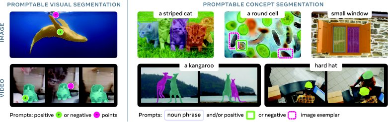
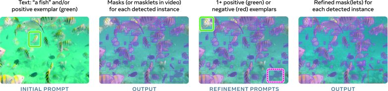
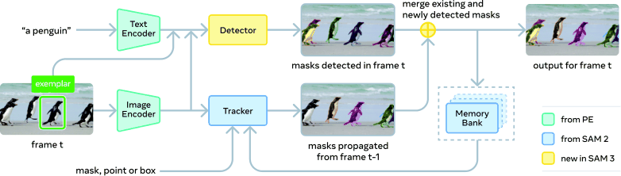
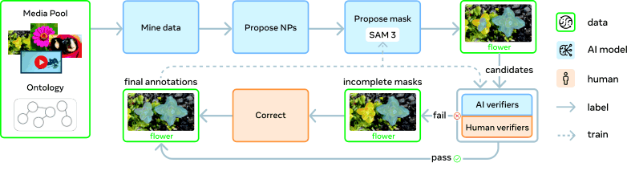
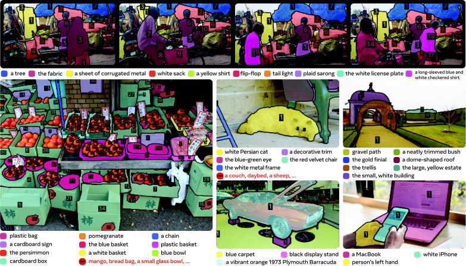

> "고양이 한 마리를 클릭해서 분할"하던 SAM 1·2에서 "영상 속 모든 고양이를 찾아 분할·추적"으로 문제를 확장한 Meta의 SAM 3(ICLR 2026)를 리뷰한다. Promptable Concept Segmentation(PCS)이라는 새 태스크, presence token으로 인식과 localization을 분리한 모델, AI annotator로 사람 처리량을 2배로 만든 data engine, 4M 개념의 SA-Co 데이터셋이 한 편에 담긴 대작이다. 코드·checkpoint·benchmark가 모두 공개되어 있다.

## 논문 정보

| 항목 | 내용 |
| --- | --- |
| 제목 | [SAM 3: Segment Anything with Concepts](https://arxiv.org/abs/2511.16719) |
| 저자 | Nicolas Carion, Laura Gustafson, Yuan-Ting Hu 외 (project lead: Nikhila Ravi 등) |
| 소속 / 연도 | Meta Superintelligence Labs, 2025 (arXiv:2511.16719, ICLR 2026) |
| 분야 | Open-Vocabulary Segmentation / Video Segmentation |
| 코드 | [GitHub](https://github.com/facebookresearch/sam3) |

## 1. Introduction

시각 장면에서 무엇이든 찾아 분할하는 능력은 멀티모달 AI의 기반으로, 로보틱스·콘텐츠 제작·AR·데이터 주석·과학 전반의 응용을 뒷받침한다. SAM 시리즈는 promptable segmentation 태스크를 도입했지만, 점·box·mask로 **prompt당 물체 하나**를 분할하는 Promptable Visual Segmentation(PVS)에 집중했다. 입력 어디에든 나타나는 **concept의 모든 instance**(예: 비디오 속 모든 "고양이")를 찾아 분할하는 일반적인 태스크는 다루지 못했다.

이 간극을 메우는 SAM 3는 SAM 2 대비 PVS를 개선하면서 **Promptable Concept Segmentation(PCS)** 의 새 기준을 세운다. PCS는 텍스트와 image exemplar를 입력받아 concept에 맞는 **모든** 물체의 instance·semantic mask를 예측하고 비디오 frame들에 걸쳐 identity를 유지하는 태스크다(2절). 원자적 시각 개념 인식에 집중하기 위해 텍스트는 "red apple", "striped cat" 같은 단순 명사구(NP)로 제한한다. 긴 지시 표현이나 추론이 필요한 질의는 설계 범위 밖이지만, MLLM과 결합하면 간단히 처리할 수 있음을 보인다. 이전 SAM처럼 완전히 상호작용적이어서, 사용자가 정제 prompt를 더해 모호성을 해소할 수 있다.

*[Figure 1] 클릭 기반 PVS의 SAM 2 대비 개선(왼쪽)과, 명사구·exemplar로 모든 instance를 분할·추적하는 새로운 PCS 능력(오른쪽)*

모델(3절)은 vision encoder를 공유하는 detector와 tracker로 구성된다. detector는 텍스트·기하·image exemplar로 조건화되는 DETR 기반 모델이고, open-vocabulary concept 검출의 난제를 위해 **인식과 localization을 분리하는 presence head**를 도입한다(어려운 negative phrase 학습에서 특히 효과적). tracker는 SAM 2의 transformer encoder-decoder 구조를 물려받아 비디오 분할과 상호작용 정제를 지원한다. detector는 identity에 무관해야 하고 tracker는 identity를 구분해야 하므로, 분리된 설계가 태스크 충돌을 피한다.

큰 성능 도약을 위해 human-and-model-in-the-loop **data engine**(4절)을 구축했다. (i) 미디어 큐레이션: 균질한 웹 소스에 의존한 과거 접근보다 다양한 도메인을 큐레이션하고, (ii) label 큐레이션: ontology와 멀티모달 LLM을 "AI annotator"로 활용해 명사구와 hard negative를 생성해 label의 다양성·난이도를 크게 올리고, (iii) label 검증: MLLM을 fine-tuning한 "AI verifier"가 인간에 가까운 정확도로 주석 처리량을 2배로 만든다. noisy한 미디어-구문-mask pseudo-label에서 출발해 인간·AI verifier가 mask 품질과 빠짐없음(exhaustivity)을 검사하고, 인간 annotator는 어려운 오류 사례의 수정에 집중한다. 이렇게 4M 고유 구문·52M mask의 고품질 학습 데이터와 38M 구문·1.4B mask의 합성 데이터셋을 주석했고, 기존 benchmark보다 50배 이상 많은 207K 고유 concept의 **SA-Co benchmark**(5절)를 만들었다.

실험(6절)에서 SAM 3는 promptable segmentation의 새 state-of-the-art를 세운다. LVIS zero-shot mask AP 48.8(기존 최고 38.5), SA-Co에서 baseline의 2배 이상, SAM 2 대비 visual prompt 개선까지. H200 GPU에서 물체 100개 이상인 단일 이미지에 30ms가 걸리고, 비디오에서는 동시 물체 약 5개까지 준실시간을 유지한다.

## 2. Promptable Concept Segmentation (PCS)

PCS는 이미지 또는 짧은 비디오(30초 이하)가 주어지면, 짧은 텍스트 구문·image exemplar·그 조합으로 지정된 시각 concept의 **모든 instance를 검출·분할·추적**하는 태스크다. concept은 명사와 선택적 수식어로 이뤄진 단순 명사구로 제한한다. 명사구 prompt는 이미지/비디오 전체 frame에 전역으로 적용되고, image exemplar는 개별 frame에 positive/negative bounding box로 주어 target mask를 반복 정제할 수 있다(Figure 3).

*[Figure 3] PCS 태스크가 지원하는 초기 prompt(명사구, exemplar)와 선택적 상호작용 정제 prompt의 예*

모든 prompt는 카테고리 정의에서 일관되어야 하며, 그렇지 않으면 모델 동작이 정의되지 않는다(예: "fish"를 꼬리만 담은 exemplar로 정제할 수 없고 텍스트 prompt를 바꿔야 한다). exemplar는 모델이 일부 instance를 놓쳤거나 concept이 희귀할 때 특히 유용하다.

시각 장면에 ground 가능한 어떤 단순 명사구든 어휘에 포함하므로 태스크는 본질적으로 모호하다. 다의어("mouse"), 주관적 수식어("cozy", "large"), ground 불가능할 수 있는 맥락 의존 구문("brand identity"), 경계 모호성(거울에 틀이 포함되는가), occlusion·blur 등이 원인이다. LVIS 같은 closed-vocabulary corpus는 어휘를 신중히 큐레이션해 이를 완화하지만, SAM 3는 테스트 주석을 전문가 3명에게서 수집하고 복수의 유효한 해석을 허용하도록 평가 protocol을 조정하며, 주석 모호성을 최소화하는 데이터 pipeline·지침과 모델의 모호성 모듈로 대응한다.

## 3. Model

SAM 3는 SAM 2의 일반화로, 새로운 PCS와 기존 PVS를 모두 지원한다. concept prompt(단순 명사구, image exemplar)나 visual prompt(점, box, mask)로 시공간적으로 분할할 물체를 지정하고, false positive/negative 물체는 exemplar로 제거·추가하며 개별 mask(let)는 SAM 2 스타일 PVS로 정제할 수 있다. 구조는 SAM과 (M)DETR 계열에 기반한 이중 encoder-decoder transformer로, 이미지 수준을 담당하는 **detector**와 비디오를 위한 **tracker·memory**로 구성되며, 둘은 정렬된 vision-language backbone인 **Perception Encoder(PE)** 를 공유한다.

*[Figure 4] PE backbone을 공유하는 detector(fusion encoder + DETR식 decoder + presence token)와 tracker(SAM 2식 memory 기반 전파)로 구성된 SAM 3 구조*

**Detector Architecture.** 이미지와 텍스트 prompt는 PE로, image exemplar는 exemplar encoder로 encoding한다(exemplar token과 텍스트 token을 합쳐 "prompt token"). fusion encoder가 이미지 embedding을 prompt token에 cross-attention시켜 조건화하고, DETR식 decoder에서 학습된 object query들이 조건화된 이미지 embedding에 cross-attention한다. 각 decoder layer는 query마다 분류 logit(prompt에 해당하는 물체인지의 이진 label)과 이전 수준 box로부터의 delta를 예측한다. box-region-positional bias로 attention을 물체에 집중시키되 최근 DETR들과 달리 vanilla attention을 유지하고, 학습에는 DAC-DETR의 이중 supervision과 Align loss를 채택한다. mask head는 MaskFormer에서 가져왔고, 픽셀마다 prompt 해당 여부를 예측하는 semantic segmentation head도 있다.

**Presence Token.** 각 proposal query가 물체의 인식(무엇)과 localization(어디)을 동시에 하기는 어렵다. 인식에는 이미지 전체의 문맥 단서가 중요하지만, proposal query에 전역 문맥 이해를 강제하면 본질적으로 국소적인 localization 목표와 충돌한다. 그래서 학습된 전역 **presence token**을 도입해 두 단계를 분리한다. 이 token은 명사구가 이미지/frame에 존재하는지 $$p(\text{NP is present in input})$$ 만을 예측하고, 각 proposal query $$q_i$$ 는 조건부 localization 문제 $$p(q_i \text{ is a match} \mid \text{NP is present in input})$$ 만 풀면 된다. query의 최종 점수는 자신의 점수와 presence 점수의 곱이다.

**Image Exemplars and Interactivity.** exemplar는 bounding box와 positive/negative 이진 label의 쌍으로, 단독으로든 텍스트 보완으로든 쓸 수 있다. 예를 들어 개 한 마리에 positive box를 주면 이미지의 **모든 개**를 검출한다(visual prompt가 단일 instance만 내는 PVS와 다른 점). 각 exemplar는 위치 embedding, label embedding, ROI-pooled 시각 feature를 이어붙여 작은 transformer로 처리하고, 결과를 텍스트 prompt에 연결해 prompt token을 구성한다. 현재 검출의 오류에 따라 상호작용적으로 exemplar를 추가해 출력을 정제할 수 있다.

**Tracker and Video Architecture.** 비디오와 prompt $$P$$ 가 주어지면 매 frame에서 detector가 새 물체 $$\mathcal{O}_t$$ 를 찾고, tracker가 이전 frame의 masklet(시공간 mask) $$\mathcal{M}_{t-1}$$ 을 현재 frame 위치 $$\hat{\mathcal{M}}_t$$ 로 전파한 뒤, matching 함수로 둘을 연결한다.

$$
\hat{\mathcal{M}}_t = \mathrm{propagate}(\mathcal{M}_{t-1}), \qquad \mathcal{O}_t = \mathrm{detect}(I_t, P), \qquad \mathcal{M}_t = \mathrm{match\_and\_update}(\hat{\mathcal{M}}_t, \mathcal{O}_t)
$$

첫 frame에서 검출된 모든 물체에 masklet을 초기화하고, 이후 frame마다 SAM 2의 video object segmentation과 유사한 단일 frame 전파로 위치를 갱신한다. tracker는 detector와 PE backbone을 공유하며, detector 학습 후 PE를 고정하고 SAM 2처럼 prompt encoder·mask decoder·memory encoder·memory bank를 학습한다. 추론 시에는 물체가 확실히 존재하는 frame만 memory bank에 유지하고, 모호성 처리를 위해 추적 물체마다 frame당 3개의 출력 mask와 confidence를 예측해 가장 확신 있는 것을 선택한다.

**Matching and Updating.** 전파된 mask와 현재 frame 검출을 IoU 기반 matching으로 연결하고, 연결되지 않은 새 검출에는 새 masklet을 만든다. 혼잡한 장면의 모호성에는 두 가지 시간적 전략으로 대응한다. 첫째, 시간 창 안에서 masklet이 검출과 얼마나 일관되게 매칭되는지 재는 masklet detection score가 threshold 아래로 떨어지면 억제한다. 둘째, 주기적으로 고신뢰 검출 mask로 tracker를 다시 prompt해 tracker 자신의 예측 대신 최신의 신뢰할 수 있는 참조가 memory bank에 들어가게 한다(occlusion·distractor로 인한 실패 모드 해소).

**Instance Refinement with Visual Prompts.** 초기 mask(let)를 얻은 뒤 positive/negative 클릭으로 개별 mask를 정제할 수 있다. 클릭을 prompt encoder로 encoding해 mask decoder에 넣어 조정된 mask를 예측하고, 비디오에서는 전체로 전파해 정제된 masklet을 얻는다.

**Training Stages.** (1) PE 사전학습, (2) detector 사전학습, (3) detector fine-tuning, (4) backbone 고정 tracker 학습의 4단계로 데이터와 능력을 점진적으로 추가한다.

## 4. Data Engine

PCS의 도약에는 기존 데이터셋 너머의 크고 다양한 concept·시각 도메인 학습이 필요하다. SAM 3, 인간 annotator, AI annotator의 피드백 루프로 주석 데이터를 반복 생성하는 data engine을 구축해, 현재 SAM 3가 실패하는 미디어-구문 쌍을 능동적으로 채굴해 고품질 학습 데이터를 만든다. 인간 수준 이상의 AI annotator에게 일부 작업을 위임해 인간 전용 pipeline 대비 처리량을 2배 이상으로 만들었다. 엔진은 4개 phase로 발전하며 phase마다 AI 활용을 늘려 인간 노력을 가장 어려운 실패 사례에 집중시킨다(1~3은 이미지, 4는 비디오).

*[Figure 5] ontology 기반 미디어 채굴, AI의 명사구·mask 제안, Mask Verification(MV)·Exhaustivity Verification(EV) 2단계 검증, 수동 수정으로 이어지는 최종 data engine*

**구성요소.** 큐레이션된 ontology의 도움으로 대형 pool에서 미디어를 채굴하고, AI 모델이 시각 concept을 설명하는 명사구를 제안하며, 다른 모델(예: SAM 3)이 각 구문의 후보 instance mask를 생성한다. 제안된 mask는 2단계로 검증된다. **Mask Verification(MV)** 에서 annotator가 mask의 품질·구문 관련성으로 수락/거부하고, **Exhaustivity Verification(EV)** 에서 해당 구문의 모든 instance가 mask되었는지 확인한다. exhaustivity를 통과하지 못한 쌍은 수동 수정 단계로 보내져 인간이 mask를 추가·제거·수정한다(브라우저 도구에서 SAM 1 사용, 작은 물체는 "group" mask 허용).

**Phase 1: Human Verification.** 무작위 이미지에 단순한 captioner·parser로 명사구를 제안하고, off-the-shelf open-vocabulary detector 출력으로 SAM 2를 prompt한 것을 초기 mask 제안 모델로, 인간을 초기 verifier로 쓴다. 4.3M 이미지-구문 쌍을 수집해 초기 SA-Co/HQ를 만들고, 이것으로 학습한 SAM 3를 다음 phase의 mask 제안 모델로 쓴다.

**Phase 2: Human + AI Verification.** Phase 1에서 모인 인간의 수락/거부 label로 Llama 3.2를 fine-tuning해 MV·EV를 자동 수행하는 **AI verifier**를 만든다. 이미지-구문-mask triplet을 받아 mask 품질·빠짐없음을 객관식으로 평가하는 모델이다. 자동 검증으로 인간 노력이 가장 어려운 사례에 집중되고, SAM 3를 새 데이터로 6회 재학습한다. AI verifier 도입으로 엔진 처리량이 인간 대비 약 2배가 됐다. 명사구 제안도 SAM 3에 적대적인 hard negative까지 제안하는 Llama 기반 pipeline으로 upgrade했다. 이 phase에서 122M 이미지-구문 쌍이 추가됐다.

**Phase 3: Scaling and Domain Expansion.** AI 모델로 점점 어려운 사례를 채굴하고 SA-Co/HQ의 도메인을 15개 데이터셋으로 넓힌다. 새 도메인에서 MV AI verifier는 zero-shot으로 잘 동작하지만 EV AI verifier는 약간의 도메인별 인간 supervision으로 개선이 필요했다. 이미지 alt-text에서 명사구를 추출하고 Wikidata 기반 22.4M 노드 SA-Co ontology(최상위 17개 카테고리, 72개 하위 카테고리)에서 concept을 채굴해 long-tail·세밀한 concept으로 범위를 넓힌다. SAM 3를 7회, AI verifier를 3회 반복 학습하며 19.5M 쌍을 추가했다.

**Phase 4: Video Annotation.** 성숙한 이미지 SAM 3로 비디오 고유의 난제를 담는 표적 주석을 수집한다. scene/motion 필터, 콘텐츠 균형, ranking, 표적 검색을 거쳐 frame을 샘플링해 이미지 주석 흐름으로 보내고, 비디오로 확장된 SAM 3로 masklet을 만들어 중복 제거·자명한 mask 제거로 후처리한다. 혼잡한 물체가 많고 tracking이 실패하기 쉬운 클립을 우선해 인간을 실패 가능성이 높은 곳에 집중시킨다. 수집된 SA-Co/VIDEO는 52.5K 비디오·467K masklet이다.

## 5. Segment Anything with Concepts (SA-Co) Dataset

**Training Data.** 이미지 데이터셋 3종을 수집한다. (i) **SA-Co/HQ**: phase 1~4 data engine의 고품질 데이터로 5.2M 이미지·4M 고유 명사구를 주석한 최대 규모 고품질 open-vocabulary 분할 데이터셋, (ii) **SA-Co/SYN**: 인간 개입 없이 성숙한 엔진이 label한 합성 데이터셋, (iii) **SA-Co/EXT**: instance mask가 있는 외부 데이터셋 15개에 ontology pipeline으로 hard negative를 보강한 것. 비디오 데이터셋 **SA-Co/VIDEO**는 52.5K 비디오·24.8K 고유 명사구·134K 비디오-구문 쌍이다(평균 84.1 frame, 6fps).

*[Figure 6] 구문과 instance mask가 주석된 SA-Co의 비디오(위)·이미지(아래) 예시*

**SA-Co Benchmark.** 평가 benchmark는 207K 고유 구문, 121K 이미지·비디오, hard negative label이 있는 3M 이상의 미디어-구문 쌍으로 open-vocabulary 인식을 시험한다. 4개 split으로, SA-Co/Gold는 7개 도메인에 이미지-구문 쌍마다 3명이 주석(인간 성능 측정에 사용), SA-Co/Silver는 10개 도메인에 1명 주석, SA-Co/Bronze·SA-Co/Bio는 기존 데이터셋 9개다. 비디오용 SA-Co/VEval은 3개 도메인이다.

**Metrics.** downstream 응용에서의 유용성을 재는 것이 목표다. AP 같은 검출 지표는 calibration을 반영하지 않아 실사용이 어려울 수 있으므로, confidence 0.5 이상의 예측만 평가해 좋은 calibration을 강제한다. PCS를 localization과 분류로 나눠, localization은 ground-truth mask가 있는 positive 쌍의 positive micro F1($$\mathrm{pmF}_1$$)로, 분류는 mask 품질과 무관하게 "물체가 있는가"의 이미지 수준 이진 예측을 재는 Matthews Correlation Coefficient($$\mathrm{IL\_MCC} \in [-1, 1]$$)로 평가한다. 주 지표인 classification-gated F1은 둘의 곱이다.

$$
\mathrm{cgF}_1 = 100 \times \mathrm{pmF}_1 \times \mathrm{IL\_MCC}
$$

**Handling Ambiguity.** SA-Co/Gold는 구문당 3개의 주석을 수집하고, 각 예측을 모든 ground truth와 비교해 최고 점수를 취하는 oracle 정확도를 잰다.

## 6. Experiments

**Image PCS with Text.** 명사구 하나씩 prompt해 instance 분할·box 검출·semantic 분할을 평가한다. baseline은 OWLv2, GroundingDino, LLMDet(box를 SAM 1에 넣어 분할 평가), APE, DINO-X, 그리고 범용 LLM인 Gemini 2.5 Flash다. zero-shot으로 closed-vocabulary COCO·COCO-O·LVIS box에서 새 state-of-the-art를 세우고 LVIS mask에서는 크게 앞선다. open-vocabulary SA-Co/Gold에서는 최강 baseline OWLv2★의 2배 이상 cgF1을 얻어 인간 성능 추정치의 74%에 도달하며, 다른 split에서는 격차가 더 크다. ADE-847·PC-59·Cityscapes의 open-vocabulary semantic 분할에서도 전문 baseline APE를 능가한다.

| Model | LVIS Inst. cgF1 | LVIS Inst. AP | Gold cgF1 | Silver cgF1 | Bronze cgF1 | Bio pmF1 | LVIS Box cgF1 | LVIS Box AP | COCO AP | COCO-O APo | Gold(box) | Silver(box) | Bronze(box) | Bio(box) | ADE-847 | PC-59 | Cityscapes |
| --- | --- | --- | --- | --- | --- | --- | --- | --- | --- | --- | --- | --- | --- | --- | --- | --- | --- |
| Human | – | – | 72.8 | – | – | – | – | – | – | – | 74.0 | – | – | – | – | – | – |
| OWLv2 | 20.1 | – | 17.3 | 7.6 | 3.9 | 0.64 | 19.9 | 35.2 | 38.2 | 42.4 | 16.9 | 7.1 | 4.1 | 0.95 | – | – | – |
| OWLv2★ | 29.3 | 43.4 | 24.6 | 11.5 | 11.7 | 0.04 | 30.2 | 45.5 | 46.1 | 23.9 | 24.5 | 11.0 | 12.0 | 0.08 | – | – | – |
| gDino-T | 14.7 | – | 3.3 | 2.7 | 7.0 | 0.34 | 15.1 | 20.5 | 45.7 | 35.3 | 3.4 | 2.5 | 7.6 | 0.35 | – | – | – |
| LLMDet-L | 35.1 | 36.3 | 6.5 | 7.1 | 12.5 | 0.15 | 39.3 | 42.0 | 55.6 | 49.8 | 6.8 | 6.7 | 14.0 | 0.17 | – | – | – |
| APE-D★ | – | 53.0† | 16.4 | 7.3 | 12.4 | 0.00 | – | 59.6† | 58.3† | – | 17.3 | 7.7 | 14.3 | 0.00 | 9.2† | 58.5† | 44.2† |
| DINO-X | – | 38.5† | 21.3δ | – | – | – | – | 52.4† | 56.0† | – | 22.5δ | – | – | – | – | – | – |
| Gemini 2.5 | 13.4 | – | 13.0 | 8.3 | 7.3 | 10.7 | 16.1 | – | – | – | 14.4 | 9.4 | 8.2 | 12.4 | – | – | – |
| **SAM 3** | **37.2** | **48.5** | **54.1** | **49.6** | **42.6** | **55.4** | **40.6** | **53.6** | **56.4** | **55.7** | **55.7** | **50.0** | **47.1** | **56.3** | **13.8** | **60.8** | **65.2** |

*[Table 1] 텍스트 prompt 이미지 concept 분할 평가(굵게 최고). APo는 COCO-O, ★는 LVIS 부분 학습, †는 원 논문 수치, δ는 DINO-X API 수치. 원문의 회색(해당 closed-vocabulary 학습 데이터 사용) 표시는 HTML 소스에 없어 생략*

**Few-Shot Adaptation.** ODinW13과 RF100-VL에서 원래 label을 prompt로 zero/few-shot 전이를 평가한다(prompt tuning 없음, mask loss 없이 fine-tuning). SAM 3는 Gemini의 in-context prompting과 검출 전문 모델(gDino)을 넘는 state-of-the-art 10-shot 성능을 달성한다. RF-100VL에는 현재 범위 밖의 특수 prompt 도메인이 있지만 baseline보다 효율적으로 fine-tuning 적응한다.

| Model | ODinW13 AP0 | ODinW13 AP10 | RF-100VL AP0 | RF-100VL AP10 |
| --- | --- | --- | --- | --- |
| Gemini2.5-Pro | 33.7 | – | 11.6 | 9.8 |
| gDino-T | 49.7 | – | **15.7** | 33.7 |
| gDino1.5-Pro | 58.7 | 67.9 | – | – |
| **SAM 3** | **61.0** | **71.8** | 15.2 | **36.5** |

*[Table 2] in-the-wild 데이터셋의 zero-shot·10-shot 전이(굵게 최고)*

**PCS with 1 Exemplar.** ground truth에서 무작위로 뽑은 box 하나를 exemplar로 주는 평가다(prompt된 물체가 이미지에 있는 "positive" 데이터에서만 가능하므로 $$\mathrm{AP}^+$$ 로 보고). 텍스트(T)·exemplar(I)·둘 다(T+I) 세 설정 모두에서 기존 state-of-the-art T-Rex2를 COCO +18.3, LVIS +10.3, ODinW +20.5로 크게 앞선다.

| Model | COCO AP(T) | COCO AP+(T) | COCO AP+(I) | COCO AP+(T+I) | LVIS AP(T) | LVIS AP+(T) | LVIS AP+(I) | LVIS AP+(T+I) | ODinW13 AP(T) | AP+(T) | AP+(I) | AP+(T+I) |
| --- | --- | --- | --- | --- | --- | --- | --- | --- | --- | --- | --- | --- |
| T-Rex2 | 52.2 | – | 58.5 | – | 45.8 | – | 65.8 | – | 50.3 | – | 61.8 | – |
| **SAM 3** | **56.4** | **58.8** | **76.8** | **78.1** | **52.4** | **54.7** | **76.0** | **78.4** | **61.1** | **63.1** | **82.2** | **81.8** |

*[Table 3] exemplar 1개 prompting 평가. T는 텍스트, I는 exemplar, T+I는 조합(굵게 최고)*

**PCS with K Exemplars.** 텍스트 prompt에서 시작해 놓친 ground truth는 positive, false positive는 negative exemplar로 한 번에 하나씩 추가하는 상호작용 설정을 평가한다. 사용자가 이상적인 box-to-mask 수정으로 개별 오류를 고치는 완벽한 PVS baseline과 비교하면, PCS는 exemplar에서 일반화(유사 물체를 함께 검출·억제)하므로 cgF1이 더 빨리 오른다. 3클릭 후 텍스트 전용 대비 +21.6, PVS 정제 대비 +2.0 cgF1이고, 4클릭 이후에는 exemplar가 낮은 품질의 mask를 고칠 수 없어 정체된다. 이 시점에 PVS로 전환하는 hybrid를 시뮬레이션하면 추가 이득이 나와 상호보완적임을 보여준다.

**Object Counting.** CountBench·PixMo-Count에서 여러 MLLM과 정확도·MAE로 비교하면, SAM 3는 좋은 counting 정확도를 얻을 뿐 아니라 대부분의 MLLM이 제공하지 못하는 물체 분할까지 제공한다.

**Video PCS with Text.** SA-Co/VEval과 공개 benchmark에서 텍스트 prompt 비디오 분할을 평가한다. baseline은 open-vocabulary 이미지·비디오 분할 모델 GLEE, detector를 LLMDet로 바꾼 "LLMDet + SAM 3 Tracker", tracker를 tracking-by-detection 연결 모듈로 바꾼 "SAM 3 Detector + T-by-D"다. SAM 3가 특히 명사구가 아주 많은 benchmark에서 크게 앞서고, SA-Co/VEval에서 인간 pHOTA의 80% 이상에 도달한다.

| Model | SA-V cgF1 | SA-V pHOTA | YT-1B cgF1 | YT-1B pHOTA | SmartGlasses cgF1 | SmartGlasses pHOTA | LVVIS mAP | BURST HOTA | YTVIS21 mAP | OVIS mAP |
| --- | --- | --- | --- | --- | --- | --- | --- | --- | --- | --- |
| Human | 53.1 | 70.5 | 71.2 | 78.4 | 58.5 | 72.3 | – | – | – | – |
| GLEE† (all NPs at once) | 0.1 | 8.7 | 1.6 | 16.7 | 0.0 | 4.7 | 20.8 | 28.4 | **62.2** | 38.7 |
| GLEE† (one NP at a time) | 0.1 | 11.8 | 2.2 | 18.9 | 0.1 | 5.6 | 9.3 | 20.2 | 56.5 | 32.4 |
| LLMDet† + SAM 3 Tracker | 2.3 | 30.1 | 8.0 | 37.9 | 0.3 | 18.6 | 15.2 | 33.3 | 31.3 | 20.4 |
| SAM 3† Detector + T-by-D | 25.7 | 55.7 | 47.6 | 68.2 | 29.7 | 60.0 | 35.9 | 39.7 | 56.5 | 55.1 |
| **SAM 3** | **30.3** | **58.0** | **50.8** | **69.9** | **36.4** | **63.6** | **36.3** | **44.5** | 57.4 | **60.5** |

*[Table 4] 텍스트 prompt 비디오 PCS(open-vocabulary video instance segmentation) 평가(굵게 최고, †는 zero-shot)*

**PVS.** visual prompt 태스크에서도 평가한다. VOS에서 SAM 2 대비 대부분의 benchmark에서 유의미하게 개선되고, 특히 어려운 MOSEv2에서 기존 최고를 6.5점 앞선다. 37개 데이터셋의 상호작용 이미지 분할 benchmark에서도 평균 mIoU로 SAM 2를 능가한다.

| Model | MOSEv1 val | DAVIS17 val | LVOSv2 val | SA-V val | SA-V test | YTVOS19 val | MOSEv2 val |
| --- | --- | --- | --- | --- | --- | --- | --- |
| SAMURAI | 72.6 | 89.9 | 84.2 | 79.8 | 80.0 | 88.3 | 51.1 |
| SAM2Long | 75.2 | 91.4 | 85.9 | 81.1 | 81.2 | 88.7 | 51.5 |
| SeC | 75.3 | 91.3 | 86.5 | 82.7 | 81.7 | 88.6 | 53.8 |
| SAM 2.1 L | 77.9 | 90.7 | 79.6 | 77.9 | 78.4 | 89.3 | 47.9† |
| **SAM 3** | **78.4** | **92.2** | **88.5** | **83.5** | **84.4** | **89.7** | **60.3** |

*[Table 5] VOS 평가($$\mathcal{J}\&\mathcal{F}$$·$$\mathcal{G}$$, 굵게 최고, †는 zero-shot)*

| Model | 1-click mIoU | 3-clicks mIoU | 5-clicks mIoU | FPS |
| --- | --- | --- | --- | --- |
| SAM 1 H | 58.5 | 77.0 | 82.1 | 41.0 |
| SAM 2.1 L | **66.4** | 80.3 | 84.3 | **93.0** |
| **SAM 3** | 66.1 | **81.3** | **85.1** | 43.5 |

*[Table 6] SA-37 benchmark의 상호작용 이미지 분할(굵게 최고)*

**SAM 3 Agent.** SAM 3를 도구로 쓰는 MLLM 실험이다. MLLM이 명사구 query를 제안해 SAM 3를 prompt하고 반환된 mask를 분석하며 만족스러울 때까지 반복한다. referring expression·reasoning 분할 데이터 학습 없이 zero-shot으로 ReasonSeg·OmniLabel에서 기존 연구를 넘어서고, RefCOCO+·RefCOCOg의 기존 zero-shot 결과도 앞선다. 여러 MLLM에 같은 system prompt로 결합해도 동작해 SAM 3의 강건성을 보여준다.

| Model | MLLM | ReasonSeg val gIoU | ReasonSeg test All | test Short | test Long | OmniLabel descr | descr-S | descr-M | descr-L |
| --- | --- | --- | --- | --- | --- | --- | --- | --- | --- |
| X-SAM | Phi-3-3.8B | 56.6 | 57.8 | 47.7 | 56.0 | 12.0\* | 17.1\* | 11.4\* | 8.8\* |
| SegZero | Qwen2.5-VL 7B | 62.6 | 57.5 | – | – | 13.5\* | 20.7\* | 12.4\* | 9.1\* |
| RSVP | GPT-4o | 64.7 | 55.4 | 61.9 | 60.3 | – | – | – | – |
| Overall SOTA† | | 65.0 | 61.3 | 55.4 | 63.2 | 36.5 | 54.4 | 33.2 | 25.5 |
| **SAM 3 Agent** | Qwen2.5-VL 7B | 62.2 | 63.0 | 59.4 | 64.1 | 36.7 | 52.6 | 34.3 | 26.6 |
| **SAM 3 Agent** | Llama4 Maverick | 68.5 | 67.1 | 66.8 | 67.2 | 32.8 | 43.7 | 30.9 | 27.5 |
| **SAM 3 Agent** | Qwen2.5-VL 72B | 74.6 | 70.8 | 70.3 | 71.0 | 42.0 | **56.0** | 40.4 | 33.2 |
| **SAM 3 Agent** | Gemini 2.5 Pro | **77.0** | **74.0** | **75.8** | **73.4** | **45.3** | 53.8 | **45.1** | **37.7** |

*[Table 7] SAM 3 Agent 결과(굵게 최고). \*는 재현 수치, †는 ReasonSeg는 LISA-13B-LLaVA1.5, OmniLabel은 REAL 기준*

**Selected Ablations.** SA-Co/Gold에서의 대표 ablation이다(짧은 별도 학습이라 표 간 직접 비교 불가). presence head는 cgF1을 +1.5 올리는데, 이미지 수준 인식(IL_MCC)이 +0.05 개선된 결과다. hard negative 추가는 IL_MCC를 0.44에서 0.68로 크게 끌어올린다. 데이터 구성에서는 합성(SYN)이 외부(EXT) 대비 +8.8 cgF1, 고품질(HQ) 주석이 그 위에 +14.6 cgF1을 더한다. pseudo-label 개선에서는 SAM 3의 presence score를 EV AI verifier 점수로 바꾸면 +7.2, MV AI verifier로 나쁜 mask를 제거하면 +1.1이 더해져, AI verifier가 SAM 3와 인간 성능 격차의 절반을 좁힌다.

| Presence head | cgF1 | IL_MCC | pmF1 |
| --- | --- | --- | --- |
| ✗ | 50.7 | 0.77 | **65.4** |
| ✓ | **52.2** | **0.82** | 63.4 |

*[Table 8a] presence head의 효과*

| Hard negative 수/img | cgF1 | IL_MCC | pmF1 |
| --- | --- | --- | --- |
| 0 | 28.3 | 0.44 | 62.4 |
| 5 | 39.4 | 0.62 | **62.9** |
| 15 | 41.8 | 0.67 | 62.4 |
| 30 | **43.0** | **0.68** | 62.8 |

*[Table 8b] hard negative 수의 효과*

| EXT | SYN | HQ | cgF1 | IL_MCC | pmF1 |
| --- | --- | --- | --- | --- | --- |
| ✓ | ✗ | ✗ | 23.7 | 0.46 | 50.4 |
| ✓ | ✓ | ✗ | 32.8 | 0.57 | 56.9 |
| ✓ | ✗ | ✓ | 45.5 | 0.71 | **64.0** |
| ✓ | ✓ | ✓ | **47.4** | **0.74** | 63.8 |

*[Table 8c] 학습 데이터 구성의 효과*

| Model | cgF1 | IL_MCC | pmF1 |
| --- | --- | --- | --- |
| Human | 72.8 | 0.94 | 77.0 |
| SAM 3 | 54.0 | 0.82 | 65.9 |
| + EV AI | 61.2 | 0.86 | 70.8 |
| + MV AI | **62.3** | **0.87** | **71.1** |

*[Table 8d] AI verifier의 pseudo-label 개선 효과*

**Domain Adaptation Ablation.** SAM 3 + AI verifier가 만든 도메인별 합성 데이터만으로 인간 주석 없이 새 도메인 성능을 크게 올릴 수 있다. "Food&drink" 도메인을 학습에서 제외한 뒤, 고품질 AI+인간 주석(HQ-Food), AI만 쓴 합성 주석(SYN-Food), AI verifier·인간 모두 건너뛴 pseudo-label(PL-Food) 세 가지로 학습 데이터를 만들어 비교하면, PL-Food는 품질이 낮아 한참 뒤처지지만 SYN-Food는 HQ-Food와 유사한 scaling을 보이며 결국 따라잡는다. 인간 주석 비용 없이 새 데이터 분포의 성능을 올리는 확장 가능한 길을 보여준다.

## 7. Related Work

**Promptable and Interactive Visual Segmentation.** SAM은 상호작용 정제가 있는 promptable 이미지 분할을 도입했다(원래 태스크 정의에 텍스트 prompt가 있었지만 충분히 발전되지 않았다). SAM 2는 이를 비디오로 확장했다. SAM 3는 기하 기반 분할을 물려받으면서 텍스트·exemplar prompt로 concept의 모든 instance 분할로 확장한다.

**Open-Vocabulary Detection and Segmentation.** 최근 OV 검출·분할은 CLIP 같은 대규모 vision-language encoder로 임의 텍스트 카테고리를 다룬다. DETR는 학습 때 본 closed set에 제한되지만 MDETR가 raw 텍스트 query 조건화로 발전시켰다. DINOv, T-Rex2처럼 image exemplar를 prompt로 쓰는 접근은 실용적 대안이지만 추상적 concept 전달에서는 텍스트에 못 미친다. SAM 3는 기존보다 100배 이상 많은 고유 concept의 OV 분할 benchmark를 도입한다.

**Visual Grounding.** GLIP·GroundingDino는 검출을 phrase grounding으로 정식화해 통합 학습하고, MQ-GLIP은 exemplar를 query에 더했다. GLEE는 이미지·비디오에서 텍스트 구문, referring expression, visual prompt를 지원하지만 exemplar와 상호작용 정제는 지원하지 않는다. LISA는 추론이 필요한 분할을, OMG-LLaVa·GLaMM은 분할 mask가 섞인 자연어 응답을 생성한다. Gemini 2.5, Molmo 같은 범용 MLLM도 box·mask·점을 출력할 수 있다. SAM 3는 MLLM과 결합하는 "vision tool"로 쓸 수 있다.

**Multi-Object Tracking and Segmentation.** tracking-by-detection은 frame별 독립 검출 후 motion·appearance 기반 matching으로 연결하고(SORT, ByteTrack 등), TrackFormer·MOTR 같은 end-to-end 구조는 검출과 연결을 함께 학습한다. joint 모델의 난제는 검출(semantic 집중)과 tracking(identity 분리)의 충돌이다. SAM 3는 강한 이미지 detector를 tracker에 긴밀히 통합해 비디오의 concept을 분할한다.

## 8. Conclusion

open-vocabulary 텍스트와 image exemplar를 상호작용 분할의 prompt로 가능하게 하는 Segment Anything with Concepts를 제시했다. 주요 기여는 (i) PCS 태스크와 SA-Co benchmark의 도입, (ii) 인식·localization·tracking을 분리하고 SAM 2를 concept 분할로 확장하면서 시각 분할 능력을 유지하는 구조, (iii) 인간과 AI annotator의 상호보완적 강점을 활용하는 고품질·고효율 data engine이다. SAM 3는 이미지·비디오 PCS에서 기존 시스템의 2배 성능으로 state-of-the-art를 달성한다. 다만 한계도 있는데, 예를 들어 도메인 밖 용어로의 일반화가 어렵다. 자동 도메인 확장으로 완화할 수 있으나 추가 학습이 필요하다. SAM 3와 SA-Co benchmark가 컴퓨터 비전 연구·응용의 중요한 이정표가 될 것으로 본다.
