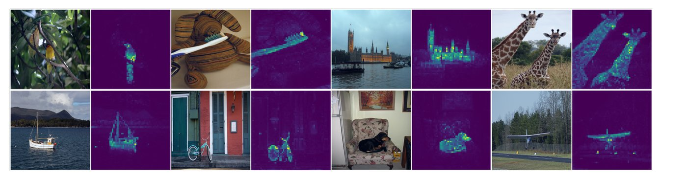
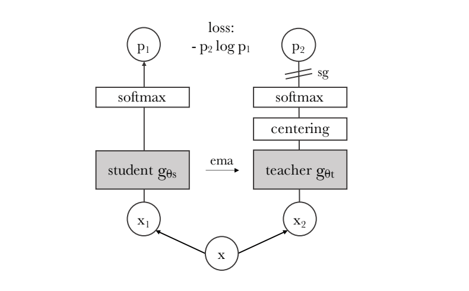
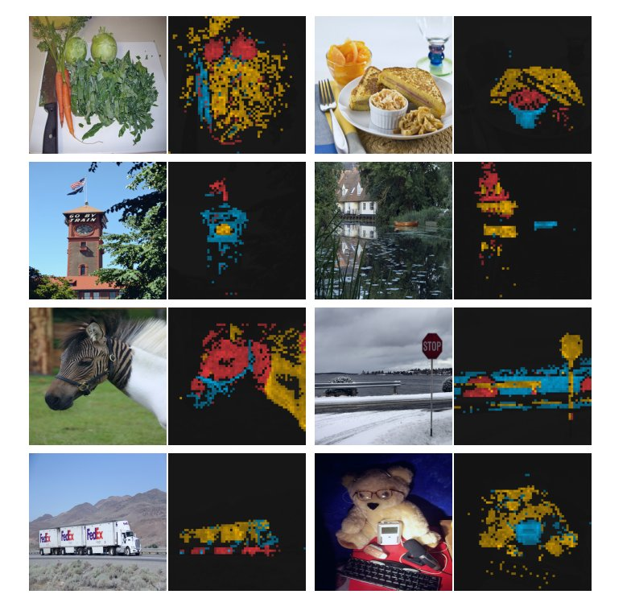
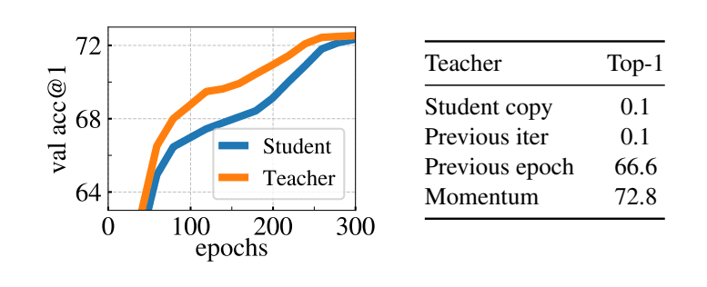
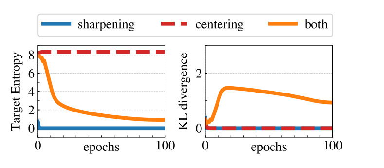

> DINO 시리즈 1편. supervision 없이 ViT를 학습하면 무엇이 창발하는지 보인 원조 DINO(ICCV 2021) 논문을 리뷰한다. 이어서 DINOv2, DINOv3 리뷰로 이어진다.

## 논문 정보

| 항목 | 내용 |
| --- | --- |
| 제목 | [Emerging Properties in Self-Supervised Vision Transformers](https://arxiv.org/abs/2104.14294) |
| 저자 | Mathilde Caron, Hugo Touvron, Ishan Misra, Hervé Jégou, Julien Mairal, Piotr Bojanowski, Armand Joulin |
| 소속 / 연도 | Facebook AI Research, Inria, Sorbonne University, ICCV 2021 (arXiv:2104.14294) |
| 분야 | Self-Supervised Learning, Vision Transformer |
| 코드 | [GitHub](https://github.com/facebookresearch/dino) |

## 1. Introduction

Transformer는 시각 인식에서 convolutional neural network(convnet)의 대안으로 떠올랐다. 그런데 Vision Transformer(ViT)는 convnet과 경쟁할 만한 성능을 내면서도 뚜렷한 이점을 보여주지 못했다. 계산량이 더 많고, 더 많은 학습 데이터가 필요하며, feature에 고유한 성질도 없었다.

저자들은 vision에서 Transformer의 성공이 미진했던 이유가 **pretraining에 supervision을 썼기 때문**이 아닌지 질문한다. NLP에서 Transformer가 성공한 주요 요인 중 하나는 BERT의 빈칸 채우기나 GPT의 language modeling 같은 self-supervised pretraining이었다. 이런 목적함수는 문장 안의 단어들을 이용해, 문장당 label 하나를 예측하는 supervised 목적보다 풍부한 학습 신호를 만든다. 이미지에서도 image-level supervision은 이미지의 풍부한 시각 정보를 미리 정의된 수천 개 카테고리 중 하나로 축소해 버린다.

이 관점에서 self-supervised pretraining이 ViT feature에 주는 영향을 연구한 결과, supervised ViT나 convnet에서는 나타나지 않는 성질들을 발견했다.

- self-supervised ViT feature는 **scene layout과 object 경계를 명시적으로 담고 있다**(Figure 1). 이 정보는 마지막 block의 self-attention module에서 바로 읽을 수 있다
- self-supervised ViT feature는 finetuning·linear classifier·data augmentation 없이 기본 **$$k$$-NN classifier만으로** ImageNet top-1 78.3%를 달성한다


*[Figure 1] supervision 없이 학습한 8×8 patch ViT의 [CLS] token self-attention map*

segmentation mask의 창발은 self-supervised 방법들이 공유하는 성질로 보이는 반면, 좋은 $$k$$-NN 성능은 momentum encoder와 multi-crop augmentation 같은 구성 요소를 결합했을 때만 나타난다. 또 하나의 발견은 ViT에서 **더 작은 patch**를 쓰면 feature 품질이 좋아진다는 점이다.

이 발견들을 종합해, label 없는 knowledge distillation의 한 형태로 해석할 수 있는 단순한 self-supervised 방법 **DINO**(self-**di**stillation with **no** labels)를 설계한다. DINO는 momentum encoder로 만든 teacher network의 출력을 표준 cross-entropy loss로 직접 예측한다. collapse를 피하는 데는 teacher 출력의 centering과 sharpening만으로 충분하며, predictor·advanced normalization·contrastive loss 같은 요소는 안정성이나 성능에 거의 기여하지 않는다. 아키텍처 수정 없이 convnet과 ViT 모두에서 동작한다.

ViT-Base(작은 patch)로 ImageNet linear evaluation 80.1% top-1을 달성해 기존 self-supervised feature를 넘어섰고, ResNet-50에서도 state of the art와 대등함을 확인했다. 8-GPU 서버 2대로 3일이면 ImageNet linear 76.1%에 도달해, 비슷한 크기의 convnet 기반 시스템보다 훨씬 적은 계산으로 더 좋은 성능을 낸다.

## 2. Related Work

**Self-supervised learning.** 많은 연구가 각 이미지를 하나의 class로 보고 augmentation까지 같은 이미지끼리 구별하도록 학습하는 instance classification을 다뤘다. 모든 이미지를 구별하는 classifier를 명시적으로 학습하는 방식은 이미지 수에 따라 확장되지 않아, noise contrastive estimator(NCE)로 instance를 비교하는 방식이 제안됐다. 다만 이 접근은 많은 이미지의 feature를 동시에 비교해야 해 큰 batch나 memory bank가 필요하다. 한편 BYOL은 momentum encoder가 만든 representation에 feature를 맞추는 metric-learning 형태로, 이미지 간 구별 없이 feature를 학습할 수 있음을 보였다. DINO는 BYOL에서 영감을 받았지만 다른 similarity matching loss를 쓰고 student와 teacher가 완전히 같은 아키텍처를 갖는다. 이로써 self-supervised learning을 label 없는 Mean Teacher self-distillation로 보는 해석을 완성한다.

**Self-training과 knowledge distillation.** self-training은 소수의 annotation을 대량의 unlabeled 데이터로 전파해 feature 품질을 높인다. soft label을 쓰는 경우 knowledge distillation이라 부르며, 원래는 큰 network의 출력을 작은 network가 흉내 내 모델을 압축하는 용도로 설계됐다. 기존 연구들은 미리 학습된 고정 teacher에 의존한 반면, DINO의 teacher는 학습 중에 동적으로 만들어진다. 즉 knowledge distillation을 self-supervised pretraining의 후처리가 아니라 **self-supervised 목적함수 그 자체**로 만든다.

## 3. Approach

### 3.1 SSL with Knowledge Distillation

DINO는 최근 self-supervised 방법들과 같은 전체 구조를 공유하지만, knowledge distillation의 관점에서 제시된다. 전체 구조는 Figure 2, pseudocode는 Algorithm 1과 같다.


*[Figure 2] 한 쌍의 view로 단순화한 DINO의 self-distillation 구조*

knowledge distillation은 student network $$g_{\theta_{s}}$$ 가 주어진 teacher network $$g_{\theta_{t}}$$ 의 출력을 맞추도록 학습하는 패러다임이다($$\theta_{s}$$, $$\theta_{t}$$ 는 각각의 parameter). 입력 이미지 $$x$$ 에 대해 두 network는 $$K$$ 차원 확률분포 $$P_{s}$$, $$P_{t}$$ 를 출력한다. 확률 $$P$$ 는 network 출력 $$g$$ 를 softmax로 정규화해 얻는다.

$$
P_{s}(x)^{(i)}=\frac{\exp(g_{\theta_{s}}(x)^{(i)}/\tau_{s})}{\sum_{k=1}^{K}\exp(g_{\theta_{s}}(x)^{(k)}/\tau_{s})}
$$

여기서 $$\tau_{s}>0$$ 은 출력 분포의 sharpness를 조절하는 temperature이고, $$i$$ 는 출력 차원 인덱스다. teacher도 temperature $$\tau_{t}$$ 로 같은 식을 따른다. 고정된 teacher가 있다면 cross-entropy를 최소화해 분포를 맞춘다.

$$
\min_{\theta_{s}}H(P_{t}(x),P_{s}(x))
$$

여기서 $$H(a,b)=-a\log b$$ 는 cross-entropy다. 이 문제를 self-supervised learning에 맞게 조정한다. 먼저 multi-crop 전략으로 한 이미지에서 왜곡된 view의 집합 $$V$$ 를 만든다. $$V$$ 는 두 개의 global view $$x^{g}_{1}$$, $$x^{g}_{2}$$ 와 더 작은 해상도의 여러 local view로 구성된다. **모든 crop은 student를 통과하지만 teacher에는 global view만 통과시켜** "local-to-global" 대응을 유도한다.

$$
\min_{\theta_{s}}\sum_{x\in\{x^{g}_{1},x^{g}_{2}\}}\;\sum_{\substack{x^{\prime}\in V \\ x^{\prime}\neq x}}H(P_{t}(x),P_{s}(x^{\prime}))
$$

바깥 합은 teacher가 보는 두 global view, 안쪽 합은 그와 다른 모든 student view에 대해 돈다. 이 loss는 view 개수와 무관하게 쓸 수 있다. 기본 설정은 원본의 넓은 영역(예: 50% 이상)을 덮는 $$224^{2}$$ global view 2개와 작은 영역(예: 50% 미만)만 덮는 $$96^{2}$$ local view 여러 개다.

```text
# gs, gt: student and teacher networks
# C: center (K)
# tps, tpt: student and teacher temperatures
# l, m: network and center momentum rates
gt.params = gs.params
for x in loader:  # load a minibatch x with n samples
    x1, x2 = augment(x), augment(x)  # random views

    s1, s2 = gs(x1), gs(x2)  # student output n-by-K
    t1, t2 = gt(x1), gt(x2)  # teacher output n-by-K

    loss = H(t1, s2)/2 + H(t2, s1)/2
    loss.backward()  # back-propagate

    # student, teacher and center updates
    update(gs)  # SGD
    gt.params = l*gt.params + (1-l)*gs.params
    C = m*C + (1-m)*cat([t1, t2]).mean(dim=0)

def H(t, s):
    t = t.detach()  # stop gradient
    s = softmax(s / tps, dim=1)
    t = softmax((t - C) / tpt, dim=1)  # center + sharpen
    return - (t * log(s)).sum(dim=1).mean()
```
*[Algorithm 1] DINO PyTorch pseudocode w/o multi-crop*

**Teacher network.** 일반적인 knowledge distillation과 달리 teacher가 미리 주어지지 않으므로, student의 과거 iteration에서 teacher를 만든다. student weight에 exponential moving average(EMA)를 적용하는 momentum encoder가 특히 잘 맞는다. 업데이트 규칙은 $$\theta_{t}\leftarrow\lambda\theta_{t}+(1-\lambda)\theta_{s}$$ 이고, $$\lambda$$ 는 학습 동안 0.996에서 1로 cosine schedule을 따른다. 원래 momentum encoder는 contrastive learning에서 queue의 대용으로 도입됐지만, DINO에는 queue도 contrastive loss도 없으므로 그 역할이 다르다. 오히려 self-training의 mean teacher에 가깝다. 실제로 이 teacher는 지수 감쇠를 갖는 Polyak-Ruppert averaging 형태의 model ensembling을 수행하며, 학습 내내 student보다 좋은 성능을 유지해 더 높은 품질의 target feature로 student의 학습을 이끈다.

**Network architecture.** network $$g$$ 는 backbone $$f$$ (ViT 또는 ResNet)와 projection head $$h$$ 로 구성된다($$g=h\circ f$$). downstream task에는 backbone $$f$$ 의 출력을 쓴다. projection head는 hidden 차원 2048의 3-layer MLP, $$\ell_{2}$$ normalization, $$K$$ 차원의 weight normalized fully connected layer로 이루어진다. BYOL 계열과 달리 predictor를 쓰지 않아 student와 teacher의 아키텍처가 완전히 같다. ViT는 기본적으로 batch normalization(BN)을 쓰지 않으므로 projection head에도 BN을 쓰지 않아, 시스템 전체가 **BN-free**다.

**Avoiding collapse.** DINO는 momentum teacher 출력의 **centering과 sharpening**만으로 collapse를 피할 수 있다. centering은 한 차원이 지배하는 것을 막지만 uniform 분포로의 collapse를 부추기고, sharpening은 그 반대다. 두 연산을 함께 적용하면 효과가 균형을 이룬다. centering은 teacher에 bias 항 $$c$$ 를 더하는 것으로 볼 수 있고($$g_{t}(x)\leftarrow g_{t}(x)+c$$), center $$c$$ 는 EMA로 업데이트되어 batch 크기가 달라져도 잘 동작한다.

$$
c\leftarrow mc+(1-m)\frac{1}{B}\sum_{i=1}^{B}g_{\theta_{t}}(x_{i})
$$

여기서 $$m>0$$ 은 rate parameter, $$B$$ 는 batch 크기, $$x_{i}$$ 는 batch 안의 $$i$$ 번째 샘플이다. sharpening은 teacher softmax의 temperature $$\tau_{t}$$ 를 낮게 잡아 얻는다.

### 3.2 Implementation and Evaluation Protocols

**Vision Transformer.** ViT는 해상도 $$N\times N$$ 의 겹치지 않는 patch 격자를 입력으로 받는다. 이 논문에서는 주로 $$N=16$$ ("/16") 또는 $$N=8$$ ("/8")을 쓴다. patch는 linear layer를 거쳐 embedding 집합이 되고, 시퀀스 전체의 정보를 모으는 학습 가능한 [CLS] token이 추가된다. projection head $$h$$ 는 이 token의 출력에 붙는다. 사용한 network 구성은 Table 1과 같다.

| model | blocks | dim | heads | #tokens | #params | im/s |
| --- | --- | --- | --- | --- | --- | --- |
| ResNet-50 | – | 2048 | – | – | 23M | 1237 |
| ViT-S/16 | 12 | 384 | 6 | 197 | 21M | 1007 |
| ViT-S/8 | 12 | 384 | 6 | 785 | 21M | 180 |
| ViT-B/16 | 12 | 768 | 12 | 197 | 85M | 312 |
| ViT-B/8 | 12 | 768 | 12 | 785 | 85M | 63 |

*[Table 1] network 구성. "im/s"는 NVIDIA V100 기준 inference 처리량*

**Implementation details.** label 없이 ImageNet에서 pretraining한다. adamw optimizer, batch 1024, ViT-S/16 기준 16 GPU. learning rate는 처음 10 epoch 동안 linear scaling rule($$lr=0.0005*\text{batchsize}/256$$)의 기준값까지 warmup 후 cosine schedule로 감쇠한다. weight decay도 0.04에서 0.4로 cosine schedule을 따른다. $$\tau_{s}=0.1$$ 이고 $$\tau_{t}$$ 는 처음 30 epoch 동안 0.04에서 0.07로 linear warmup한다. augmentation은 BYOL의 것(color jittering, Gaussian blur, solarization)과 multi-crop을 따른다.

**Evaluation protocols.** 표준 protocol은 frozen feature 위 linear classifier 학습 또는 downstream task finetuning이다. 다만 둘 다 hyperparameter에 민감해, 단순한 weighted nearest neighbor classifier($$k$$-NN)로도 feature 품질을 평가한다. pretrained model을 freeze한 채 downstream 학습 데이터의 feature를 저장하고, 테스트 이미지의 feature를 $$k$$ 개의 최근접 feature와 매칭해 투표로 분류한다. $$k=20$$ 이 일관되게 가장 좋았다. 이 protocol은 hyperparameter tuning도 augmentation도 필요 없다.

## 4. Main Results

### 4.1 Comparing with SSL Frameworks on ImageNet

**같은 아키텍처 비교.** ViT-S는 parameter 수(21M vs 23M), 처리량(1007 vs 1237 im/s), supervised 성능(79.8% vs 79.3%)에서 ResNet-50과 비슷해 비교 기준으로 삼았다. ResNet-50에서 DINO는 state of the art와 대등해 표준 설정에서도 동작함을 확인했다. ViT로 바꾸면 DINO는 BYOL·MoCov2·SwAV를 linear에서 +3.5%, $$k$$-NN에서 +7.9% 앞선다. 특히 단순한 $$k$$-NN classifier가 linear classifier에 거의 근접하는데(74.5% vs 77.0%), 이 성질은 DINO + ViT 조합에서만 나타난다.

**아키텍처 간 비교.** 더 큰 ViT를 학습하면 성능이 오르지만, **patch 크기를 줄이는 것**("/8" variant)이 더 큰 영향을 준다. patch를 줄여도 parameter는 늘지 않는다. DINO로 학습한 ViT-B/8은 linear 80.1%, $$k$$-NN 77.4%로, 이전 state of the art보다 10배 적은 parameter와 1.4배 빠른 실행 시간으로 더 높은 성능을 달성한다.

| Method | Arch. | Param. | im/s | Linear | $$k$$-NN |
| --- | --- | --- | --- | --- | --- |
| Supervised | RN50 | 23 | 1237 | 79.3 | 79.3 |
| SCLR | RN50 | 23 | 1237 | 69.1 | 60.7 |
| MoCov2 | RN50 | 23 | 1237 | 71.1 | 61.9 |
| InfoMin | RN50 | 23 | 1237 | 73.0 | 65.3 |
| BarlowT | RN50 | 23 | 1237 | 73.2 | 66.0 |
| OBoW | RN50 | 23 | 1237 | 73.8 | 61.9 |
| BYOL | RN50 | 23 | 1237 | 74.4 | 64.8 |
| DCv2 | RN50 | 23 | 1237 | 75.2 | 67.1 |
| SwAV | RN50 | 23 | 1237 | **75.3** | 65.7 |
| DINO | RN50 | 23 | 1237 | **75.3** | **67.5** |
| Supervised | ViT-S | 21 | 1007 | 79.8 | 79.8 |
| BYOL∗ | ViT-S | 21 | 1007 | 71.4 | 66.6 |
| MoCov2∗ | ViT-S | 21 | 1007 | 72.7 | 64.4 |
| SwAV∗ | ViT-S | 21 | 1007 | 73.5 | 66.3 |
| DINO | ViT-S | 21 | 1007 | **77.0** | **74.5** |
| *Comparison across architectures* |  |  |  |  |  |
| SCLR | RN50w4 | 375 | 117 | 76.8 | 69.3 |
| SwAV | RN50w2 | 93 | 384 | 77.3 | 67.3 |
| BYOL | RN50w2 | 93 | 384 | 77.4 | – |
| DINO | ViT-B/16 | 85 | 312 | 78.2 | 76.1 |
| SwAV | RN50w5 | 586 | 76 | 78.5 | 67.1 |
| BYOL | RN50w4 | 375 | 117 | 78.6 | – |
| BYOL | RN200w2 | 250 | 123 | 79.6 | 73.9 |
| DINO | ViT-S/8 | 21 | 180 | 79.7 | **78.3** |
| SCLRv2 | RN152w3+SK | 794 | 46 | 79.8 | 73.1 |
| DINO | ViT-B/8 | 85 | 63 | **80.1** | 77.4 |

*[Table 2] ImageNet linear·$$k$$-NN top-1 정확도. ∗는 저자들이 직접 실행한 결과*

### 4.2 Properties of ViT Trained with SSL

#### 4.2.1 Nearest Neighbor Retrieval with DINO ViT

**Image retrieval.** revisited Oxford·Paris 데이터셋에서 frozen feature에 $$k$$-NN을 바로 적용해 mAP를 잰다. DINO feature가 label로 학습한 ImageNet feature를 능가한다. annotation이 필요 없다는 SSL의 장점을 살려 retrieval용 landmark 데이터셋 GLDv2(1.2M)로 DINO를 학습하면, off-the-shelf descriptor 기반의 기존 발표 방법들을 뛰어넘는다.

| Pretrain | Arch. | Pretrain data | $$\mathcal{R}$$Ox M | $$\mathcal{R}$$Ox H | $$\mathcal{R}$$Par M | $$\mathcal{R}$$Par H |
| --- | --- | --- | --- | --- | --- | --- |
| Sup. | RN101+R-MAC | ImNet | 49.8 | 18.5 | 74.0 | **52.1** |
| Sup. | ViT-S/16 | ImNet | 33.5 | 8.9 | 63.0 | 37.2 |
| DINO | ResNet-50 | ImNet | 35.4 | 11.1 | 55.9 | 27.5 |
| DINO | ViT-S/16 | ImNet | 41.8 | 13.7 | 63.1 | 34.4 |
| DINO | ViT-S/16 | GLDv2 | **51.5** | **24.3** | **75.3** | 51.6 |

*[Table 3] revisited Oxford·Paris image retrieval mAP (Medium·Hard split)*

**Copy detection.** INRIA Copydays "strong" subset에서 blur·삽입·인쇄 후 스캔 등으로 왜곡된 이미지를 찾는 task다. [CLS] token 출력과 GeM pooling한 patch token 출력을 이어 붙인 descriptor(ViT-B 기준 1536d)에 whitening을 적용하고 cosine similarity로 매칭한다. DINO로 학습한 ViT가 매우 경쟁력 있는 성능을 보인다.

| Method | Arch. | Dim. | Resolution | mAP |
| --- | --- | --- | --- | --- |
| Multigrain | ResNet-50 | 2048 | $$224^{2}$$ | 75.1 |
| Multigrain | ResNet-50 | 2048 | largest side 800 | 82.5 |
| Supervised | ViT-B/16 | 1536 | $$224^{2}$$ | 76.4 |
| DINO | ViT-B/16 | 1536 | $$224^{2}$$ | 81.7 |
| DINO | ViT-B/8 | 1536 | $$320^{2}$$ | **85.5** |

*[Table 4] Copydays "strong" subset copy detection mAP*

#### 4.2.2 Discovering the Semantic Layout of Scenes

**Video instance segmentation.** DAVIS-2017 benchmark에서 연속 frame 간 nearest neighbor로 scene을 segmentation한다. feature 위에 아무 모델도 학습하지 않고 weight도 finetuning하지 않는다. dense task를 위해 설계된 목적함수도 아키텍처도 아니지만 성능이 경쟁력 있다. 특히 작은 patch variant("/8")가 훨씬 좋다(ViT-B 기준 $$(\mathcal{J}$$&$$\mathcal{F})_{m}$$ +9.1%).

| Method | Data | Arch. | $$(\mathcal{J}$$&$$\mathcal{F})_{m}$$ | $$\mathcal{J}_{m}$$ | $$\mathcal{F}_{m}$$ |
| --- | --- | --- | --- | --- | --- |
| *Supervised* |  |  |  |  |  |
| ImageNet | INet | ViT-S/8 | 66.0 | 63.9 | 68.1 |
| STM | I/D/Y | RN50 | 81.8 | 79.2 | 84.3 |
| *Self-supervised* |  |  |  |  |  |
| CT | VLOG | RN50 | 48.7 | 46.4 | 50.0 |
| MAST | YT-VOS | RN18 | 65.5 | 63.3 | 67.6 |
| STC | Kinetics | RN18 | 67.6 | 64.8 | 70.2 |
| DINO | INet | ViT-S/16 | 61.8 | 60.2 | 63.4 |
| DINO | INet | ViT-B/16 | 62.3 | 60.7 | 63.9 |
| DINO | INet | ViT-S/8 | **69.9** | **66.6** | **73.1** |
| DINO | INet | ViT-B/8 | **71.4** | **67.9** | **74.9** |

*[Table 5] DAVIS 2017 video object segmentation. $$\mathcal{J}_{m}$$ 은 mean region similarity, $$\mathcal{F}_{m}$$ 은 mean contour-based accuracy*

**Probing the self-attention map.** 마지막 layer의 서로 다른 head들이 이미지의 서로 다른 semantic 영역에 attend한다. 가려진 물체(덤불)나 작은 물체(깃발)도 잡아낸다(Figure 3). supervised ViT는 clutter가 있을 때 물체에 잘 attend하지 못한다. self-attention map을 질량의 60%까지 thresholding해 만든 mask와 ground truth의 Jaccard similarity를 재면, supervised와 DINO 모델 사이에 뚜렷한 차이가 있다.


*[Figure 3] DINO로 학습한 ViT-S/8 마지막 layer에서 [CLS] token query에 대한 head별 attention map*

#### 4.2.3 Transfer Learning on Downstream Tasks

DINO로 pretraining한 feature를 downstream task에 finetuning해 supervised pretraining과 비교한다. ViT에서 self-supervised pretraining이 supervised보다 더 잘 transfer되며, ImageNet 자체에서도 결과가 +1~2% 좋아진다.

|  | Cifar₁₀ | Cifar₁₀₀ | INat₁₈ | INat₁₉ | Flwrs | Cars | INet |
| --- | --- | --- | --- | --- | --- | --- | --- |
| *ViT-S/16* |  |  |  |  |  |  |  |
| Sup. | **99.0** | 89.5 | 70.7 | 76.6 | 98.2 | 92.1 | 79.9 |
| DINO | **99.0** | **90.5** | **72.0** | **78.2** | **98.5** | **93.0** | **81.5** |
| *ViT-B/16* |  |  |  |  |  |  |  |
| Sup. | 99.0 | 90.8 | **73.2** | 77.7 | 98.4 | 92.1 | 81.8 |
| DINO | **99.1** | **91.7** | 72.6 | **78.6** | **98.8** | **93.0** | **82.8** |

*[Table 6] downstream task finetuning top-1 정확도*

## 5. Ablation Study of DINO

이 절의 모든 실험은 ViT-S 기준이다.

### 5.1 Importance of the Different Components

| # | Method | Mom. | SK | MC | Loss | Pred. | $$k$$-NN | Lin. |
| --- | --- | --- | --- | --- | --- | --- | --- | --- |
| 1 | DINO | ✓ | ✗ | ✓ | CE | ✗ | 72.8 | 76.1 |
| 2 |  | ✗ | ✗ | ✓ | CE | ✗ | 0.1 | 0.1 |
| 3 |  | ✓ | ✓ | ✓ | CE | ✗ | 72.2 | 76.0 |
| 4 |  | ✓ | ✗ | ✗ | CE | ✗ | 67.9 | 72.5 |
| 5 |  | ✓ | ✗ | ✓ | MSE | ✗ | 52.6 | 62.4 |
| 6 |  | ✓ | ✗ | ✓ | CE | ✓ | 71.8 | 75.6 |
| 7 | BYOL | ✓ | ✗ | ✗ | MSE | ✓ | 66.6 | 71.4 |
| 8 | MoCov2 | ✓ | ✗ | ✗ | INCE | ✗ | 62.0 | 71.6 |
| 9 | SwAV | ✗ | ✓ | ✓ | CE | ✗ | 64.7 | 71.8 |

*[Table 7] 구성 요소별 ablation (300 epochs, ViT-S/16). SK: Sinkhorn-Knopp, MC: Multi-Crop, Pred.: Predictor, CE: Cross-Entropy, MSE: Mean Square Error, INCE: InfoNCE*

- momentum이 없으면 framework가 동작하지 않고(row 2), collapse를 피하려면 Sinkhorn-Knopp(SK) 같은 더 복잡한 연산이 필요하다(row 9). momentum이 있으면 SK를 추가해도 효과가 없다(row 3)
- multi-crop과 cross-entropy loss가 좋은 feature에 중요하다(rows 4, 5)
- student에 predictor를 붙여도 거의 영향이 없다(row 6). BYOL에서는 predictor가 collapse 방지에 필수인 것과 대비된다

**Patch 크기의 중요성.** $$16\times16$$, $$8\times8$$, $$5\times5$$ patch로 학습한 ViT-S와 ViT-B를 비교하면 patch가 작아질수록 성능이 크게 오른다. parameter 추가 없이 성능이 오르는 대신 처리량이 준다. $$5\times5$$ patch는 44 im/s로 떨어진다($$8\times8$$ 은 180 im/s).

### 5.2 Impact of the Choice of Teacher Network


*[Figure 6] $$k$$-NN 기준 momentum teacher와 student의 학습 중 성능 비교(왼쪽), teacher 구성 방식별 성능(오른쪽)*

**student로부터 teacher 만들기.** 이전 epoch의 student를 teacher로 쓰면 collapse 없이 MoCo-v2나 BYOL에 필적하는 성능이 나온다. 반면 이전 iteration의 student나 student 복사본을 쓰면 수렴하지 않는다. momentum encoder가 가장 좋지만 유일한 선택지는 아니다.

**학습 동역학 분석.** momentum teacher는 학습 내내 student보다 성능이 좋다(Figure 6 왼쪽). 이는 momentum을 쓰는 다른 framework나 이전 epoch teacher에서는 관찰되지 않는 현상이다. 저자들은 이를 지수 감쇠를 갖는 Polyak-Ruppert averaging으로 해석한다. 학습 중에 계속 model ensembling을 수행해 항상 더 좋은 모델을 만들고, 이 ensemble이 student의 학습을 이끄는 구조다.

### 5.3 Avoiding Collapse

collapse에는 두 형태가 있다. 입력과 무관하게 출력이 모든 차원에서 uniform해지거나, 한 차원이 지배하는 경우다. centering은 지배 차원에 의한 collapse를 막지만 uniform 출력을 부추기고, sharpening은 반대 효과를 낸다. cross-entropy $$H$$ 를 entropy $$h$$ 와 Kullback-Leibler divergence $$D_{KL}$$ 로 분해하면 이 상보성이 보인다.

$$
H(P_{t},P_{s})=h(P_{t})+D_{KL}(P_{t}\mid P_{s})
$$

$$D_{KL}=0$$ 은 출력이 상수라는 뜻, 즉 collapse다. 두 연산 중 하나라도 빠지면 KL이 0으로 수렴해 collapse가 일어난다(Figure 7). 다만 entropy $$h$$ 의 수렴값이 다르다. centering이 없으면 0(한 차원 지배), sharpening이 없으면 $$-\log(1/K)$$ (uniform)로 수렴해, 두 연산이 서로 다른 형태의 collapse를 유도함을 보여준다. 둘을 함께 쓰면 효과가 균형을 이룬다.


*[Figure 7] centering·sharpening 유무에 따른 teacher target entropy(왼쪽)와 teacher-student KL divergence(오른쪽)의 변화*

### 5.4 Compute Requirements

| multi-crop | top-1 (100ep) | time (100ep) | top-1 (300ep) | time (300ep) | mem. |
| --- | --- | --- | --- | --- | --- |
| $$2\times224^{2}$$ | 67.8 | 15.3h | 72.5 | 45.9h | 9.3G |
| $$2\times224^{2}+2\times96^{2}$$ | 71.5 | 17.0h | 74.5 | 51.0h | 10.5G |
| $$2\times224^{2}+6\times96^{2}$$ | 73.8 | 20.3h | 75.9 | 60.9h | 12.9G |
| $$2\times224^{2}+10\times96^{2}$$ | 74.6 | 24.2h | 76.1 | 72.6h | 15.4G |

*[Table 8] 8-GPU 머신 2대 기준 실행 시간과 GPU당 peak memory (ViT-S/16)*

multi-crop은 정확도/실행시간 tradeoff를 개선한다. multi-crop 없이 46시간 학습해 72.5%인 반면, $$2\times224^{2}+10\times96^{2}$$ 설정은 24시간 만에 74.6%에 도달한다(+2%, 시간 절반). 이 이득은 $$2\times224^{2}$$ 설정을 더 오래 학습해도 따라잡을 수 없어, "local-to-global" augmentation의 가치를 보여준다. 종합하면 DINO + ViT는 8-GPU 서버 2대로 3일 만에 76.1%를 달성한다.

### 5.5 Training with Small Batches

| bs | 128 | 256 | 512 | 1024 |
| --- | --- | --- | --- | --- |
| top-1 | 57.9 | 59.1 | 59.6 | 59.9 |

*[Table 9] batch 크기별 $$k$$-NN top-1 (100 epochs, multi-crop 없음)*

작은 batch로도 높은 성능의 모델을 학습할 수 있다. batch 128은 GPU 1개로 돈다. batch 8로도 50 epoch에 35.2%에 도달해, GPU당 이미지 하나가 겨우 들어가는 거대 모델 학습의 가능성을 보였다.

## 6. Conclusion

이 논문은 표준 ViT 모델을 self-supervised pretraining하는 것만으로, 이 설정을 위해 특별히 설계된 최고의 convnet에 필적하는 성능을 낼 수 있음을 보였다. 그리고 두 가지 창발 성질이 관찰됐다. $$k$$-NN 분류에서의 뛰어난 feature 품질은 image retrieval에 활용될 수 있고, feature 안의 scene layout 정보는 weakly supervised image segmentation에 도움이 될 수 있다. 그러나 가장 중요한 결과는 self-supervised learning이 ViT 기반의 BERT류 모델을 만드는 열쇠가 될 수 있다는 증거다. 후속 연구로 uncurated 무작위 이미지로 대형 ViT를 DINO pretraining해 시각 feature의 한계를 밀어붙일 계획을 밝힌다.
