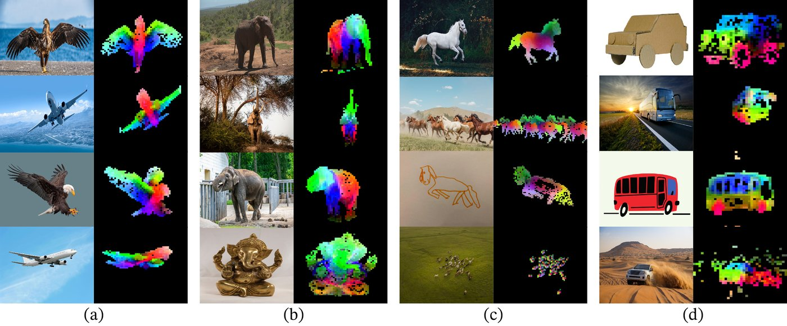
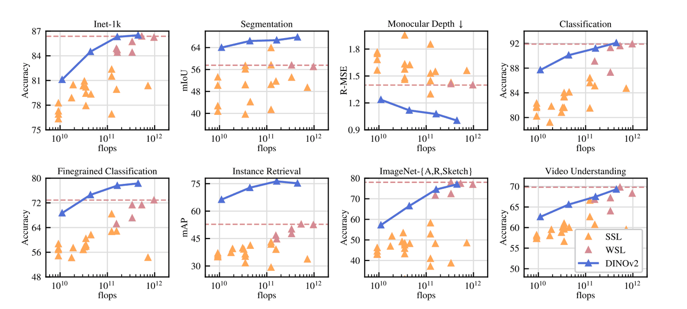
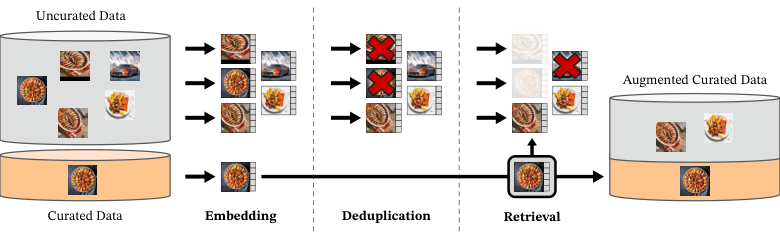
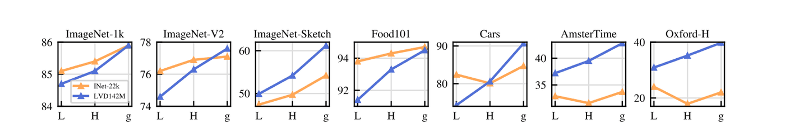

> DINO 시리즈 2편. self-supervised learning을 데이터와 모델 양쪽으로 스케일업해 foundation model급 범용 feature를 만든 DINOv2(TMLR 2024)를 리뷰한다.

## 논문 정보

| 항목 | 내용 |
| --- | --- |
| 제목 | [DINOv2: Learning Robust Visual Features without Supervision](https://arxiv.org/abs/2304.07193) |
| 저자 | Maxime Oquab, Timothée Darcet, Théo Moutakanni, Huy Vo, Marc Szafraniec, Vasil Khalidov 외 (Meta AI Research, Inria) |
| 소속 / 연도 | Meta AI Research, Inria, TMLR 2024 (arXiv:2304.07193) |
| 분야 | Self-Supervised Learning, Vision Foundation Model |
| 코드 | [GitHub](https://github.com/facebookresearch/dinov2) |

## 1. Introduction

NLP에서는 대량의 raw 텍스트로 pretraining한 task-agnostic representation이 표준이 됐고, finetuning 없이 "있는 그대로" 써도 task-specific 모델보다 좋은 성능을 낸다. 이 패러다임을 따라 computer vision에도 비슷한 "foundation" model이 기대된다. 이런 모델은 image-level(분류)과 pixel-level(segmentation) 모두에서 어떤 task에도 바로 동작하는 visual feature를 만들어야 한다.

유망한 시도 대부분은 text-guided pretraining에 집중해 왔다. 그러나 caption은 이미지의 풍부한 정보를 근사할 뿐이라 이 supervision으로는 담을 수 있는 정보가 제한되고, 복잡한 pixel-level 정보는 드러나지 않을 수 있다. 게다가 aligned text-image corpus가 필요해 raw 데이터만으로 학습하는 유연성이 없다. 대안인 self-supervised learning은 이미지만으로 feature를 학습하고 image·pixel level 정보를 모두 포착할 수 있지만, 발전 대부분이 ImageNet-1k라는 작은 curated 데이터셋에서 이뤄졌다. uncurated 데이터로 스케일을 키우려는 시도는 데이터 품질·다양성에 대한 통제가 없어 feature 품질이 크게 떨어졌다.

이 논문은 **대량의 curated 데이터로 pretraining하면 self-supervised learning이 범용 visual feature를 학습할 수 있는지** 탐구한다. 기여는 두 갈래다.

- **기술**: image-level과 patch-level에서 feature를 학습하는 discriminative self-supervised 방법(iBOT 계열)을 재검토하고, 큰 데이터셋 관점에서 설계를 다시 골랐다. 이 개선으로 비슷한 방법 대비 약 2배 빠르고 메모리는 1/3만 쓰며, 더 큰 batch로 더 오래 학습할 수 있다
- **데이터**: 방대한 uncurated 이미지 모음에서 필터링·재균형하는 자동 pipeline을 구축했다. NLP의 데이터 pipeline처럼 외부 metadata 대신 데이터 간 유사도를 쓰고 수동 annotation이 필요 없다. 이렇게 142M 이미지의 corpus를 모았다

최종적으로 여러 ViT 아키텍처로 학습한 pretrained 모델군 **DINOv2**를 공개한다. 1B parameter ViT 모델을 학습한 뒤 더 작은 모델들로 distillation해, 공개된 최고의 범용 feature인 OpenCLIP를 image·pixel level benchmark 대부분에서 능가한다.

*[Figure 1] 같은 열 이미지들의 patch 간 PCA 첫 3개 성분 시각화. pose·style·물체가 달라도 같은 part끼리 매칭되는 모습*

*[Figure 2] 8개 vision task 유형에서 parameter scaling에 따른 성능 변화. DINOv2(파랑)가 SSL(주황)을 크게 넘어 weakly-supervised(분홍 점선) 수준에 도달*

## 2. Related Work

**Intra-image self-supervised training.** patch의 context 예측, 재채색, 변환 예측, inpainting, patch 재배열 같은 이미지 내부 pretext task 계열이다. ViT의 등장으로 inpainting류가 재조명됐고, masked auto-encoder(MAE)는 finetuning했을 때 큰 향상을 주는 feature를 학습한다. 다만 MAE류 feature는 supervised finetuning이 필요한 반면 DINOv2의 feature는 바로 잘 동작한다.

**Discriminative self-supervised learning.** 이미지 간 discriminative 신호로 feature를 학습하는 계열로, instance classification에서 출발해 instance-level 목적함수나 clustering 기반으로 발전했다. ImageNet 같은 표준 benchmark에서 성능 좋은 frozen feature를 만들지만 큰 모델로 확장하기 어려웠다. DINOv2는 이 계열, 특히 iBOT를 대규모 데이터·모델 맥락에서 재검토한다.

**Scaling self-supervised pretraining.** 데이터·모델 크기 확장 연구 대부분은 대량의 uncurated 데이터를 쓰며, 데이터 품질이 낮아 결과 대부분이 finetuning으로 얻어졌다. 이 계열이 "아무 데이터로나 되는가"를 물었다면, DINOv2는 최고의 pretrained encoder를 만드는 데 집중한다.

**Automatic data curation.** dataset 구축은 image retrieval 연구에서 빌려 왔다. hashtag·metadata·pretrained encoder로 필터링한 기존 연구와 달리, pretrained encoder도 metadata도 supervision도 없이 이미지 간 시각적 유사도만 쓴다. Wikipedia로 학습한 language model로 uncurated 텍스트를 스코어링하는 NLP curation pipeline에서 영감을 받았다.

## 3. Data Processing

curated 데이터셋 **LVD-142M**은 여러 curated 데이터셋의 이미지와 가까운 이미지를 대규모 uncurated 데이터 풀에서 retrieval해 조립한다. pipeline은 metadata나 텍스트 없이 이미지만으로 동작한다(Figure 3).

*[Figure 3] curated·uncurated 소스를 embedding으로 매핑하고, 중복 제거 후 curated 이미지와 매칭해 데이터셋을 증강하는 data processing pipeline*

- **Data sources.** curated 소스는 ImageNet-22k, ImageNet-1k train split, Google Landmarks와 여러 fine-grained 데이터셋. uncurated 소스는 크롤링된 웹 데이터 저장소의 `` 태그에서 URL을 추출해 모은 raw 이미지다. 안전하지 않거나 제한된 도메인의 URL을 버리고 후처리(PCA hash 중복 제거, NSFW 필터링, 얼굴 blur)를 거쳐 1.2B개의 고유 이미지를 얻는다
- **Deduplication.** copy detection pipeline으로 near-duplicate를 제거해 중복을 줄이고 다양성을 높인다. benchmark의 test·validation set과 유사한 이미지도 제거한다
- **Self-supervised image retrieval.** ImageNet-22k로 pretraining한 self-supervised ViT-H/16으로 이미지 embedding을 계산하고 cosine similarity로 거리를 잰다. uncurated 데이터를 k-means clustering한 뒤, query 데이터셋이 크면 query 이미지당 nearest neighbor $$N$$ 개(보통 4)를, 작으면 해당 cluster에서 $$M$$ 개를 샘플링한다
- **구현.** 중복 제거와 retrieval은 Faiss의 GPU 가속 index(inverted file + product quantization)를 활용하며, V100-32GB 8개짜리 노드 20대에서 이틀 이내에 LVD-142M이 만들어진다

## 4. Discriminative Self-supervised Pre-training

DINO와 iBOT loss의 결합에 SwAV의 centering을 더한 discriminative self-supervised 방법으로 feature를 학습한다. feature를 퍼뜨리는 regularizer와 짧은 고해상도 학습 단계도 추가한다.

**Image-level objective (DINO).** 같은 이미지의 다른 crop에서 나온 student·teacher ViT의 class token feature 간 cross-entropy loss를 쓴다. student class token을 student DINO head(MLP)에 통과시켜 "prototype score" vector를 얻고 softmax로 $$p_{s}$$ 를 만든다. teacher도 같은 과정 뒤 moving average centering(또는 Sinkhorn-Knopp)을 적용해 $$p_{t}$$ 를 얻는다.

$$
\mathcal{L}_{DINO}=-\sum p_{t}\log p_{s}
$$

student parameter는 학습하고, teacher head는 과거 iterate의 exponential moving average로 만든다.

**Patch-level objective (iBOT).** student 입력 patch 일부를 무작위로 masking하고 teacher에는 masking하지 않는다. student iBOT head를 student mask token에, teacher iBOT head를 student에서 masking된 위치에 대응하는 (보이는) teacher patch token에 적용한 뒤, 위와 같은 softmax·centering을 거쳐 loss를 계산한다.

$$
\mathcal{L}_{iBOT}=-\sum_{i}p_{ti}\log p_{si}
$$

여기서 $$i$$ 는 masking된 token의 patch 인덱스다.

- **head 분리.** iBOT 논문의 ablation에서는 DINO·iBOT head의 parameter 공유가 더 좋았지만, 대규모에서는 반대임을 관찰해 두 head를 분리한다
- **Sinkhorn-Knopp centering.** teacher의 softmax-centering을 SwAV의 Sinkhorn-Knopp(SK) batch normalization으로 대체한다(3 iteration). student는 softmax normalization을 쓴다
- **KoLeo regularizer.** Kozachenko-Leonenko differential entropy 추정에서 유도된 regularizer로, batch 안에서 feature가 균일하게 퍼지도록 유도한다

$$
\mathcal{L}_{\mathrm{koleo}}=-\frac{1}{n}\sum_{i=1}^{n}\log(d_{n,i})
$$

여기서 $$n$$ 은 batch의 vector 수, $$d_{n,i}=\min_{j\neq i}\|x_{i}-x_{j}\|$$ 는 $$x_{i}$$ 와 batch 내 다른 점 사이의 최소 거리다. regularizer 계산 전에 feature를 $$\ell_{2}$$ normalization한다.

- **해상도 적응.** 고해상도는 segmentation·detection 같은 pixel-level task에 핵심이지만 고해상도 학습은 시간·메모리를 많이 쓴다. 대신 pretraining 마지막의 짧은 기간만 이미지 해상도를 $$518\times518$$ 로 올린다

## 5. Efficient Implementation

A100 GPU + PyTorch 2.0 기준으로, 같은 하드웨어에서 iBOT 구현 대비 약 2배 빠르고 메모리는 1/3만 쓴다.

- **Fast and memory-efficient attention.** FlashAttention을 자체 구현해 self-attention의 메모리와 속도를 개선했다. GPU 특성상 head당 embedding 차원이 64의 배수, 전체 차원이 256의 배수일 때 효율이 최고라서, ViT-g를 1408 차원/16 head 대신 **1536 차원/24 head**(64 dim/head)로 변경했다(1.1B parameters)
- **Sequence packing.** 큰 crop(224)과 작은 crop(98)은 token 길이가 달라 함께 forward할 수 없다. NLP에서 온 "sequence packing"으로 두 시퀀스를 하나의 긴 시퀀스로 이어 붙이고, attention에 block-diagonal mask를 적용해 시퀀스 간 attention을 막는다. 각각 forward하는 것과 수학적으로 동일하면서 계산 효율이 크게 오른다
- **Efficient stochastic depth.** drop된 residual의 계산 자체를 건너뛰는 개선된 stochastic depth를 구현했다. drop rate($$d=40\%$$)에 비례해 메모리와 계산이 절약된다
- **FSDP.** AdamW로 학습하려면 float32 모델 replica 4개(student, teacher, optimizer 1·2차 moment)가 필요해 ViT-g 기준 16GB다. PyTorch FSDP로 replica를 GPU들에 shard해 모델 크기가 단일 GPU 메모리에 묶이지 않게 했다. weight broadcast·gradient reduce는 float16으로 수행해(MLP head는 float32) DDP 대비 통신 비용을 약 50% 줄였다
- **Model distillation.** 작은 모델은 처음부터 학습하는 대신 가장 큰 ViT-g에서 distillation한다. 목적함수 자체가 teacher→student distillation 형태이므로 같은 학습 loop를 재사용하되, 큰 모델을 frozen teacher로 쓰고, student의 EMA를 최종 모델로 취하고, masking과 stochastic depth를 제거하고, iBOT loss를 두 global crop에 적용한다

## 6. Ablation Studies

### 6.1 Improved Training Recipe

iBOT baseline에서 구성 요소를 하나씩 추가하며 ImageNet-1k $$k$$-NN·linear probe 성능을 측정한다. 대부분의 요소가 둘 중 하나 이상을 개선한다. LayerScale·Stochastic Depth는 linear probe 성능을 떨어뜨리지만 학습 중 NaN loss를 피하는 안정성을 크게 높인다.

|  | INet-1k k-NN | INet-1k linear |
| --- | --- | --- |
| iBOT | 72.9 | 82.3 |
| +(our reproduction) | 74.5 ↑1.6 | 83.2 ↑0.9 |
| +LayerScale, Stochastic Depth | 75.4 ↑0.9 | 82.0 ↓1.2 |
| +128k prototypes | 76.6 ↑1.2 | 81.9 ↓0.1 |
| +KoLeo | 78.9 ↑2.3 | 82.5 ↑0.6 |
| +SwiGLU FFN | 78.7 ↓0.2 | 83.1 ↑0.6 |
| +Patch size 14 | 78.9 ↑0.2 | 83.5 ↑0.4 |
| +Teacher momentum 0.994 | 79.4 ↑0.5 | 83.6 ↑0.1 |
| +Tweak warmup schedules | 80.5 ↑1.1 | 83.8 ↑0.2 |
| +Batch size 3k | 81.7 ↑1.2 | 84.7 ↑0.9 |
| +Sinkhorn-Knopp | 81.7 = | 84.7 = |
| +Untying heads = DINOv2 | 82.0 ↑0.3 | 84.5 ↓0.2 |

*[Table 1] iBOT에서 DINOv2까지의 학습 recipe ablation (ViT-L, ImageNet-22k)*

### 6.2 Pretraining Data Source

ViT-g/14를 같은 iteration 수로 LVD-142M, ImageNet-22k, uncurated 데이터(같은 소스에서 무작위 142M)로 각각 학습했다. curated 데이터가 uncurated보다 대부분의 benchmark에서 좋아, self-supervised pretraining에서도 curation의 이득이 확인된다. LVD-142M은 ImageNet-1k를 제외한 모든 benchmark에서 ImageNet-22k보다 좋다. curation에 쓰이지 않은 도메인(iNaturalist, Places205)의 성능도 오르므로, 규모와 다양성이 처음 보는 도메인에도 이득을 준다.

| Training Data | INet-1k | Im-A | ADE-20k | Oxford-M | iNat2018 | iNat2021 | Places205 |
| --- | --- | --- | --- | --- | --- | --- | --- |
| INet-22k | **85.9** | 73.5 | 46.6 | 62.5 | 81.1 | 85.6 | 67.0 |
| INet-22k∖INet-1k | 85.3 | 70.3 | 46.2 | 58.7 | 80.1 | 85.1 | 66.5 |
| Uncurated data | 83.3 | 59.4 | 48.5 | 54.3 | 68.0 | 76.4 | 67.2 |
| LVD-142M | 85.8 | **73.9** | **47.7** | **64.6** | **82.3** | **86.4** | **67.6** |

*[Table 2] pretraining 데이터 소스 ablation*

### 6.3 Model Size and Data

모델이 커질수록 LVD-142M 학습이 ImageNet-22k 학습보다 유리해진다. LVD-142M으로 학습한 ViT-g는 ImageNet-1k에서 ImageNet-22k 학습 모델과 대등하면서 다른 benchmark에서는 크게 앞선다.

*[Figure 4] 두 pretraining 데이터셋(ImageNet-22k 14M, LVD-142M 142M)에서 모델 크기(L/H/g)에 따른 성능 변화*

### 6.4 Loss Components

| KoLeo | INet-1k | Im-A | ADE-20k | Oxford-M |
| --- | --- | --- | --- | --- |
| ✕ | 85.3 | 70.6 | 47.2 | 55.6 |
| ✓ | 85.8 | 72.8 | 47.1 | 63.9 |

*[Table 3a] KoLeo loss의 효과*

| MIM | INet-1k | Im-A | ADE-20k | Oxford-M |
| --- | --- | --- | --- | --- |
| ✕ | 85.3 | 72.0 | 44.2 | 64.3 |
| ✓ | 85.8 | 72.8 | 47.1 | 63.9 |

*[Table 3b] iBOT MIM(masked image modeling) 항의 효과*

KoLeo loss는 instance retrieval 성능을 8% 이상 올리며(feature를 출력 공간에 퍼뜨리는 역할의 확인), 다른 지표는 손해 보지 않는다. iBOT의 MIM 항은 dense prediction task에 결정적이며 segmentation을 약 3% 올린다.

### 6.5 Impact of Knowledge Distillation

12개 benchmark에서 처음부터 학습한 ViT-L/14와 ViT-g/14에서 distillation한 ViT-L/14를 비교하면, distillation 모델이 12개 모두에서 앞선다. ViT-L 크기에서도 distillation이 from scratch보다 낫다.

### 6.6 Impact of Resolution

고정 해상도 $$224$$, 고정 $$416$$, 그리고 $$224$$ 학습 후 마지막 10k iteration만 $$416$$ 으로 이어 학습한 모델을 비교했다(ImageNet-1k, ViT-L/16). 고해상도 고정 학습이 모든 평가 해상도에서 최고지만 계산이 약 3배 비싸다. 마지막 10k iteration만 고해상도로 학습해도 거의 대등하면서 계산은 일부만 든다. 그래서 학습 끝의 고해상도 적응 단계를 채택한다.

## 7. Results

baseline은 공개된 최고의 self-supervised 모델(MAE, DINO, SEERv2, MSN, EsViT, Mugs, iBOT)과 weakly-supervised 모델(CLIP, OpenCLIP, SWAG)이다.

### 7.1 ImageNet Classification

frozen backbone 위 linear classifier로 ImageNet-1k를 평가한다. 이전 self-supervised state of the art(iBOT ViT-L/16, ImageNet-22k) 대비 linear evaluation **+4.2%**의 큰 향상을 보이고, 대체 test set(ReaL, V2)에서의 향상 폭이 더 커 일반화가 더 강함을 시사한다. weakly-supervised 모델과 비교해도 OpenCLIP ViT-G/14(+0.3%), EVA-CLIP ViT-g/14(+0.1%)를 넘어서며, ImageNet-V2에서는 격차가 더 크다(+1.1% vs EVA-CLIP).

| Method | Arch. | Data | Text sup. | kNN val | linear val | ReaL | V2 |
| --- | --- | --- | --- | --- | --- | --- | --- |
| *Weakly supervised* |  |  |  |  |  |  |  |
| CLIP | ViT-L/14 | WIT-400M | ✓ | 79.8 | 84.3 | 88.1 | 75.3 |
| CLIP | ViT-L/14₃₃₆ | WIT-400M | ✓ | 80.5 | 85.3 | 88.8 | 75.8 |
| SWAG | ViT-H/14 | IG3.6B | ✓ | 82.6 | 85.7 | 88.7 | 77.6 |
| OpenCLIP | ViT-H/14 | LAION-2B | ✓ | 81.7 | 84.4 | 88.4 | 75.5 |
| OpenCLIP | ViT-G/14 | LAION-2B | ✓ | 83.2 | 86.2 | 89.4 | 77.2 |
| EVA-CLIP | ViT-g/14 | custom∗ | ✓ | **83.5** | 86.4 | 89.3 | 77.4 |
| *Self-supervised* |  |  |  |  |  |  |  |
| MAE | ViT-H/14 | INet-1k | ✕ | 49.4 | 76.6 | 83.3 | 64.8 |
| DINO | ViT-S/8 | INet-1k | ✕ | 78.6 | 79.2 | 85.5 | 68.2 |
| SEERv2 | RG10B | IG2B | ✕ | – | 79.8 | – | – |
| MSN | ViT-L/7 | INet-1k | ✕ | 79.2 | 80.7 | 86.0 | 69.7 |
| EsViT | Swin-B/W=14 | INet-1k | ✕ | 79.4 | 81.3 | 87.0 | 70.4 |
| Mugs | ViT-L/16 | INet-1k | ✕ | 80.2 | 82.1 | 86.9 | 70.8 |
| iBOT | ViT-L/16 | INet-22k | ✕ | 72.9 | 82.3 | 87.5 | 72.4 |
| DINOv2 | ViT-S/14 | LVD-142M | ✕ | 79.0 | 81.1 | 86.6 | 70.9 |
|  | ViT-B/14 | LVD-142M | ✕ | 82.1 | 84.5 | 88.3 | 75.1 |
|  | ViT-L/14 | LVD-142M | ✕ | **83.5** | 86.3 | 89.5 | 78.0 |
|  | ViT-g/14 | LVD-142M | ✕ | **83.5** | **86.5** | **89.6** | **78.4** |

*[Table 4] ImageNet-1k frozen feature linear·kNN 평가. ∗는 custom 데이터*

**Finetuning 가능 여부.** finetuning pipeline을 hyperparameter 조정 없이 적용하면 top-1이 +2% 이상 오른다(해상도 224·448 모두). 최고 finetuned 성능 88.9%는 절대 state of the art(91.1%)에서 2.2%p 이내다. frozen에서도 finetuning에서도 강하므로 finetuning은 선택 사항이다.

| Arch. | Res. | Linear | Finetuned | $$\Delta$$ |
| --- | --- | --- | --- | --- |
| ViT-g/14 | 224 | 86.5 | 88.5 | +2.0 |
|  | 448 | 86.7 | 88.9 | +2.2 |

*[Table 5] ImageNet-1k supervised finetuning*

**Robustness 분석.** domain generalization benchmark에서 iBOT 대비 ImageNet-A +29.6%, R +22.1%, Sketch +23.0%로 극적으로 강건하다. 최고 weakly-supervised 모델보다 A에서는 앞서고 R·Sketch에서는 뒤진다.

| Method | Arch | Data | Im-A | Im-R | Im-C ↓ | Sketch |
| --- | --- | --- | --- | --- | --- | --- |
| OpenCLIP | ViT-G/14 | LAION-2B | 63.8 | **87.8** | 45.3 | **66.4** |
| MAE | ViT-H/14 | INet-1k | 10.2 | 34.4 | 61.4 | 21.9 |
| DINO | ViT-B/8 | INet-1k | 23.9 | 37.0 | 56.6 | 25.5 |
| iBOT | ViT-L/16 | INet-22k | 41.5 | 51.0 | 43.9 | 38.5 |
| DINOv2 | ViT-S/14 | LVD-142M | 33.5 | 53.7 | 54.4 | 41.2 |
|  | ViT-B/14 | LVD-142M | 55.1 | 63.3 | 42.7 | 50.6 |
|  | ViT-L/14 | LVD-142M | 71.3 | 74.4 | 31.5 | 59.3 |
|  | ViT-g/14 | LVD-142M | **75.9** | 78.8 | **28.2** | 62.5 |

*[Table 6] frozen feature linear probe 기반 domain generalization. Im-C는 낮을수록 좋음*

### 7.2 Additional Image and Video Classification Benchmarks

iNaturalist 양쪽에서 OpenCLIP ViT-G/14를 크게 앞서고(2018 +8.6%, 2021 +9.7%) Places205에서는 약간 뒤진다(-2.3%). 비디오로 학습한 적이 없음에도 video action recognition에서 self-supervised 최고를 경신했고, OpenCLIP와 UCF·Kinetics는 대등, 더 풍부한 이해가 필요한 SSv2에서는 +2.5%로 앞선다.

| Feature | Arch | iNat2018 | iNat2021 | Places205 | K400 | UCF-101 | SSv2 |
| --- | --- | --- | --- | --- | --- | --- | --- |
| OpenCLIP | ViT-G/14 | 73.0 | 76.0 | **69.8** | 78.3 | 90.7 | 35.8 |
| MAE | ViT-H/14 | 31.0 | 32.3 | 52.4 | 54.2 | 70.6 | 29.2 |
| DINO | ViT-B/8 | 59.6 | 68.3 | 60.4 | 64.5 | 85.0 | 32.6 |
| iBOT | ViT-L/16 | 66.3 | 74.6 | 64.4 | 72.6 | 88.6 | **38.7** |
| DINOv2 | ViT-S/14 | 69.0 | 74.2 | 62.9 | 67.8 | 87.0 | 33.1 |
|  | ViT-B/14 | 76.4 | 81.1 | 66.2 | 73.2 | 89.1 | 34.4 |
|  | ViT-L/14 | 80.4 | 85.1 | 67.3 | 76.3 | 90.5 | 35.6 |
|  | ViT-g/14 | **81.6** | **85.7** | 67.5 | **78.4** | **91.2** | 38.3 |

*[Table 7] fine-grained 이미지·비디오 분류 linear 평가*

12개 transfer 분류 benchmark에서도 state-of-the-art SSL 모델을 크게 앞선다(Stanford Cars +14.8% vs DINO ViT-B/8, FGVC Aircraft +14.8% vs iBOT ViT-L/16). text-guided pretraining에 유리한 benchmark임에도 대부분에서 OpenCLIP와 경쟁하며, SUN(-5.3%)과 Cars(-4.7%)만 예외다.

| Feature | Arch | Food | C10 | C100 | SUN | Cars | Aircr | VOC | DTD | Pets | Cal101 | Flowers | CUB | Avg |
| --- | --- | --- | --- | --- | --- | --- | --- | --- | --- | --- | --- | --- | --- | --- |
| OpenCLIP | ViT-G/14 | 94.5 | 98.7 | 91.0 | **84.0** | **96.1** | 80.2 | **89.3** | **86.0** | 95.7 | **98.1** | 99.5 | 89.9 | 91.9 |
| MAE | ViT-H/14 | 78.4 | 96.1 | 83.9 | 63.9 | 56.1 | 63.4 | 84.3 | 75.4 | 89.4 | 95.9 | 92.3 | 57.2 | 78.0 |
| DINO | ViT-B/8 | 85.1 | 97.2 | 86.9 | 70.3 | 76.6 | 70.6 | 86.7 | 79.6 | 93.2 | 95.4 | 97.6 | 81.7 | 85.1 |
| iBOT | ViT-L/16 | 91.0 | 99.0 | 92.8 | 75.6 | 71.8 | 72.4 | 89.0 | 80.7 | 87.7 | 97.5 | 99.6 | 82.1 | 86.6 |
| DINOv2 | ViT-S/14 | 89.1 | 97.7 | 87.5 | 74.4 | 81.6 | 74.0 | 87.8 | 80.6 | 95.1 | 97.0 | 99.6 | 88.1 | 87.7 |
|  | ViT-B/14 | 92.8 | 98.7 | 91.3 | 77.3 | 88.2 | 79.4 | 88.2 | 83.3 | 96.2 | 96.1 | 99.6 | 89.6 | 90.1 |
|  | ViT-L/14 | 94.3 | 99.3 | 93.4 | 78.7 | 90.1 | 81.5 | 88.3 | 84.0 | 96.6 | 97.5 | 99.7 | 90.5 | 91.2 |
|  | ViT-g/14 | **94.7** | **99.5** | **94.4** | 78.7 | 91.4 | **87.2** | 89.0 | 84.5 | **96.7** | 97.6 | **99.7** | **91.6** | **92.1** |

*[Table 8] 12개 fine-grained benchmark linear 평가*

### 7.3 Instance Recognition

query 이미지와의 cosine similarity로 데이터베이스 이미지를 랭킹하는 non-parametric 방식이다. landmark(Oxford, Paris), 미술품(Met), 시대 간 street view 매칭(AmsterTime) 모두에서 SSL(+41% mAP Oxford-Hard)과 weakly-supervised(+34% mAP) 대비 큰 폭으로 앞선다. category-level과 instance-level 양쪽 granularity에서 모두 잘 동작한다.

| Feature | Arch | Oxford M | Oxford H | Paris M | Paris H | Met GAP | Met GAP- | Met ACC | AmsterTime mAP |
| --- | --- | --- | --- | --- | --- | --- | --- | --- | --- |
| OpenCLIP | ViT-G/14 | 50.7 | 19.7 | 79.2 | 60.2 | 6.5 | 23.9 | 34.4 | 24.6 |
| MAE | ViT-H/14 | 11.7 | 2.2 | 19.9 | 4.7 | 7.5 | 23.5 | 30.5 | 4.2 |
| DINO | ViT-B/8 | 40.1 | 13.7 | 65.3 | 35.3 | 17.1 | 37.7 | 43.9 | 24.6 |
| iBOT | ViT-L/16 | 39.0 | 12.7 | 70.7 | 47.0 | 25.1 | 54.8 | 58.2 | 26.7 |
| DINOv2 | ViT-S/14 | 68.8 | 43.2 | 84.6 | 68.5 | 29.4 | 54.3 | 57.7 | 43.5 |
|  | ViT-B/14 | 72.9 | 49.5 | 90.3 | 78.6 | 36.7 | 63.5 | 66.1 | 45.6 |
|  | ViT-L/14 | **75.1** | **54.0** | **92.7** | **83.5** | **40.0** | 68.9 | 71.6 | **50.0** |
|  | ViT-g/14 | 73.6 | 52.3 | 92.1 | 82.6 | 36.8 | **73.6** | **76.5** | 46.7 |

*[Table 9] instance-level recognition 평가*

### 7.4 Dense Recognition Tasks

**Semantic segmentation.** 두 설정을 쓴다. **lin.**: patch token에서 class logit을 예측하는 linear layer 하나(저해상도 logit map을 upsampling). **+ms**: 마지막 4개 layer의 patch token concat + 해상도 640 + multiscale test-time augmentation. 모든 데이터셋·설정에서 매우 좋은 성능을 보이며, +ms 평가는 MAE + UperNet decoder 전체 finetuning과 대등하다(53.0 vs 53.6 mIoU). Pascal VOC에서는 state of the art에 근접한다(86.2 vs 89.0 mIoU). 나아가 frozen backbone에 ViT-Adapter + Mask2Former head를 붙이면(전체 weight의 66%가 frozen) ADE20k 60.2 mIoU로 경쟁력 있는 state of the art(62.9)에 근접한다.

| Method | Arch. | ADE20k lin. | ADE20k +ms | CityScapes lin. | CityScapes +ms | VOC lin. | VOC +ms |
| --- | --- | --- | --- | --- | --- | --- | --- |
| OpenCLIP | ViT-G/14 | 39.3 | 46.0 | 60.3 | 70.3 | 71.4 | 79.2 |
| MAE | ViT-H/14 | 33.3 | 30.7 | 58.4 | 61.0 | 67.6 | 63.3 |
| DINO | ViT-B/8 | 31.8 | 35.2 | 56.9 | 66.2 | 66.4 | 75.6 |
| iBOT | ViT-L/16 | 44.6 | 47.5 | 64.8 | 74.5 | 82.3 | 84.3 |
| DINOv2 | ViT-S/14 | 44.3 | 47.2 | 66.6 | 77.1 | 81.1 | 82.6 |
|  | ViT-B/14 | 47.3 | 51.3 | 69.4 | 80.0 | 82.5 | 84.9 |
|  | ViT-L/14 | 47.7 | **53.1** | 70.3 | 80.9 | 82.1 | 86.0 |
|  | ViT-g/14 | **49.0** | 53.0 | **71.3** | **81.0** | **83.0** | **86.2** |

*[Table 10] frozen feature semantic segmentation mIoU. 각 데이터셋의 절대 state of the art는 62.9 / 86.9 / 89.0*

**Depth estimation.** NYUd, KITTI와 NYUd→SUN RGB-D zero-shot transfer에서 세 설정(lin. 1: 마지막 layer + [CLS] concat + linear, lin. 4: 4개 layer concat, DPT: frozen backbone 위 DPT decoder)으로 평가한다. 최고의 SSL·WSL feature를 뚜렷하게 넘는다. iBOT ViT-L이 OpenCLIP ViT-G를 앞서는 점은 caption 기반 학습이 이런 미묘한 패턴을 놓친다는 직관을 뒷받침한다. 실내(NYUd)에서 학습한 depth module이 SUN RGB-D로 잘 일반화된다.

| Method | Arch. | NYUd lin.1 | NYUd lin.4 | NYUd DPT | KITTI lin.1 | KITTI lin.4 | KITTI DPT | SUN lin.1 | SUN lin.4 | SUN DPT |
| --- | --- | --- | --- | --- | --- | --- | --- | --- | --- | --- |
| OpenCLIP | ViT-G/14 | 0.541 | 0.510 | 0.414 | 3.57 | 3.21 | 2.56 | 0.537 | 0.476 | 0.408 |
| MAE | ViT-H/14 | 0.517 | 0.483 | 0.415 | 3.66 | 3.26 | 2.59 | 0.545 | 0.523 | 0.506 |
| DINO | ViT-B/8 | 0.555 | 0.539 | 0.492 | 3.81 | 3.56 | 2.74 | 0.553 | 0.541 | 0.520 |
| iBOT | ViT-L/16 | 0.417 | 0.387 | 0.358 | 3.31 | 3.07 | 2.55 | 0.447 | 0.435 | 0.426 |
| DINOv2 | ViT-S/14 | 0.449 | 0.417 | 0.356 | 3.10 | 2.86 | 2.34 | 0.477 | 0.431 | 0.409 |
|  | ViT-B/14 | 0.399 | 0.362 | 0.317 | 2.90 | 2.59 | 2.23 | 0.448 | 0.400 | 0.377 |
|  | ViT-L/14 | 0.384 | 0.333 | 0.293 | 2.78 | 2.50 | 2.14 | 0.429 | 0.396 | 0.360 |
|  | ViT-g/14 | **0.344** | **0.298** | **0.279** | **2.62** | **2.35** | **2.11** | **0.402** | **0.362** | **0.338** |

*[Table 11] frozen feature depth estimation RMSE(낮을수록 좋음). SUN 열은 NYUd→SUN RGB-D zero-shot transfer*

### 7.5 Qualitative Results

- **Segmentation·depth 정성 비교**: linear 설정에서 DINOv2 backbone은 OpenCLIP보다 훨씬 좋은 결과를 낸다. OpenCLIP의 segmentation mask에는 artifact와 끊어진 성분이 많고, depth도 DINOv2 쪽이 더 매끄럽다
- **Out-of-distribution 일반화**: 동물 사진, 그림 같은 매우 다른 도메인에서도 depth·segmentation linear classifier가 좋은 품질을 유지한다
- **PCA of patch features**: 첫 PCA 성분을 thresholding하면 전경/배경이 분리되고, 나머지 성분은 물체의 "part"에 대응하며 같은 카테고리의 이미지 간에 잘 매칭된다. part를 파싱하도록 학습한 적이 없는데도 나타나는 창발 성질이다
- **Patch matching**: 서로 다른 물체에서 비슷한 목적을 갖는 semantic 영역이 매칭된다. 비행기 날개와 새의 날개가 매칭되고, 사진과 그림, 큰 pose 변화에도 강건하다

## 8. Fairness and Bias Analysis

### 8.1 Geographical Fairness

Dollar Street 데이터셋(54개국 289가구 16,073장, 94개 개념 인식)에서 지역·소득별 성능을 잰다. DINOv2는 지리적으로 다양한 데이터로 학습한 SEERv2보다 지역·소득 전반에서 약간 더 공정하고 supervised baseline보다는 크게 낫다. 그러나 여전히 유럽 대비 아프리카에서 25.7% 떨어지고 고소득 가구 대비 저소득 가구에서 31.7% 낮아, 서구·고소득 가구에 편향되어 있다.

| Method | Arch. | Data | low | medium | high | Africa | Asia | Americas | Europe |
| --- | --- | --- | --- | --- | --- | --- | --- | --- | --- |
| SEERv2 | RG-10B | IG-1B | 59.7 | 78.5 | 86.6 | 65.9 | 76.3 | 81.1 | 85.6 |
| DINOv2 | ViT-g/14 | LVD-142M | 67.4 | 83.3 | 90.5 | 74.0 | 81.6 | 86.2 | 89.7 |

*[Table 12] 소득 구간·지역별 geographical fairness 분석*

### 8.2 Gender, Skintones and Age

ImageNet-22k의 619개 class 부분집합으로 multiclass classifier를 학습하고(backbone frozen), Casual Conversations 데이터셋 2,955장에 대해 Human / Possibly Human / Non-Human / Crime 4개 메타 카테고리 예측을 본다. 모든 그룹에서 대체로 Human으로 분류하며 skin tone 간 큰 편차가 없다. SEERv2와 DINOv2 모두 유해한 Non-Human·Crime label을 예측하지 않는다(배경의 창살이 감옥 창살과 유사했던 2건 예외). 특정 그룹에 대한 명확한 편향 패턴은 발견되지 않았지만, 더 철저한 평가에서 결함이 드러날 수 있음을 인정한다.

## 9. Estimating the Environmental Impact of Training our Models

데이터센터 고유 값 대신 "미국 평균 데이터센터에서 비슷한 모델을 재학습할 때의 잠재적 탄소 배출"(PUE 1.1, 0.385 kg CO2eq/KWh)로 비교한다. DINOv2-g 재학습은 22,016 GPU-hours, 9.7 MWh, 3.7 tCO2eq다. 같은 조건에서 OpenCLIP ViT-L은 22.4 MWh, ViT-G는 118.9 MWh로 약 10배의 탄소를 배출한다(text encoder를 함께 학습하므로 공정한 비교는 아니다). 시각 feature만 필요하다면 self-supervised 학습이 탄소 면에서 유리하다. 프로젝트 전체 발자국은 약 200k GPU-days, 0.5k~1k tCO2eq로 추정된다.

| Model to Reproduce | GPU Type | GPU Power consumption | GPU-hours | PUE | Total power consumption | Carbon emitted (tCO2eq) |
| --- | --- | --- | --- | --- | --- | --- |
| DINOv2-g | A100-40GB | 400W | 22,016 | 1.1 | 9.7 MWh | 3.7 |

*[Table 14] DINOv2 재현의 탄소 발자국*

## 10. Future Work and Discussion

DINOv2는 대규모 curated 데이터로 supervision 없이 pretraining한 새로운 image encoder 시리즈로, 이미지 데이터에서 SSL이 넓은 범위의 benchmark에 걸쳐 finetuning 없이 (weakly) supervised 대안과의 성능 격차를 닫은 첫 사례다. 강한 성능의 요인은 (i) 더 나은 hyperparameter·regularization의 개선된 recipe(Table 1), (ii) 데이터와 무관하게 결과를 올리는 더 큰 모델 스케일(Figure 4), (iii) 더 큰 데이터셋(Figure 4), (iv) 작은 모델이 ViT-g의 성능을 물려받게 하는 distillation(Fig. 5)이다.

이미지 도메인과 무관한 물체 part와 scene geometry의 이해 같은 성질이 창발하며, LLM의 instruction emergence처럼 모델·데이터 스케일이 커지면 더 많은 성질이 나타날 것으로 기대한다. 이 feature들은 linear layer만큼 단순한 classifier와도 호환된다. 즉 필요한 정보가 바로 꺼내 쓸 수 있는 형태로 담겨 있다. 후속 연구로는 이 visual feature를 word token처럼 처리할 수 있는 language-enabled AI 시스템의 학습을 계획한다.
