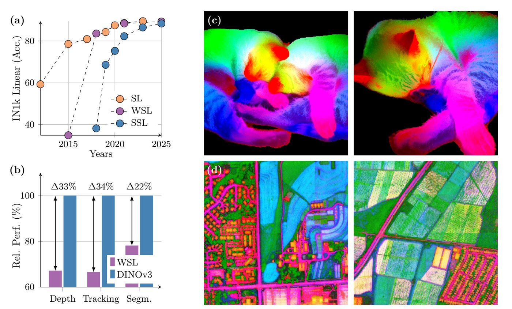
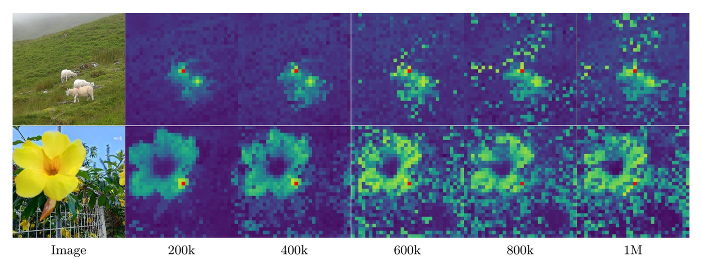
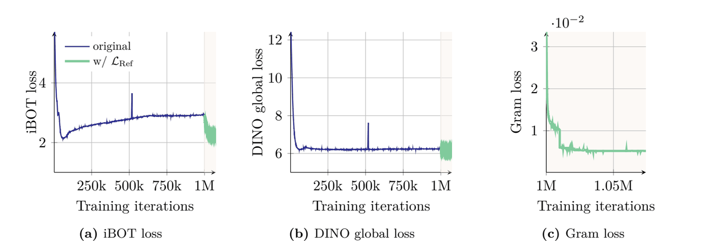
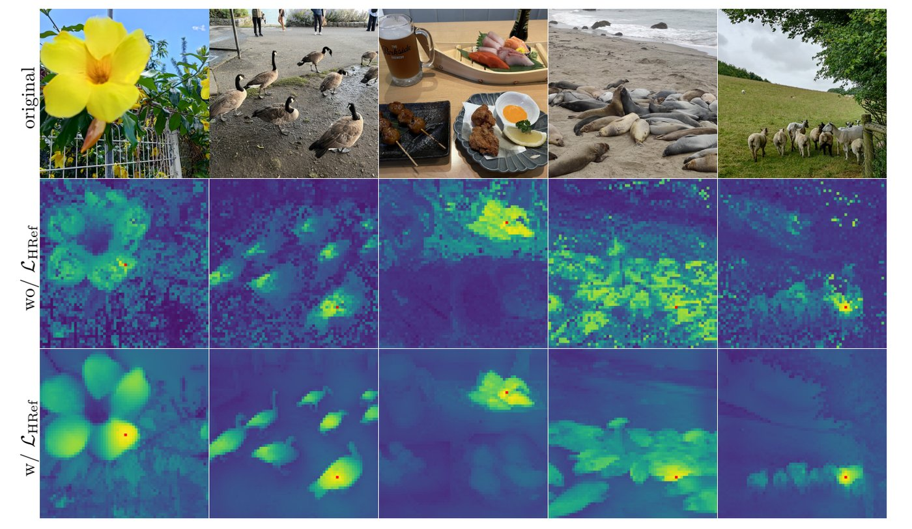
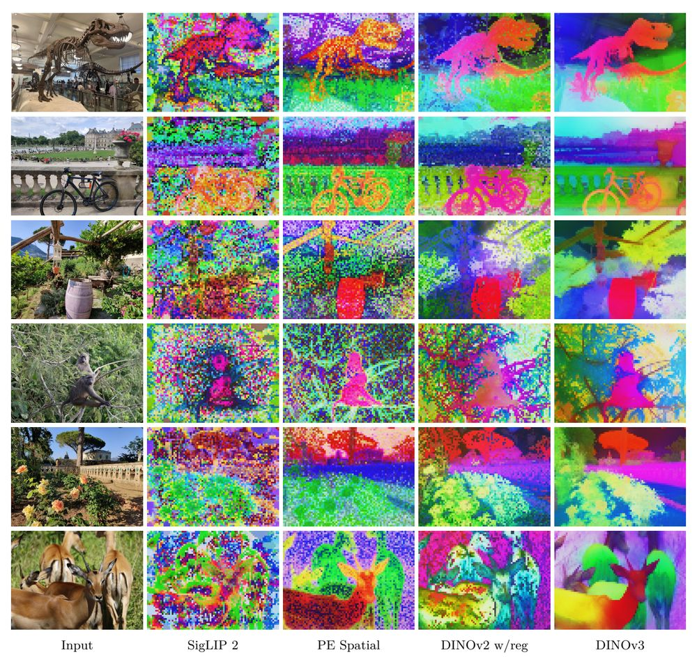
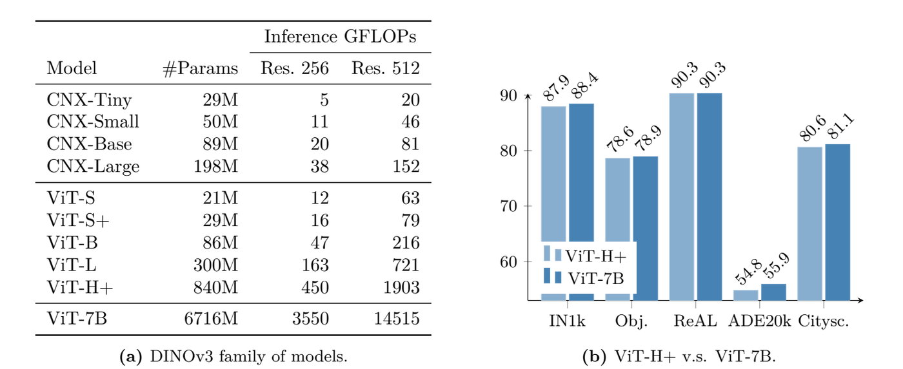

> DINO 시리즈 3편. SSL을 7B parameter·1.7B 이미지 규모로 밀어붙이고, 장기 학습에서 dense feature가 무너지는 문제를 Gram anchoring으로 해결한 DINOv3 technical report를 리뷰한다.

## 논문 정보

| 항목 | 내용 |
| --- | --- |
| 제목 | [DINOv3](https://arxiv.org/abs/2508.10104) |
| 저자 | Oriane Siméoni, Huy V. Vo, Maximilian Seitzer, Federico Baldassarre, Maxime Oquab, Cijo Jose 외 (Meta AI Research) |
| 소속 / 연도 | Meta AI Research, WRI, Inria, 2025 (arXiv:2508.10104, technical report) |
| 분야 | Self-Supervised Learning, Vision Foundation Model |
| 코드 | [GitHub](https://github.com/facebookresearch/dinov3) |

## 1. Introduction

Self-supervised learning(SSL)은 고품질 metadata가 붙은 이미지를 요구하는 weakly-/fully-supervised pretraining과 달리, raw 이미지 모음에서 바로 학습할 수 있어 사실상 무제한의 학습 데이터를 쓸 수 있다. SSL 모델은 입력 분포 변화에 강건하고, 강한 global·local feature를 모두 제공하며, 특정 task로 편향되지 않은 범용 feature를 만든다. metadata가 없는 관측 데이터 도메인(병리조직, 생물학, 의료영상, 원격탐사, 천문학 등)에 특히 적합하다.

그러나 SSL의 약속(대량의 비정제 데이터로 임의로 크고 강한 모델을 만드는 것)은 규모에서 여전히 어렵다. 세 가지 문제가 있다.

1. unlabeled 모음에서 유용한 데이터를 어떻게 모을지 불분명하다
2. cosine schedule을 쓰는 관행은 최적화 horizon을 미리 알아야 하는데, 대규모 corpus에서는 알기 어렵다
3. **학습 초기 이후 feature 성능이 점차 떨어진다.** patch similarity map을 보면 확인되는 이 현상은 ViT-Large(300M) 이상 모델의 장기 학습에서 나타나 DINOv2 스케일업의 발목을 잡았다

DINOv3는 이 문제들을 해결해 SSL 학습을 대규모로 전진시킨다. **단일 frozen SSL backbone**이 supervised·metadata 의존 pretraining을 능가하는 범용 visual encoder가 될 수 있음을 보인다. 목표는 (1) task·도메인을 가로지르는 versatile foundation model 학습, (2) 기존 SSL 모델의 dense feature 약점 개선, (3) off-the-shelf로 쓸 수 있는 모델군 배포다.

*[Figure 1] 연도별 ImageNet1k linear probing 추이(a), dense task에서 최고 WSL 모델 대비 상대 성능(b), 자연(c)·항공(d) 고해상도 이미지에서 DINOv3 feature의 PCA map*

**기여 요약**

- **(i) 데이터 스케일링**: hierarchical k-means 기반 자동 curation으로 얻은 대규모 "background" 데이터셋에 소량의 특화 데이터(ImageNet-1k)를 신중히 섞는다(§3.1)
- **(ii) 모델·학습**: axial RoPE 등 현대적 설계를 담은 custom ViT로 7B parameter까지 키우고, 여러 cosine schedule 대신 **constant hyperparameter schedule**로 1M iteration을 학습한다(§3.2)
- **(iii) Gram anchoring**: 규모가 커지면 나타나는 dense feature 붕괴를 고치는 새 학습 단계. feature map의 노이즈를 청소해 dense task 성능을 극적으로 끌어올린다(§4)
- **(iv) 모델군**: 고해상도 post-training과 novel한 single-teacher multi-student distillation로 7B frontier 모델의 힘을 다양한 크기의 실용 모델로 옮긴다(§5.2)

그 결과 frozen backbone으로 object detection(COCO mAP 66.1), segmentation(ADE20k mIoU 63.0) 같은 오래된 문제에서 특화 finetuned pipeline을 넘는 state of the art를 달성하고, 위성 영상에도 같은 알고리즘을 적용해(§8) 기존 접근을 모두 능가한다.

## 2. Related Work

**Self-Supervised Learning.** 이미지 일부로 다른 부분을 예측하는 pretext task(상대 patch 위치, patch 재배열, inpainting, 재채색 등)에서 출발해, ViT의 patch 구조와 맞는 inpainting 계열(MAE 등)이 주목받았다. latent 공간 예측(JEPA 계열)은 더 높은 수준의 feature를 만든다. 다른 갈래는 이미지 간 discriminative 신호를 쓰는 계열로, instance classification에서 contrastive·clustering 기반으로 발전했고, iBOT는 discriminative loss와 masked reconstruction을 결합했다. 대부분 큰 모델로의 확장이 어려웠다.

**Vision Foundation Models.** AlexNet 이후 아키텍처 발전(VGG, GoogleNet, ResNet)과 JFT 같은 대규모 supervised 데이터로의 확장(ViT-22B까지)이 이어졌다. 수동 labeling의 비용 때문에 metadata에서 annotation을 얻는 weakly-supervised 학습이 대안이 됐고, contrastive loss와 caption 표현의 joint 학습(Align, CLIP)으로 만개했다. SigLIP 2와 Perception Encoder(PE)는 40B 이상의 image-text pair로 학습해 인상적인 결과를 얻었다. 반면 unsupervised 이미지 pretraining의 스케일링 연구는 상대적으로 적었고, DINOv2가 처음으로 open-source CLIP 계열과 대등해졌다.

**Dense Transformer Features.** 현대 vision 응용 다수(멀티모달, 생성 모델, 3D·비디오 이해, robotics)가 pretrained transformer의 dense feature를 소비한다. local SSL loss, register token, agglomerative distillation(AM-RADIO, PEspatial) 등 dense feature 품질을 높이는 연구가 이어졌다. DINOv3는 style transfer에서 쓰이던 **Gram matrix** 정합의 아이디어를 채택하되, teacher로 SSL 모델 자신의 이른 iteration을 쓴다. 초기 SSL 모델이 global·dense 모두에서 SSL 학습을 효과적으로 이끈다는 것을 보인다.

## 3. Training at Scale Without Supervision

### 3.1 Data Preparation

**Data collection and curation.** Instagram 공개 게시물에서 수집된 약 17B 이미지의 웹 데이터 풀에서 세 부분으로 데이터셋을 만든다.

1. **clustering 기반 curation**: DINOv2 embedding으로 5-level hierarchical k-means(cluster 수 200M→8M→800k→100k→25k)를 만들고 balanced sampling을 적용해, 웹의 모든 시각 개념을 균형 있게 덮는 **LVD-1689M**(1,689M장)을 얻는다
2. **retrieval 기반 curation**: DINOv2 방식대로 seed 데이터셋과 유사한 이미지를 검색해 downstream 관련 개념을 덮는다
3. **raw 공개 데이터셋**: ImageNet1k/22k, Mapillary Street-level Sequences

**Data sampling.** 매 iteration마다 ImageNet1k만의 homogeneous batch(전체의 10%) 또는 나머지 모든 성분을 섞은 heterogeneous batch를 무작위로 샘플링한다. 소량의 고품질 데이터로 구성된 homogeneous batch가 유익하다는 관찰을 따른 설계다.

**Data ablation.** 어느 단일 curation 기법도 모든 benchmark에서 최고가 아니며, 전체 mix가 양쪽의 장점을 모두 얻는다.

| Dataset | IN1k k-NN | IN1k Linear | ObjectNet | iNaturalist 2021 | Paris Retrieval |
| --- | --- | --- | --- | --- | --- |
| Raw | 80.1 | 84.8 | 70.3 | 70.1 | 63.3 |
| Clustering | 79.4 | 85.4 | 72.3 | 81.3 | 85.2 |
| Retrieval | 84.0 | 86.7 | 70.7 | 86.0 | 82.7 |
| LVD-1689M (ours) | **84.6** | **87.2** | **72.8** | **87.0** | **85.9** |

*[Table 1] 학습 데이터가 feature 품질에 주는 영향 (200k iteration 단축 schedule)*

### 3.2 Large-Scale Training with Self-Supervision

**Learning objective.** global·local loss 항을 섞은 discriminative self-supervised 전략으로 학습한다. DINOv2처럼 image-level objective $$\mathcal{L}_{\mathrm{DINO}}$$ 와 patch-level latent reconstruction objective $$\mathcal{L}_{\mathrm{iBOT}}$$ 를 균형시키고, 두 objective 모두 DINO의 centering을 SwAV의 Sinkhorn-Knopp로 대체한다. batch 안에서 feature가 균일하게 퍼지도록 하는 Koleo regularizer는 16개 샘플 단위의 분산 구현으로 적용한다. 첫 학습 단계의 loss는 다음과 같다.

$$
\mathcal{L}_{\mathrm{Pre}}=\mathcal{L}_{\mathrm{DINO}}+\mathcal{L}_{\mathrm{iBOT}}+0.1*\mathcal{L}_{\mathrm{DKoleo}}
$$

여기서 $$\mathcal{L}_{\mathrm{DKoleo}}$$ 는 분산 구현된 Koleo regularizer다. local·global crop의 backbone 출력에 별도의 layer normalization을 적용하는 변경도 더했다(IN1k kNN +0.2, ADE20k +1 mIoU).

**Updated model architecture.** 모델을 7B parameter로 키운다. custom **RoPE** 변형을 쓴다. 각 patch에 정규화된 $$[-1,1]$$ box 좌표를 주고 두 patch의 상대 위치에 따라 multi-head attention에 bias를 더한다. 해상도·스케일·종횡비에 강건하도록 **RoPE-box jittering**(좌표 box를 $$[-s,s]$$, $$s\in[0.5,2]$$ 로 무작위 스케일)을 적용한다.

| Teacher model | DINOv2 | DINOv3 |
| --- | --- | --- |
| Backbone | ViT-giant | ViT-7B |
| #Params | 1.1B | 6.7B |
| #Blocks | 40 | 40 |
| Patch Size | 14 | 16 |
| Pos. Embeddings | Learnable | RoPE |
| Registers | 4 | 4 |
| Embed. Dim. | 1536 | 4096 |
| FFN Type | SwiGLU | SwiGLU |
| FFN Hidden Dim. | 4096 | 8192 |
| Attn. Heads | 24 | 32 |
| Attn. Heads Dim. | 64 | 128 |
| DINO Head MLP | 4096-4096-256 | 8192-8192-512 |
| DINO Prototypes | 128k | 256k |
| iBOT Head MLP | 4096-4096-256 | 8192-8192-384 |
| iBOT Prototypes | 128k | 96k |

*[Table 2] DINOv2와 DINOv3 teacher 아키텍처 비교*

**Optimization.** 모델 용량과 데이터 복잡도의 상호작용을 미리 알 수 없어 올바른 최적화 horizon을 추정할 수 없다. 그래서 모든 parameter scheduling을 없애고 **learning rate·weight decay·teacher EMA momentum을 상수로** 학습한다. downstream 성능이 오르는 한 계속 학습할 수 있고, hyperparameter 수도 줄어든다. 시작 시에만 learning rate와 teacher temperature를 linear warmup한다. AdamW, batch 4096(GPU 256개), multi-crop(global 2개 256px + local 8개 112px), batch당 총 3.7M token이다.

## 4. Gram Anchoring: A Regularization for Dense Features

7B 모델을 무한정 학습한다는 생각으로 장기 학습을 하면, global benchmark는 계속 좋아지지만 **dense task 성능이 저하된다**. patch-level 표현에 불일치가 생기기 때문으로, 장기 학습의 의미를 훼손하는 문제다.

### 4.1 Loss of Patch-Level Consistency Over Training

ViT-g와 ViT-7B 모두 분류 정확도(IN1k linear)는 학습 내내 단조 증가하지만, segmentation(VOC linear) 성능은 약 200k iteration 이후 하락하며 ViT-7B는 초기 수준 아래로 떨어진다. patch 간 cosine similarity map을 보면(Figure 6) 200k에서는 매끄럽고 잘 국소화되어 있으나, 600k 이후에는 기준 patch와 무관한 patch들이 높은 유사도를 갖는 식으로 크게 열화된다. 이 patch-level 일관성 상실이 dense 성능 하락과 상관된다. register token 덕에 patch norm은 안정적이므로 이는 high-norm outlier와는 다른 현상이다. 대신 CLS token과 patch 출력 간 cosine similarity가 점점 커진다. 즉 patch feature의 국소성이 줄어든다.

*[Figure 6] 학습 iteration(200k~1M)에 따른 기준 patch(빨강)와 나머지 patch 간 cosine similarity 변화*

### 4.2 Gram Anchoring Objective

강한 discriminative feature 학습과 국소 일관성 유지가 서로 비교적 독립적이라는 관찰에서 출발한다. 새 objective는 **Gram matrix**(이미지 안 patch feature들의 모든 쌍별 내적 행렬)에 작용한다. student의 Gram matrix를 **이른 iteration의 teacher(Gram teacher)** 의 것으로 밀어붙인다. feature 자체가 아니라 유사도 구조에만 제약을 걸어, 유사도 구조가 유지되는 한 local feature는 자유롭게 움직일 수 있다.

이미지가 $$P$$ 개 patch로 구성되고 network 차원이 $$d$$ 일 때, $$\mathbf{X}_{S}$$ 와 $$\mathbf{X}_{G}$$ 를 각각 student와 Gram teacher의 $$\ell_{2}$$ normalize된 local feature 행렬($$P\times d$$)이라 하면

$$
\mathcal{L}_{\text{Gram}}=\left\|\mathbf{X}_{S}\cdot\mathbf{X}_{S}^{\top}-\mathbf{X}_{G}\cdot\mathbf{X}_{G}^{\top}\right\|_{\text{F}}^{2}
$$

이다. $$\|\cdot\|_{\text{F}}$$ 는 Frobenius norm으로, 두 Gram matrix의 원소별 차이 제곱합을 최소화한다. 이 loss는 global crop에만 계산한다. 효율을 위해 1M iteration 이후에만 적용하는데, 늦게 적용해도 심하게 열화된 local feature를 "수리"해 낸다. 성능을 더 올리기 위해 Gram teacher를 10k iteration마다 main EMA teacher로 갱신한다. 이 두 번째 학습 단계(refinement step)의 objective는

$$
\mathcal{L}_{\mathrm{Ref}}=w_{\mathrm{D}}\mathcal{L}_{\mathrm{DINO}}+\mathcal{L}_{\mathrm{iBOT}}+w_{\mathrm{DK}}\mathcal{L}_{\mathrm{DKoleo}}+w_{\mathrm{Gram}}\mathcal{L}_{\mathrm{Gram}}
$$

이다. $$w_{\mathrm{D}}$$, $$w_{\mathrm{DK}}$$, $$w_{\mathrm{Gram}}$$ 은 각 항의 가중치다. loss 곡선을 보면(Figure 7) Gram objective가 iBOT loss를 더 빠르게 감소시키는 반면 DINO loss에는 큰 영향이 없다. Gram과 iBOT는 feature에 비슷한 방향으로, DINO는 다른 방향으로 작용한다는 뜻이다. 효과는 거의 즉각적이어서 첫 10k iteration 안에 dense task가 크게 개선되고, Gram teacher 갱신 때마다 ADE20k가 추가로 오른다.

*[Figure 7] 학습 iteration에 따른 iBOT loss(a), DINO global loss(b), Gram loss(c)의 변화. 음영은 $$\mathcal{L}_{\mathrm{Ref}}$$ refinement 구간*

### 4.3 Leveraging Higher-Resolution Features

patch feature의 가중 평균이 outlier patch를 매끄럽게 해 더 강한 local 표현을 만든다는 관찰과, 고해상도 입력이 더 정밀한 feature map을 만든다는 관찰을 결합한다. Gram teacher에 **2배 해상도 이미지를 입력하고, 결과 feature map을 bicubic interpolation으로 2배 downsampling**해 student 출력 크기에 맞춘다. 고해상도 feature의 우수한 patch-level 일관성이 downsampling 후에도 보존되어 더 매끄러운 표현을 얻는다. 이 downsampled feature의 Gram matrix로 $$\mathbf{X}_{G}$$ 를 대체한 objective를 $$\mathcal{L}_{\mathrm{HRef}}$$ 라 한다. RoPE 덕에 모델은 별도 적응 없이 다양한 해상도를 처리할 수 있다.

이 distillation로 dense task가 $$\mathcal{L}_{\mathrm{Ref}}$$ 대비 추가로 개선된다(ADE20k +2 mIoU). Gram teacher를 100k나 200k iteration에서 골라도 결과 차이가 없지만, 1M처럼 늦은 teacher는 patch-level 일관성이 열등해 해롭다.

*[Figure 10] 1024×1024 입력에서 $$\mathcal{L}_{\mathrm{HRef}}$$ refinement 전후의 cosine map 비교*

## 5. Post-Training

### 5.1 Resolution Scaling

본 학습은 해상도 256(patch 16, DINOv2의 224/patch 14와 같은 시퀀스 길이)으로 하지만, 실제 응용은 512 이상을 자주 요구한다. 그래서 **mixed resolution의 고해상도 적응 단계**를 둔다. global crop {512, 768}, local crop {112, 168, 224, 336}을 mini-batch마다 섞어 10k iteration 추가 학습한다. 이때도 7B teacher를 Gram teacher로 쓰는 Gram anchoring이 핵심이다. 없으면 dense 성능이 크게 나빠진다. 적응 후 모델은 학습 최대 해상도 768을 훨씬 넘는 4k 이상 해상도에서도 안정적인 feature map을 낸다.

### 5.2 Model Distillation

**모델군.** ViT-7B를 ViT-S/S+/B/L/H+ 등 작은 variant로 knowledge distillation한다. 첫 학습 단계와 같은 objective를 쓰되 EMA 대신 고정된 7B 모델을 teacher로 쓴다. 이 경우 patch-level 일관성 문제가 없어 Gram anchoring은 쓰지 않는다. 1M iteration 학습 후 250k iteration의 cosine cooldown, 이어 고해상도 단계를 적용한다.

**Efficient multi-student distillation.** teacher inference 비용이 student 학습보다 훨씬 크므로, 여러 student를 동시에 학습하며 **teacher inference를 모든 노드가 공유**하는 병렬 pipeline을 설계했다. 전체 GPU가 teacher inference를 나눠 수행하고 all-gather로 결과를 공유한 뒤, student별 GPU 그룹이 각자 학습한다. student를 추가해도 전체 계산은 그 student의 학습 비용만큼만 늘고 iteration당 GPU당 계산은 오히려 줄어든다.

### 5.3 Aligning DINOv3 with Text

dino.txt의 전략(LiT 패러다임)을 따라, vision encoder를 frozen한 채 text encoder를 contrastive objective로 처음부터 학습한다. 유연성을 위해 frozen backbone 위에 transformer layer 2개를 추가하고, **mean-pooling한 patch embedding을 CLS token 출력과 concat**해 text embedding과 매칭한다. global과 local visual feature가 모두 텍스트에 정렬되어 dense 예측 task에서도 개선을 얻는다.

## 6. Results

flagship DINOv3 7B를 frozen 상태로 평가한다. baseline은 weakly-supervised PEcore·SigLIP 2, self-supervised DINOv2(+registers)·Web-DINO·Franca, agglomerative AM-RADIOv2.5·PEspatial 등이다.

### 6.1 DINOv3 Provides Exceptional Dense Features

#### 6.1.1 Qualitative Analysis

dense feature를 PCA로 3차원으로 투영해 RGB로 시각화하면(Figure 13), DINOv3의 feature가 다른 backbone보다 훨씬 선명하고 노이즈가 적으며 semantic 일관성이 우수하다.

*[Figure 13] SigLIP 2, PEspatial, DINOv2(w/reg), DINOv3 dense feature의 PCA 시각화 비교(feature map 크기 80×60)*

#### 6.1.2 Dense Linear Probing

| Method | ViT | ADE20k | Citysc. | VOC | NYUv2 ↓ | KITTI ↓ |
| --- | --- | --- | --- | --- | --- | --- |
| *Agglomerative backbones* |  |  |  |  |  |  |
| AM-RADIOv2.5 | g/14 | 53.0 | 78.4 | 85.4 | 0.340 | 2.918 |
| PEspatial | G/14 | 49.3 | 73.2 | 82.7 | 0.362 | 3.082 |
| *Weakly-supervised backbones* |  |  |  |  |  |  |
| SigLIP 2 | g/16 | 42.7 | 64.8 | 72.7 | 0.494 | 3.273 |
| PEcore | G/14 | 38.9 | 61.1 | 69.2 | 0.590 | 4.119 |
| *Self-supervised backbones* |  |  |  |  |  |  |
| Franca | g/14 | 46.3 | 68.7 | 82.9 | 0.445 | 3.140 |
| DINOv2 | g/14 | 49.5 | 75.6 | 83.1 | 0.372 | 2.624 |
| Web-DINO | 7B/14 | 42.7 | 68.3 | 76.1 | 0.466 | 3.158 |
| DINOv3 | 7B/16 | **55.9** | **81.1** | **86.6** | **0.309** | **2.346** |

*[Table 3] frozen backbone dense linear probing. segmentation은 mIoU, depth는 RMSE(낮을수록 좋음)*

ADE20k에서 SSL baseline을 6 mIoU 이상, weakly-supervised를 13 이상 앞서고, SAM에서 distillation한 강력한 baseline인 PEspatial을 6, AM-RADIOv2.5를 약 3 앞선다. linear classifier만으로 55.9 mIoU는 절대 state of the art(63.0)에 근접하는 수치다.

#### 6.1.3 3D Correspondence Estimation

Probe3D protocol로 multi-view 일관성을 평가한다(geometric: NAVI, semantic: SPair, 지표는 correspondence recall).

| Method | ViT | NAVI (Geometric) | SPair (Semantic) |
| --- | --- | --- | --- |
| *Agglomerative backbones* |  |  |  |
| AM-RADIOv2.5 | g/14 | 59.4 | 56.8 |
| PEspatial | G/14 | 53.8 | 49.6 |
| *Weakly-supervised backbones* |  |  |  |
| SigLIP 2 | g/16 | 49.4 | 42.6 |
| PEcore | G/14 | 39.9 | 23.1 |
| *Self-supervised backbones* |  |  |  |
| Franca | g/14 | 54.6 | 51.0 |
| DINOv2 | g/14 | 60.1 | 56.1 |
| Web-DINO | 7B/14 | 55.0 | 32.2 |
| DINOv3 | 7B/16 | **64.4** | **58.7** |

*[Table 4] 3D keypoint correspondence recall*

geometric에서 2위 DINOv2를 +4.3% recall로 앞선다. weakly-supervised 모델은 3D 인식이 부족하고, SAM distillation 모델 중 PEspatial도 DINOv2에 크게 뒤진다. SSL이 이 task의 핵심 요소임을 시사한다.

#### 6.1.4 Unsupervised Object Discovery

TokenCut(non-parametric graph 기반)으로 class-agnostic segmentation을 평가한다(CorLoc). dense task에 강했던 DINOv2가 정작 object discovery에는 실패하는 반면(feature artifact 탓), 깨끗한 feature map을 가진 DINOv3는 VOC 2007에서 원조 DINO 대비 +5.9 CorLoc로 모든 backbone을 앞선다.

#### 6.1.5 Video Segmentation Tracking

첫 frame의 instance mask를 이후 frame으로 전파하는 non-parametric label propagation으로 시간적 일관성을 평가한다.

| Method | ViT | DAVIS S | DAVIS M | DAVIS L | YT-VOS S | YT-VOS M | YT-VOS L | MOSE S | MOSE M | MOSE L |
| --- | --- | --- | --- | --- | --- | --- | --- | --- | --- | --- |
| AM-RADIOv2.5 | g/14 | 66.5 | 77.3 | 81.4 | 70.1 | 78.1 | 79.2 | 44.0 | 52.6 | 54.3 |
| PEspatial | G/14 | 68.4 | 74.5 | 70.5 | 68.5 | 67.5 | 55.6 | 39.3 | 40.2 | 34.0 |
| SigLIP 2 | g/16 | 56.1 | 62.3 | 62.9 | 52.0 | 57.3 | 55.1 | 28.0 | 30.3 | 29.2 |
| PEcore | G/14 | 48.2 | 53.1 | 49.8 | 34.7 | 33.0 | 25.3 | 17.8 | 19.0 | 15.4 |
| Franca | g/14 | 61.8 | 66.9 | 66.5 | 67.3 | 70.5 | 67.9 | 40.3 | 42.6 | 41.9 |
| DINOv2 | g/14 | 63.9 | 73.6 | 76.6 | 65.6 | 73.5 | 74.6 | 40.4 | 47.6 | 48.5 |
| Web-DINO | 7B/14 | 57.2 | 65.8 | 69.5 | 43.9 | 49.6 | 50.9 | 24.9 | 29.9 | 31.1 |
| DINOv3 | 7B/16 | **71.1** | **79.7** | **83.3** | **74.1** | **80.2** | **80.7** | **46.0** | **53.9** | **55.6** |

*[Table 5] video segmentation tracking $$\mathcal{J}\&\mathcal{F}$$-mean (S/M/L은 입력 해상도)*

DAVIS-L에서 83.3으로 DINOv2를 6.7점 앞선다. 해상도가 커질수록 성능이 건강하게 오르는 반면(SigLIP 2·PEcore는 정체, PEspatial은 하락), 비디오 튜닝 없이도 물체를 시간 축으로 정확히 추적한다.

#### 6.1.6 Video Classification

frame별 patch feature 위에 4-layer attentive probe를 학습한다(UCF101, SSv2, K400). attention layer를 학습하는 평가라 모델 간 차이가 작지만, DINOv3는 PEcore·SigLIP 2와 같은 수준에 들고 DINOv2·AM-RADIO를 뚜렷이 앞선다. motion 이해가 필요한 SSv2에서 weakly-supervised 대비 격차가 더 크다(전용 비디오 모델 V-JEPA 2가 SSv2 최고).

### 6.2 DINOv3 Has Robust and Versatile Global Image Descriptors

#### 6.2.1 Image Classification with Linear Probing

| Method | ViT | Val | V2 | ReaL | R | S | A | C ↓ | Obj. |
| --- | --- | --- | --- | --- | --- | --- | --- | --- | --- |
| *Supervised backbones* |  |  |  |  |  |  |  |  |  |
| Zhai et al. 2022∗ | G/14 | 89.0 | 81.3 | 90.6 | 91.7 | – | 78.8 | – | 69.6 |
| Chen et al. 2023∗ | e/14 | 89.3 | 82.5 | 90.7 | 94.3 | – | 81.6 | – | 71.5 |
| Dehghani et al. 2023∗ | 22B/14 | 89.5 | 83.2 | 90.9 | 94.3 | – | 83.8 | – | 74.3 |
| *Agglomerative backbones* |  |  |  |  |  |  |  |  |  |
| AM-RADIOv2.5 | g/14 | 88.0 | 80.2 | 90.3 | 83.8 | 67.1 | 81.3 | 27.1 | 68.4 |
| *Weakly-supervised backbones* |  |  |  |  |  |  |  |  |  |
| PEcore | G/14 | **89.3** | **81.6** | 90.4 | **92.2** | **71.9** | **89.0** | 22.7 | **80.2** |
| SigLIP 2 | g/16 | 89.1 | 81.6 | **90.5** | **92.2** | 71.8 | 84.6 | 30.0 | 78.6 |
| AIMv2 | 3B/14 | 87.9 | 79.5 | 89.7 | 82.3 | 67.1 | 74.5 | 29.5 | 69.0 |
| EVA-CLIP | 18B/14 | 87.9 | 79.3 | 89.5 | 85.2 | 64.0 | 81.6 | 33.0 | 71.9 |
| *Self-supervised backbones* |  |  |  |  |  |  |  |  |  |
| Web-DINO | 7B/14 | 85.9 | 77.1 | 88.6 | 75.6 | 64.0 | 71.6 | 31.2 | 69.7 |
| Franca | g/14 | 84.8 | 75.3 | 89.2 | 67.6 | 49.5 | 56.5 | 40.0 | 54.5 |
| DINOv2 | g/14 | 87.3 | 79.5 | 89.9 | 81.1 | 65.4 | 81.7 | 24.1 | 66.4 |
| DINOv3 | 7B/16 | 88.4 | 81.4 | 90.4 | 91.1 | 71.3 | 86.9 | **19.6** | 79.0 |

*[Table 7] ImageNet1k linear probe와 domain generalization. ∗는 다른 평가 protocol로 직접 비교 불가, C는 낮을수록 좋음*

기존 최강 SSL인 DINOv2 대비 ImageNet-R +10%, Sketch +6%, ObjectNet +13%의 큰 향상이다. 검증 세트에서는 SigLIP 2·PE에 0.7~0.9점 뒤지지만 "더 깨끗한" test set(V2, ReaL)에서는 사실상 같고, corruption 강건성(ImageNet-C)은 최고다. **SSL 모델이 이미지 분류에서 weakly-/supervised 모델과 대등해진 첫 사례**로, ViT-22B·SigLIP 2·PE가 대규모 human annotation으로 학습된 것과 달리 DINOv3는 순수하게 이미지만으로 학습됐다.

fine-grained 분류에서도 모든 기존 SSL을 넘고, 어려운 iNaturalist 2021에서는 89.8%로 최고 weakly-supervised인 PEcore(87.0%)마저 앞선다.

| Method | ViT | Fine-S | Places | iNat18 | iNat21 |
| --- | --- | --- | --- | --- | --- |
| AM-RADIOv2.5 | g/14 | 93.9 | 70.2 | 79.0 | 83.7 |
| SigLIP 2 | g/16 | 93.7 | 70.5 | 80.7 | 82.7 |
| PEcore | G/14 | **94.5** | **71.3** | **86.6** | 87.0 |
| AIMv2 | 3B/14 | 92.9 | 70.7 | 80.8 | 83.2 |
| EVA CLIP | 18B/14 | 92.9 | 71.1 | 80.7 | 83.5 |
| Franca | g/14 | 87.7 | 64.6 | 61.4 | 70.6 |
| DINOv2 | g/14 | 92.6 | 68.2 | 80.7 | 86.1 |
| Web-DINO | 7B/14 | 90.2 | 69.6 | 65.3 | 74.1 |
| DINOv3 | 7B/16 | 93.0 | 70.0 | 85.6 | **89.8** |

*[Table 8] fine-grained 분류 linear probe. Fine-S는 12개 소형 데이터셋 평균*

#### 6.2.2 Instance Recognition

CLS token의 cosine similarity로 랭킹하는 non-parametric retrieval이다.

| Method | Oxford-H | Paris-H | Met (GAP) | AmsterTime |
| --- | --- | --- | --- | --- |
| AM-RADIOv2.5 | 47.5 | 85.7 | 30.5 | 23.1 |
| SigLIP 2 | 25.1 | 60.9 | 13.9 | 15.5 |
| PEcore | 32.7 | 68.9 | 10.6 | 23.1 |
| AIMv2 | 28.8 | 71.4 | 29.5 | 14.6 |
| EVA CLIP | 27.1 | 65.6 | 0.5 | 18.9 |
| Franca | 14.3 | 51.6 | 27.2 | 21.1 |
| DINOv2 | 58.2 | 84.6 | 44.6 | 48.9 |
| Web-DINO | 31.2 | 80.3 | 35.2 | 30.6 |
| DINOv3 | **60.7** | **87.1** | **55.4** | **56.5** |

*[Table 9] instance-level recognition. Met +10.8, AmsterTime +7.6로 2위 DINOv2를 큰 폭으로 상회*

### 6.3 DINOv3 Is a Foundation for Complex Computer Vision Systems

lightweight probing을 넘어, frozen DINOv3 위에 본격적인 downstream decoder를 학습해 task-specific 최강 시스템과 비교한다.

**Object detection (Plain-DETR).** transformer encoder를 backbone에 융합하지 않고 별도 module로 둬 DINOv3 backbone을 완전히 frozen한 채 학습한다. Objects365 pre-training 후 COCO에서 학습한 100M parameter decoder만으로 state of the art를 달성한다.

| Model | Detector | FT | Encoder | Decoder | Trainable | COCO Simple | COCO TTA | COCO-O mAP | ER |
| --- | --- | --- | --- | --- | --- | --- | --- | --- | --- |
| EVA-02 | Cascade | 🔥 | 300M | – | 300M | 64.1 | – | 63.6 | 34.7 |
| InternImage-G | DINO | 🔥 | 6B | – | 6B | 65.1 | 65.3 | – | – |
| EVA-02 | Co-DETR | 🔥 | 300M | – | 300M | 65.4 | 65.9 | 63.7 | 34.3 |
| PEspatial | DETA | 🔥 | 1.9B | 50M | 2B | 65.3 | 66.0 | 64.0 | 34.7 |
| DINOv3 | Plain-DETR | ❄ | 7B | 100M | 100M | **65.6** | **66.1** | **66.4** | **36.8** |

*[Table 10] COCO·COCO-O object detection. FT의 🔥는 backbone finetuning, ❄는 frozen*

**Semantic segmentation (Mask2Former + ViT-Adapter).** frozen backbone에 injector를 제거한 ViT-Adapter와 Mask2Former decoder를 붙인다. COCO-Stuff → Hypersim → ADE20k 순으로 decoder만 학습해 ONE-PEACE와 같은 **63.0 mIoU**의 state of the art에 도달하고, COCO-Stuff·VOC 2012에서는 기존 최고를 넘는다.

| Model | FT | Encoder | Decoder | Trainable | Simple | TTA |
| --- | --- | --- | --- | --- | --- | --- |
| BEIT3 | 🔥 | 1.0B | 550M | 1.6B | 62.0 | 62.8 |
| InternImage-H | 🔥 | 1.1B | 230M | 1.3B | 62.5 | 62.9 |
| ONE-PEACE | 🔥 | 1.5B | 710M | 2.2B | 62.0 | **63.0** |
| DINOv3 | ❄ | 0.7B | 927M | 927M | **62.6** | **63.0** |

*[Table 11] ADE20k semantic segmentation mIoU (해상도 896)*

**Monocular depth estimation (Depth Anything V2).** DAv2 pipeline의 DINOv2를 DINOv3로 교체하되 backbone은 frozen으로 유지한다. synthetic 데이터로만 학습해 5개 실세계 데이터셋 zero-shot 상대 depth에서 새 state of the art를 세운다(DIODE ARel만 DPT에 뒤짐). 다른 baseline이 모두 backbone을 finetuning하는 것과 대비된다.

| Method | FT | NYUv2 ARel↓ | δ₁↑ | KITTI ARel↓ | δ₁↑ | ETH3D ARel↓ | δ₁↑ | ScanNet ARel↓ | δ₁↑ | DIODE ARel↓ | δ₁↑ |
| --- | --- | --- | --- | --- | --- | --- | --- | --- | --- | --- | --- |
| MiDaS | 🔥 | 11.1 | 88.5 | 23.6 | 63.0 | 18.4 | 75.2 | 12.1 | 84.6 | 33.2 | 71.5 |
| LeReS | 🔥 | 9.0 | 91.6 | 14.9 | 78.4 | 17.1 | 77.7 | 9.1 | 91.7 | 27.1 | 76.6 |
| Omnidata | 🔥 | 7.4 | 94.5 | 14.9 | 83.5 | 16.6 | 77.8 | 7.5 | 93.6 | 33.9 | 74.2 |
| DPT | 🔥 | 9.8 | 90.3 | 10.0 | 90.1 | 7.8 | 94.6 | 8.2 | 93.4 | **18.2** | 75.8 |
| Marigold | 🔥 | 5.5 | 96.4 | 9.9 | 91.6 | 6.5 | 96.0 | 6.4 | 95.1 | 30.8 | 77.3 |
| DAv2 (ViT-g) | 🔥 | 4.4 | 97.9 | 7.5 | 94.7 | 13.1 | 86.5 | – | – | – | – |
| DINOv3 | ❄ | **4.3** | **98.0** | **7.3** | **96.7** | **5.4** | **97.5** | **4.4** | **98.1** | 25.6 | **82.2** |

*[Table 12] zero-shot 상대 monocular depth estimation*

**VGGT with DINOv3.** VGGT의 DINOv2 backbone을 DINOv3 ViT-L로 교체하면 camera pose estimation(Re10K 86.3, CO3Dv2 89.6), DTU multi-view estimation(Overall 0.368), ScanNet-1500 two-view matching(AUC@5 35.2)에서 모두 기존 VGGT의 state of the art를 넘는다. 추상적 장면 이해부터 dense 기하 예측, pixel-level 대응까지 3D task 전반에 대한 적합성을 보여준다.

## 7. Evaluating the Full Family of DINOv3 Models

*[Figure 16] distilled 모델군의 parameter 수·inference GFLOPs(a)와 ViT-H+ 대 ViT-7B teacher 성능 비교(b)*

### 7.1 A Vision Transformer for Every Use Case

| Size | Model | IN-ReaL | IN-R | Obj. | Ox.-H | ADE20k | NYU ↓ | DAVIS | NAVI | SPair |
| --- | --- | --- | --- | --- | --- | --- | --- | --- | --- | --- |
| S | DINOv2 | 87.3 | 54.0 | 47.8 | 39.5 | 45.5 | 0.446 | 73.6 | 53.4 | 51.6 |
| S | DINOv3 | 87.0 | 60.4 | 50.9 | 49.5 | 47.0 | 0.403 | 72.7 | 56.3 | 50.4 |
| S+ | DINOv3 | 88.0 | 68.8 | 54.6 | 50.0 | 48.8 | 0.399 | 75.5 | 57.1 | 55.2 |
| B | PEcore | 87.5 | 68.4 | 57.9 | 20.2 | 37.4 | 0.641 | 44.5 | 41.8 | 13.7 |
| B | SigLIP 2 | 89.3 | 80.6 | 66.9 | 20.2 | 41.6 | 0.512 | 63.2 | 45.4 | 32.8 |
| B | DINOv2 | 89.0 | 68.4 | 57.3 | 51.0 | 48.4 | 0.416 | 72.9 | 56.9 | 57.1 |
| B | DINOv3 | 89.3 | 76.7 | 64.1 | 58.5 | 51.8 | 0.373 | 77.2 | 58.8 | 57.2 |
| L | PEcore | 90.1 | 87.7 | 74.9 | 25.6 | 39.7 | 0.650 | 48.2 | 42.1 | 19.2 |
| L | SigLIP 2 | 90.1 | 89.2 | 75.0 | 21.4 | 43.6 | 0.484 | 66.3 | 47.8 | 41.9 |
| L | DINOv2 | 89.7 | 79.1 | 64.7 | 55.7 | 48.8 | 0.394 | 73.4 | 59.9 | 57.0 |
| L | DINOv3 | 90.2 | 88.1 | 74.8 | 63.1 | 54.9 | 0.352 | 79.9 | 62.3 | 61.2 |
| SO400m | SigLIP 2 | 90.3 | 90.4 | 76.2 | 23.0 | 44.0 | 0.402 | 64.8 | 48.8 | 38.7 |
| H+ | DINOv3 | 90.3 | 90.0 | 78.6 | 64.5 | 54.8 | 0.352 | 79.3 | 63.3 | 56.3 |

*[Table 14] 크기별 open-source 대안과의 비교 (patch token 수를 맞춘 조건)*

dense task에서 같은 크기의 경쟁 모델을 일관되게 앞선다(ViT-L ADE20k +6 mIoU vs DINOv2). global benchmark에서도 경쟁력을 유지해, dense 향상이 global의 희생 위에 있지 않다. ViT-H+는 8배 큰 7B teacher와 대등한 성능을 내(Figure 16b) distillation의 유효성을 입증한다.

### 7.2 Efficient ConvNeXts for Resource-Constrained Environments

CNX T/S/B/L을 distillation해 ImageNet-22k supervised ConvNeXt와 비교한다. 해상도 256의 in-distribution 분류만 supervised가 근소하게 앞서고, 512에서는 supervised가 크게 무너지는 반면 DINOv3 모델은 해상도와 함께 좋아진다. OOD 분류(IN-R, ObjectNet)와 dense task의 격차는 크다(CNX-T ADE20k 42.7 vs 24.8, +17.9 mIoU; CNX-L 47.8 vs 33.3). CLS token이 없는 convolution 아키텍처로 transformer의 지식이 옮겨진다는 점도 의미가 있다.

### 7.3 Zero-shot Inference with DINOv3-based dino.txt

| Method | IN1k | A | R | Obj. | I→T | T→I | ADE20k | Cityscapes |
| --- | --- | --- | --- | --- | --- | --- | --- | --- |
| CLIP | 76.6 | 77.5 | 89.0 | 72.3 | 57.9 | 37.1 | 6.0 | 11.5 |
| EVA-02-CLIP | 80.4 | 82.9 | 93.2 | 78.5 | 64.1 | 47.9 | 10.9 | 14.1 |
| dino.txt | 81.6 | 83.2 | 88.8 | 74.5 | 62.5 | 45.0 | 19.2 | 27.4 |
| SigLIP 2 | 83.1 | 84.3 | **95.7** | 84.4 | 71.4 | 55.3 | 10.8 | 16.3 |
| PE | **83.5** | **89.0** | 95.2 | **84.7** | **75.9** | **57.1** | 17.6 | 21.4 |
| DINOv3 dino.txt | 82.3 | 85.4 | 93.0 | 80.5 | 63.7 | 45.6 | **24.7** | **36.9** |

*[Table 16] text-aligned DINOv3 ViT-L의 zero-shot 분류·retrieval·open-vocabulary segmentation (모두 ViT-L급, 시퀀스 길이 576)*

global 정렬에서는 CLIP·EVA-02-CLIP를 앞서고 SigLIP 2·PE에 조금 뒤지지만, dense 정렬(open-vocabulary segmentation)에서는 깨끗한 feature map 덕에 큰 차이로 최고다.

## 8. DINOv3 on Geospatial Data

같은 SSL recipe를 위성 영상에 그대로 적용해 범용성을 보인다.

### 8.1 Pre-Training Data and Benchmarks

Maxar RGB ortho-rectified 영상(0.6m 해상도)에서 무작위 샘플링한 **SAT-493M**(493M장, 512×512)으로 위성용 DINOv3 7B를 학습한다. RGB 정규화 상수와 학습 길이만 빼면 웹 모델과 같은 hyperparameter를 쓴다(100k pre-training + 10k Gram + 8k 고해상도). 이 7B도 ViT-L로 distillation한다. 평가는 canopy height mapping(SatLidar, Open-Canopy), GEO-Bench 12개 task, 고해상도 segmentation·detection(LoveDA, iSAID, DIOR)이다.

### 8.2 Canopy Height Estimation

위성 영상에서 수관 높이를 추정하는 metric task로, 전 지구 탄소 모니터링과 산림 관리에 중요하다. frozen backbone 위 DPT head만 학습한다. 위성 DINOv3 7B가 SatLidar val MAE 2.4→2.2, test 3.4→3.2, Open-Canopy 2.42→2.02로 기존 방법(Tolan et al. 2024)을 넘는 state of the art를 세운다. distilled ViT-L 위성 모델도 7B와 대등하고 Neon test에서는 오히려 최고(MAE 2.4)다. 웹 모델도 상당한 성능을 내지만 위성 모델에는 못 미쳐, 물리적 측정 task에서는 도메인 특화 pretraining이 강함을 보여준다.

### 8.3 Comparison to the Earth Observation State of the Art

frozen DINOv3 위성·웹 모델이 15개 분류·segmentation·detection task 중 12개에서 새 state of the art를 세운다. RGB만 쓰는 frozen backbone으로, 6개 이상 밴드와 task별 finetuning을 쓰는 Prithvi-v2·DOFA를 넘는다. 흥미롭게도 **웹 모델이 semantic task(GEO-Bench 다수, LoveDA 56.2 mIoU, DIOR 80.5 mAP)에서 최고**이고, 위성 모델은 metric task(canopy height)에 강하다. 도메인 특화와 범용 pretraining의 상보적 강점을 보여준다.

## 9. Environmental Impact

PUE 1.1, 미국 평균 탄소 계수 0.385 kg CO2eq/KWh 가정으로 계산한다. DINOv3 ViT-7B pre-training은 H100 61,440 GPU-hours, 47 MWh, 18 tCO2eq다. 프로젝트 전체는 약 9M GPU-hours, 약 2600 tCO2eq로 추정된다.

| Model | Arch. | GPU type | Power (W) | Steps | GPU hours | PUE | Total power (MWh) | Emission (tCO2eq) |
| --- | --- | --- | --- | --- | --- | --- | --- | --- |
| MetaCLIP | ViT-G | A100-40GB | 400W | 390k | 368,640 | 1.1 | 160 | 62 |
| DINOv2 | ViT-g | A100-40GB | 400W | 625k | 22,016 | 1.1 | 9.7 | 3.7 |
| DINOv3 | ViT-7B | H100-SXM5 | 700W | 1,000k | 61,440 | 1.1 | 47 | 18 |

*[Table 20] 모델 pre-training 재현의 탄소 발자국*

## 10. Conclusion

DINOv3는 신중한 데이터 준비·설계·최적화로 데이터셋과 모델 크기를 스케일링해, 수동 annotation 의존을 없애는 self-supervised learning의 잠재력을 보여준다. Gram anchoring은 장기 학습에서 dense feature map이 열화되는 문제를 효과적으로 완화하고, 고해상도 post-training과 distillation 같은 post-hoc 전략과 결합해 **image encoder의 finetuning 없이** 넓은 범위의 시각 task에서 state-of-the-art 성능을 달성한다. DINOv3 모델군은 다양한 자원 제약·배포 시나리오·응용에 걸친 해법을 제공하며, computer vision과 그 너머에서 self-supervised learning의 약속을 입증한다.
