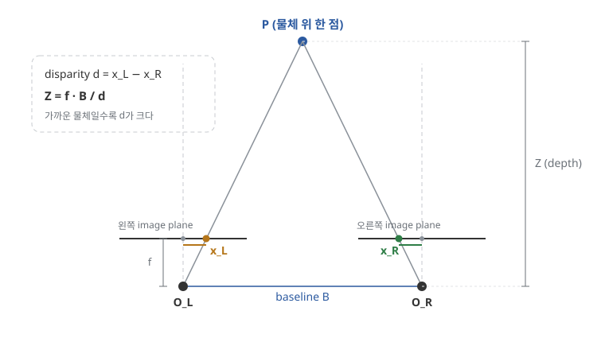
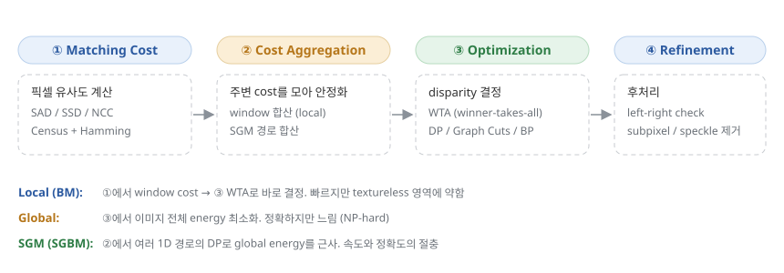
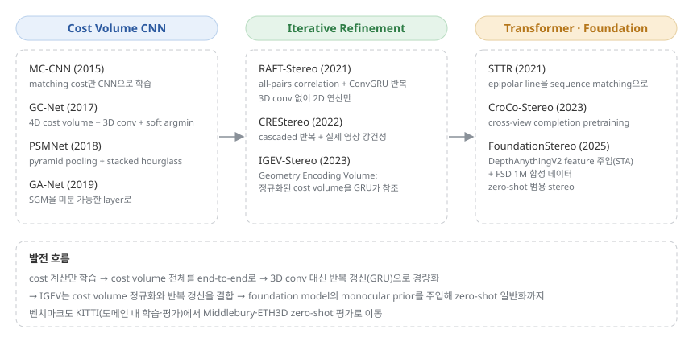

> 두 장의 이미지로 depth를 복원하는 stereo matching을 처음부터 정리한다. 기하 원리 → 고전 알고리즘(Block Matching, SGM/OpenCV SGBM) → 학습 기반(cost volume CNN, RAFT-Stereo, IGEV) → transformer·foundation model 기반(FoundationStereo) 순으로, 각 방법의 수식과 설계 그리고 서로의 차이를 살펴본다.

## 1. Stereo Matching의 원리

### 1.1 문제 정의

stereo matching은 **같은 장면을 수평으로 떨어진 두 카메라로 찍은 이미지 쌍에서, 왼쪽 이미지의 각 픽셀이 오른쪽 이미지의 어디에 대응하는지** 찾는 문제다. 대응만 찾으면 depth는 기하학이 공짜로 준다.

두 카메라가 **rectification**(두 이미지를 같은 평면에 재투영해 epipolar line을 수평 스캔라인에 맞추는 정렬)되어 있다고 하자. 그러면 왼쪽 이미지의 픽셀 $$(x, y)$$ 의 대응점은 오른쪽 이미지의 **같은 행** $$y$$ 위에만 존재한다. 2D 탐색이 1D 탐색으로 줄어드는 것이 stereo matching의 출발점이다. epipolar geometry의 유도는 [3D Reconstruction 기하 편]()에서 다뤘다.

### 1.2 Disparity와 Depth

왼쪽 이미지에서 $$x_{L}$$, 오른쪽 이미지에서 $$x_{R}$$ 에 맺힌 대응쌍의 좌표 차이를 **disparity**라 한다.

$$
d = x_{L} - x_{R}
$$

카메라 중심 $$O_{L}$$, $$O_{R}$$ 사이 거리(baseline)를 $$B$$, focal length를 $$f$$ 라 하면, 닮은 삼각형에서 점 $$P$$ 의 depth $$Z$$ 는

$$
Z = \frac{f \cdot B}{d}
$$

가 된다. 삼각형 $$P O_{L} O_{R}$$ 과 두 투영점이 만드는 삼각형의 비례에서 $$\frac{B}{Z} = \frac{d}{f}$$ 가 나오는 것이다. 이 식에서 두 가지 성질이 따라온다.

- **가까운 물체일수록 disparity가 크다.** $$Z \propto 1/d$$ 이므로 disparity map은 사실상 역수 스케일의 depth map이다.
- **멀수록 오차가 커진다.** $$Z$$ 를 $$d$$ 로 미분하면 $$\left\lvert \Delta Z \right\rvert = \frac{Z^{2}}{fB}\left\lvert \Delta d \right\rvert$$. 같은 disparity 오차 $$\Delta d$$ 라도 depth 오차는 **거리의 제곱**에 비례해 커진다. baseline $$B$$ 를 키우면 오차가 줄지만, 두 시점의 겹침이 줄고 occlusion이 늘어나는 trade-off가 있다.

### 1.3 왜 어려운가

원리는 단순하지만 "대응점 찾기" 자체가 어렵다. 고전·학습 기반을 가리지 않고 모든 방법이 싸우는 난제는 같다.

- **Textureless 영역**: 흰 벽처럼 무늬가 없으면 어느 위치나 똑같이 생겨 매칭이 모호하다
- **반복 패턴**: 창문, 타일처럼 같은 패턴이 반복되면 여러 위치가 동시에 잘 맞는다
- **Occlusion**: 한쪽 이미지에만 보이는 영역은 대응점 자체가 없다
- **비램버시안 표면**: 유리·금속처럼 시점에 따라 겉모습이 변하는 표면은 두 이미지에서 다르게 보인다
- **얇은 구조와 경계**: 물체 경계에서 disparity가 불연속으로 점프해, 스무딩을 걸면 경계가 뭉개진다

## 2. 고전 알고리즘 기반 Stereo Matching

### 2.1 4단계 분류 체계

Scharstein & Szeliski의 고전적 분류에 따르면 stereo 알고리즘은 네 단계의 조합으로 나뉜다. ① matching cost 계산, ② cost aggregation, ③ disparity 계산/최적화, ④ refinement다.

### 2.2 Matching Cost

픽셀 $$p=(x,y)$$ 가 disparity $$d$$ 를 가질 때의 비용 $$C(p, d)$$, 즉 왼쪽 $$(x,y)$$ 와 오른쪽 $$(x-d,y)$$ 가 얼마나 다른지를 정의해야 한다. window $$W$$ 를 두고 계산하는 대표적인 cost들:

$$
C_{\text{SAD}}(p,d)=\sum_{q\in W(p)}\left\lvert I_{L}(q)-I_{R}(q-d) \right\rvert
$$

$$
C_{\text{SSD}}(p,d)=\sum_{q\in W(p)}\left(I_{L}(q)-I_{R}(q-d)\right)^{2}
$$

여기서 $$I_{L}$$, $$I_{R}$$ 은 좌우 이미지의 밝기, $$q-d$$ 는 $$q$$ 를 $$x$$ 방향으로 $$d$$ 만큼 옮긴 픽셀이다. SAD(절대차 합)와 SSD(제곱차 합)는 빠르지만 좌우 카메라의 노출·조명 차이에 약하다. 이를 보완하는 것이 정규화 상관계수다.

$$
C_{\text{NCC}}(p,d)=-\frac{\sum_{q\in W}\left(I_{L}(q)-\bar{I}_{L}\right)\left(I_{R}(q-d)-\bar{I}_{R}\right)}{\sqrt{\sum_{q\in W}\left(I_{L}(q)-\bar{I}_{L}\right)^{2}\;\sum_{q\in W}\left(I_{R}(q-d)-\bar{I}_{R}\right)^{2}}}
$$

$$\bar{I}_{L}$$, $$\bar{I}_{R}$$ 은 window 안 평균 밝기다. 평균을 빼고 표준편차로 나누므로 밝기의 선형 변화(gain·offset)에 불변이다.

실전에서 가장 널리 쓰이는 것은 **Census transform**이다. 각 픽셀을 "window 안 이웃들이 중심보다 밝은지"의 비트열로 인코딩한다.

$$
T(p)=\bigotimes_{q\in W(p)}\xi\left(I(p), I(q)\right),\qquad \xi(a,b)=\begin{cases}1 & b<a\\ 0 & \text{otherwise}\end{cases}
$$

$$\bigotimes$$ 는 비트 연결(concatenation)이다. cost는 두 비트열의 **Hamming distance**(다른 비트 수)로 정의한다. 밝기의 절대값이 아니라 **상대적 순서**만 쓰므로 radiometric 변화에 매우 강건해, SGM 계열 구현 대부분이 Census를 쓴다.

### 2.3 Local 방법: Block Matching (OpenCV StereoBM)

가장 단순한 전략은 **winner-takes-all(WTA)**: 각 픽셀에서 window cost를 계산하고, 탐색 범위 $$[0, D_{\max}]$$ 에서 cost가 최소인 disparity를 고른다.

$$
d^{*}(p)=\arg\min_{d\in[0, D_{\max}]} C(p,d)
$$

OpenCV의 `StereoBM`이 이 방식이다. Sobel 기반 prefilter로 텍스처를 강조한 뒤 SAD window matching을 하고, 후처리로 신뢰도가 낮은 픽셀을 걸러낸다.

- **uniqueness ratio**: 최솟값 cost가 2등 cost보다 일정 비율 이상 좋지 않으면(매칭이 모호하면) 무효 처리
- **texture threshold**: 텍스처가 부족한 window는 무효 처리
- **speckle filter**: 고립된 작은 disparity 덩어리 제거

CPU에서도 실시간으로 돌 만큼 빠르지만, 한계가 뚜렷하다. window 전체가 같은 disparity를 갖는다고 암묵적으로 가정하므로 **물체 경계에서 전경이 부풀어 오르는 fattening**이 생기고, textureless 영역은 거의 전멸한다.

### 2.4 Global 방법: Energy 최소화

local 방법의 문제는 픽셀마다 독립적으로 결정한다는 점이다. global 방법은 disparity map $$D$$ 전체에 대한 energy를 세우고 한꺼번에 최소화한다.

$$
E(D)=\sum_{p}C\left(p, D_{p}\right)+\sum_{(p,q)\in\mathcal{N}}V\left(D_{p}, D_{q}\right)
$$

첫 항은 data term(각 픽셀이 자기 cost가 낮은 disparity를 갖게), 둘째 항은 smoothness term(이웃 픽셀 쌍 $$\mathcal{N}$$ 이 비슷한 disparity를 갖게)이다. $$V$$ 로는 절단된(truncated) 페널티를 써서 물체 경계의 disparity 점프는 허용한다. 이 energy의 2D 최소화는 일반적으로 NP-hard라, Graph Cuts나 Belief Propagation 같은 근사 최적화를 쓴다. 정확하지만 느려서 실시간 응용에는 부적합했다.

### 2.5 Semi-Global Matching (SGM)

SGM(Hirschmüller, 2005)은 "2D 최적화는 못 풀지만 **1D 최적화는 DP로 정확히 풀 수 있다**"는 관찰에서 출발한다. 2D energy를 직접 풀지 않고, 여러 방향의 1D 경로를 따라 DP를 돌린 결과를 합산해 근사한다.

energy는 smoothness를 두 단계로 나눈 형태다.

$$
E(D)=\sum_{p}\Big(C(p,D_{p})+\sum_{q\in\mathcal{N}_{p}}P_{1}\,\mathbf{1}\left[\left\lvert D_{p}-D_{q} \right\rvert=1\right]+\sum_{q\in\mathcal{N}_{p}}P_{2}\,\mathbf{1}\left[\left\lvert D_{p}-D_{q} \right\rvert>1\right]\Big)
$$

$$\mathbf{1}[\cdot]$$ 은 조건이 참이면 1인 indicator다. 이웃과 disparity가 1만 차이 나는 완만한 변화에는 작은 페널티 $$P_{1}$$ 을, 그보다 큰 점프에는 큰 페널티 $$P_{2}$$ 를 준다. 기울어진 표면(disparity가 서서히 변함)은 싸게 허용하고 경계의 큰 점프는 억제하되 금지하지는 않는 설계다.

방향 $$\mathbf{r}$$ 의 경로를 따라 픽셀 $$p$$, disparity $$d$$ 에 누적되는 cost는 재귀식으로 계산한다.

$$
L_{\mathbf{r}}(p,d)=C(p,d)+\min\Big(L_{\mathbf{r}}(p-\mathbf{r},d),\; L_{\mathbf{r}}(p-\mathbf{r},d-1)+P_{1},\; L_{\mathbf{r}}(p-\mathbf{r},d+1)+P_{1},\; \min_{i}L_{\mathbf{r}}(p-\mathbf{r},i)+P_{2}\Big)-\min_{k}L_{\mathbf{r}}(p-\mathbf{r},k)
$$

$$p-\mathbf{r}$$ 은 경로에서 한 칸 이전 픽셀이다. min 안의 네 항은 각각 "이전 픽셀도 $$d$$", "$$d\pm1$$ 에서 옴($$P_{1}$$)", "먼 disparity에서 점프($$P_{2}$$)"를 뜻하고, 마지막에 이전 픽셀의 최솟값을 빼는 것은 누적값이 무한히 커지는 것을 막는 정규화다(최솟값의 위치는 바뀌지 않는다). 8방향(또는 16방향) 경로의 누적 cost를 더해

$$
S(p,d)=\sum_{\mathbf{r}}L_{\mathbf{r}}(p,d)
$$

를 만들고, 픽셀별로 $$S$$ 가 최소인 $$d$$ 를 고른다. 1D DP를 여러 방향으로 돌리는 것뿐이라 복잡도가 $$O(W\!\cdot\!H\!\cdot\!D_{\max})$$ 로 선형이고, 결과는 global 방법에 근접한다. 지금도 임베디드·로봇 실무에서 가장 널리 쓰이는 고전 알고리즘이다.

**OpenCV StereoSGBM**은 SGM의 변형 구현으로 다음 특징이 있다.

- cost로 mutual information(원논문) 대신 **Birchfeld-Tomasi subpixel cost + block 단위 SAD**를 쓴다
- 기본 mode는 5방향(메모리 절약), `MODE_HH`가 원논문의 8방향
- 페널티 권장값은 채널 수 $$c$$, block 크기 $$w$$ 에 대해 $$P_{1}=8\,c\,w^{2}$$, $$P_{2}=32\,c\,w^{2}$$
- **left-right consistency check**: 좌→우로 구한 disparity와 우→좌로 구한 disparity가 일정 차이(`disp12MaxDiff`) 이상이면 occlusion으로 보고 무효 처리
- **subpixel 보간**: 최솟값 이웃의 cost 세 점에 포물선을 맞춰 정수 이하 정밀도를 얻는다

$$
d_{\text{sub}}=d^{*}+\frac{C(d^{*}-1)-C(d^{*}+1)}{2\left(C(d^{*}-1)-2C(d^{*})+C(d^{*}+1)\right)}
$$

분자는 좌우 cost의 기울기, 분모는 곡률에 해당하며, 최솟값 주변을 2차 함수로 근사했을 때의 꼭짓점 위치다.

## 3. 학습 기반 Stereo Matching

### 3.1 Matching Cost의 학습: MC-CNN

딥러닝의 첫 진입점은 pipeline 전체가 아니라 **① matching cost 단계만**이었다. MC-CNN(2015)은 좌우 patch 쌍이 대응인지 아닌지를 판별하는 CNN을 학습해 $$C(p,d)$$ 를 만들고, 이후의 aggregation·최적화·후처리는 고전 방식(cross-based aggregation + SGM)을 그대로 썼다. 손으로 설계한 SAD·Census보다 훨씬 좋은 cost를 얻어 KITTI 상위권을 휩쓸었고, "cost는 학습이 이긴다"를 보여줬다.

### 3.2 End-to-End Cost Volume: GC-Net과 PSMNet

GC-Net(2017)부터는 pipeline 전체가 하나의 미분 가능한 network가 된다. 구조는 이후 계열의 표준이 됐다.

1. **Feature 추출**: 공유 weight의 CNN으로 좌우 이미지에서 feature map $$f_{L}, f_{R}$$ 을 뽑는다(보통 1/4 해상도)
2. **Cost volume 구성**: 각 disparity 후보 $$d$$ 마다 $$f_{L}(x,y)$$ 와 $$f_{R}(x-d,y)$$ 를 **concat**해 4D volume $$(높이\times너비\times disparity\times채널)$$ 을 만든다
3. **3D convolution 정규화**: 4D volume을 3D conv 스택(hourglass)으로 필터링한다. 이 단계가 고전의 ② aggregation + ③ optimization을 통째로 대체한다. 공간과 disparity 축을 함께 보므로 문맥에 따른 스무딩을 학습으로 얻는다
4. **Soft argmin**: 정규화된 cost $$c_{d}$$ 에서 미분 가능하게 disparity를 회귀한다

$$
\hat{d}=\sum_{d=0}^{D_{\max}}d\cdot\operatorname{softmax}\left(-c_{d}\right)
$$

cost가 낮은 disparity일수록 큰 확률을 갖게 한 뒤 기댓값을 취하는 것으로, argmin의 미분 가능한 근사이자 자연스러운 subpixel 보간이다. PSMNet(2018)은 여기에 spatial pyramid pooling(넓은 문맥의 feature)과 stacked hourglass 3D conv를 더해 정확도를 끌어올렸고, GA-Net(2019)은 SGM의 경로 합산 자체를 미분 가능한 semi-global aggregation layer로 만들어 3D conv를 대체했다.

이 계열의 약점은 **3D conv의 비용**이다. 메모리와 연산이 $$D_{\max}$$ 에 비례해 커서 고해상도·큰 disparity 범위에 부담이 크고, 학습한 disparity 범위를 벗어나면 일반화가 어렵다.

### 3.3 RAFT-Stereo: 반복 갱신으로의 전환

RAFT-Stereo(2021)는 optical flow의 RAFT 구조를 stereo로 가져와, **3D conv 없이 반복 갱신(iterative refinement)** 으로 disparity를 푼다.

**All-pairs correlation.** 좌우 feature의 내적으로 correlation volume을 만든다. rectified stereo에서는 같은 행끼리만 매칭하면 되므로

$$
\mathbf{C}(x, y, x')=\left\langle f_{L}(x,y),\; f_{R}(x',y)\right\rangle
$$

즉 왼쪽의 $$x$$ 와 오른쪽 같은 행의 모든 $$x'$$ 사이 유사도다(3D volume). 이를 disparity 축으로 average pooling해 4단계 **correlation pyramid**를 만들어 넓은 범위의 대응을 값싸게 조회할 수 있게 한다.

**GRU 반복 갱신.** disparity 추정 $$d_{0}=0$$ 에서 시작해, 매 반복 $$k$$ 마다

1. 현재 추정 $$d_{k}$$ 주변의 correlation 값을 pyramid에서 **lookup**하고
2. correlation, 현재 disparity, context feature를 입력으로 ConvGRU가 보정량을 출력한다

$$
d_{k+1}=d_{k}+\Delta d_{k}
$$

GRU의 hidden state가 "지금까지 본 것"의 기억 역할을 해서, 반복이 진행될수록 모호한 영역이 주변 문맥으로 채워진다. RAFT-Stereo는 1/32까지 내려가는 **multilevel GRU**로 receptive field를 키워 textureless 영역의 전파를 돕고, 최종 disparity는 낮은 해상도 출력을 **convex upsampling**(주변 9개 coarse 값의 학습된 가중 평균)으로 원해상도에 올린다.

이 설계의 이점은 두 가지다. 3D conv가 없어 **disparity 범위에 대한 hard limit이 없고**, 합성 데이터(SceneFlow)로만 학습해도 실제 데이터로의 **zero-shot 일반화**가 기존 방법보다 크게 좋았다. 반복 횟수로 정확도와 속도를 조절할 수 있는 것도 실용적이다.

### 3.4 IGEV-Stereo: Cost Volume과 반복 갱신의 결합

RAFT-Stereo의 correlation volume은 정규화를 전혀 거치지 않은 raw 유사도라, 모호한 영역에서는 노이즈투성이다. 그 부담을 GRU 반복이 모두 떠안으므로 수렴이 느리다. IGEV-Stereo(2023)의 답은 **cost volume 계열의 정규화를 가볍게 되살려서 GRU에게 좋은 지도를 주자**는 것이다.

**Geometry Encoding Volume (GEV).** group-wise correlation으로 cost volume을 만든다. feature 채널을 $$N_{g}$$ 개 그룹으로 나누고 그룹별 내적을 취한다.

$$
\mathbf{C}_{\text{gwc}}(g,d,x,y)=\frac{N_{g}}{N_{c}}\left\langle f_{L}^{g}(x,y),\; f_{R}^{g}(x-d,y)\right\rangle
$$

$$N_{c}$$ 는 전체 채널 수, $$f^{g}$$ 는 $$g$$ 번째 그룹의 feature다. 단일 내적보다 풍부한 유사도 표현을 주면서 concat volume보다 가볍다. 이 volume을 **경량 3D 정규화 network**(작은 hourglass)로 필터링한 것이 GEV다. 정규화 덕에 모호한 영역·occlusion에서도 비교적 매끈한 기하 정보를 담지만, 과도한 스무딩으로 디테일은 뭉갤 수 있다. 그래서 raw한 all-pairs correlation volume과 **concat해 Combined GEV**를 만든다. 서로의 약점(노이즈 ↔ 과스무딩)을 보완하는 조합이다.

**시작점과 반복.** GEV에 soft argmin을 적용해 **초기 disparity $$d_{0}$$ 를 바로 회귀**한다. RAFT-Stereo처럼 0에서 시작하는 것이 아니라 이미 좋은 추정에서 출발하므로 반복 수가 크게 준다. 이후는 RAFT 방식대로 ConvGRU가 Combined GEV를 lookup하며 $$d_{k+1}=d_{k}+\Delta d_{k}$$ 로 정제한다. 발표 당시 KITTI 1위, SceneFlow→실데이터 zero-shot에서도 최상위권이었고, 이후 후속(IGEV++ 등)과 수많은 파생을 낳으며 사실상 현재 표준 아키텍처가 됐다.

## 4. Transformer·Foundation Model 기반

### 4.1 STTR: Sequence Matching으로 보는 Stereo

STTR(2021)는 stereo matching을 "cost volume 위 최적화"가 아니라 **epipolar line 위 두 sequence의 매칭 문제**로 재정의했다. 같은 행의 좌우 픽셀 feature들을 transformer의 self-attention(행 내부 문맥)과 cross-attention(좌우 상호작용)으로 갱신한 뒤, attention 유사도에 **optimal transport**를 적용해 매칭한다. 한 픽셀이 최대 하나의 대응만 갖는 **uniqueness 제약**을 자연스럽게 걸 수 있고, 매칭 확률에서 occlusion 여부도 함께 추정된다. 고정된 disparity 범위 없이 동작한다는 점도 cost volume 계열과의 차별점이다. attention의 전역 receptive field 덕에 반복 패턴·textureless에 강하지만, 계산량이 커 고해상도에서 무겁다.

### 4.2 CroCo-Stereo: Pretraining의 힘

CroCo(2022~2023)는 "같은 장면의 다른 시점 이미지로 가려진 부분을 복원"하는 **cross-view completion**을 pretext task로 대규모 pretraining한 ViT다. 한 이미지의 patch 일부를 masking하고 다른 시점 이미지를 참조해 복원하려면 시점 간 대응을 암묵적으로 배워야 하므로, 기하 대응에 특화된 표현이 학습된다. 이를 finetuning한 CroCo-Stereo는 cost volume 없이 순수 transformer로 당시 최상위권 성능을 냈다. task 특화 아키텍처 없이 **pretraining이 기하 문제를 푼다**는 것을 보인 사례로, foundation model 흐름의 전조다.

### 4.3 Monocular Depth Foundation Model이라는 재료

한편 DepthAnything, Depth Pro 같은 **monocular depth foundation model**들이 등장했다. 한 장의 이미지에서 상대 depth를 놀랍도록 강건하게 추정하지만, 단안이라 **절대 스케일이 모호**하다. stereo는 정확한 metric 스케일을 주지만 위 난제들(textureless, 반사, occlusion)에 취약하다. 그렇다면 monocular prior의 강건함과 stereo의 metric 정확도를 결합하면 어떨까. 이 발상이 최신 stereo 연구의 중심 흐름이다.

### 4.4 FoundationStereo

FoundationStereo(CVPR 2025)는 이 결합을 본격적으로 구현해 **zero-shot으로 어디서나 동작하는 stereo foundation model**을 목표로 한다. 뼈대는 IGEV 계열(cost volume + GRU 반복)이고, 세 가지 축을 더했다.

- **Side-Tuning Adapter (STA)**: frozen한 DepthAnythingV2 ViT의 feature를 가벼운 CNN adapter로 stereo feature에 주입한다. monocular foundation model이 가진 "단안으로도 기하를 아는" prior가 textureless·반사 영역의 모호함을 풀어준다. foundation model 자체는 학습하지 않으므로 그 일반화 능력이 보존된다
- **Attentive Hybrid Cost Filtering (AHCF)**: cost volume 정규화를 두 갈래로 강화한다. **APC**(Axial-Planar Convolution)는 3D conv를 공간축과 disparity 축으로 분리한 separable 3D conv로, 큰 kernel을 감당 가능한 비용으로 쓴다. **Disparity Transformer**는 disparity 축을 따라 self-attention을 걸어 volume 전체 문맥으로 모호성을 정리한다
- **FSD 데이터셋**: 100만 쌍 규모의 고품질 합성 stereo 데이터(FSD)를 만들고, 학습된 모델로 데이터를 다시 평가해 나쁜 샘플을 걸러내는 **self-curation**을 돌렸다

그 결과 학습에 실제 도메인 데이터를 전혀 쓰지 않고도 Middlebury·ETH3D·KITTI zero-shot에서 도메인 내 학습 모델들에 필적하거나 능가하는, "튜닝 없이 갖다 쓰는" stereo를 달성했다. 상세한 수식·실험은 [FoundationStereo 논문리뷰]()에서 다뤘다.

## 5. 방법 비교

| 방법 | 연도 | 접근 | 핵심 설계 | 강점 | 한계 |
| --- | --- | --- | --- | --- | --- |
| StereoBM | – | local | window SAD + WTA | CPU 실시간, 단순 | textureless 전멸, 경계 fattening |
| SGM / SGBM | 2005 | semi-global | 다방향 1D DP 합산 | 속도·정확도 절충, 임베디드 표준 | 텍스처 의존, 파라미터 튜닝 필요 |
| MC-CNN | 2015 | cost 학습 | patch 유사도 CNN | 고전 대비 cost 품질 급상승 | pipeline 나머지는 고전 그대로 |
| GC-Net / PSMNet | 2017~18 | cost volume CNN | 4D volume + 3D conv + soft argmin | end-to-end, 높은 정확도 | 3D conv 비용, 고정 disparity 범위 |
| RAFT-Stereo | 2021 | 반복 갱신 | all-pairs correlation + ConvGRU | 범위 제한 없음, zero-shot 일반화 | raw correlation이라 수렴 느림 |
| IGEV-Stereo | 2023 | volume + 반복 | 정규화된 GEV로 초기화 + GRU 정제 | 빠른 수렴, 현 표준 구조 | 여전히 도메인 갭 존재 |
| STTR | 2021 | transformer | sequence matching + optimal transport | uniqueness·occlusion 명시적 처리 | 계산량, 고해상도 부담 |
| CroCo-Stereo | 2023 | pretraining | cross-view completion ViT | 대응 관계를 pretraining으로 학습 | task 구조 없이 무거움 |
| FoundationStereo | 2025 | foundation | monocular prior 주입(STA) + AHCF + FSD | zero-shot 범용, 튜닝 불필요 | 모델 크기·추론 비용 |

**선택 가이드**

- **임베디드·CPU 실시간**: SGBM. 여전히 대체재가 마땅치 않다. 파라미터($$P_{1}, P_{2}$$, uniqueness, speckle)를 장면에 맞게 튜닝하는 것이 핵심이다
- **GPU가 있고 대상 도메인의 학습 데이터가 있을 때**: IGEV 계열. 정확도·속도 균형이 가장 좋다
- **도메인을 모르는 범용 제품, 튜닝 없이 배포**: FoundationStereo류 zero-shot 모델. 추론 비용을 감당할 수 있다면 강건함이 압도적이다
- **disparity 범위가 크거나 가변인 고해상도 입력**: RAFT 계열(범위 무제한)이나 transformer 계열

## 정리

stereo matching의 역사는 "대응의 모호함을 무엇으로 해소하는가"의 역사다. 고전 알고리즘은 **손으로 설계한 cost와 smoothness 가정**(SGM의 $$P_{1}, P_{2}$$)으로, cost volume CNN은 **3D conv가 학습한 문맥**으로, RAFT·IGEV는 **반복 갱신과 정규화된 volume의 결합**으로, foundation model 세대는 **대규모 데이터에서 배운 단안 기하 prior**로 그 모호함을 푼다. 도구는 바뀌어도 $$Z=fB/d$$ 라는 기하와, textureless·반사·occlusion이라는 적은 그대로다.

- 기하 배경: [3D Reconstruction: 카메라 기하와 epipolar geometry]()
- 최신 방법 상세: [FoundationStereo 논문리뷰]()
