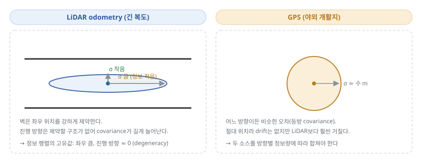
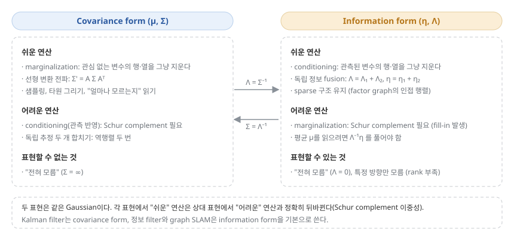
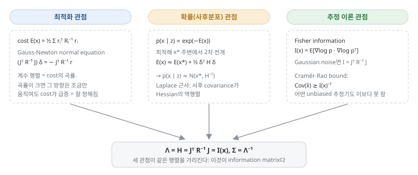

> localization이나 6DoF pose 추정 결과를 여러 센서·모듈에서 받아 합치려면, 각 추정치가 "얼마나 믿을 만한지"를 같은 언어로 표현해야 한다. 이 시리즈는 그 언어인 Gaussian 불확실성에서 출발해 Kalman filter, SE(3) 위의 pose 불확실성, Covariance Intersection까지 정리한다. 1편은 기초인 covariance와 information matrix, 그리고 least squares의 Hessian이 왜 information matrix와 같은 것인지 다룬다.

## 1. 왜 불확실성을 다뤄야 하는가

로봇의 위치를 추정하는 소스는 하나가 아니다. wheel odometry, IMU, LiDAR odometry, visual odometry, GPS, marker 기반 pose 추정 등이 각자 "나는 로봇이 여기 있다고 본다"는 값을 낸다. 이 값들을 합치는 가장 단순한 방법은 평균이지만, 평균은 모든 소스를 똑같이 믿는다는 뜻이다. 실제로는 GPS는 수 m 오차가 나고 LiDAR odometry는 cm 단위지만 시간이 지나면 drift가 쌓인다. 게다가 오차는 방향마다 다르다. 긴 복도에서 LiDAR odometry는 좌우 위치는 정확히 알지만 진행 방향으로는 거의 아무것도 모른다.

그래서 각 추정치에는 값뿐 아니라 **불확실성**이 붙어야 하고, fusion은 그 불확실성으로 가중치를 정해야 한다. 이 불확실성을 표현하는 표준 도구가 **Gaussian 분포**이고, Gaussian을 나타내는 두 가지 방식이 **covariance**와 **information matrix**다. 이 둘의 관계와 성질을 알아야 Kalman filter(2편)도, pose fusion(3편)도, Covariance Intersection(4편)도 한 줄로 이해된다.

## 2. Gaussian 분포와 Covariance

### 2.1 다변량 Gaussian

추정하려는 상태를 $$x \in \mathbb{R}^n$$ 이라 하자. 2D 위치라면 $$n = 2$$, 6DoF pose라면 (일단 벡터로 다룰 수 있다고 가정하고) $$n = 6$$ 이다. 다변량 Gaussian 분포는 다음과 같다.

$$
p(x) = \mathcal{N}(x;\, \mu, \Sigma) = \frac{1}{\sqrt{(2\pi)^n \det \Sigma}} \exp\!\left( -\frac{1}{2} (x - \mu)^\top \Sigma^{-1} (x - \mu) \right)
$$

- $$\mu \in \mathbb{R}^n$$: 평균(mean). 추정치의 "값"에 해당한다
- $$\Sigma \in \mathbb{R}^{n \times n}$$: **covariance 행렬**. 대칭이고 양의 정부호(positive definite)다. 대각 원소 $$\Sigma_{ii}$$ 는 $$i$$ 번째 성분의 분산 $$\sigma_i^2$$, 비대각 원소 $$\Sigma_{ij}$$ 는 $$i, j$$ 성분이 함께 변하는 정도다
- $$\det \Sigma$$: 행렬식. 정규화 상수에만 들어가고, 분포의 모양은 지수 안의 이차식이 결정한다

지수 안의 이차식은 **Mahalanobis 거리**의 제곱이다.

$$
d_M^2(x) = (x - \mu)^\top \Sigma^{-1} (x - \mu)
$$

이 값은 "$$x$$ 가 평균에서 얼마나 떨어져 있는가"를 각 방향의 표준편차 단위로 잰 것이다. 분산이 큰 방향으로는 멀리 가도 $$d_M$$ 이 작고, 분산이 작은 방향으로는 조금만 가도 $$d_M$$ 이 커진다. $$d_M^2 = c$$ 인 점들의 집합이 흔히 그리는 **confidence ellipse**(2D면 타원, 3D면 타원체)다.

### 2.2 Covariance의 기하

$$\Sigma$$ 는 대칭 양의 정부호이므로 고유분해가 된다.

$$
\Sigma = V \operatorname{diag}(\lambda_1, \dots, \lambda_n) V^\top
$$

- $$V$$: 열이 고유벡터 $$v_1, \dots, v_n$$ 인 직교행렬. 타원의 **주축 방향**
- $$\lambda_i > 0$$: 고유값. 그 축 방향의 분산이므로 타원 반지름은 $$\sqrt{\lambda_i}$$ 에 비례

즉 covariance 타원은 "어느 방향으로 얼마나 모르는지"를 그린 그림이다. 앞의 복도 예시에서 LiDAR odometry의 $$\Sigma$$ 는 진행 방향 고유값이 크고 좌우 고유값이 작은, 길쭉한 타원이 된다. GPS는 고유값이 비슷한 원에 가깝다.

### 2.3 선형 변환과 covariance 전파

Gaussian 확률변수를 선형 변환해도 Gaussian이다. $$y = A x + b$$ 이고 $$x \sim \mathcal{N}(\mu, \Sigma)$$ 이면

$$
y \sim \mathcal{N}(A\mu + b,\; A \Sigma A^\top)
$$

- $$A \in \mathbb{R}^{m \times n}$$: 변환 행렬, $$b \in \mathbb{R}^m$$: 상수 이동
- $$A \Sigma A^\top$$: 변환된 covariance. 이 형태는 이 시리즈 내내 등장한다(Kalman prediction, pose 합성의 불확실성 전파, adjoint 변환 모두 이 꼴이다)

비선형 함수 $$y = g(x)$$ 이면 $$A$$ 자리에 Jacobian $$G = \partial g / \partial x$$ 를 넣어 1차 근사한다. 이것이 **first-order covariance propagation**이고, EKF와 SE(3) 불확실성 전파(3편)의 기반이다.

## 3. Information Matrix

### 3.1 정의: Canonical form

같은 Gaussian을 다르게 매개화할 수 있다. 지수 안의 이차식을 전개하면

$$
-\frac{1}{2}(x-\mu)^\top \Sigma^{-1} (x-\mu) = -\frac{1}{2} x^\top \Sigma^{-1} x + x^\top \Sigma^{-1} \mu + \text{const}
$$

이므로 다음 두 양으로 분포가 완전히 정해진다.

$$
\Lambda = \Sigma^{-1}, \qquad \eta = \Sigma^{-1} \mu = \Lambda \mu
$$

- $$\Lambda \in \mathbb{R}^{n \times n}$$: **information matrix**(precision matrix). covariance의 역행렬
- $$\eta \in \mathbb{R}^n$$: **information vector**. 평균에 information matrix를 곱한 것

이 $$(\eta, \Lambda)$$ 표현을 **canonical form** 또는 **information form**이라 하고, $$(\mu, \Sigma)$$ 를 **moment form** 또는 **covariance form**이라 한다. 정보 형태에서 분포는

$$
p(x) \propto \exp\!\left( -\frac{1}{2} x^\top \Lambda x + \eta^\top x \right)
$$

이고, 평균이 필요하면 선형계 $$\Lambda \mu = \eta$$ 를 풀어 $$\mu = \Lambda^{-1} \eta$$ 로 얻는다.

### 3.2 무엇이 "정보"인가

$$\Lambda$$ 의 고유벡터는 $$\Sigma$$ 와 같고 고유값은 역수 $$1/\lambda_i$$ 다. 따라서 **information matrix의 고유값이 큰 방향은 분산이 작은, 즉 잘 아는 방향**이다. 복도 예시에서 LiDAR odometry의 $$\Lambda$$ 는 좌우 방향 고유값이 크고 진행 방향 고유값이 0에 가깝다. 고유값 0은 "그 방향은 전혀 모른다"는 뜻이고, 이는 covariance로는 무한대라서 표현할 수 없다. **"모름"을 유한한 숫자로 쓸 수 있다**는 것이 information form의 첫 번째 장점이다. ICP나 pose graph에서 말하는 **degeneracy**는 정확히 이 상황, 즉 $$\Lambda$$ 의 rank가 부족하거나 최소 고유값이 매우 작은 상황을 가리킨다.

### 3.3 두 표현의 연산 이중성

같은 분포인데 왜 두 가지를 다 쓰는가. 어떤 연산은 covariance에서 쉽고, 다른 연산은 information에서 쉽기 때문이다. 상태를 두 블록 $$x = (x_a, x_b)$$ 로 나눠 쓰자.

$$
\mu = \begin{bmatrix} \mu_a \\ \mu_b \end{bmatrix}, \quad
\Sigma = \begin{bmatrix} \Sigma_{aa} & \Sigma_{ab} \\ \Sigma_{ba} & \Sigma_{bb} \end{bmatrix}, \quad
\Lambda = \begin{bmatrix} \Lambda_{aa} & \Lambda_{ab} \\ \Lambda_{ba} & \Lambda_{bb} \end{bmatrix}
$$

**Marginalization**(주변화). $$x_b$$ 에 관심이 없어 적분해 없애고 $$p(x_a)$$ 만 남기는 연산이다.

- covariance form: $$p(x_a) = \mathcal{N}(\mu_a, \Sigma_{aa})$$. **해당 블록을 그냥 떼면 된다**
- information form: $$\Lambda_a' = \Lambda_{aa} - \Lambda_{ab} \Lambda_{bb}^{-1} \Lambda_{ba}$$, $$\eta_a' = \eta_a - \Lambda_{ab}\Lambda_{bb}^{-1}\eta_b$$. **Schur complement** 계산이 필요하다

**Conditioning**(조건화). $$x_b$$ 의 값을 알게 되어 $$p(x_a \mid x_b)$$ 를 구하는 연산이다.

- information form: $$\Lambda_{a \mid b} = \Lambda_{aa}$$, $$\eta_{a \mid b} = \eta_a - \Lambda_{ab} x_b$$. **해당 블록을 그냥 떼면 된다**
- covariance form: $$\Sigma_{a \mid b} = \Sigma_{aa} - \Sigma_{ab}\Sigma_{bb}^{-1}\Sigma_{ba}$$. **Schur complement**가 필요하다

여기서 $$\Lambda_{ab}\Lambda_{bb}^{-1}\Lambda_{ba}$$ 같은 항이 **Schur complement**다. 큰 행렬에서 한 블록을 소거할 때 나머지 블록에 남는 보정항으로, 두 표현에서 역할이 정확히 뒤바뀐다. 한쪽에서 "떼기"인 연산이 다른 쪽에서는 "Schur complement"다.

| 연산 | Covariance form $$(\mu, \Sigma)$$ | Information form $$(\eta, \Lambda)$$ |
| --- | --- | --- |
| marginalization ($$x_b$$ 제거) | 블록 떼기 | Schur complement |
| conditioning ($$x_b$$ 관측) | Schur complement | 블록 떼기 |
| 독립 정보 두 개 합치기 | 역행렬 두 번 | 덧셈 |
| 선형 변환 $$y = Ax$$ | $$A\Sigma A^\top$$ | $$A^{-\top}\Lambda A^{-1}$$ ($$A$$ 가 정방·가역일 때) |
| "전혀 모름" 표현 | 불가 ($$\Sigma = \infty$$) | $$\Lambda = 0$$ |
| SLAM에서의 구조 | dense | sparse (graph 인접 구조) |

### 3.4 독립 정보의 Fusion은 덧셈이다

이 시리즈에서 가장 중요한 한 줄이다. 같은 상태 $$x$$ 에 대한 **서로 독립인** 두 추정치 $$\mathcal{N}(\mu_1, \Sigma_1)$$, $$\mathcal{N}(\mu_2, \Sigma_2)$$ 가 있을 때, 둘을 합친 사후분포는 두 Gaussian의 곱에 비례한다.

$$
p(x \mid 1, 2) \propto \mathcal{N}(x; \mu_1, \Sigma_1)\, \mathcal{N}(x; \mu_2, \Sigma_2)
$$

지수를 더하면 이차항은 $$-\frac{1}{2}x^\top(\Lambda_1 + \Lambda_2)x$$, 일차항은 $$(\eta_1 + \eta_2)^\top x$$ 가 되므로

$$
\Lambda = \Lambda_1 + \Lambda_2, \qquad \eta = \eta_1 + \eta_2
$$

- $$\Lambda_i = \Sigma_i^{-1}$$, $$\eta_i = \Lambda_i \mu_i$$: 각 추정치의 정보 행렬과 정보 벡터
- 합친 결과의 평균은 $$\mu = \Lambda^{-1}\eta = (\Lambda_1 + \Lambda_2)^{-1}(\Lambda_1 \mu_1 + \Lambda_2 \mu_2)$$ 로, **정보 행렬로 가중한 평균**이다

1차원으로 줄이면 분산 $$\sigma_1^2, \sigma_2^2$$ 에 대해

$$
\frac{1}{\sigma^2} = \frac{1}{\sigma_1^2} + \frac{1}{\sigma_2^2}, \qquad
\mu = \frac{\sigma_2^2}{\sigma_1^2 + \sigma_2^2}\mu_1 + \frac{\sigma_1^2}{\sigma_1^2 + \sigma_2^2}\mu_2
$$

가 된다. 분산이 작은(더 정확한) 쪽에 큰 가중치가 가고, 합친 분산은 둘 중 작은 것보다도 더 작아진다. 정보는 쌓인다. 2편의 Kalman filter update는 이 식에 관측 모델을 끼워 넣은 것이고, 4편의 Covariance Intersection은 "독립" 가정이 깨졌을 때 이 덧셈을 어떻게 고쳐야 하는가에 대한 답이다.

### 3.5 SLAM에서 information matrix는 sparse하다

pose graph SLAM이나 bundle adjustment에서 상태 $$x$$ 는 모든 pose(와 landmark)를 이어 붙인 큰 벡터다. 각 측정(odometry edge, loop closure, landmark 관측)은 상태 중 두어 개 변수만 관계시키므로, 3.4의 덧셈으로 쌓인 전체 $$\Lambda$$ 는 **측정이 연결하는 변수 쌍에만 비영 블록**을 가진다. 즉 $$\Lambda$$ 의 sparsity pattern이 곧 factor graph의 인접 구조다. 반면 $$\Sigma = \Lambda^{-1}$$ 는 dense하다. 멀리 떨어진 두 pose도 측정 체인으로 연결돼 있으면 상관이 생기기 때문이다. graph SLAM solver가 covariance가 아니라 information form으로 문제를 세우는 이유가 이것이다.

## 4. Least Squares와 Hessian

localization과 SLAM의 back-end는 대부분 **nonlinear least squares**다. 여기서 나오는 Hessian이 왜 information matrix인지가 이 편의 핵심이다.

### 4.1 MAP 추정은 least squares가 된다

측정 $$z_i$$ 가 상태 $$x$$ 의 함수에 Gaussian noise가 더해진 것이라 하자.

$$
z_i = h_i(x) + n_i, \qquad n_i \sim \mathcal{N}(0, R_i), \qquad i = 1, \dots, m
$$

- $$h_i(\cdot)$$: $$i$$ 번째 측정 모델(예: pose에서 landmark의 예상 픽셀 좌표, 두 pose 사이의 상대 변환)
- $$R_i$$: $$i$$ 번째 측정 noise의 covariance
- $$m$$: 측정 개수

측정들이 서로 독립이면 likelihood는 곱이고, 음의 로그를 취하면 합이 된다.

$$
-\log p(z_1, \dots, z_m \mid x) = \frac{1}{2}\sum_{i=1}^{m} r_i(x)^\top R_i^{-1} r_i(x) + \text{const}, \qquad r_i(x) = z_i - h_i(x)
$$

- $$r_i(x)$$: **residual**. 실제 측정과 예측의 차이

이 합을 $$E(x)$$ 라 하면 likelihood를 최대로 하는 $$x$$ (MLE)는 $$E(x)$$ 를 최소로 하는 $$x$$ 다. 각 항이 residual의 제곱(Mahalanobis 노름)이라 **weighted nonlinear least squares**다. 여기에 사전분포 $$p(x) = \mathcal{N}(\mu_0, \Sigma_0)$$ 가 있으면 $$\frac{1}{2}(x-\mu_0)^\top \Sigma_0^{-1}(x-\mu_0)$$ 항이 하나 더 붙는 MAP 추정이 되는데, 형태는 같다. prior도 "측정 하나"처럼 취급된다.

모든 residual을 세로로 쌓아 $$r(x) \in \mathbb{R}^{M}$$, noise covariance를 블록 대각으로 모아 $$R = \operatorname{blkdiag}(R_1, \dots, R_m)$$ 이라 쓰면

$$
E(x) = \frac{1}{2} r(x)^\top R^{-1} r(x)
$$

### 4.2 Gauss-Newton과 근사 Hessian

$$h_i$$ 가 비선형이라 닫힌 해가 없다. 현재 추정 $$\hat{x}$$ 주변에서 residual을 1차 근사한다.

$$
r(\hat{x} + \delta) \approx r(\hat{x}) + J \delta, \qquad J = \frac{\partial r}{\partial x}\Big\rvert_{\hat{x}} \in \mathbb{R}^{M \times n}
$$

- $$\delta \in \mathbb{R}^n$$: 상태의 작은 갱신량
- $$J$$: residual의 **Jacobian**. $$r = z - h(x)$$ 이므로 $$J = -\partial h / \partial x$$

이를 $$E$$ 에 넣으면 $$\delta$$ 에 대한 이차식이 되고, 미분해서 0으로 놓으면 **normal equation**이 나온다.

$$
(J^\top R^{-1} J)\, \delta = -J^\top R^{-1} r(\hat{x})
$$

좌변의 계수 행렬을 $$H = J^\top R^{-1} J$$ 라 쓴다. 이것이 흔히 "Hessian"이라 부르는 행렬인데, 정확히는 $$E$$ 의 **Gauss-Newton 근사 Hessian**이다. 진짜 Hessian은

$$
\nabla^2 E = J^\top R^{-1} J + \sum_{i} \left( R_i^{-1} r_i \right)^\top \frac{\partial^2 r_i}{\partial x^2}
$$

로 두 번째 항(residual의 2차 미분에 residual 자체가 곱해진 항)이 더 있다. 최적해 근처에서는 residual이 작아 이 항이 무시할 만하고, 계산도 무겁기 때문에 Gauss-Newton은 첫 항만 쓴다. 이 시리즈에서 "Hessian"은 이 $$H = J^\top R^{-1} J$$ 를 뜻한다.

$$H$$ 의 의미를 곡률로 읽어 보자. $$E$$ 를 최적해 $$x^*$$ 근처에서 전개하면 $$E(x^* + \delta) \approx E(x^*) + \frac{1}{2}\delta^\top H \delta$$ 다(1차항은 최적점이라 0). $$H$$ 의 고유값이 큰 방향은 조금만 움직여도 cost가 급격히 오르는 방향, 즉 **측정이 그 방향을 강하게 제약하는** 방향이다. 고유값이 0인 방향은 움직여도 cost가 안 변하는, 측정이 전혀 제약하지 않는 방향이다. 벌써 information matrix의 성질(3.2)과 똑같이 들린다.

### 4.3 Laplace 근사: Hessian의 역행렬이 사후 covariance

이제 확률 관점으로 옮긴다. 사후분포는 $$p(x \mid z) \propto \exp(-E(x))$$ 였다. 최적해 $$x^*$$ 주변의 이차 전개를 그대로 지수에 넣으면

$$
p(x \mid z) \approx \exp\!\left( -E(x^*) - \frac{1}{2}(x - x^*)^\top H (x - x^*) \right) \propto \mathcal{N}(x;\, x^*, H^{-1})
$$

즉 사후분포를 **평균 $$x^*$$, covariance $$H^{-1}$$ 인 Gaussian으로 근사**한 것이다. 이를 **Laplace 근사**라 한다. 2.1의 정의와 맞춰 보면 지수 안의 행렬이 $$\Sigma^{-1}$$ 자리에 있으므로

$$
\Lambda_{\text{post}} = H = J^\top R^{-1} J, \qquad \Sigma_{\text{post}} = H^{-1}
$$

**Gauss-Newton이 매 반복 푸는 normal equation의 계수 행렬이 그대로 사후분포의 information matrix**다. 최적화 solver는 해와 함께 불확실성을 공짜로 계산하고 있었던 셈이다.

### 4.4 Fisher Information과 Cramér-Rao bound

추정 이론에서도 같은 행렬이 나온다. **Fisher information**은 log-likelihood의 기울기(score)의 공분산으로 정의된다.

$$
I(x) = \mathbb{E}\!\left[ \nabla_x \log p(z \mid x)\, \nabla_x \log p(z \mid x)^\top \right] = -\mathbb{E}\!\left[ \nabla_x^2 \log p(z \mid x) \right]
$$

- $$\mathbb{E}[\cdot]$$: 측정 $$z$$ 의 분포에 대한 기댓값
- 두 번째 등호는 정칙 조건 하에서 성립하는 항등식으로, Fisher information은 log-likelihood의 **기대 곡률**이다

Gaussian noise 모델 $$z = h(x) + n$$ 에서는 $$\log p(z \mid x) = -\frac{1}{2}(z - h(x))^\top R^{-1}(z - h(x)) + \text{const}$$ 이므로 score는 $$-J^\top R^{-1} r$$ 이고, $$\mathbb{E}[r r^\top] = R$$ 을 쓰면

$$
I(x) = J^\top R^{-1} R\, R^{-1} J = J^\top R^{-1} J
$$

역시 같은 행렬이다. Fisher information이 중요한 이유는 **Cramér-Rao lower bound** 때문이다. 어떤 unbiased 추정기 $$\hat{x}$$ 의 covariance도

$$
\operatorname{Cov}(\hat{x}) \succeq I(x)^{-1}
$$

를 만족한다($$\succeq$$ 는 좌변 빼기 우변이 양의 준정부호라는 뜻). 즉 $$H^{-1}$$ 은 "이 측정들로 도달할 수 있는 최선의 covariance"이고, Gauss-Newton으로 얻는 MLE는 (점근적으로) 이 bound를 달성한다.

정리하면 세 관점이 한 행렬을 가리킨다.

| 관점 | 이름 | 식 | 읽는 법 |
| --- | --- | --- | --- |
| 최적화 | Gauss-Newton Hessian | $$H = J^\top R^{-1} J$$ | cost의 곡률. 큰 방향 = 잘 제약된 방향 |
| 확률 | 사후 information matrix | $$\Lambda_{\text{post}} = \Sigma_{\text{post}}^{-1}$$ | Laplace 근사로 $$p(x \mid z) \approx \mathcal{N}(x^*, H^{-1})$$ |
| 추정 이론 | Fisher information | $$I(x)$$ | Cramér-Rao: 어떤 추정기도 $$I^{-1}$$ 보다 좋을 수 없음 |

### 4.5 주의: Levenberg-Marquardt의 damping은 정보가 아니다

실제 solver(Ceres, g2o, GTSAM)는 Gauss-Newton 대신 Levenberg-Marquardt(LM)를 많이 쓴다. LM은 normal equation의 계수 행렬을 $$H + \lambda D$$ 로 바꾼다($$\lambda > 0$$ 은 damping 계수, $$D$$ 는 보통 $$\operatorname{diag}(H)$$ 또는 단위행렬). 이 damping은 수렴을 안정시키는 장치일 뿐 측정 정보가 아니다. **covariance를 꺼낼 때는 damping 없는 $$H$$ 의 역행렬을 써야 한다.** 수렴 후 $$\lambda \to 0$$ 이 되므로 마지막 반복의 행렬을 쓰면 대개 문제없지만, 라이브러리가 어떤 행렬을 반환하는지는 확인해야 한다.

## 5. 실전: Optimizer에서 Covariance 꺼내기

### 5.1 Pose graph의 marginal covariance

pose graph에서 $$H$$ 는 pose 개수 $$N$$ 에 대해 $$6N \times 6N$$ 이고 sparse하다. 특정 pose $$x_k$$ 의 covariance는 $$\Sigma = H^{-1}$$ 의 $$k$$ 번째 $$6 \times 6$$ 대각 블록이다. 3.3의 이중성으로 말하면, information form $$H$$ 에서 다른 모든 pose를 **marginalization**한 결과가 필요한 것이고, 이는 Schur complement, 즉 사실상 $$H^{-1}$$ 의 일부를 계산하는 일이다. 전체 역행렬은 dense라 $$N$$ 이 크면 불가능하므로, sparse Cholesky 분해 $$H = L L^\top$$ 을 한 뒤 필요한 블록만 back-substitution으로 구하거나(GTSAM의 `marginalCovariance`, g2o의 `computeMarginals`), 대각 블록만 근사하는 방법을 쓴다.

또 하나 중요한 점은 **gauge freedom**이다. 상대 측정(odometry, loop closure)만 있는 pose graph는 전체를 통째로 이동·회전해도 cost가 안 변하므로 $$H$$ 가 6차원 null space를 갖고 특이(singular)하다. 첫 pose를 고정하거나(해당 변수 제거) prior factor를 붙여야 $$H$$ 가 가역이 되고, 그때 얻는 covariance는 "고정한 pose에 대한 상대 불확실성"이라는 뜻이 된다.

### 5.2 ICP/registration의 covariance

LiDAR odometry에서 ICP로 얻은 상대 pose에도 covariance가 필요하다. 가장 단순한 방법은 4.3을 그대로 적용해, 수렴 지점에서 point-to-plane residual의 Jacobian으로 $$H = J^\top R^{-1} J$$ 를 만들고 역행렬을 취하는 것이다. 다만 ICP는 대응(correspondence)이 매 반복 바뀌고 residual이 점 noise뿐 아니라 표면 샘플링에도 의존하므로, 이 값은 실제 오차보다 지나치게 낙관적일 때가 많다. Censi의 closed-form은 점 측정 noise $$\operatorname{Cov}(z)$$ 가 해 $$x$$ 에 미치는 영향을 cost의 혼합 2차 미분으로 전파해

$$
\operatorname{Cov}(x) \approx \left(\frac{\partial^2 E}{\partial x^2}\right)^{-1} \frac{\partial^2 E}{\partial z\, \partial x}\, \operatorname{Cov}(z)\, \frac{\partial^2 E}{\partial z\, \partial x}^\top \left(\frac{\partial^2 E}{\partial x^2}\right)^{-1}
$$

로 계산한다. 여기서 $$z$$ 는 모든 점 측정을 쌓은 벡터고, 앞뒤의 $$(\partial^2 E / \partial x^2)^{-1}$$ 은 역시 Hessian의 역행렬이다. 어느 방법이든 **복도 같은 degenerate 환경에서 $$H$$ 의 최소 고유값이 0에 가까워지는 것**을 잡아내는 것이 실용적으로 가장 중요하다. 이를 감지해 해당 방향의 갱신을 막거나 다른 센서에 맡기는 것이 degeneracy-aware odometry의 기본 발상이고, [GenZ-ICP]()가 다룬 문제도 이것이다.

### 5.3 자주 하는 실수: 가중치와 단위

- **$$R^{-1}$$ 을 빼먹는 것.** $$J^\top J$$ 만 쓰면 단위 없는 곡률이지 information이 아니다. 픽셀 residual과 미터 residual이 섞인 문제에서 $$R^{-1}$$ 없이 만든 $$H$$ 의 역행렬은 covariance로서 의미가 없다
- **noise 크기를 모를 때.** $$R = \sigma^2 I$$ 로 두고 $$\sigma^2$$ 를 모르면, 수렴 후 residual로 $$\hat{\sigma}^2 = r^\top r / (M - n)$$ 을 추정해 $$\Sigma = \hat{\sigma}^2 (J^\top J)^{-1}$$ 로 보정한다($$M$$ 은 residual 차원, $$n$$ 은 상태 차원). 고전 통계의 잔차 분산 추정이다
- **outlier와 robust kernel.** Huber 같은 robust loss를 쓰면 $$H$$ 는 kernel의 가중치가 곱해진 형태가 되고, outlier가 많으면 Laplace 근사 자체가 거칠어진다. 이 경우 $$H^{-1}$$ 은 참고값으로만 쓴다

## 6. 정리 표: Covariance vs Information

| 항목 | Covariance $$\Sigma$$ | Information $$\Lambda = \Sigma^{-1}$$ |
| --- | --- | --- |
| 고유값 큰 방향 | 잘 모르는 방향 | 잘 아는 방향 |
| 0에 가까운 고유값 | 거의 확실히 안다 | 전혀 모른다 (degenerate) |
| 자연스러운 연산 | marginalization, 선형 전파 $$A\Sigma A^\top$$ | conditioning, 독립 정보 fusion(덧셈) |
| 최적화와의 관계 | $$\Sigma = H^{-1}$$ | $$\Lambda = H = J^\top R^{-1} J$$ |
| 추정 이론 | Cramér-Rao bound $$\succeq I^{-1}$$ | Fisher information $$I(x)$$ |
| SLAM에서 | dense, 관심 블록만 계산 | sparse, solver의 기본 표현 |
| 주로 쓰는 곳 | Kalman filter, 결과 보고·시각화 | information filter, graph SLAM, factor 누적 |

## 정리

Gaussian 불확실성은 covariance $$\Sigma$$ 와 information matrix $$\Lambda = \Sigma^{-1}$$ 두 얼굴을 갖고, 두 표현은 marginalization과 conditioning, "떼기"와 "Schur complement"가 정확히 뒤바뀌는 이중성을 이룬다. **서로 독립인 정보는 information form에서 단순히 더해진다**는 것이 이 시리즈를 관통하는 한 줄이다. 그리고 least squares의 Gauss-Newton Hessian $$H = J^\top R^{-1} J$$ 는 Laplace 근사로는 사후 information matrix, 추정 이론으로는 Fisher information이라는 같은 대상이다. 그래서 SLAM optimizer가 뱉는 Hessian에서 pose covariance를 꺼내 쓸 수 있고, 그 최소 고유값으로 degeneracy를 감지할 수 있다.

다음 편에서는 이 "정보 덧셈"에 시간축을 붙인다. 상태가 시간에 따라 변할 때 prediction과 update를 반복하는 Kalman filter를 유도하고, 같은 filter를 information form으로 쓴 information filter가 왜 다중 센서 fusion에 자연스러운지 본다.

- 다음 글: [상태 추정과 Sensor Fusion 2: Kalman Filter와 Information Filter]()
- 관련 글: [GenZ-ICP 논문리뷰]() (복도 degeneracy와 LiDAR odometry)
