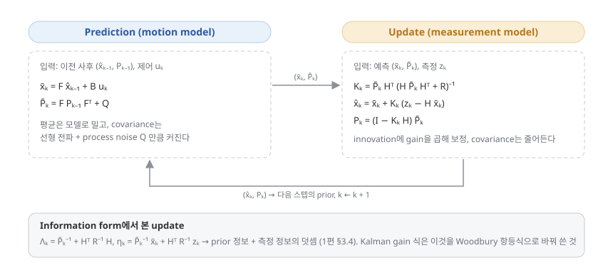
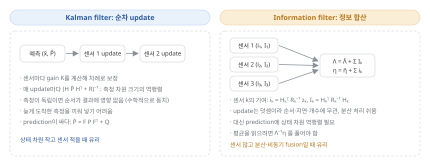

> [1편]()에서 "독립 정보는 information form에서 더해진다"를 봤다. 이번 편은 여기에 시간축을 붙인다. 상태가 움직일 때 prediction과 update를 번갈아 하는 Bayes filter에서 Kalman filter를 유도하고, Kalman gain이 결국 정보 가중 평균이라는 것, 같은 filter를 information form으로 쓴 information filter가 왜 다중 센서 fusion에 자연스러운지, 그리고 비선형으로 확장한 EKF까지 정리한다.

## 1. 문제 설정: 움직이는 상태

1편의 least squares는 상태 $$x$$ 가 고정돼 있고 측정이 한꺼번에 주어지는 상황이었다. localization에서는 로봇이 움직이므로 상태가 시간에 따라 변하고, 측정은 한 스텝씩 순차적으로 들어온다. 시각 $$k$$ 의 상태를 $$x_k \in \mathbb{R}^n$$ 이라 하고 두 모델을 둔다.

**Motion model**(process model). 이전 상태와 제어 입력으로 다음 상태가 정해지되 noise가 섞인다.

$$
x_k = f(x_{k-1}, u_k) + w_k, \qquad w_k \sim \mathcal{N}(0, Q_k)
$$

- $$u_k$$: 제어 입력 또는 proprioceptive 측정(wheel odometry, IMU 적분 등)
- $$w_k$$: process noise. 모델이 설명 못 하는 움직임(바퀴 미끄러짐, IMU bias 등)
- $$Q_k \in \mathbb{R}^{n \times n}$$: process noise covariance

**Measurement model**(observation model). 현재 상태에서 어떤 측정이 나올지 정한다.

$$
z_k = h(x_k) + v_k, \qquad v_k \sim \mathcal{N}(0, R_k)
$$

- $$z_k \in \mathbb{R}^p$$: 시각 $$k$$ 의 측정(GPS 위치, LiDAR로 얻은 pose, landmark 픽셀 좌표 등)
- $$v_k$$: measurement noise, $$R_k \in \mathbb{R}^{p \times p}$$: 그 covariance

목표는 지금까지의 모든 측정 $$z_{1:k}$$ 와 입력 $$u_{1:k}$$ 가 주어졌을 때 현재 상태의 사후분포 $$p(x_k \mid z_{1:k}, u_{1:k})$$ 를 매 스텝 갱신하는 것이다. 이를 **filtering**이라 한다.

## 2. Bayes Filter

두 가지 가정을 둔다. **Markov 가정**: $$x_k$$ 는 $$x_{k-1}$$ 과 $$u_k$$ 만 주어지면 과거와 독립이다. **측정 독립 가정**: $$z_k$$ 는 $$x_k$$ 만 주어지면 다른 모든 것과 독립이다. 이 두 가정 아래 사후분포는 두 단계로 재귀적으로 계산된다.

**Prediction**(Chapman-Kolmogorov). 이전 사후분포를 motion model로 밀어 현재 상태의 사전분포를 만든다.

$$
\overline{\operatorname{bel}}(x_k) = \int p(x_k \mid x_{k-1}, u_k)\, \operatorname{bel}(x_{k-1})\, dx_{k-1}
$$

- $$\operatorname{bel}(x_{k-1}) = p(x_{k-1} \mid z_{1:k-1}, u_{1:k-1})$$: 이전 스텝의 사후분포(belief)
- $$p(x_k \mid x_{k-1}, u_k)$$: motion model이 정하는 전이 확률
- $$\overline{\operatorname{bel}}(x_k)$$: 측정 $$z_k$$ 를 보기 전의 예측 분포

**Update**(Bayes 정리). 측정 likelihood를 곱해 정규화한다.

$$
\operatorname{bel}(x_k) = \eta\, p(z_k \mid x_k)\, \overline{\operatorname{bel}}(x_k)
$$

- $$p(z_k \mid x_k)$$: measurement model이 정하는 likelihood
- $$\eta$$: 정규화 상수(적분해 1이 되도록)

이 두 식이 Bayes filter의 전부다. 문제는 일반적인 분포에 대해 적분과 곱을 닫힌 형태로 계산할 수 없다는 것이다. 분포를 Gaussian으로, 모델을 선형으로 제한하면 두 단계가 모두 행렬 연산으로 닫힌다. 그것이 Kalman filter다.

## 3. Kalman Filter

### 3.1 선형 Gaussian 가정

motion model과 measurement model을 선형으로 둔다.

$$
x_k = F_k x_{k-1} + B_k u_k + w_k, \qquad z_k = H_k x_k + v_k
$$

- $$F_k \in \mathbb{R}^{n \times n}$$: 상태 전이 행렬
- $$B_k \in \mathbb{R}^{n \times l}$$: 제어 입력 $$u_k \in \mathbb{R}^l$$ 을 상태에 반영하는 행렬
- $$H_k \in \mathbb{R}^{p \times n}$$: 측정 행렬. 상태에서 측정으로의 선형 사상

이전 사후분포를 $$\operatorname{bel}(x_{k-1}) = \mathcal{N}(\hat{x}_{k-1}, P_{k-1})$$ 라 한다. 이 시리즈에서는 filter 문맥의 covariance를 $$P$$ 로 쓴다(1편의 $$\Sigma$$ 와 같은 것이다).

### 3.2 Prediction

Gaussian을 선형 변환하면 Gaussian이고(1편 §2.3), 독립 Gaussian noise를 더하면 covariance가 더해진다. 따라서 Chapman-Kolmogorov 적분이 그대로 닫힌다.

$$
\bar{x}_k = F_k \hat{x}_{k-1} + B_k u_k, \qquad \bar{P}_k = F_k P_{k-1} F_k^\top + Q_k
$$

- $$\bar{x}_k, \bar{P}_k$$: 예측(prior) 평균과 covariance. 위에 bar를 붙여 update 전임을 표시한다
- $$F_k P_{k-1} F_k^\top$$: 이전 불확실성이 motion model을 통해 전파된 것
- $$+ Q_k$$: 이번 스텝의 process noise. **prediction은 항상 불확실성을 키운다**

### 3.3 Update: Information form에서 출발한다

update는 예측 분포 $$\mathcal{N}(\bar{x}_k, \bar{P}_k)$$ 와 측정 likelihood의 곱이다. 1편 §3.4의 "독립 정보 덧셈"을 그대로 쓰면 가장 짧게 유도된다. 측정 $$z_k = H_k x_k + v_k$$ 가 상태에 대해 갖는 정보는 1편 §4.4의 Fisher information으로 $$H_k^\top R_k^{-1} H_k$$ 이고, 정보 벡터는 $$H_k^\top R_k^{-1} z_k$$ 다(측정 모델의 Jacobian이 $$H_k$$ 이므로). 따라서 사후분포의 information form은

$$
P_k^{-1} = \bar{P}_k^{-1} + H_k^\top R_k^{-1} H_k, \qquad P_k^{-1} \hat{x}_k = \bar{P}_k^{-1} \bar{x}_k + H_k^\top R_k^{-1} z_k
$$

- 첫 식: 사후 information = prior information + 측정 information
- 둘째 식: 사후 information vector = prior information vector + 측정 information vector

이것이 Kalman update의 본질이다. 흔히 보는 gain 형태는 이 두 식을 $$\bar{P}_k$$ 에 대해 다시 쓴 것뿐이다.

### 3.4 Kalman Gain 형태로 바꾸기

역행렬을 상태 차원 $$n$$ 이 아니라 측정 차원 $$p$$ 에서 하도록 **Woodbury 항등식**을 적용한다. $$(A + U C V)^{-1} = A^{-1} - A^{-1} U (C^{-1} + V A^{-1} U)^{-1} V A^{-1}$$ 에 $$A = \bar{P}_k^{-1}$$, $$U = H_k^\top$$, $$C = R_k^{-1}$$, $$V = H_k$$ 를 넣으면

$$
P_k = \bar{P}_k - \bar{P}_k H_k^\top \left( H_k \bar{P}_k H_k^\top + R_k \right)^{-1} H_k \bar{P}_k
$$

가 된다. 여기서 반복되는 덩어리에 이름을 붙인다.

$$
S_k = H_k \bar{P}_k H_k^\top + R_k, \qquad K_k = \bar{P}_k H_k^\top S_k^{-1}
$$

- $$S_k \in \mathbb{R}^{p \times p}$$: **innovation covariance**. 예측한 측정 $$H_k \bar{x}_k$$ 의 불확실성($$H_k \bar{P}_k H_k^\top$$)에 측정 noise($$R_k$$)를 더한 것
- $$K_k \in \mathbb{R}^{n \times p}$$: **Kalman gain**

그러면 update 식은 다음과 같이 정리된다.

$$
\hat{x}_k = \bar{x}_k + K_k \left( z_k - H_k \bar{x}_k \right), \qquad P_k = (I - K_k H_k)\, \bar{P}_k
$$

- $$z_k - H_k \bar{x}_k$$: **innovation**(residual). 실제 측정과 예측 측정의 차이
- 평균 갱신: 예측에 innovation을 gain만큼 곱해 더한다
- covariance 갱신: prior covariance를 $$(I - K_k H_k)$$ 만큼 줄인다. **update는 항상 불확실성을 줄인다**

평균 식이 information form과 같다는 것은 $$K_k = P_k H_k^\top R_k^{-1}$$ 라는 다른 표현으로 확인된다. 사후 information 식에 $$P_k$$ 를 곱하면 $$\hat{x}_k = P_k \bar{P}_k^{-1} \bar{x}_k + P_k H_k^\top R_k^{-1} z_k$$ 이고, $$P_k \bar{P}_k^{-1} = I - K_k H_k$$ 이므로 위의 gain 형태로 돌아온다.

**수치 안정성.** $$P_k = (I - K_k H_k)\bar{P}_k$$ 는 $$K_k$$ 가 최적일 때만 성립하는 축약형이라 반올림 오차로 대칭성·양의 정부호성이 깨질 수 있다. 실제 구현은 **Joseph form** $$P_k = (I - K_k H_k)\bar{P}_k (I - K_k H_k)^\top + K_k R_k K_k^\top$$ 을 쓰는 편이 안전하다. 어떤 $$K_k$$ 에 대해서도 성립하는 일반식이고 결과가 항상 대칭 양의 준정부호다.

### 3.5 Kalman Gain의 해석

1차원으로 줄여 보자. 상태가 위치 하나, 측정이 위치 직접 관측($$H = 1$$)이면

$$
K = \frac{\bar{P}}{\bar{P} + R}, \qquad \hat{x} = \bar{x} + K(z - \bar{x}) = (1 - K)\bar{x} + K z
$$

- $$\bar{P}$$: 예측의 분산, $$R$$: 측정의 분산
- 결과는 예측과 측정의 **분산 역수(정보) 가중 평균**이다. 1편 §3.4의 1D fusion 식과 정확히 같다

극한을 보면 직관이 잡힌다.

- $$R \to 0$$ (측정이 완벽): $$K \to 1$$, 측정을 그대로 믿는다
- $$R \to \infty$$ (측정이 쓸모없음): $$K \to 0$$, 예측을 유지한다
- $$\bar{P} \to \infty$$ (예측을 전혀 못 믿음): $$K \to 1$$, 역시 측정을 따른다
- $$Q$$ 가 크면 매 스텝 $$\bar{P}$$ 가 크게 불어 $$K$$ 가 커지고, 측정을 빨리 따라가는 대신 noise도 같이 탄다. $$Q$$ 가 작으면 매끄럽지만 실제 움직임에 뒤처진다

filter가 정상 상태(steady state)에 들어가면 $$\bar{P}_k$$ 와 $$K_k$$ 가 상수로 수렴하고, 이때 Kalman filter는 일정한 계수의 저역 통과 필터처럼 동작한다. $$Q$$ 와 $$R$$ 의 **비율**이 그 응답 속도를 정한다.

아래는 1차원 등속 모델에서 위치 측정만으로 위치·속도를 추정하는 Kalman filter다. 측정 노이즈와 process noise를 바꿔 가며 gain과 $$\pm 2\sigma$$ 띠가 어떻게 달라지는지 보면 위의 극한이 눈에 들어온다.



### 3.6 Kalman Filter는 MAP 추정이다

1편과 잇는 관점 하나. 선형 Gaussian 문제에서 시각 $$k$$ 의 update는 prior $$\mathcal{N}(\bar{x}_k, \bar{P}_k)$$ 와 측정 하나를 가진 least squares

$$
\hat{x}_k = \arg\min_x \frac{1}{2}(x - \bar{x}_k)^\top \bar{P}_k^{-1} (x - \bar{x}_k) + \frac{1}{2}(z_k - H_k x)^\top R_k^{-1} (z_k - H_k x)
$$

의 해다. 이 cost의 Hessian은 $$\bar{P}_k^{-1} + H_k^\top R_k^{-1} H_k$$ 이고, 1편 §4.3에 따라 그 역행렬이 사후 covariance $$P_k$$ 다. 3.3의 information update가 그대로 나온다. **Kalman filter는 매 스텝 prior를 하나의 측정처럼 취급하는 재귀적 least squares**다. 과거 측정을 전부 들고 다니는 대신 prior $$(\bar{x}_k, \bar{P}_k)$$ 하나로 요약(marginalization)한다는 점만 다르다.

## 4. Information Filter

### 4.1 정의

Kalman filter를 처음부터 끝까지 information form $$(\eta, \Lambda)$$ 로 쓴 것이 **information filter**다. $$\Lambda_k = P_k^{-1}$$, $$\eta_k = \Lambda_k \hat{x}_k$$ 라 두면 update는 3.3에서 이미 봤듯 덧셈이다.

$$
\Lambda_k = \bar{\Lambda}_k + H_k^\top R_k^{-1} H_k, \qquad \eta_k = \bar{\eta}_k + H_k^\top R_k^{-1} z_k
$$

반면 prediction은 covariance form에서 쉬운 연산이므로 information form에서는 역행렬을 거쳐야 한다.

$$
\bar{\Lambda}_k = \left( F_k \Lambda_{k-1}^{-1} F_k^\top + Q_k \right)^{-1}, \qquad \bar{\eta}_k = \bar{\Lambda}_k \left( F_k \Lambda_{k-1}^{-1} \eta_{k-1} + B_k u_k \right)
$$

- $$\Lambda_{k-1}^{-1}$$: 이전 사후 covariance를 복원하는 역행렬(상태 차원 $$n$$)
- 바깥의 $$(\cdot)^{-1}$$: 전파된 covariance를 다시 information으로 바꾸는 역행렬

두 filter는 수학적으로 동치이고, 어느 쪽이 싼지는 어느 단계가 병목인지에 달렸다. Kalman filter는 update에서 $$p \times p$$ 역행렬($$S_k^{-1}$$), information filter는 prediction에서 $$n \times n$$ 역행렬을 한다. 1편 §3.3의 이중성이 filter에서 그대로 재현되는 셈이다.

### 4.2 다중 센서 Fusion: 순서·지연·개수에 무관

information filter가 sensor fusion에서 빛나는 이유는 update가 **덧셈**이기 때문이다. 같은 시각에 센서 $$j = 1, \dots, N$$ 에서 측정 $$z_k^{(j)} = H_k^{(j)} x_k + v_k^{(j)}$$, $$v_k^{(j)} \sim \mathcal{N}(0, R_k^{(j)})$$ 가 들어오고 noise가 서로 독립이면

$$
\Lambda_k = \bar{\Lambda}_k + \sum_{j=1}^{N} H_k^{(j)\top} R_k^{(j)-1} H_k^{(j)}, \qquad
\eta_k = \bar{\eta}_k + \sum_{j=1}^{N} H_k^{(j)\top} R_k^{(j)-1} z_k^{(j)}
$$

- 센서 $$j$$ 의 기여는 information 쌍 $$\left( i_k^{(j)}, I_k^{(j)} \right) = \left( H_k^{(j)\top} R_k^{(j)-1} z_k^{(j)},\; H_k^{(j)\top} R_k^{(j)-1} H_k^{(j)} \right)$$ 로 요약된다

이 구조의 장점은 다음과 같다.

- **순서 무관**: 덧셈은 교환 법칙을 만족하므로 어느 센서를 먼저 반영하든 결과가 같다. Kalman filter도 측정이 독립이면 순차 update의 결과는 같지만, gain을 센서마다 계산해야 한다
- **개수 무관**: 센서를 추가하는 것이 항 하나 더하는 것이다. 측정을 세로로 쌓아 큰 $$H, R$$ 을 만들 필요가 없다
- **분산 처리**: 각 센서 노드가 자기 information 쌍 $$(i, I)$$ 만 계산해 보내면 중앙에서는 더하기만 한다. 노드끼리 상태를 공유할 필요가 없어 **decentralized fusion**의 기본 구조가 된다
- **지연 측정**: 늦게 도착한 측정도 해당 시각의 information에 더하면 되므로 (재예측 비용은 별도지만) 끼워 넣기가 자연스럽다

단, **"noise가 서로 독립"이라는 가정이 반드시 필요하다.** 두 센서가 같은 IMU를 참조하거나, 같은 map을 보거나, 한 노드의 출력이 다른 노드의 입력으로 들어가면 독립이 아니다. 그때 위 덧셈을 그대로 쓰면 같은 정보가 두 번 더해져 covariance가 실제보다 작아진다. 이것이 4편 Covariance Intersection의 출발점이다.

### 4.3 Sparse Information Filter와 Graph SLAM

1편 §3.5에서 SLAM의 information matrix는 sparse하다고 했다. information filter로 SLAM을 돌리면 prediction의 marginalization(과거 pose 제거)이 sparsity를 깨뜨려 $$\Lambda$$ 가 점점 dense해진다(Schur complement의 fill-in). 이를 근사적으로 sparse하게 유지하는 것이 Sparse Extended Information Filter(SEIF)이고, 아예 과거 pose를 marginalization하지 않고 전부 남겨 최적화하는 것이 smoothing 기반 graph SLAM(iSAM, GTSAM)이다. 후자는 "information filter의 prediction을 하지 않는" 대신 큰 sparse least squares를 푼다. filter냐 smoothing이냐는 결국 marginalization을 언제 얼마나 할 것인가의 선택이다.

## 5. 비선형 확장: EKF

### 5.1 선형화

실제 모델 $$f, h$$ 는 비선형이다(회전이 들어가는 순간 비선형이다). **Extended Kalman filter**(EKF)는 현재 추정치 주변에서 1차 Taylor 전개해 Kalman filter 식을 그대로 쓴다.

$$
F_k = \left.\frac{\partial f}{\partial x}\right\rvert_{\hat{x}_{k-1}, u_k}, \qquad
H_k = \left.\frac{\partial h}{\partial x}\right\rvert_{\bar{x}_k}
$$

- $$F_k$$: motion model의 Jacobian. 이전 사후 평균에서 평가
- $$H_k$$: measurement model의 Jacobian. 예측 평균에서 평가

prediction의 평균은 비선형 함수를 그대로 통과시키고($$\bar{x}_k = f(\hat{x}_{k-1}, u_k)$$), covariance만 Jacobian으로 전파한다($$\bar{P}_k = F_k P_{k-1} F_k^\top + Q_k$$). update의 innovation도 비선형 예측을 쓴다($$z_k - h(\bar{x}_k)$$). 나머지 gain·covariance 식은 선형 Kalman filter와 같다.

### 5.2 EKF의 한계와 consistency

EKF는 선형화 지점이 참값과 멀면 Jacobian이 틀리고, 그 결과 covariance가 실제 오차보다 작게 나오는 **overconfidence**(inconsistency)가 생긴다. filter가 "나는 확실하다"고 믿으면 이후 측정을 무시하게 되어(gain이 작아져) 오차가 발산할 수 있다. EKF-SLAM에서 heading 불확실성이 클 때 map이 무너지는 현상이 대표적이다.

filter가 consistent한지는 **NEES**(Normalized Estimation Error Squared)로 검사한다. 참값 $$x_k$$ 를 아는 시뮬레이션에서

$$
\epsilon_k = (x_k - \hat{x}_k)^\top P_k^{-1} (x_k - \hat{x}_k)
$$

의 평균이 상태 차원 $$n$$ 근처여야 한다($$\chi^2$$ 분포). 참값을 모르는 실환경에서는 innovation으로 같은 검사를 하는 **NIS** $$(z_k - H_k\bar{x}_k)^\top S_k^{-1} (z_k - H_k\bar{x}_k)$$ 를 쓰고, 평균이 측정 차원 $$p$$ 보다 훨씬 크면 filter가 overconfident하거나 $$R$$ 이 너무 작은 것이다.

### 5.3 개선안

- **Iterated EKF**(IEKF): update 후 갱신된 $$\hat{x}_k$$ 에서 $$H_k$$ 를 다시 계산해 update를 반복한다. §3.6의 MAP least squares를 Gauss-Newton으로 여러 번 푸는 것과 같아서 선형화 오차가 줄어든다
- **Unscented Kalman filter**(UKF): Jacobian 대신 평균 주변의 결정적 sigma point들을 비선형 함수에 통과시켜 평균·covariance를 재구성한다. 2차 정확도이고 미분이 필요 없다
- **Error-state KF**(ESKF): 상태를 "nominal 상태 + 작은 오차"로 나누고 오차만 filter로 추정한다. 회전처럼 벡터공간이 아닌 상태에 Kalman filter를 쓰는 표준 방법으로, 3편에서 SE(3)와 함께 다룬다

## 6. Sensor Fusion 관점에서 본 Kalman Filter

### 6.1 어떤 센서가 어디에 들어가는가

localization 시스템에서 센서는 두 자리 중 하나에 들어간다.

| 자리 | 역할 | 대표 센서 | 특성 |
| --- | --- | --- | --- |
| prediction의 $$u_k$$ | 상태를 앞으로 밀기 | IMU, wheel odometry | 고주파, 상대 측정, drift 누적 |
| update의 $$z_k$$ | 상태를 바로잡기 | GPS, LiDAR/visual pose, marker, UWB | 저주파, 절대 또는 상대 측정, drift 보정 |

IMU는 측정이지만 "상태 → 측정" 모델보다 "이전 상태 + IMU → 다음 상태" 모델로 쓰는 편이 자연스러워 prediction에 들어간다. LiDAR odometry는 상대 pose를 내므로 prediction에 쓸 수도, 이전 pose를 상태에 포함시켜 update로 쓸 수도 있다.

### 6.2 두 pose 추정치를 직접 합치기

LiDAR odometry가 낸 pose $$(x_1, P_1)$$ 과 visual odometry가 낸 pose $$(x_2, P_2)$$ 를 합치는 가장 단순한 경우를 보자. 한쪽을 prior, 다른 쪽을 $$H = I$$ 인 측정으로 두면 Kalman update는

$$
K = P_1 (P_1 + P_2)^{-1}, \qquad \hat{x} = x_1 + K(x_2 - x_1), \qquad P = (I - K) P_1
$$

이고, 정리하면 $$P^{-1} = P_1^{-1} + P_2^{-1}$$, $$\hat{x} = P (P_1^{-1} x_1 + P_2^{-1} x_2)$$ 로 1편 §3.4와 같다. 이것이 **loosely coupled fusion**의 기본 연산이다. 각 모듈이 독립적으로 pose와 covariance를 내고, fusion 노드가 이를 information 가중 평균한다. 반대로 **tightly coupled**는 raw 측정(LiDAR 점, 이미지 feature)을 하나의 filter 또는 optimizer가 직접 쓰는 방식으로, 정확하지만 각 모듈을 갈아 끼우기 어렵다.

loosely coupled fusion에서 결과의 품질은 각 모듈이 내는 $$P_i$$ 가 얼마나 정직한가에 달렸다. 1편 §5에서 optimizer의 Hessian으로 covariance를 꺼내는 방법을 다룬 이유다. 그리고 pose는 벡터가 아니라 SE(3) 원소이므로 위의 "$$x_2 - x_1$$"을 어떻게 정의할지가 남는데, 이것이 3편의 주제다.

### 6.3 실전 체크리스트

- **$$Q$$, $$R$$ 튜닝**: $$R$$ 은 센서 사양이나 정지 상태 측정의 분산으로, $$Q$$ 는 모델이 무시한 동역학(가속도 범위 등)으로 초기값을 잡고 NIS로 검증한다. 둘의 비율이 응답 속도를 정한다
- **시간 정렬**: 센서 timestamp가 다르면 측정 시각까지 prediction한 뒤 update한다. 지연이 크면 버퍼를 두고 재예측한다
- **outlier 게이팅**: innovation의 Mahalanobis 거리 $$\nu^\top S^{-1} \nu$$ 가 $$\chi^2$$ 임계값을 넘으면 그 측정을 버린다. GPS 다중 경로, ICP 실패 등을 거른다
- **독립성 확인**: fusion에 넣는 두 소스가 같은 센서나 같은 map을 공유하지 않는지 확인한다. 공유하면 4편의 방법이 필요하다

## 7. 정리 표

| 항목 | Kalman filter | Information filter |
| --- | --- | --- |
| 상태 표현 | $$(\hat{x}, P)$$ | $$(\eta, \Lambda) = (P^{-1}\hat{x}, P^{-1})$$ |
| prediction | $$\bar{P} = F P F^\top + Q$$ (곱셈) | $$n \times n$$ 역행렬 필요 |
| update | gain $$K = \bar{P}H^\top S^{-1}$$, $$p \times p$$ 역행렬 | $$\Lambda = \bar{\Lambda} + H^\top R^{-1} H$$ (덧셈) |
| 다중 센서 | 순차 update, 센서마다 gain | information 합산, 순서·개수 무관 |
| 초기 "모름" 표현 | $$P$$ 를 큰 값으로 근사 | $$\Lambda = 0$$ 으로 정확히 표현 |
| 평균 읽기 | 직접 | $$\Lambda^{-1}\eta$$ 를 풀어야 함 |
| 유리한 상황 | 상태 작고 센서 적음, 실시간 단일 노드 | 센서 많고 분산·비동기, graph SLAM |

## 정리

Bayes filter의 prediction(Chapman-Kolmogorov)과 update(Bayes 정리)를 선형 Gaussian 모델에 적용하면 Kalman filter가 된다. update의 본질은 1편의 정보 덧셈 $$P_k^{-1} = \bar{P}_k^{-1} + H_k^\top R_k^{-1} H_k$$ 이고, Kalman gain 식은 이를 Woodbury 항등식으로 측정 차원에서 계산하도록 바꿔 쓴 것이다. 그래서 gain은 예측과 측정의 정보 가중 평균이며, Kalman filter는 prior를 측정 하나로 취급하는 재귀적 least squares다. 같은 filter를 information form으로 쓴 information filter는 update가 덧셈이라 다중 센서 fusion에서 순서·개수·분산 처리에 유리하고, 대신 prediction에서 역행렬을 치른다. 비선형 모델은 EKF로 선형화하되 consistency(NEES/NIS)를 감시해야 한다.

남은 문제는 두 가지다. pose는 벡터가 아니라서 "$$x_2 - x_1$$"과 "$$P$$"를 SE(3) 위에서 다시 정의해야 하고(3편), fusion하는 소스들이 독립이 아닐 때 정보 덧셈을 어떻게 고쳐야 하는지(4편)다.

- 이전 글: [상태 추정과 Sensor Fusion 1: Gaussian 불확실성, Information Matrix, Hessian]()
- 다음 글: [상태 추정과 Sensor Fusion 3: SE(3) Pose 불확실성과 6DoF Pose Fusion]()
