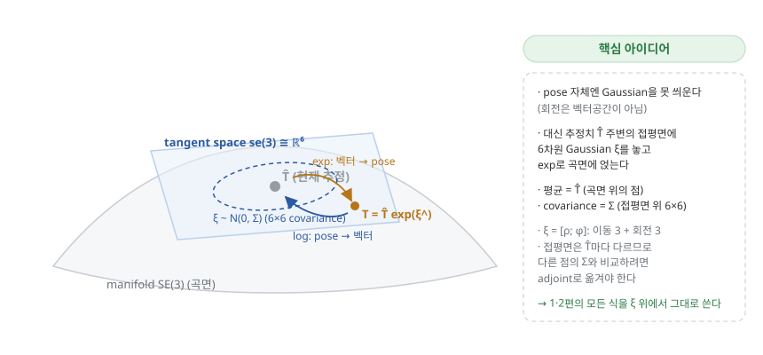
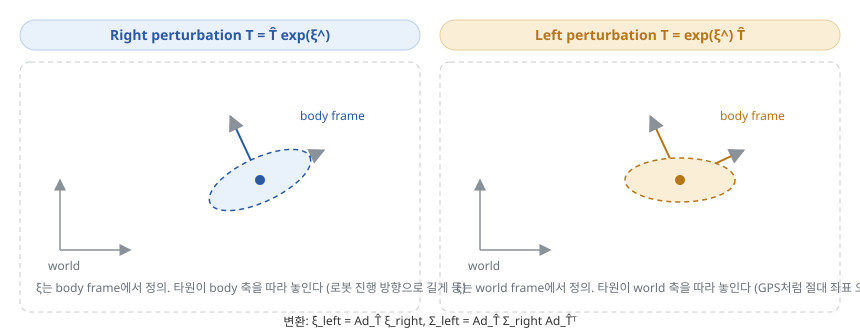
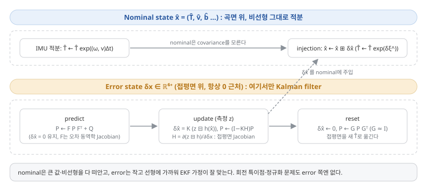

> [2편]()은 상태가 벡터라고 가정했다. 6DoF pose는 벡터가 아니라 SE(3)의 원소라서 "두 pose의 차", "pose의 covariance", "pose를 조금 움직이기"를 먼저 정의해야 한다. 이 편은 Lie group SE(3)의 최소한의 도구(exp, log, adjoint)로 pose 위에 Gaussian을 올리고, pose를 합성할 때 불확실성이 어떻게 전파되는지, error-state Kalman filter가 왜 그 표준 구현인지, 그리고 두 6DoF pose 추정치를 실제로 어떻게 합치는지 정리한다.

## 1. 왜 Pose에 Covariance를 그냥 못 씌우는가

pose $$T$$ 는 회전 $$R$$ 과 이동 $$t$$ 로 이뤄진다. 이동은 $$\mathbb{R}^3$$ 벡터라 문제가 없지만 회전은 벡터공간이 아니다.

- **Euler angle** 3개: 벡터처럼 보이지만 $$\pm 180°$$ 에서 wrap-around가 있고, gimbal lock 근처에서 작은 회전 변화가 각도의 큰 변화로 나타난다. 그 위에 Gaussian을 놓으면 같은 회전이 여러 값을 가져 분포가 왜곡된다
- **Quaternion** 4개: 단위 노름 제약이 있어 자유도는 3이다. $$4 \times 4$$ covariance는 제약 방향으로 rank가 부족한 특이 행렬이 되고, $$q$$ 와 $$-q$$ 가 같은 회전이라는 이중성도 있다
- **회전행렬** 9개: 6개의 제약(직교, 행렬식 1)이 있어 $$9 \times 9$$ covariance는 더 심하게 특이하다

공통 원인은 회전이 곡면(manifold) 위에 살기 때문이다. 해결책은 곡면 위의 한 점 $$\hat{T}$$ 를 잡고, **그 점의 접공간(tangent space)에 Gaussian을 놓은 뒤 곡면에 얹는 것**이다. 접공간은 $$\mathbb{R}^6$$ 이므로 1편·2편의 모든 식을 거기서 그대로 쓸 수 있다. 접공간과 곡면을 오가는 사상이 Lie group의 $$\exp$$ 와 $$\log$$ 다.

## 2. Lie Group SO(3), SE(3) 기초

### 2.1 SO(3)와 so(3)

회전행렬의 집합 $$SO(3) = \{ R \in \mathbb{R}^{3 \times 3} : R^\top R = I, \det R = 1 \}$$ 은 행렬 곱에 대해 group이면서 매끄러운 3차원 곡면이다. 단위원 $$I$$ 에서의 접공간을 Lie algebra $$\mathfrak{so}(3)$$ 라 하고, 그 원소는 $$3 \times 3$$ 반대칭 행렬이다. 벡터 $$\phi \in \mathbb{R}^3$$ 와 반대칭 행렬을 잇는 **hat 연산자** $$(\cdot)^\wedge$$ 와 그 역 **vee** $$(\cdot)^\vee$$ 를 둔다.

$$
\phi^\wedge = \begin{bmatrix} 0 & -\phi_3 & \phi_2 \\ \phi_3 & 0 & -\phi_1 \\ -\phi_2 & \phi_1 & 0 \end{bmatrix}, \qquad (\phi^\wedge)^\vee = \phi
$$

$$\phi^\wedge a = \phi \times a$$ 이므로 hat은 외적을 행렬로 쓴 것이다. $$\phi$$ 는 **axis-angle**(rotation vector)로, 방향이 회전축, 크기 $$\theta = \lVert \phi \rVert$$ 가 회전각이다.

**Exponential map**은 접공간의 벡터를 회전행렬로 보낸다. 행렬 지수를 정리하면 Rodrigues 공식이 된다.

$$
\exp(\phi^\wedge) = I + \frac{\sin\theta}{\theta}\phi^\wedge + \frac{1 - \cos\theta}{\theta^2}(\phi^\wedge)^2
$$

**Logarithm map**은 그 역이다. $$\theta = \arccos\!\left(\frac{\operatorname{tr}(R) - 1}{2}\right)$$, $$\phi = \frac{\theta}{2\sin\theta}(R - R^\top)^\vee$$ 로 계산하며 $$\theta < \pi$$ 에서 유일하다. $$\theta$$ 가 0 근처면 Taylor 전개로 수치 처리한다.

### 2.2 SE(3)와 se(3)

rigid transform의 집합 $$SE(3) = \left\{ T = \begin{bmatrix} R & t \\ 0^\top & 1 \end{bmatrix} : R \in SO(3), t \in \mathbb{R}^3 \right\}$$ 은 6차원 Lie group이다. Lie algebra $$\mathfrak{se}(3)$$ 의 원소는 6차원 벡터 $$\xi$$ 로 매개화한다.

$$
\xi = \begin{bmatrix} \rho \\ \phi \end{bmatrix} \in \mathbb{R}^6, \qquad
\xi^\wedge = \begin{bmatrix} \phi^\wedge & \rho \\ 0^\top & 0 \end{bmatrix} \in \mathbb{R}^{4 \times 4}
$$

- $$\rho \in \mathbb{R}^3$$: 이동 성분, $$\phi \in \mathbb{R}^3$$: 회전 성분(axis-angle)
- 순서는 관례다. 이 글은 Barfoot의 책과 Sophus를 따라 이동을 먼저 쓴다. GTSAM은 회전을 먼저 쓴다($$[\phi; \rho]$$). **라이브러리 간에 covariance를 주고받을 때 이 순서를 반드시 맞춰야 한다**

SE(3)의 exponential map은

$$
\exp(\xi^\wedge) = \begin{bmatrix} \exp(\phi^\wedge) & J_l(\phi)\, \rho \\ 0^\top & 1 \end{bmatrix}, \qquad
J_l(\phi) = I + \frac{1 - \cos\theta}{\theta^2}\phi^\wedge + \frac{\theta - \sin\theta}{\theta^3}(\phi^\wedge)^2
$$

- $$J_l(\phi)$$: SO(3)의 **left Jacobian**. 이동 부분이 $$\rho$$ 그대로가 아니라 $$J_l \rho$$ 인 이유는 회전하면서 이동하는 나선 운동(screw motion)의 적분이기 때문이다. $$\theta \to 0$$ 이면 $$J_l \to I$$
- 반대로 $$\log(T)^\vee = [J_l(\phi)^{-1} t;\ \phi]$$ 로 $$\phi = \log(R)^\vee$$ 를 먼저 구하고 이동을 되돌린다

$$\xi$$ 가 작을 때 $$\exp(\xi^\wedge) \approx I + \xi^\wedge$$ 라는 1차 근사가 모든 선형화의 출발점이다.

### 2.3 Adjoint

같은 작은 움직임을 다른 좌표계에서 표현하면 벡터가 달라진다. 그 변환이 **adjoint** $$\operatorname{Ad}_T \in \mathbb{R}^{6 \times 6}$$ 이다.

$$
T \exp(\xi^\wedge) T^{-1} = \exp\!\left( (\operatorname{Ad}_T\, \xi)^\wedge \right), \qquad
\operatorname{Ad}_T = \begin{bmatrix} R & t^\wedge R \\ 0 & R \end{bmatrix}
$$

- 좌변: $$T$$ 의 좌표계에서 본 움직임 $$\xi$$ 를 $$T$$ 로 감싸 바깥 좌표계로 옮긴 것
- 회전 성분은 $$R$$ 로 회전되고, 이동 성분은 회전될 뿐 아니라 lever arm $$t^\wedge R \phi$$ 만큼 회전에 의한 이동이 추가된다
- $$\operatorname{Ad}_{T^{-1}} = \operatorname{Ad}_T^{-1}$$, $$\operatorname{Ad}_{T_1 T_2} = \operatorname{Ad}_{T_1}\operatorname{Ad}_{T_2}$$

adjoint는 "접공간 벡터를 다른 점의 접공간으로 옮기는 선형 사상"이라 1편 §2.3의 $$A \Sigma A^\top$$ 전파를 그대로 적용할 수 있다. 이 편의 covariance 변환 식은 전부 $$\operatorname{Ad}$$ 로 쓰인다.

## 3. Pose 위의 Gaussian: Perturbation 모델

### 3.1 정의

pose의 확률분포를 다음처럼 정의한다.

$$
T = \hat{T} \exp(\xi^\wedge), \qquad \xi \sim \mathcal{N}(0, \Sigma), \qquad \Sigma \in \mathbb{R}^{6 \times 6}
$$

- $$\hat{T} \in SE(3)$$: 평균(nominal) pose. 곡면 위의 점
- $$\xi \in \mathbb{R}^6$$: $$\hat{T}$$ 의 접공간 위의 오차. 평균 0인 Gaussian
- $$\Sigma$$: pose의 covariance. **$$\hat{T}$$ 의 접공간에서 정의된** $$6 \times 6$$ 행렬

이 형태를 **right perturbation**(오른쪽에 곱하므로)이라 한다. $$\xi$$ 가 $$\hat{T}$$ 뒤에 곱해지므로 **body frame**(로봇 좌표계)에서 본 오차다. "로봇 진행 방향으로 3cm, 좌우로 1cm 불확실"처럼 로봇 기준으로 오차를 말할 때 자연스럽다.

반대로 **left perturbation** $$T = \exp(\xi^\wedge)\hat{T}$$ 는 $$\xi$$ 가 **world frame**에서 본 오차다. "동쪽으로 3m, 북쪽으로 1m 불확실"처럼 GPS 오차를 말할 때 자연스럽다.

### 3.2 두 관례 사이의 변환

같은 분포를 두 방식으로 쓸 수 있고, 둘 사이는 adjoint로 옮긴다. $$\exp(\xi_l^\wedge)\hat{T} = \hat{T}\exp(\xi_r^\wedge)$$ 가 되려면 $$\exp(\xi_l^\wedge) = \hat{T}\exp(\xi_r^\wedge)\hat{T}^{-1} = \exp((\operatorname{Ad}_{\hat{T}}\xi_r)^\wedge)$$ 이므로

$$
\xi_l = \operatorname{Ad}_{\hat{T}}\, \xi_r, \qquad \Sigma_l = \operatorname{Ad}_{\hat{T}}\, \Sigma_r\, \operatorname{Ad}_{\hat{T}}^\top
$$

- $$\xi_l, \Sigma_l$$: left(world frame) 오차와 covariance
- $$\xi_r, \Sigma_r$$: right(body frame) 오차와 covariance

**covariance 행렬 하나만 보고는 어느 관례인지 알 수 없다.** 두 모듈이 다른 관례로 covariance를 내면 fusion 결과가 틀린다. 관례는 라이브러리마다 다르다. GTSAM은 right(local) perturbation에 회전 우선 순서, Sophus는 이동 우선 순서, ROS의 `PoseWithCovariance`는 이동 3 + fixed-axis 회전 3 순서로 world frame에 가깝다. 접점을 만들 때마다 문서를 확인해야 한다.

### 3.3 Pose의 역과 합성: 불확실성 전파

right perturbation을 기준으로 두 연산의 covariance를 구한다. 모두 "$$\exp$$ 를 adjoint로 옮기고 1차 근사한다"는 한 가지 기술이다.

**역(inverse).** $$T = \hat{T}\exp(\xi^\wedge)$$ 이면

$$
T^{-1} = \exp(-\xi^\wedge)\hat{T}^{-1} = \hat{T}^{-1}\left(\hat{T}\exp(-\xi^\wedge)\hat{T}^{-1}\right) = \hat{T}^{-1}\exp\!\left( (-\operatorname{Ad}_{\hat{T}}\xi)^\wedge \right)
$$

이므로 $$T^{-1}$$ 의 right perturbation covariance는 $$\operatorname{Ad}_{\hat{T}}\Sigma\operatorname{Ad}_{\hat{T}}^\top$$ 이다. 역을 취하면 오차의 기준 좌표계가 바뀌므로 adjoint가 붙는다.

**합성(compounding).** 서로 독립인 두 pose $$T_{ab} = \hat{T}_{ab}\exp(\xi_{ab}^\wedge)$$, $$T_{bc} = \hat{T}_{bc}\exp(\xi_{bc}^\wedge)$$ 를 곱해 $$T_{ac} = T_{ab}T_{bc}$$ 를 만든다(예: 이전 pose에 odometry 증분을 곱해 다음 pose를 얻는 경우).

$$
T_{ac} = \hat{T}_{ab}\exp(\xi_{ab}^\wedge)\hat{T}_{bc}\exp(\xi_{bc}^\wedge)
= \hat{T}_{ab}\hat{T}_{bc}\exp\!\left( (\operatorname{Ad}_{\hat{T}_{bc}^{-1}}\xi_{ab})^\wedge \right)\exp(\xi_{bc}^\wedge)
$$

가운데 항은 $$\hat{T}_{bc}^{-1}\exp(\xi_{ab}^\wedge)\hat{T}_{bc}$$ 를 adjoint로 정리한 것이다. 두 지수의 곱은 Baker-Campbell-Hausdorff 공식에 따라 1차에서 $$\exp((\xi_1 + \xi_2)^\wedge)$$ 로 근사되므로

$$
\xi_{ac} \approx \operatorname{Ad}_{\hat{T}_{bc}^{-1}}\xi_{ab} + \xi_{bc}, \qquad
\Sigma_{ac} \approx \operatorname{Ad}_{\hat{T}_{bc}^{-1}}\,\Sigma_{ab}\,\operatorname{Ad}_{\hat{T}_{bc}^{-1}}^\top + \Sigma_{bc}
$$

- 앞 pose의 오차는 뒤 pose의 좌표계로 옮겨진 뒤 더해진다. 뒤 pose의 오차는 이미 최종 body frame이라 그대로 더해진다
- 두 오차가 독립이므로 covariance는 그냥 합이다. 상관이 있으면 교차항 $$\operatorname{Ad}\,\Sigma_{ab,bc} + (\cdot)^\top$$ 이 추가된다

left perturbation으로 쓰면 대칭적으로 $$\Sigma_{ac} \approx \Sigma_{ab} + \operatorname{Ad}_{\hat{T}_{ab}}\Sigma_{bc}\operatorname{Ad}_{\hat{T}_{ab}}^\top$$ 이 되고, 이것이 Barfoot과 Furgale(2014)이 정리한 형태다. 이 논문은 2차·4차 항까지 포함한 더 정확한 전파식도 제시하지만, 회전 불확실성이 크지 않은 대부분의 odometry에서는 위의 1차식으로 충분하다.

odometry를 $$N$$ 스텝 누적하면 이 식을 $$N$$ 번 적용하는 것이고, 매 스텝 $$\Sigma$$ 가 더해지므로 **dead-reckoning의 covariance는 단조 증가**한다. 회전 오차가 lever arm $$t^\wedge$$ 를 타고 이동 오차로 번지는 것(adjoint의 우상단 블록)도 이 식에서 바로 보인다. 먼 거리를 갈수록 작은 heading 오차가 큰 위치 오차가 되는 이유다.

### 3.4 점의 변환

pose로 3D 점을 변환할 때의 불확실성도 같은 방식이다. body frame의 점 $$p_b$$ (동차 좌표, 4차원)를 world로 옮기면 $$p_w = T p_b = \hat{T}\exp(\xi^\wedge)p_b \approx \hat{T}(I + \xi^\wedge)p_b$$ 이다. $$\xi^\wedge p_b$$ 는 $$\xi$$ 에 대해 선형이므로 **odot 연산자**로 다시 쓴다.

$$
\xi^\wedge p = p^\odot \xi, \qquad
p^\odot = \begin{bmatrix} I_3 & -\tilde{p}^\wedge \\ 0^\top & 0^\top \end{bmatrix} \in \mathbb{R}^{4 \times 6}
$$

- $$\tilde{p} \in \mathbb{R}^3$$: 동차 좌표 $$p = [\tilde{p}; 1]$$ 의 앞 세 성분
- 유도: $$\xi^\wedge p = [\phi^\wedge\tilde{p} + \rho;\ 0] = [\rho - \tilde{p}^\wedge\phi;\ 0]$$

따라서 world 점의 covariance는 $$\Sigma_{p_w} \approx \hat{T}\,p_b^\odot\,\Sigma\,p_b^{\odot\top}\hat{T}^\top$$ 이고, 점 자체의 측정 noise가 있으면 $$\hat{T}\Sigma_{p_b}\hat{T}^\top$$ 을 더한다. LiDAR 점을 map에 등록할 때 pose 불확실성이 점의 불확실성으로 번지는 계산이 정확히 이것이다.

## 4. Manifold 위의 Least Squares와 Jacobian

### 4.1 boxplus, boxminus

1편의 least squares를 pose에 쓰려면 "상태를 조금 움직이기"와 "두 상태의 차"를 정의해야 한다. 관례적으로 다음 두 연산을 둔다.

$$
T \boxplus \delta = T\exp(\delta^\wedge), \qquad T_2 \boxminus T_1 = \log(T_1^{-1}T_2)^\vee
$$

- $$\boxplus$$: pose에 접공간 벡터 $$\delta \in \mathbb{R}^6$$ 를 더해 곡면 위의 새 pose를 만든다
- $$\boxminus$$: 두 pose의 차를 $$T_1$$ 의 접공간 벡터로 잰다. $$T_1 = T_2$$ 면 0이다

이 두 연산이 벡터의 $$+$$, $$-$$ 를 대신한다. Gauss-Newton은 $$\hat{T} \leftarrow \hat{T}\boxplus\delta$$ 로 갱신하고, residual은 $$\boxminus$$ 로 정의하며, Jacobian은 $$\delta$$ 에 대한 미분이 된다.

### 4.2 Pose 측정의 residual과 Jacobian

pose $$T$$ 를 추정하는데, 어떤 센서가 $$T$$ 의 측정값 $$Z = T\exp(\epsilon^\wedge)$$, $$\epsilon \sim \mathcal{N}(0, \Sigma_Z)$$ 를 줬다고 하자. residual을

$$
r(T) = T \boxminus Z = \log(Z^{-1}T)^\vee
$$

로 정의하면 참값에서 $$r = \log(\exp(-\epsilon^\wedge))^\vee = -\epsilon$$ 이므로 **residual의 covariance는 정확히 $$\Sigma_Z$$** 다. 별도의 adjoint 변환이 필요 없다는 것이 이 정의의 장점이다. 현재 추정 $$\hat{T}$$ 를 $$\delta$$ 만큼 움직였을 때의 변화는

$$
r(\hat{T}\boxplus\delta) = \log\!\left(Z^{-1}\hat{T}\exp(\delta^\wedge)\right)^\vee
= \log\!\left(\exp(\hat{r}^\wedge)\exp(\delta^\wedge)\right)^\vee
\approx \hat{r} + J_r(\hat{r})^{-1}\delta
$$

- $$\hat{r} = r(\hat{T})$$: 현재 residual
- $$J_r(\hat{r})^{-1}$$: SE(3)의 right Jacobian의 역. $$\hat{r}$$ 이 작으면 $$I$$ 에 가깝고, 실무에서는 $$I$$ 로 두는 경우도 많다

따라서 이 측정의 Jacobian은 $$J = J_r(\hat{r})^{-1} \approx I$$ 이고, 1편 §4.2의 normal equation에 $$J^\top\Sigma_Z^{-1}J$$ 로 들어간다. 상대 pose 측정(pose graph의 edge) $$Z_{ij} \approx T_i^{-1}T_j$$ 의 residual $$\log(Z_{ij}^{-1}T_i^{-1}T_j)^\vee$$ 도 같은 요령으로 $$T_i$$, $$T_j$$ 각각에 대한 Jacobian을 얻으며, 이때는 adjoint가 등장한다($$T_i$$ 쪽 Jacobian이 $$-J_r^{-1}\operatorname{Ad}_{T_j^{-1}T_i}$$ 꼴이 된다).

### 4.3 결과의 covariance

Gauss-Newton이 $$\hat{T}$$ 에서 수렴하면 1편 §4.3에 따라 사후 information matrix는 $$H = \sum_i J_i^\top\Sigma_i^{-1}J_i$$ 이고 covariance는 $$H^{-1}$$ 이다. 여기서 $$H$$ 는 $$\delta$$ 에 대한 Hessian이므로, **얻어진 covariance는 $$\hat{T}$$ 의 접공간에서 right perturbation으로 정의된 $$\Sigma$$** 다. 즉 SLAM optimizer가 뱉는 pose covariance는 "그 pose의 body frame 기준 $$6 \times 6$$" 이고, 다른 곳에서 쓰려면 §3.2의 변환이 필요할 수 있다.

## 5. Error-State Kalman Filter

### 5.1 아이디어

2편의 EKF를 pose에 직접 쓰려면 상태 벡터에 quaternion을 넣고 정규화하고 특이 covariance를 다루는 등 번거롭다. **error-state Kalman filter**(ESKF)는 상태를 둘로 나눈다.

- **nominal state** $$\hat{x}$$: pose $$\hat{T}$$, 속도 $$\hat{v}$$, IMU bias 등. 곡면 위에 살고, 비선형 운동 방정식을 그대로 적분한다. covariance를 갖지 않는다
- **error state** $$\delta x$$: nominal과 참값의 차 $$T = \hat{T}\exp(\delta\xi^\wedge)$$ 등. 접공간의 벡터라 Kalman filter를 그대로 쓸 수 있다. 항상 0 근처에 머무르므로 선형화가 잘 맞는다

nominal이 "큰 값과 비선형"을 떠안고 error가 "작고 선형"만 다루는 분업이다. 회전의 특이점, wrap-around, 정규화 문제가 error 쪽에는 없다.

### 5.2 단계

**Prediction.** nominal은 IMU 측정 $$(\omega, a)$$ 로 비선형 적분한다(예: $$\hat{R} \leftarrow \hat{R}\exp((\omega\Delta t)^\wedge)$$). error의 평균은 0을 유지하고 covariance만 전파한다.

$$
P \leftarrow F P F^\top + Q
$$

- $$F$$: error dynamics의 Jacobian. $$\delta x_{k} \approx F\delta x_{k-1} + w$$ 가 되도록 nominal 궤적 주변에서 유도한 것으로, 회전 블록에는 $$\exp((\omega\Delta t)^\wedge)^\top$$ 같은 항이 들어간다
- $$Q$$: IMU noise와 bias random walk의 covariance

**Update.** 측정 $$z = h(x) + v$$ 가 오면 innovation을 manifold 위에서 정의하고($$z \boxminus h(\hat{x})$$, pose 측정이면 §4.2의 $$\log$$), error에 대한 Jacobian $$H = \partial(z \boxminus h)/\partial\delta x$$ 로 2편의 update를 돌린다.

$$
K = PH^\top(HPH^\top + R)^{-1}, \qquad \delta\hat{x} = K\left(z \boxminus h(\hat{x})\right), \qquad P \leftarrow (I - KH)P
$$

**Injection과 reset.** error의 추정치를 nominal에 넣고 error를 0으로 되돌린다.

$$
\hat{x} \leftarrow \hat{x}\boxplus\delta\hat{x}, \qquad \delta\hat{x} \leftarrow 0, \qquad P \leftarrow G P G^\top
$$

- $$G$$: reset Jacobian. 접공간이 옛 $$\hat{T}$$ 에서 새 $$\hat{T}$$ 로 옮겨지므로 $$P$$ 도 옮겨야 하는데, 회전 블록이 $$I - \frac{1}{2}\delta\phi^\wedge$$ 꼴로 $$I$$ 와 거의 같아 생략하는 구현도 많다

이 구조는 Solà의 "Quaternion kinematics for the error-state Kalman filter"(2017)에 상세히 정리돼 있고, VIO·LiDAR-inertial odometry의 filter 계열(MSCKF, FAST-LIO 등)이 모두 이 틀 위에 있다. 관점을 바꾸면 ESKF는 §4의 manifold Gauss-Newton을 매 스텝 한 번만 돌리는 것이다. IEKF는 여러 번 돌리는 것이고, FAST-LIO가 "iterated ESKF"인 이유다.

## 6. 6DoF Pose Fusion

### 6.1 문제

같은 시각의 로봇 pose에 대해 두 모듈이 추정치를 냈다.

$$
T_1 = T\exp(\epsilon_1^\wedge),\ \epsilon_1 \sim \mathcal{N}(0, \Sigma_1), \qquad
T_2 = T\exp(\epsilon_2^\wedge),\ \epsilon_2 \sim \mathcal{N}(0, \Sigma_2)
$$

- $$T$$: 참 pose, $$T_1, T_2$$: 두 추정치(예: LiDAR odometry와 visual odometry, 또는 marker 기반 추정과 IMU 적분)
- $$\Sigma_1, \Sigma_2$$: 각 추정치의 right perturbation covariance. **같은 관례, 같은 성분 순서**로 맞춰져 있어야 한다
- 두 오차는 독립이라 가정한다(깨지면 4편)

### 6.2 Manifold 위의 MAP

2편 §6.2의 벡터 fusion을 $$\boxminus$$ 로 옮기면 cost는

$$
E(T) = \frac{1}{2}\left\lVert T \boxminus T_1 \right\rVert^2_{\Sigma_1^{-1}} + \frac{1}{2}\left\lVert T \boxminus T_2 \right\rVert^2_{\Sigma_2^{-1}}
$$

- $$\lVert r \rVert^2_{\Sigma^{-1}} = r^\top\Sigma^{-1}r$$: Mahalanobis 노름
- §4.2에 따라 각 residual의 covariance는 정확히 $$\Sigma_i$$ 다

$$\hat{T} = T_1$$ 에서 Gauss-Newton을 시작하자. 첫 residual은 $$\hat{r}_1 = 0$$, $$\hat{r}_2 = \log(T_2^{-1}T_1)^\vee = -\log(T_1^{-1}T_2)^\vee$$ 이고 Jacobian을 $$I$$ 로 근사하면 normal equation은

$$
(\Sigma_1^{-1} + \Sigma_2^{-1})\,\delta = -\left(\Sigma_1^{-1}\cdot 0 + \Sigma_2^{-1}\hat{r}_2\right) = \Sigma_2^{-1}\log(T_1^{-1}T_2)^\vee
$$

이므로 첫 갱신은

$$
\delta = \underbrace{(\Sigma_1^{-1} + \Sigma_2^{-1})^{-1}\Sigma_2^{-1}}_{K}\,\log(T_1^{-1}T_2)^\vee, \qquad
\hat{T} \leftarrow T_1\exp(\delta^\wedge)
$$

- $$K = (\Sigma_1^{-1} + \Sigma_2^{-1})^{-1}\Sigma_2^{-1} = \Sigma_1(\Sigma_1 + \Sigma_2)^{-1}$$: 2편의 Kalman gain과 같은 꼴이다
- $$\log(T_1^{-1}T_2)^\vee$$: "$$x_2 - x_1$$"의 manifold 버전. $$T_1$$ 의 접공간에서 잰 두 pose의 차

즉 **6DoF pose fusion은 두 pose의 차를 접공간에서 재고, Kalman gain으로 가중한 만큼 $$T_1$$ 에서 $$T_2$$ 쪽으로 exp를 따라 움직이는 것**이다. 결과 covariance는 1편 §4.3에 따라 $$\Sigma = (\Sigma_1^{-1} + \Sigma_2^{-1})^{-1}$$ 이고, 새 $$\hat{T}$$ 의 접공간에서 정의된다. Jacobian을 $$I$$ 로 둔 근사가 걸리면 $$\hat{T}$$ 에서 $$J_r^{-1}$$ 을 다시 계산해 두어 번 더 반복한다. 두 추정치가 서로 가까우면(같은 pose의 추정치이므로 보통 그렇다) 한 번으로 충분하다.

### 6.3 실전에서 확인할 것

- **관례 일치**: right/left, 성분 순서(이동 우선/회전 우선), 각도 단위(rad). 하나라도 다르면 $$K$$ 가 엉뚱한 방향을 가중한다
- **frame 일치**: 두 pose가 같은 world frame과 같은 body frame을 기준으로 해야 한다. LiDAR frame과 camera frame의 pose를 합치려면 extrinsic $$T_{LC}$$ 로 먼저 통일하고, covariance도 §3.3의 합성 식으로 같이 옮긴다
- **시각 일치**: 두 추정치의 timestamp가 다르면 한쪽을 odometry로 §3.3처럼 전파해 시각을 맞춘 뒤 합친다. 전파하면서 covariance가 늘어나는 것이 맞다
- **degeneracy**: 1편 §3.2처럼 $$\Sigma_1^{-1}$$ 의 어떤 방향 고유값이 0에 가까우면 그 방향은 자동으로 $$T_2$$ 를 따른다. information form은 이 경우를 자연스럽게 처리하지만 $$\Sigma_1$$ 자체는 거의 특이하므로 역행렬을 취하지 말고 information으로 직접 받는 편이 안전하다
- **독립성**: 두 모듈이 같은 IMU를 쓰거나 한쪽이 다른 쪽을 초기값으로 쓰면 독립이 아니다. 이때 위 식은 overconfident한 $$\Sigma$$ 를 낸다. 4편에서 다룬다

## 7. 정리 표: 회전 표현과 불확실성

| 표현 | 파라미터 수 | 자유도 | covariance로 쓸 때 문제 | 용도 |
| --- | --- | --- | --- | --- |
| Euler angle | 3 | 3 | wrap-around, gimbal lock 근처 왜곡 | 사람이 읽는 출력 |
| Quaternion | 4 | 3 | 단위 노름 제약으로 특이, $$\pm q$$ 이중성 | nominal 상태 저장, 보간 |
| 회전행렬 | 9 | 3 | 6개 제약, 심하게 특이 | 계산, nominal 상태 |
| 접공간 벡터 $$\phi$$ (axis-angle) | 3 | 3 | 없음 (국소적으로 $$\mathbb{R}^3$$), $$\theta$$ 가 $$\pi$$ 근처면 주의 | **error state, covariance** |

| 연산 | 식 (right perturbation) | 의미 |
| --- | --- | --- |
| left ↔ right | $$\Sigma_l = \operatorname{Ad}_{\hat{T}}\Sigma_r\operatorname{Ad}_{\hat{T}}^\top$$ | body frame ↔ world frame 오차 |
| 역 | $$\Sigma_{T^{-1}} = \operatorname{Ad}_{\hat{T}}\Sigma\operatorname{Ad}_{\hat{T}}^\top$$ | 기준 좌표계가 바뀜 |
| 합성 $$T_{ab}T_{bc}$$ | $$\operatorname{Ad}_{\hat{T}_{bc}^{-1}}\Sigma_{ab}\operatorname{Ad}_{\hat{T}_{bc}^{-1}}^\top + \Sigma_{bc}$$ | odometry 누적, dead-reckoning |
| 점 변환 $$Tp$$ | $$\hat{T}p^\odot\Sigma p^{\odot\top}\hat{T}^\top$$ | pose 오차 → 점 오차 |
| 두 pose 차 | $$\log(T_1^{-1}T_2)^\vee$$ | residual, innovation |
| fusion | $$T_1\exp\!\left((\Sigma_1^{-1}+\Sigma_2^{-1})^{-1}\Sigma_2^{-1}\log(T_1^{-1}T_2)^\vee\right)$$ | manifold 위 Kalman update |

## 정리

pose는 벡터가 아니므로 Gaussian을 직접 씌울 수 없고, 대신 추정치 $$\hat{T}$$ 의 접공간에 6차원 Gaussian $$\xi$$ 를 놓고 $$T = \hat{T}\exp(\xi^\wedge)$$ 로 곡면에 얹는다. right perturbation은 body frame, left는 world frame 오차이며 둘은 adjoint로 오간다. 역·합성·점 변환의 불확실성 전파는 모두 "exp를 adjoint로 옮기고 1차 근사"라는 한 가지 기술로 얻어지고, 그 결과 dead-reckoning covariance는 단조 증가하며 회전 오차가 lever arm을 타고 위치 오차로 번진다. manifold 위의 least squares는 $$\boxplus$$, $$\boxminus$$ 로 1편의 식을 그대로 쓰며, error-state KF는 이를 매 스텝 한 번 돌리는 filter다. 두 6DoF pose의 fusion은 접공간에서 잰 차 $$\log(T_1^{-1}T_2)^\vee$$ 에 Kalman gain을 곱해 exp로 움직이는 것이고, 결과 covariance는 information의 합의 역행렬이다.

여기까지는 모두 "두 오차가 독립"이라는 가정 위에 있다. 다음 편은 그 가정이 깨졌을 때, 즉 두 추정치가 공통 정보를 공유해 상관을 모르는 경우에 information 덧셈 대신 무엇을 써야 하는지, Covariance Intersection을 다룬다.

- 이전 글: [상태 추정과 Sensor Fusion 2: Kalman Filter와 Information Filter]()
- 다음 글: [상태 추정과 Sensor Fusion 4: Covariance Intersection]()
