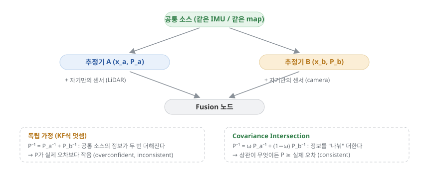
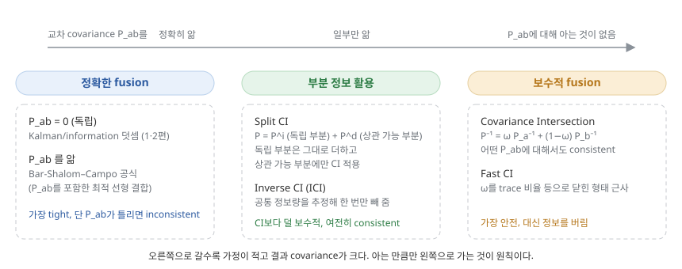

> 1편의 정보 덧셈, 2편의 Kalman update, 3편의 pose fusion은 모두 "합치는 두 추정치의 오차가 독립"이라는 가정 위에 있었다. 실제 시스템에서는 두 모듈이 같은 IMU를 쓰거나, 같은 map을 보거나, 한쪽 출력이 다른 쪽 입력으로 흘러 들어가 이 가정이 흔히 깨진다. 이 편은 그때 무슨 일이 생기는지, 상관을 모르는 채로도 안전하게 합치는 Covariance Intersection(CI)이 어떻게 그것을 해결하는지, 그리고 그 변형들과 6DoF pose fusion에의 적용을 정리한다.

## 1. 문제: 상관을 모르는 두 추정치

### 1.1 상관은 어디서 생기는가

같은 상태 $$x$$ 에 대한 두 추정치 $$(x_a, P_a)$$, $$(x_b, P_b)$$ 가 있다. 각각의 오차를 $$e_a = x_a - x$$, $$e_b = x_b - x$$ 라 하면 두 추정치의 결합 covariance는

$$
\operatorname{Cov}\!\begin{bmatrix} e_a \\ e_b \end{bmatrix} = \begin{bmatrix} P_a & P_{ab} \\ P_{ba} & P_b \end{bmatrix}, \qquad P_{ba} = P_{ab}^\top
$$

- $$P_{ab} = \mathbb{E}[e_a e_b^\top]$$: **교차 covariance**(cross-covariance). 두 오차가 함께 움직이는 정도

1편 §3.4의 정보 덧셈은 $$P_{ab} = 0$$ 을 전제한다. localization에서 $$P_{ab} \neq 0$$ 이 되는 전형적인 상황은 다음과 같다.

- **공통 센서**: LiDAR-inertial odometry와 visual-inertial odometry가 같은 IMU를 쓴다. IMU bias 오차가 양쪽에 같은 방향으로 들어간다
- **공통 map / 공통 prior**: 두 로봇이 같은 map으로 localization하면 map 오차를 공유한다. 한 filter의 출력이 다른 filter의 초기값이 되면 그 prior를 공유한다
- **네트워크의 순환**: 분산 fusion에서 노드 A가 B에게 보낸 정보가 C를 거쳐 다시 A로 돌아오면, A는 자기 정보를 남의 것으로 착각하고 다시 더한다. **rumor propagation** 또는 **data incest**라 부른다
- **시간 상관**: 같은 filter가 낸 연속 두 시각의 추정치는 process noise를 공유해 강하게 상관된다. 이것을 독립인 양 두 번 fusion하면 안 된다

이런 상관은 정확히 추적하려면 두 시스템의 내부 상태와 이력을 전부 알아야 한다. 대부분 불가능하거나 너무 비싸다. 그래서 **$$P_{ab}$$ 를 모른다**는 전제로 fusion을 설계해야 한다.

### 1.2 상관을 무시하면 무슨 일이 생기는가

상관을 무시하고 1편의 정보 덧셈을 쓰면 결과는

$$
P_{\text{naive}} = (P_a^{-1} + P_b^{-1})^{-1}, \qquad x_{\text{naive}} = P_{\text{naive}}(P_a^{-1}x_a + P_b^{-1}x_b)
$$

이다. 극단적인 예로 두 추정치가 **완전히 같은 정보**라 하자($$x_a = x_b$$, $$P_a = P_b = P_{ab} = P$$). 새 정보가 전혀 없는데도 $$P_{\text{naive}} = P/2$$ 로 covariance가 반으로 준다. 같은 정보를 두 번 셌기 때문이다. 이 결과를 다시 다른 노드와 합치면 또 반으로 줄고, 몇 번 돌면 filter는 "나는 거의 확실히 안다"고 믿게 된다. 그러면 2편 §5.2처럼 gain이 0에 가까워져 새 측정을 무시하고, 오차는 커지는데 covariance는 작아지는 **발산**으로 이어진다.

일반적으로 어떤 선형 결합 $$\hat{x} = W_a x_a + W_b x_b$$ ($$W_a + W_b = I$$ 로 unbiased)의 실제 오차 covariance는

$$
\tilde{P} = W_a P_a W_a^\top + W_b P_b W_b^\top + W_a P_{ab} W_b^\top + W_b P_{ba} W_a^\top
$$

- 앞 두 항: 각 추정치의 오차가 가중치를 거쳐 기여하는 부분
- 뒤 두 항: 교차항. $$P_{ab}$$ 를 모르면 이 항을 계산할 수 없다

naive fusion은 교차항을 0으로 두고 $$P_{\text{naive}}$$ 를 보고한다. 실제 $$\tilde{P}$$ 가 그보다 크면 filter는 **inconsistent**하다.

### 1.3 Consistency의 정의

추정치 $$(\hat{x}, P)$$ 가 **consistent**하다는 것은 보고한 covariance가 실제 오차 covariance보다 작지 않다는 뜻이다.

$$
P \succeq \mathbb{E}\!\left[(\hat{x} - x)(\hat{x} - x)^\top\right]
$$

- $$\succeq$$: 좌변 빼기 우변이 양의 준정부호. 모든 방향에서 보고한 분산이 실제 분산 이상이라는 뜻

consistent한 추정치는 "실제보다 덜 확신"하므로 안전하다. 너무 보수적이면 정보를 버리는 셈이지만, overconfident보다는 낫다. 2편의 NEES가 이를 검사하는 통계량이다. CI의 목표는 **$$P_{ab}$$ 가 무엇이든 consistency를 보장하는 fusion 규칙**을 만드는 것이다.

## 2. Covariance Intersection

### 2.1 식

Julier와 Uhlmann(1997)이 제안한 **Covariance Intersection**은 정보 덧셈에 가중치 $$\omega$$ 를 끼워 넣는다.

$$
P^{-1} = \omega P_a^{-1} + (1 - \omega)P_b^{-1}, \qquad
P^{-1}\hat{x} = \omega P_a^{-1}x_a + (1 - \omega)P_b^{-1}x_b, \qquad \omega \in [0, 1]
$$

- $$\omega$$: 두 추정치의 정보를 나누는 비율. $$\omega = 1$$ 이면 $$(x_a, P_a)$$ 그대로, $$\omega = 0$$ 이면 $$(x_b, P_b)$$ 그대로
- 1편의 덧셈 $$P_a^{-1} + P_b^{-1}$$ 과 비교하면, 두 정보의 **합이 아니라 볼록 결합**(convex combination)이다. 총 정보량이 늘지 않도록 두 정보를 "나눠 갖는다"

정보 형태로 쓰면 $$\Lambda = \omega\Lambda_a + (1-\omega)\Lambda_b$$, $$\eta = \omega\eta_a + (1-\omega)\eta_b$$ 로 더 단순하다. 1편 §3의 표현을 그대로 쓸 수 있다.

### 2.2 기하: 왜 "intersection"인가

2차원에서 $$P_a$$, $$P_b$$ 의 $$1\sigma$$ 타원을 그리면, 어떤 $$\omega$$ 에 대해서도 CI 결과 $$P(\omega)$$ 의 타원은 **두 타원의 교집합을 감싼다**. $$\omega$$ 를 0에서 1로 움직이면 $$P(\omega)$$ 의 타원은 $$P_b$$ 에서 $$P_a$$ 로 연속적으로 변하며, 그 사이 모든 타원이 교집합의 바깥 경계를 스친다. 반면 독립을 가정한 naive fusion의 타원은 교집합 **안쪽**으로 파고든다. 그 안쪽 영역이 바로 "두 번 센 정보"다.

아래 위젯에서 $$\omega$$ 를 움직여 보면 CI 타원이 항상 교집합 바깥에 머무는 것과, 점선(naive)이 그 안으로 들어가는 것이 보인다. 두 타원의 방향이 다를수록 CI로 얻는 이득(교집합이 각 타원보다 훨씬 작아지는 것)이 크다.



### 2.3 Consistency 증명

CI가 임의의 $$P_{ab}$$ 에 대해 consistent하다는 것은 짧게 증명된다. CI의 가중치는 $$W_a = \omega P P_a^{-1}$$, $$W_b = (1-\omega)P P_b^{-1}$$ 이고 $$W_a + W_b = P P^{-1} = I$$ 다. 실제 오차 covariance는 §1.2의 식으로

$$
\tilde{P} = \begin{bmatrix} W_a & W_b \end{bmatrix}
\begin{bmatrix} P_a & P_{ab} \\ P_{ba} & P_b \end{bmatrix}
\begin{bmatrix} W_a^\top \\ W_b^\top \end{bmatrix}
$$

이다. 핵심 부등식은 **결합 covariance가 양의 준정부호이기만 하면** 다음이 성립한다는 것이다.

$$
\begin{bmatrix} P_a & P_{ab} \\ P_{ba} & P_b \end{bmatrix} \preceq
\begin{bmatrix} P_a/\omega & 0 \\ 0 & P_b/(1-\omega) \end{bmatrix}
$$

이유: 임의의 벡터 $$u, v$$ 에 대해 결합 covariance가 PSD이므로 $$\lvert u^\top P_{ab} v \rvert \le \sqrt{(u^\top P_a u)(v^\top P_b v)}$$ (Cauchy-Schwarz)이고, 산술-기하 평균 부등식으로 $$2\sqrt{\alpha\beta} \le \frac{1-\omega}{\omega}\alpha + \frac{\omega}{1-\omega}\beta$$ 이므로 $$2u^\top P_{ab}v \le \frac{1-\omega}{\omega}u^\top P_a u + \frac{\omega}{1-\omega}v^\top P_b v$$ 다. 이를 정리하면 우변 빼기 좌변이 PSD가 된다. 이 부등식을 $$\tilde{P}$$ 에 넣으면

$$
\tilde{P} \preceq W_a \frac{P_a}{\omega} W_a^\top + W_b \frac{P_b}{1-\omega} W_b^\top
= P\left(\omega P_a^{-1} + (1-\omega)P_b^{-1}\right)P = P
$$

- 가운데 등호: $$W_a P_a W_a^\top / \omega = \omega P P_a^{-1} P_a P_a^{-1} P = \omega P P_a^{-1} P$$ 로 정리하고 $$W_b$$ 쪽도 같이 계산
- 마지막 등호: 괄호 안이 CI의 정의로 $$P^{-1}$$

즉 **어떤 $$P_{ab}$$ 에 대해서도 $$\tilde{P} \preceq P$$** 다. CI가 보고하는 $$P$$ 는 항상 실제 오차 covariance의 상계다. 가정한 것은 결합 covariance가 PSD라는 것뿐이고, 그것은 어떤 covariance든 자동으로 만족한다.

### 2.4 $$\omega$$ 의 선택

$$\omega$$ 는 모든 값이 consistent하므로 "가장 덜 보수적인" 것을 고른다. 보통 결과 covariance의 크기를 재는 스칼라를 최소화한다.

$$
\omega^* = \arg\min_{\omega \in [0,1]} \det P(\omega) \qquad \text{또는} \qquad \arg\min_{\omega \in [0,1]} \operatorname{tr} P(\omega)
$$

- $$\det P$$: 타원의 부피. 모든 방향을 함께 본다
- $$\operatorname{tr} P$$: 분산의 합. 특정 성분(예: 위치만)을 중시하려면 그 부분의 trace를 쓴다

$$\det P(\omega) = 1/\det(\omega\Lambda_a + (1-\omega)\Lambda_b)$$ 이고 $$\log\det$$ 는 PSD 행렬의 볼록 결합에 대해 concave이므로 $$\det P(\omega)$$ 는 $$[0,1]$$ 에서 단봉(unimodal)이다. 1차원 탐색(golden section, 또는 몇 점 샘플 후 정제)으로 충분하다.

닫힌 형태 근사인 **Fast CI**도 있다. Niehsen(2002)의 trace 기반 근사는

$$
\omega \approx \frac{\operatorname{tr} P_b}{\operatorname{tr} P_a + \operatorname{tr} P_b}
$$

로, $$P_a$$ 가 크면(덜 정확하면) $$\omega$$ 가 작아져 $$P_b$$ 쪽 정보를 많이 쓴다. 최적은 아니지만 consistent하고 계산이 없다시피 하다.

### 2.5 1차원에서는 이득이 없다

1차원으로 줄이면 $$1/P = \omega/P_a + (1-\omega)/P_b$$ 는 $$\omega$$ 에 대해 선형이다. $$P$$ 를 최소화하려면 $$1/P$$ 를 최대화하면 되고, 선형 함수의 최댓값은 끝점에서 나므로 $$\omega^* \in \{0, 1\}$$ 이다. 즉 **1차원 CI는 두 추정치 중 분산이 작은 쪽을 그냥 고른다.** 합치는 이득이 전혀 없다. 이것은 결함이 아니라 정직한 답이다. 상관을 모르면 두 스칼라 추정치를 합쳐서 얻을 수 있는 보장된 이득이 실제로 없기 때문이다.

이득은 차원이 2 이상이고 두 covariance의 **방향이 다를 때** 생긴다. LiDAR odometry가 좌우를 잘 알고 GPS가 등방으로 거친 1편의 예에서, CI는 좌우 방향은 LiDAR를, 진행 방향은 GPS를 따르는 결과를 낸다. 각 방향에서 더 나은 쪽을 고르는 것을 행렬 하나로 하는 셈이다.

## 3. 변형들

CI는 "아는 것이 전혀 없다"는 최악의 경우를 위한 도구다. 상관에 대해 무언가를 알면 그만큼 덜 보수적인 방법을 쓸 수 있다.

### 3.1 $$P_{ab}$$ 를 정확히 알 때: Bar-Shalom–Campo

교차 covariance를 안다면 최적 선형 결합은 닫힌 형태로 구해진다(Bar-Shalom과 Campo, 1986).

$$
\hat{x} = x_a + (P_a - P_{ab})(P_a + P_b - P_{ab} - P_{ba})^{-1}(x_b - x_a)
$$

$$
P = P_a - (P_a - P_{ab})(P_a + P_b - P_{ab} - P_{ba})^{-1}(P_a - P_{ba})
$$

- $$P_{ab} = 0$$ 을 넣으면 2편 §6.2의 Kalman 형태 $$K = P_a(P_a + P_b)^{-1}$$ 로 돌아온다
- $$P_{ab}$$ 가 클수록 두 추정치가 "같은 것을 말하고 있다"고 보고 갱신 폭이 줄어든다

가장 tight한 결과를 주지만, $$P_{ab}$$ 를 잘못 알면 consistent하지 않다. 두 filter의 내부를 모두 알고 상관을 실제로 추적할 수 있을 때(예: 한 프로세스 안에서 두 추정치를 함께 계산할 때)만 쓸 수 있다.

### 3.2 공통 정보를 정확히 알 때: 정보 빼기

분산 네트워크가 **tree 구조**라면 두 노드가 공유하는 정보는 "지난번에 서로 주고받은 것" 뿐이고, 그것을 information form으로 기억해 둘 수 있다. 그러면 fusion은

$$
\Lambda = \Lambda_a + \Lambda_b - \Lambda_{\text{common}}, \qquad \eta = \eta_a + \eta_b - \eta_{\text{common}}
$$

- $$\Lambda_{\text{common}}, \eta_{\text{common}}$$: 두 노드가 이미 공유하고 있는 정보. 두 번 세지 않도록 한 번 뺀다

이것이 decentralized data fusion의 **channel filter**다. 정확하고 보수성이 없지만 순환이 있는 네트워크에서는 공통 정보를 추적할 수 없어 쓸 수 없다. 그 경우 CI로 넘어간다.

### 3.3 일부만 상관될 때: Split CI

Julier와 Uhlmann(2001)의 **Split CI**는 각 covariance를 **독립이 확실한 부분**과 **상관될 수 있는 부분**으로 나눈다.

$$
P_a = P_a^{i} + P_a^{d}, \qquad P_b = P_b^{i} + P_b^{d}
$$

- $$P^{i}$$: 자기만의 센서 noise처럼 상대와 독립인 것이 확실한 부분
- $$P^{d}$$: 공통 prior, 공통 IMU 등 상관될 수 있는 부분

그리고 상관 가능 부분에만 $$\omega$$ 를 적용한다.

$$
P^{-1} = \left(\frac{P_a^{d}}{\omega} + P_a^{i}\right)^{-1} + \left(\frac{P_b^{d}}{1-\omega} + P_b^{i}\right)^{-1}
$$

$$
P^{-1}\hat{x} = \left(\frac{P_a^{d}}{\omega} + P_a^{i}\right)^{-1}x_a + \left(\frac{P_b^{d}}{1-\omega} + P_b^{i}\right)^{-1}x_b
$$

- $$P^{d} = 0$$ (전부 독립)이면 정보 덧셈, $$P^{i} = 0$$ (전부 상관 가능)이면 CI로 환원된다
- 독립 부분은 온전히 더해지므로 CI보다 덜 보수적이면서 consistency는 유지된다

각 모듈이 covariance를 두 조각으로 나눠 보고해야 하는 것이 부담이지만, "IMU 기인 오차"와 "자기 센서 noise"를 구분할 수 있는 시스템에서는 실용적이다.

### 3.4 Inverse Covariance Intersection (ICI)

Noack 등(2017)의 **ICI**는 상관이 **공통 정보**(common information)에서 비롯된다는 구조적 가정을 둔다. 즉 두 추정치가 어떤 공통 prior $$\Gamma$$ 를 공유하고 나머지는 독립이라 본다. 그 공통 정보의 양을 모르므로 $$\omega$$ 로 매개화한 뒤, 정보 덧셈에서 **한 번만** 빼 준다.

$$
P^{-1} = P_a^{-1} + P_b^{-1} - \left(\omega P_a + (1-\omega)P_b\right)^{-1}
$$

$$
P^{-1}\hat{x} = P_a^{-1}x_a + P_b^{-1}x_b - \left(\omega P_a + (1-\omega)P_b\right)^{-1}\left(\omega x_a + (1-\omega)x_b\right)
$$

- 앞 두 항: naive 정보 덧셈
- 마지막 항: 두 번 센 공통 정보의 추정치를 뺀 것. $$\omega P_a + (1-\omega)P_b$$ 는 공통 정보의 covariance 상계 역할을 한다

ICI는 "상관이 공통 정보로 설명된다"는 가정 아래 consistent하며, 같은 가정에서 CI보다 항상 작거나 같은 $$P$$ 를 준다. 두 filter가 같은 prior에서 출발해 각자 독립 측정을 더한 경우(분산 Kalman filter 네트워크의 전형)가 정확히 이 가정에 맞는다. 반면 상관의 원인이 공통 정보가 아닌 다른 것(예: 공통 process noise)이면 보장이 없다.

### 3.5 정리 표

| 방법 | $$P_{ab}$$ 에 대한 가정 | 식 (information form) | 결과 covariance | consistency |
| --- | --- | --- | --- | --- |
| 정보 덧셈 (KF) | $$P_{ab} = 0$$ | $$\Lambda_a + \Lambda_b$$ | 가장 작음 | 독립일 때만 |
| Bar-Shalom–Campo | $$P_{ab}$$ 를 정확히 앎 | §3.1 | 최적 | $$P_{ab}$$ 가 맞을 때만 |
| Channel filter | 공통 정보를 정확히 앎 (tree) | $$\Lambda_a + \Lambda_b - \Lambda_{\text{common}}$$ | 정확 | 순환 없을 때 |
| Split CI | 독립/상관 부분을 분리 가능 | §3.3 | CI와 KF 사이 | 항상 |
| ICI | 상관이 공통 정보에서 비롯됨 | $$\Lambda_a + \Lambda_b - (\omega P_a + (1-\omega)P_b)^{-1}$$ | CI보다 작음 | 그 가정 하에서 |
| CI | 아무것도 모름 | $$\omega\Lambda_a + (1-\omega)\Lambda_b$$ | 가장 큼 (보수적) | 항상 |

## 4. Localization과 Pose Fusion에의 적용

### 4.1 Multi-robot cooperative localization

로봇 A가 로봇 B를 관측해 상대 pose를 얻으면, A의 pose 추정치와 "B의 pose + 상대 측정"으로 얻은 A의 pose 추정치를 합칠 수 있다. 문제는 B의 pose 추정치가 과거에 A로부터 받은 정보를 포함하고 있을 수 있다는 것이다. 로봇이 여럿이고 만남이 반복되면 상관 추적은 불가능하다. Carrillo-Arce 등(2013)은 이 상황에 CI를 적용해, 각 로봇이 자기 covariance만 유지하면서 상대 관측을 consistent하게 흡수하는 decentralized cooperative localization을 보였다. 중앙 집중식 EKF보다 보수적이지만 통신·계산이 로봇 수에 대해 선형이고 발산하지 않는다.

### 4.2 Map merging과 loop closure

두 로봇(또는 두 세션)의 map을 합칠 때 겹치는 landmark의 추정치를 fusion한다. 두 map이 같은 prior map에서 출발했거나 공통 landmark 관측을 이미 교환했다면 상관이 있고, 이때 CI 또는 ICI로 합쳐야 map covariance가 실제보다 작아지는 것을 막는다. filter 기반 SLAM에서 loop closure 시 과거 pose와 현재 pose를 합치는 것도, 둘이 같은 filter 궤적에서 나와 강하게 상관돼 있으므로 같은 문제다. smoothing 기반 SLAM(graph optimization)은 모든 변수를 함께 최적화해 상관을 명시적으로 다루므로 이 문제가 애초에 생기지 않는다. 1편 §3.5, 2편 §4.3에서 본 "filter냐 smoothing이냐"의 차이가 여기서도 드러난다.

### 4.3 두 odometry 모듈의 출력 fusion

가장 흔한 실무 상황이다. LiDAR-inertial odometry와 visual-inertial odometry가 각자 pose와 covariance를 내고, 둘 다 같은 IMU를 쓴다. 두 출력을 3편 §6의 식으로 합치면 IMU 기인 오차가 두 번 세어진다. 선택지는 다음과 같다.

- **tightly coupled로 재설계**: 한 optimizer가 두 센서를 다 받는다. 상관이 내부에서 처리되지만 모듈성을 잃는다
- **Split CI**: 각 모듈이 covariance를 "IMU 기인" / "자기 센서 기인"으로 나눠 보고한다. 모듈 구현을 고쳐야 한다
- **CI**: 두 출력을 그대로 받아 CI로 합친다. 보수적이지만 아무것도 고칠 필요가 없고 발산하지 않는다. 두 모듈의 covariance 방향이 다르면(LiDAR는 구조 방향, camera는 texture 방향에 강함) 이득도 실제로 있다

### 4.4 SE(3) 위의 CI

pose는 벡터가 아니므로 3편의 틀로 옮긴다. 두 pose 추정치 $$T_1 = T\exp(\epsilon_1^\wedge)$$, $$T_2 = T\exp(\epsilon_2^\wedge)$$ 와 각각의 접공간 covariance $$\Sigma_1, \Sigma_2$$ 가 있을 때, 3편 §6.2의 cost에서 정보 행렬을 CI 가중치로 바꾼다.

$$
E(T) = \frac{\omega}{2}\left\lVert T \boxminus T_1 \right\rVert^2_{\Sigma_1^{-1}} + \frac{1-\omega}{2}\left\lVert T \boxminus T_2 \right\rVert^2_{\Sigma_2^{-1}}
$$

$$\hat{T} = T_1$$ 에서 Gauss-Newton 한 스텝을 돌리면(Jacobian $$\approx I$$)

$$
\hat{T} = T_1\exp\!\left(K_\omega \log(T_1^{-1}T_2)^\vee\right), \qquad
K_\omega = \left(\omega\Sigma_1^{-1} + (1-\omega)\Sigma_2^{-1}\right)^{-1}(1-\omega)\Sigma_2^{-1}
$$

$$
\Sigma_{CI} = \left(\omega\Sigma_1^{-1} + (1-\omega)\Sigma_2^{-1}\right)^{-1}
$$

- $$\omega = 1$$ 이면 $$K_\omega = 0$$ 으로 $$T_1$$ 에 머무르고, $$\omega = 0$$ 이면 $$K_\omega = I$$ 로 $$T_2$$ 까지 간다
- $$\omega^*$$ 는 $$\det\Sigma_{CI}$$ 를 최소화하도록 고른다. 6차원이므로 3편에서 본 방향별 정보 차이(예: LiDAR가 회전에 강하고 camera가 이동에 강함)를 CI가 살릴 수 있다
- 결과 covariance는 새 $$\hat{T}$$ 의 접공간에서 정의된다. 두 추정치가 멀면 Jacobian $$J_r^{-1}$$ 을 넣어 반복한다

한 가지 주의점은 **consistency 증명이 접공간의 선형 근사 위에서 성립한다**는 것이다. 회전 오차가 커서 선형화가 거칠면 보장이 약해지므로, 두 pose가 가까운 상황(같은 pose의 두 추정치)에서만 쓰는 것이 맞다.

### 4.5 실전 선택 가이드

- **한 프로세스 안에서 두 추정치를 함께 계산한다**: 상관을 직접 추적하거나 tightly coupled로 간다. CI는 정보를 버린다
- **tree 구조 네트워크(중앙 서버 + 말단 노드)**: channel filter로 공통 정보를 정확히 뺀다
- **분산 Kalman filter 네트워크에서 같은 prior를 공유한다**: ICI. CI보다 tight하고 가정이 맞는다
- **모듈이 IMU 기인 오차를 분리해 보고할 수 있다**: Split CI
- **블랙박스 모듈 두 개의 출력, 순환 있는 다중 로봇, 원인 불명의 상관**: CI. 보수적이지만 절대 발산하지 않는다. 실시간이면 Fast CI로 $$\omega$$ 를 근사한다
- **1차원 또는 두 covariance 방향이 거의 같다**: CI로 얻을 것이 없다. 더 나은 쪽을 고르고 끝낸다

## 정리

정보 덧셈은 두 오차가 독립일 때만 맞고, 공통 센서·공통 map·네트워크 순환·시간 상관이 있으면 같은 정보를 두 번 세어 covariance가 실제보다 작아지고 결국 filter가 발산한다. Covariance Intersection은 정보의 합 대신 볼록 결합 $$\omega\Lambda_a + (1-\omega)\Lambda_b$$ 를 쓴다. 결합 covariance가 PSD라는 것만으로 어떤 교차 covariance에 대해서도 $$\tilde{P} \preceq P$$ 가 증명되므로 항상 consistent하고, 기하적으로는 두 타원의 교집합을 감싸는 타원이다. $$\omega$$ 는 $$\det$$ 또는 $$\operatorname{tr}$$ 최소화로 고르며, 1차원에서는 더 나은 쪽을 고르는 것으로 퇴화하고 다차원에서 방향이 다를 때 이득이 난다. 상관에 대해 아는 만큼 Split CI, ICI, channel filter, Bar-Shalom–Campo로 덜 보수적인 방법을 쓸 수 있다. SE(3) 위에서는 3편의 접공간 fusion에 $$\omega$$ 를 끼워 넣으면 그대로 적용된다.

시리즈 전체를 한 줄로 요약하면, **불확실성은 information matrix로 표현하고(1편), 독립 정보는 더하며(2편), pose는 접공간에서 다루고(3편), 독립이 아니면 더하지 말고 CI로 나눠 갖는다(4편)**.

- 이전 글: [상태 추정과 Sensor Fusion 3: SE(3) Pose 불확실성과 6DoF Pose Fusion]()
- 시리즈 처음: [상태 추정과 Sensor Fusion 1: Gaussian 불확실성, Information Matrix, Hessian]()
