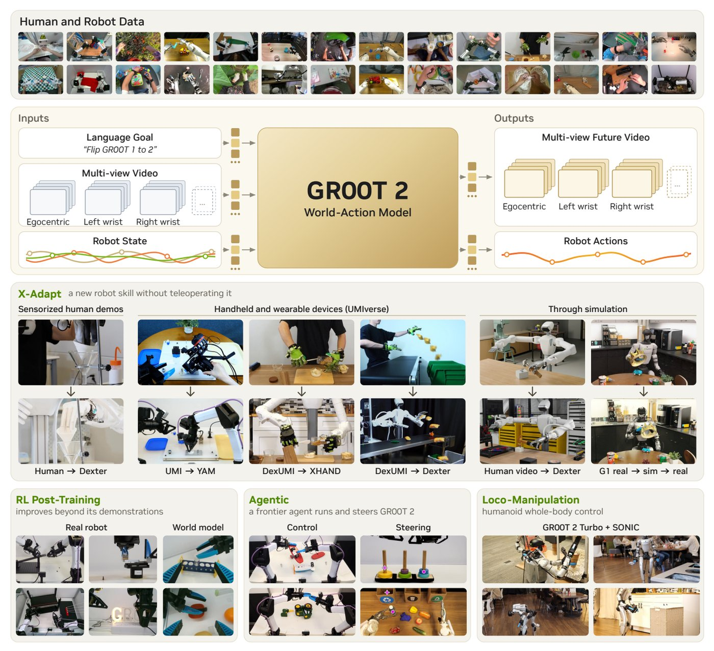
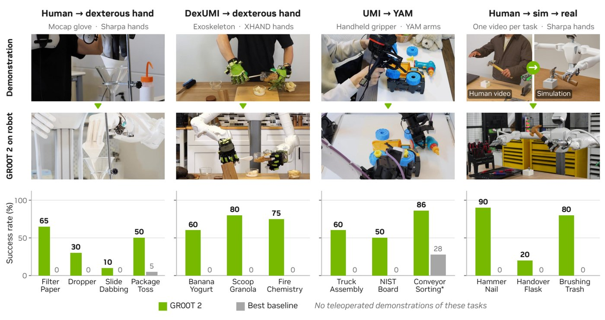
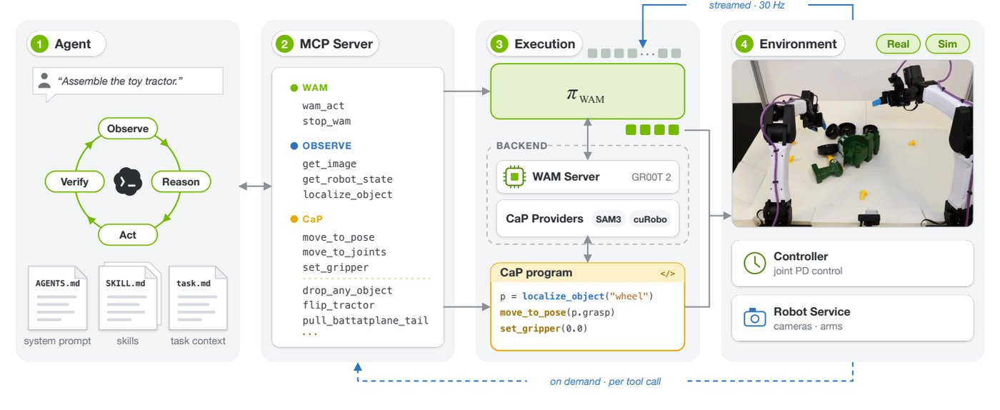
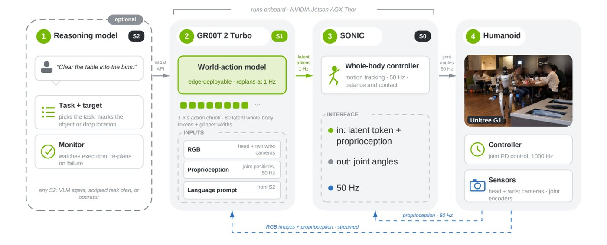
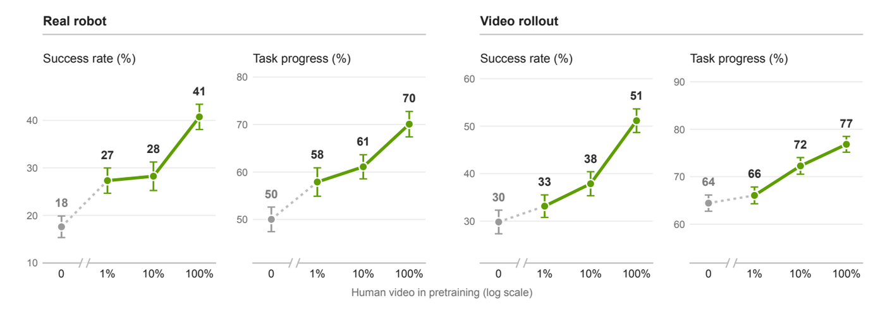
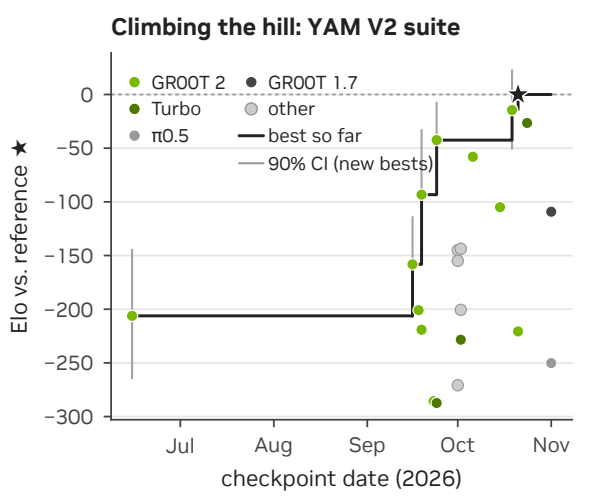
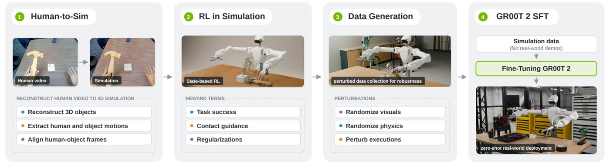

> NVIDIA GEAR가 2026년 11월 공개한 GR00T 2 whitepaper를 리뷰한다. GR00T 2는 vision-language-action(VLA) 모델이 아니라 **world-action model(WAM)**, 즉 미래 영상과 로봇 action을 한 transformer가 함께 예측하는 모델이다. 이 설계로 action이 없는 human video까지 pretraining에 쓰고, 한 embodiment에서 배운 skill을 다른 로봇으로 옮기며(X-Adapt), RL과 agent로 신뢰도를 끌어올린다. 135쪽 보고서의 본문(1~5장)을 따라 정리하고 부록의 세부는 필요한 곳에서 인용한다.

## 논문 정보

| 항목 | 내용 |
| --- | --- |
| 제목 | [GR00T 2: Scaling Robot Foundation Models for Generalization, Dexterity, and Adaptation](https://research.nvidia.com/labs/gear/gr00t-2/assets/gr00t2_whitepaper.pdf) |
| 저자 | NVIDIA (GEAR 팀) |
| 소속 / 연도 | NVIDIA, 2026년 11월 (whitepaper, CoRL 2026에서 발표) |
| 분야 | Robot Foundation Model / World-Action Model / Manipulation |
| 프로젝트 | [research.nvidia.com/labs/gear/gr00t-2](https://research.nvidia.com/labs/gear/gr00t-2) |
| 코드 | 미공개 (프로젝트 페이지 기준 2026년 12월 공개 예정, 공개되면 갱신) |
| 데이터 | [Human-1M-100K](https://huggingface.co/datasets/nvidia/PhysicalAI-Human-1M-100K) (Hugging Face) |

## 1. Introduction

범용 로봇을 만들려면 다양한 물리 skill을 익히고, task와 embodiment를 넘어 일반화하며, 새 환경과 목표에 효율적으로 적응하는 모델이 필요하다. VLA 모델이 대규모 pretraining의 가능성을 보였지만, 저자들은 로봇 지능의 scaling이 "더 큰 demonstration 데이터셋"만으로 되지 않는다고 본다. 범용 로봇 foundation model은 이질적인 물리 경험 소스에서 배우고, 적은 task 감독으로 새 능력을 얻고, 상호작용으로 개선되고, 복잡한 로봇 시스템 안에서 신뢰성 있게 반응해야 한다. 나아가 로봇이 자율적이 될수록 학습된 물리 능력이 상위 reasoning·planning 시스템에서 접근 가능해야 한다. 이를 위해서는 로봇이 **어떻게 행동하는지**뿐 아니라 **행동이 세계를 어떻게 바꾸는지**를 포착하는 모델이 필요하다는 것이 출발점이다.

GR00T 2는 이 관점의 foundation **world-action model(WAM)**이다. 미래 시각 관측과 embodied action을 함께 예측하면서 물리 상호작용이 어떻게 전개되는지와 그것을 만드는 action을 같이 배운다. 보고서가 내세우는 네 가지 진전은 다음과 같다.

1. 다양한 manipulation task와 embodiment에서 강한 out-of-the-box 성능
2. 매우 적은 demonstration으로 어려운 새 task에 빠르게 적응하고, RL로 실세계 상호작용을 통해 신뢰도를 더 높임
3. **X-Adaptation**(cross adaptation): 한 embodiment에서 얻은 물리 지식을 미래 관측·action의 joint prediction을 통해 다른 embodiment로 전이
4. **Agentic 제어**: code-as-policy(CaP)로 skill을 조합·복구하는 것과, 시각 target으로 행동을 유도하는 **WAM API**

**X-Adaptability의 창발.** 핵심 혁신으로 꼽는 것은 학습 때 본 적 없는 task-scene-embodiment 조합으로 일반화하는 능력이다. 어떤 task는 사람 demonstration에만 있고, 목표 로봇은 전혀 다른 task 데이터로만 표현돼 있다고 하자. joint world-action pretraining을 거친 GR00T 2는 **그 task를 목표 로봇이 수행하면 어떻게 보일지를 상상하고, 그 상상된 상호작용에 대응하는 action을 생성**한다. 이것이 UMI demonstration, dexterous UMI 데이터, 사람 손 상호작용, 운동학이 크게 다른 로봇 embodiment 사이에서 물리 지식을 옮기는 메커니즘이 된다. 저자들은 이를 "pretraining 중 배운 물리 행동이 embodiment를 넘어 실행 가능한 능력이 되는" 새로운 scaling 성질로 본다.

**Fast Adaptation과 Agentic 제어.** 다양한 pretraining mixture가 넓은 행동 레퍼토리를 주어 적은 demonstration으로 새 skill을 얻게 하고, RL로 신뢰도를, 효율적 inference로 반응성을 보강한다. 그 위에 상위 reasoning agent가 CaP로 skill을 조합하고 실행을 감시하며 실패에서 복구한다. 또 joint world-action 표현은 "원하는 시각적 결과나 중간 미래 상태"로 로봇 행동을 조향하는 자연스러운 인터페이스가 되고, 이를 WAM API로 노출한다.

*[Figure 1] GR00T 2 전체 개요. 사람·로봇 데이터로 pretraining하고, 언어 목표·multi-view video·로봇 상태에서 multi-view 미래 video와 action을 함께 예측하며, X-Adapt·RL post-training·agent·GR00T 2 Turbo+SONIC으로 확장되는 구성*

**GR00T 2 Turbo.** 경량 변형도 함께 소개한다. joint video-action 예측은 action이 학습된 시각 dynamics의 덕을 보게 하지만 video token 처리가 비싸고, multi-view 저지연 제어에서 특히 그렇다. Turbo는 더 압축된 video 표현을 쓰되 joint world-action modeling 틀은 유지해 학습·추론을 빠르게 하며, humanoid whole-body 제어에 맞다.

## 2. GR00T 2 Overview

GR00T 2는 로봇의 시각·proprioceptive 입력과 사용자 지시가 주어지면 **장면이 어떻게 전개될지와 로봇 action을 모두 예측하는 단일 모델**이다. 하나의 pretrained checkpoint가 parallel-gripper 팔, dexterous hand, humanoid를 모두 담당하며, 사람 egocentric video, 손에 드는 UMI gripper 데이터, 로봇 teleoperation 데이터를 함께 학습한다.

**입출력.** 매 제어 스텝에서 (i) 최대 4대 카메라(보통 head 1대 + 양쪽 wrist)의 224×320 이미지 **0.8초 history를 5 fps로**, (ii) 로봇 proprioceptive 상태, (iii) 자연어 지시를 받는다. 출력은 미래 action chunk와 **모든 카메라의 예측 미래 프레임**이다. 로봇은 다음 chunk가 계산되는 동안 현재 chunk를 자체 컨트롤러로 실행한다.

**Architecture.** world simulation용으로 pretraining된 video diffusion transformer **Cosmos-Predict2.5-2B** 위에 만들어졌다. video, state, action 입력이 모두 token이 되어 하나의 2B transformer 시퀀스에 들어간다.

- **Video.** 고정된 Wan 2.1 video VAE가 각 카메라 스트림을 시간 4×, 공간 각 축 8× 압축한다. latent를 patch로 나누면 224×320에서 latent 프레임·카메라당 280 token이 된다. 학습된 view embedding이 token의 카메라를 알려 준다. 과거 프레임은 context로 들어가고 미래 프레임은 생성된다
- **Language.** 고정된 Cosmos-Reason1 vision-language model이 지시를 인코딩하고 transformer가 cross-attention으로 읽는다
- **State와 action.** embodiment별 작은 MLP가 로봇 상태와 noisy action chunk를 transformer 폭으로 매핑하고, embodiment별 decoder가 출력 token을 action으로 되돌린다

transformer 안에서 video token은 시간·카메라를 가로질러 서로 attend하고, **action token은 생성 중인 미래 프레임을 포함한 모든 video token에 attend**한다. 따라서 action이 모델이 상상한 미래를 따라갈 수 있다. 학습은 **flow matching**으로 미래 video latent와 action에 각각 loss를 두어 함께 한다. 추론 시 denoising은 몇 스텝이면 충분하다(배포 기준 video 1~2 스텝, action 2~4 스텝).

**GR00T 2 Turbo.** GR00T 2는 workstation GPU에서 이미 실시간으로 돈다(RTX 5090에서 3-view Dexter action chunk 예측 중앙값 153 ms). 그러나 humanoid whole-body loco-manipulation은 훨씬 엄격한 예산을 요구하고 Jetson AGX Thor 같은 edge GPU에서 onboard로 돌아야 한다. 예측하는 token 대부분이 미래 video인데 video는 중복이 크므로, Turbo는 2B transformer는 유지하되 **더 높은 압축률의 VAE**로 video를 인코딩한다. 구체적으로 Wan 2.2 VAE로 바꿔 공간 압축을 축당 8×에서 16×로 올려 spatial latent grid가 4배 작아진다. latent 입출력 projection만 새 VAE에 맞추고 action horizon은 그대로다. Turbo는 Unitree G1의 onboard Jetson Thor에서 124 ms에 예측하며, dexterous task에서는 GR00T 2보다 떨어지지만 bimanual·dexterous manipulation에서 baseline을 크게 웃돈다.

**새 로봇에 쓰기.** 카메라를 head/wrist view에 매핑하고, action을 지원되는 action space로 표현하고(또는 새로 추가), 목표 task의 demonstration으로 post-training한다. 3장이 그 demonstration이 얼마나 적어도 되는지, teleoperation을 사람·UMI demonstration으로 아예 대체하는 법을 보인다.

## 3. GR00T 2 Capabilities

### 3.1 Fast Adaptation: Zero-Shot Generalization and Few-Shot Mastery

**새 task zero-shot 배포.** 여러 로봇의 teleoperation 데이터와 Human-1M human video로 pretraining한 결과, 목표 로봇에서 본 적 없는 task를 수행하는 능력이 창발한다. 이를 **Dexter**(Tianji 로봇 + 22-DoF Sharpa hand 두 개)에서 50개 task로 시험했는데, 이 task들은 Dexter 데이터에는 없고 YAM gripper 데이터나 human video에만 있다. 언어 지시만으로 바로 배포했을 때 **40%** 성공, 50개 중 40개를 최소 한 번 완수했다. 실패 대부분은 전체 실행은 맞는데 한 단계의 정밀도가 부족한 경우였다. 이 능력은 데이터와 함께 자라서, pretraining의 human video 양이 늘면 새 Dexter task의 zero-shot 성공률이 두 배 이상이 된다(Figure 10).

**분 단위 로봇 데이터로 few-shot 숙달.** pretrained 모델이 이미 task에 접근하는 법을 알기 때문에 아주 적은 로봇 데이터로 간극이 메워진다. task당 teleoperation 에피소드 1개로 71%, 5개(로봇 데이터 3분 미만)로 **95%**에 이르며 50개 중 37개 task가 모든 trial에서 성공한다. 단, 이 50개 task는 "5개 에피소드로 80% 이상 배우는 task" 중에서 골랐으므로 5-shot 수치는 구성상 높은 면이 있다고 밝힌다. 각 적응은 RTX 5090 한 장에서 약 30분의 LoRA fine-tuning이고, adapter를 가중치에 병합하면 pretrained 모델과 똑같이 서빙된다.

**정밀도와 dexterity를 요구하는 long-horizon task.** 같은 pretraining이 많은 정밀 단계를 잇는 long-horizon task의 post-training에서도 효과를 낸다. YAM의 6개 task(24단계 장난감 자동차 조립부터 breaker에 전선 삽입까지)에서 평균 **71.7%** 성공, VLA·WAM baseline은 최대 12.5%다. dexterous hand의 7개 task(crude salt 여과, 비타민 C 검사, GB300 메모리 모듈 교체 등)에서 평균 **68.6%**, GR00T 1.7과 π0.5는 최대 0.7%다. 저자들은 dexterous hand로 매 단계 빡빡한 공차를 지키며 이런 task를 end-to-end로 끝내는 것을 generalist 로봇 모델의 새 능력으로 본다.

| Task | GR00T 2 Prog. | GR00T 2 SR | GR00T 2 Turbo Prog. | GR00T 2 Turbo SR | π0.5 Prog. | π0.5 SR | GR00T 1.7 Prog. | GR00T 1.7 SR | FastWAM Prog. | FastWAM SR | MolmoAct2 Prog. | MolmoAct2 SR | FLUX 3 Action Prog. | FLUX 3 Action SR |
| --- | --- | --- | --- | --- | --- | --- | --- | --- | --- | --- | --- | --- | --- | --- |
| Hot Wheels Assembly | **95.4** | **85.0** | 68.6 | 50.0 | 13.1 | 0.0 | 19.5 | 0.0 | 0.8 | 0.0 | 1.5 | 0.0 | 0.5 | 0.0 |
| Toy Tractor Assembly | **63.8** | **45.0** | 54.5 | 40.0 | 8.4 | 0.0 | 3.6 | 0.0 | 1.9 | 0.0 | 1.1 | 0.0 | 2.4 | 0.0 |
| Toy Plane Assembly | **71.0** | **70.0** | 63.5 | 55.0 | 24.0 | 10.0 | 11.0 | 0.0 | 10.0 | 0.0 | 13.5 | 0.0 | 10.0 | 0.0 |
| iPhone into Box | 89.0 | **65.0** | **91.0** | 55.0 | 67.5 | 5.0 | 49.5 | 15.0 | 17.0 | 0.0 | 38.0 | 0.0 | 19.5 | 0.0 |
| Fixed-Pipe Fittings | 70.0 | 70.0 | **90.0** | **90.0** | 30.0 | 30.0 | 35.0 | 35.0 | 45.0 | 45.0 | 35.0 | 35.0 | 0.0 | 0.0 |
| Wire into Breaker | 98.5 | 95.0 | **100.0** | **100.0** | 30.0 | 30.0 | 17.0 | 0.0 | 18.5 | 5.0 | 10.0 | 10.0 | 8.0 | 0.0 |
| Average | **81.3** | **71.7** | 77.9 | 65.0 | 28.8 | 12.5 | 22.6 | 8.3 | 15.5 | 8.3 | 16.5 | 7.5 | 6.7 | 0.0 |

*[Table 1a] YAM long-horizon post-training benchmark. Prog.는 전체 trial의 평균 task progress, SR은 성공률(0~100). 행별 최고 Prog.·SR bold, 각 YAM 결과는 최대 20 trial. Truck Assembly는 GR00T 2·Turbo가 수정된 쉬운 시작 장면으로 평가됐고 원래 장면에서는 GR00T 2가 20회 중 7회 성공(progress 94.0)*

| Task | GR00T 2 Prog. | GR00T 2 SR | GR00T 2 Turbo Prog. | GR00T 2 Turbo SR | GR00T 1.7 Prog. | GR00T 1.7 SR | π0.5 Prog. | π0.5 SR |
| --- | --- | --- | --- | --- | --- | --- | --- | --- |
| Make Shipping Label | **78.0** | **60.0** | 73.0 | **60.0** | 41.0 | 5.0 | 16.0 | 0.0 |
| Flashlight Battery Replacement | **86.0** | **55.0** | 49.0 | 15.0 | 34.0 | 0.0 | 41.0 | 0.0 |
| GB300 Memory | **96.0** | **85.0** | 81.0 | 50.0 | 43.0 | 0.0 | 55.0 | 0.0 |
| Truck Assembly | **98.0** | **65.0** | 43.0 | 5.0 | 0.0 | 0.0 | 0.0 | 0.0 |
| Crude Salt Filtering | **98.0** | **85.0** | 88.0 | 65.0 | 17.0 | 0.0 | 14.0 | 0.0 |
| Vitamin C Test | **86.0** | **75.0** | 67.0 | 25.0 | 9.0 | 0.0 | 14.0 | 0.0 |
| Microscope | **64.0** | **55.0** | 33.0 | 20.0 | 10.0 | 0.0 | 9.0 | 0.0 |
| Average | **86.6** | **68.6** | 62.0 | 34.3 | 22.0 | 0.7 | 21.3 | 0.0 |

*[Table 1b] Dexterous-hand long-horizon post-training benchmark. 표기는 Table 1a와 같음*

**GR00T 2 Turbo.** edge 배포용으로 설계됐지만 능력의 상당 부분을 유지한다. zero-shot 평가에서 YAM은 GR00T 2에 근접하고 Dexter는 평가 모델 중 2위다. post-training 후에는 YAM 65.0%, dexterous hand 34.3%로 일부를 내주지만 여전히 baseline을 크게 웃돈다.

### 3.2 X-Adaptability: Cross-Embodiment Skill Transfer

GR00T 2는 **task별 teleoperation demonstration 없이** 로봇에게 새 task를 가르칠 수 있다. 네 가지 경로가 있다. motion-capture glove, DexUMI exoskeleton, 손에 드는 Gripper UMI로 기록한 demonstration, 그리고 사람 video 한 편을 simulation으로 확장하는 것이다.

*[Figure 4] teleoperation 없이 새 task 학습. 열마다 목표 로봇 없이 task를 시연하는 한 방식, GR00T 2의 로봇 rollout, task별 실로봇 성공률. Best baseline은 그 task에서 평가된 다른 모델(GR00T 1.7, π0.5, LingBot-VA) 중 최고. \*Conveyor Sorting은 trial 성공률이 아니라 컨베이어 50개 물품 중 분류한 비율*

glove와 Gripper UMI처럼 로봇과 다른 embodiment에서 온 demonstration에는 하나의 레시피가 간극을 메운다. **로봇 없이 기록한 demonstration이 task를 지정하고, 목표 로봇의 task-agnostic play 데이터가 embodiment를 지정하며, cross-embodiment pretraining이 둘을 잇는다.** 이 pretraining 없이 같은 post-training 데이터를 쓰면 성능이 크게 낮다. baseline들은 GR00T 2와 같은 데이터로 post-training했다. teleoperation demonstration이 있을 때는 사람 데이터를 대체하는 게 아니라 보완한다.

**Dexterous hand로의 전이.** 로봇 없이 dexterous demonstration을 기록하는 장치가 둘이다. 맨손에 끼는 motion-capture glove와, 로봇 손의 관절·접촉면을 복제하고 손가락 끝 힘을 손의 tactile 형식으로 기록하는 DexUMI exoskeleton이다. glove의 경우 head·wrist 카메라와 함께 기록하고, 오프라인에서 로봇 손으로 retargeting한 뒤 목표 로봇의 play 데이터와 co-training한다. Sharpa hand를 단 bimanual 로봇에서 이 레시피로 정밀한 화학 실험 task와 teleoperation으로는 시연할 수 없는 빠른 conveyor toss를 가르쳤다. 한 task에서는 teleoperation demonstration 없이 학습한 GR00T 2가 cross-embodiment pretraining 없이 teleoperation 10개를 받은 baseline을 앞섰다. DexUMI는 힘과 compliance에 의존하는 task로 확장한다. 힘 기록으로부터 GR00T 2는 motion과 함께 **가할 힘을 예측**하고 손의 stiffness가 그 힘에 맞춰진다. DexUMI demonstration만으로 학습해 long-horizon 아침식사 task에서 바나나를 썰고 병뚜껑을 열고, 성냥을 그어 램프를 켜며 task당 60~80% 성공한다. GR00T 1.7과 π0.5는 하나도 완수하지 못한다. DexUMI demonstration은 exoskeleton이 복제하지 않는 손으로도 옮겨진다. 22-DoF Sharpa hand로 retargeting하면 microscope slide dabbing 60%, conveyor package 선택·toss 65%를 성공하고 두 baseline은 0이다.

**Parallel-gripper 로봇으로의 전이.** 손에 드는 Gripper UMI로 로봇식 wrist 카메라와 width encoder를 통해 로봇 포맷으로 기록하고, 카메라·gripper·작업공간을 모두 공유하지 않는 YAM에 배포한다. task-agnostic YAM play 데이터와 co-training하고 YAM의 카메라 기하와 action space에 정렬한다(§4.4.2). task당 41~75개 demonstration, teleoperation 없이 long-horizon 장난감 조립 60%, 보드 분해 50%를 완수하고 움직이는 컨베이어에서 물품 86%를 분류한다. baseline은 두 long-horizon task를 하나도 못 한다. 10~20개로도 end-to-end 성공이 나온다. 수집이 로봇과 분리되고, 사람 속도의 motion이 dynamic skill을 배울 수 있게 한다.

**사람 video 한 편에서 simulation을 거친 전이.** video 한 편에서 물체와 손-물체 motion을 재구성하고, simulation에서 RL expert를 학습하고, 그 expert의 시각 randomization된 rollout으로 GR00T 2를 fine-tuning한다. 결과 policy는 실로봇으로 zero-shot 전이되어 못 박기를 10회 중 9회 성공하고, GR00T 1.7과 π0.5는 실세계 task를 하나도 완수하지 못한다.

### 3.3 Robust Deployment through Reinforcement Learning

supervised fine-tuning(SFT)이 manipulation skill을 주지만 contact-rich task는 정렬과 물리 상호작용의 작은 오차에 민감하다. SFT policy 위에 **실세계 RL**을 적용해 실제 상호작용과 task 수준 성공 피드백으로 신뢰도를 높인다. 네 가지 정밀 manipulation task(더 어려운 자세에서 시작하는 fixed-pipe fittings, finger placement, cable insertion, charger insertion)로 평가한다. **GRPO**(Group Relative Policy Optimization)로 GR00T 2를 직접 최적화하고, 성공한 GRPO rollout으로 추가 학습하는 **GRPO-induced self-imitation**을 쓴다. 고정된 GR00T 2 위에 보정을 배우는 **residual RL**과도 비교한다.

GRPO-induced self-imitation은 네 task에서 각각 **88%, 98%, 94%, 96%**를 달성한다(SFT는 40~76%). residual RL도 성능을 올리지만 GR00T 2 자체는 갱신하지 않는다. 각 막대는 50 trial, 95% Wilson 구간이다. 이렇게 얻은 skill은 더 복잡한 long-horizon task의 agentic 실행에 통합된다(§3.4).

### 3.4 Agentic GR00T 2

frontier multimodal agent와 GR00T 2는 task의 상호보완적인 부분을 맡는다. **agent는 무엇을 할지**(긴 task 분해, 진행 감시, 코드 작성)를, **GR00T 2는 어떻게 할지**(스크립트로 짜기 어려운 contact-rich manipulation)를 정한다. agent가 System 2로서 GR00T 2를 카메라·상태·CaP 도구와 나란히 하나의 도구로 호출한다. 네 가지 방식으로 GR00T 2를 지원한다.

- **Augment**: 기억이나 명시적 reasoning이 필요한 task에서 agent가 task 수준 프로그램을 돌리며 manipulation 단계마다 GR00T 2를 부른다. RL post-training과 합쳐 RoboCasa365와 RoboDojo 리더보드 모두 1위
- **Assist**: 실로봇에서 agent가 GR00T 2를 지켜보다가 떨어진 부품이나 정체를 보면 CaP skill로 상태를 수리하고 제어를 돌려준다. 어지러진 조립 task 셋에서 post-trained GR00T 2를 거의 완벽한 성공으로 끌어올림
- **Guide**: 언어 외에 WAM API를 통해 시각 target으로 GR00T 2를 조향
- **Improve**: 자율 research agent가 GR00T 2 post-training에 쓰는 RL 레시피의 기반을 발견(§4.1)

*[Figure 6] Agentic runtime 구조. System 2가 observe-reason-act-verify 루프로 실행을 감시하며 GR00T 2와 CaP 도구를 호출하고, GR00T 2 또는 ASPIRE가 생성한 프로그램이 공유 실행 환경 인터페이스 위의 backend가 되는 구성*

저자들의 권고는 manipulation은 GR00T 2에 맡기고 agent에는 task 구조, 성공 검사, 작은 복구 skill 라이브러리를 주라는 것이다.

**Code-as-Policy로 skill 조합과 복구.** simulation에서는 ASPIRE로 GR00T 2 호출을 perception·reasoning·CaP primitive와 조합하는 task 수준 프로그램을 발견한다. RL post-training과 결합해 **RoboCasa365 88.0%, RoboDojo 75.8%**(공식 layout bank 셋 중 하나)로 2026년 11월 6일 기준 두 리더보드 최고 기록이다.

실로봇에서는 GR00T 2가 주 실행자이고 agent가 진행을 감시하며 CaP skill로 표적 복구를 한다. YAM의 long-horizon 조립 task 셋(Toy Plane, Toy Tractor, Hot Wheels)을 Table 1a보다 훨씬 어려운 조건에서 시험했다. 벤치마크는 부품이 정렬된 배치에서 시작하지만, 여기서는 **매 trial 전에 사람이 부품을 책상에 무작위로 쏟아** 겹치고 임의 자세인 처음 보는 배치에서 시작하며, 방법당 100 trial이다. 로봇은 부품을 찾아 순서대로 조립하고 장난감 드릴로 고정하고 자기 오류에서 복구해야 하며 한 trial이 보통 5~14분이다. Hot Wheels의 경우 벤치마크는 고정 배치에서 85%지만 부품을 쏟으면 SFT policy는 100회 중 23회 성공한다. **DAgger**로 세 task가 84, 71, 78회가 되고, agent가 떨어진 부품과 정체를 수리한 뒤 제어를 돌려주는 hybrid 실행은 **98, 97, 97회**에 이른다.

§3.3의 RL 정밀 skill을 agentic 실행으로 더 긴 task에 조합한다. 반복 cable·charger 삽입에서 로봇은 Ethernet 케이블 5개를 네트워크 스위치에, 충전기 5개를 지정 콘센트에 연달아 꽂아야 한다. CaP가 물체 localization·파지·위치 잡기를, RL 학습된 GR00T 2가 정밀 삽입을 맡고 agent가 순서 조정·검증·복구를 한다. 같은 틀에서 SFT policy를 RL post-trained GR00T 2로 바꾸면 전체 task 성공이 cable 12/20 → 19/20, charger 2/20 → 20/20이 된다.

**Agentic Steering.** agent가 System 2, GR00T 2가 System 1일 때 둘 사이의 인터페이스, 즉 agent가 매 단계 GR00T 2에 무엇을 보낼지가 핵심 설계 질문이고 이를 **WAM API**라 부른다. 언어가 자연스럽지만 장면에 grounding하기 어렵다. GR00T 2가 지시가 가리키는 물체와 위치를 스스로 찾아야 하기 때문이다. 그래서 언어에 더해 **이미지 공간의 grasp·release 점**으로 유도한다. 점이 어떤 물체를 다룰지, 어디에 놓을지, 어느 팔이 움직일지를 직접 지정한다. 이 점들을 팔 색깔의 marker로 카메라 이미지에 그려 넣고 언어 지시와 함께 조건으로 받도록 **mid-training**한다. 점 감독은 기존 demonstration의 gripper·hand 상태에서 자동 생성되므로 수동 annotation도 새 로봇 demonstration도 필요 없다. mid-training 후에는 task별 policy fine-tuning 없이 agent가 생성한 점으로 조향할 수 있다. agent는 zero-shot으로, 에피소드당 한 대화로 쓴다.

YAM과 Dexter 두 embodiment에서 두 tier로 평가한다. short-horizon 벤치마크는 몇 단계의 지시 따르기를, long-horizon은 두 로봇 모두의 trash-sorting 전체 완수와 YAM의 보드 분해 stress test를 본다. short-horizon 지시는 reference 유형(nominal, spatial, ordinal, cardinal, arm, object-exclusion)과 실행 요건(action, grasp)으로 분류했다. 세 설정을 비교하면, 원래 task 지시만 받은 GR00T 2, agent의 언어 안내를 받은 GR00T 2, agent의 언어 안내와 시각 marker를 받은 point-conditioned GR00T 2 중 **시각 조향이 두 tier 모두 최고**다. short-horizon 벤치마크 평균 76.8%, long-horizon 평균 전체 task 성공 53.3%이고, agent 언어 안내만으로는 44.2%와 1.7%다.

다만 grasp·release 점이 모든 task 요건을 전달하지는 못한다. marker는 공간 target을 지정할 뿐 완전한 manipulation 전략이 아니어서, 물체를 옆으로 눕히기, 붓기, 떠내기 같은 요건은 여전히 언어와 GR00T 2의 학습된 skill에 달려 있다. 저자들은 목표 6D 물체 pose, goal image, affordance 기반 marking 같은 더 풍부한 안내로 인터페이스를 확장할 수 있다고 적는다.

### 3.5 Humanoid Loco-Manipulation

이족 humanoid loco-manipulation은 추가 난제를 낳는다. 모든 motion 내내 균형을 유지해야 하므로 50 Hz의 고주파 whole-body 제어가 필요하다. GR00T 2 Turbo를 학습된 whole-body controller **SONIC**과 짝지어 이 설정에 가져온다. Turbo가 카메라 관측과 proprioception으로 다음에 취할 motion을 고르고, SONIC이 그 motion을 관절 명령으로 바꾼다. 두 모델 모두 humanoid에 onboard로 돈다.

*[Figure 9] whole-body loco-manipulation 3단 스택. 선택적 reasoning model(S2)이 task와 prompt를 고르고, GR00T 2 Turbo(S1)가 RGB·proprioception에서 SONIC whole-body motion token 1.6초 chunk를 약 1 Hz로 예측하며, SONIC(S0)이 token을 50 Hz 관절 위치 목표로 decode하고 PD 컨트롤러가 1000 Hz로 추종. S1은 Jetson AGX Thor, S0은 Jetson Orin NX에서 onboard 실행*

**Whole-body loco-manipulation.** SONIC의 whole-body motion latent 인터페이스를 action space로 써서 GR00T 2 Turbo가 humanoid 전신을 locomotion과 manipulation에 조율한다. 실세계 long-horizon whole-body task 넷으로 평가한다. 팝콘 서빙(한 손으로 컵을 들고 다른 손으로 떠서 붓기), 테이블 정리(다양한 물체를 집어 쓰레기통까지 걸어가 넣기), 바닥 줍기(숙여서 다양한 물체 줍기), whole-body 청소(바닥의 컵을 집고 발 아래 수건으로 쏟은 것을 닦고 무릎 꿇어 수건을 회수해 버리기)다. 팝콘 서빙에서 Turbo는 **48 trial 전부** 완수하고, 같은 demonstration과 controller를 쓴 GR00T 1.7은 83.3%다. 각 trial은 컵 두 개를 채워야 한다.

**Loco-manipulation의 sim-and-real.** whole-body teleoperation 데이터는 수집 비용이 커서, 기록된 motion 하나를 다양한 장면의 demonstration으로 바꾸는 **motion 중심 real-to-sim 파이프라인**을 설계했다. simulation에서 motion을 SONIC으로 재생하되 고정해 두고, 로봇이 집기를 완수하도록 테이블·물체 배치를 맞춘 뒤 성공한 rollout을 다양한 방에서 렌더링한다. 실로봇의 controller와 action 표현을 보존하면서 시각 다양성을 넓힌다. out-of-distribution 테이블 pick-and-place에서 WAM이 VLA baseline보다 이 simulation 데이터를 더 잘 활용한다. 실데이터만으로 같은 6.7%에서 출발해 co-training으로 GR00T 2 Turbo는 63.3%, GR00T 1.7은 40.0%가 된다(각 30 trial).

## 4. How We Made GR00T 2

### 4.1 Training: Pre-Training and RL Post-Training

**Pre-training.** pretrained Cosmos-Predict2.5-2B video diffusion transformer에서 초기화한다. 이 video 모델을 범용 로봇 policy로 바꾸려면 물리 상호작용의 전개를 이해하고 그 dynamics를 embodiment를 넘어 action에 연결해야 하므로, 사람·로봇 경험의 다양한 mixture로 **3단계**에 걸쳐 학습한다.

1. **Stage 1: Single-view video pre-training.** egocentric human video(로봇 데이터로 보강)로 embodied 시각 경험에 적응시킨다. 사람 demonstration은 다양한 task·환경에서 손이 물체와 상호작용하는 예를, 로봇 관측은 로봇 manipulation의 시각 조건을 준다. 각 예시는 단일 카메라 view이고 관측 history에서 미래 video를 예측한다. action을 만들기 전에 embodied 상호작용의 시각 dynamics prior를 세우는 것이 목적이다
2. **Stage 2: Multi-view video-action training.** embodiment별 state·action 모듈을 붙여 학습된 시각 dynamics를 action에 연결한다. 사람·로봇 데이터에서 video와 action 예측을 함께 학습하고, 가능하면 multi-view 관측을 쓴다. 로봇 궤적은 embodiment별 action을, 사람 demonstration은 **추적된 hand-pose 궤적을 action 감독으로** 제공한다. video와 action 모두 flow matching 목적함수이고, action loss는 유효한 action 감독이 있을 때만 적용한다. mixture는 YAM과 dexterous-hand 소스 비중을 높이되 egocentric human 데이터도 상당량 유지한다
3. **Stage 3: Robot-upweighted video-action training.** 최종 policy는 로봇 자신의 action space에서 action을 내야 하므로, 로봇 demonstration(특히 YAM)에 더 큰 비중을 두고 joint video-action 학습을 이어 간다. dexterous-hand, egocentric human, 기타 소스도 유지한다

결과 모델이 task별 적응과 RL post-training의 출발점이 된다.

**RL post-training.** 탐색을 위해 rollout 때 GR00T 2의 결정적 action denoising을 **Coefficients-Preserving Sampling(CPS)**으로 바꿔 action denoising에만 noise를 넣고 video denoising은 결정적으로 둔다. policy 갱신은 GRPO 식의 group-relative 목적함수를 쓰되, **baseline이 각 context의 과거 return도 기억**해 모든 시도가 성공하거나 모두 실패한 group에서도 학습 신호가 남게 한다. 이 레시피의 기반은 research agent **AutoRL**이 simulation에서 약 35일간 알고리즘을 반복 개선해 찾았다. 보완 접근 둘은 성공한 GRPO rollout으로 fine-tuning하는 GRPO-induced self-imitation과, 고정된 GR00T 2 위에 작은 보정 policy를 배우는 residual RL이다. 실로봇 없는 RL을 위해서는 **DreamDojo** world model을 초기 policy의 rollout으로 목표 task에 적응시키고 학습된 완료 detector를 reward로 쓴다(§4.5.3). 온라인 인프라가 로봇 상호작용·학습·평가를 조율하고 중단을 넘어 경험을 유지한다.

### 4.2 Data

사람 demonstration, UMI demonstration, 로봇 teleoperation이 상호보완적 역할을 한다. Human-1M의 egocentric human video는 물리 상호작용과 환경의 넓은 coverage를 주고 로봇 성능이 그 양과 함께 자란다. UMI는 로봇 호환 action 표현을 가진 확장 가능하고 task에 집중된 demonstration을, teleoperation은 embodiment별 행동과 실행 가능한 action을 준다. 데이터 엔진 **Flora**가 이 규모에서 사람·로봇 에피소드의 subtask annotation을 단다.

#### 4.2.1 Human Data

world action model에게 egocentric 사람 경험은 물체·affordance·task·장면·환경을 넓게 덮는 데 필요한 motion·시각 다양성을 준다. GR00T 2는 Human-1M에서 필터링한 고품질 egocentric 데이터 **402,730시간**, 약 1,375만 에피소드, 51,500명 이상의 수집자, 123,000개 장면을 쓴다. Human-1M은 egocentric 카메라로 sensorize한 숙련 노동 **100만 시간** 데이터셋으로 dense 언어 annotation, SLAM, 3D hand pose keypoint를 갖추고 in-the-wild와 studio 환경을 모두 포함하며 NVIDIA가 curation했다.

**In-lab human data.** 목표 로봇 embodiment로의 직접 전이를 위해 더 엄격한 프로토콜로 수집한 **로봇 정렬 studio 데이터 3,000시간**을 포함한다. egocentric·wrist 카메라 시점을 맞춰 시각 간극을, 시연 속도를 로봇에 맞춰 motion 간극을 줄인다. 각 task를 반복 가능한 전략으로 수백 번 시연하는 demonstration 형식이다.

**Human data scaling.** 같은 architecture·학습 레시피·post-training teleoperation 데이터 아래 Human-1M pretraining 비율 네 가지(0%, 1%, 10%, 100%)를 ablation한다. 학습 길이는 epoch로 통제한다. 1%, 10%, 100% 모델은 공유된 human-video pretraining checkpoint에서 시작해 각자 몫의 약 0.5 epoch를 pretraining하고, 0% 모델은 human-video pretraining을 건너뛴다. 모든 모델을 같은 Dexter teleoperation 데이터로 3 epoch co-training한 뒤, 72개 Dexter task(새 종류의 지시를 가진 OOD 22개 + Dexter 학습 데이터에 없는 50개)에서 실로봇과 video rollout의 성공률·task progress를 잰다.

*[Figure 10] pretraining human video scaling. Human-1M 0%/1%/10%/100%로 pretraining 후 Dexter teleoperation으로 post-training해 72 task 평가. 실로봇은 task당 3 rollout(운영자가 성공 판정, VLM이 progress 채점), video rollout은 초기 구성 3개 × seed 10개의 autoregressive 생성(VLM 판정). ±1 SEM*

네 설정 모두에서 human 데이터가 늘수록 성능이 오른다. 실로봇 성공률은 0% → 100%에서 **18% → 41%**, video rollout 성공률은 30% → 51%다. 로봇 데이터를 고정한 채 multi-view human video 전부로 pretraining하면 새 task의 실로봇 성공이 두 배 이상이 되고, **어떤 지표도 100%에서 포화하지 않아** human video를 더 넣으면 계속 좋아질 것임을 시사한다.

#### 4.2.2 UMI Data

손에 드는 UMI 장치로 기록한 **UMI-10K**는 품질 관리된 942k 에피소드, **10,184시간**의 bimanual parallel-gripper demonstration을 2,897개 task에 걸쳐 제공한다. 단일 task가 전체 시간의 1.2%를 넘지 않을 만큼 다양하고, 지시는 356개 물체 범주와 49개 dexterous skill을 아우르며 2,798개의 skill-물체 조합을 덮는다. teleoperation이 거의 담지 못하는 dynamic·articulated·deformable manipulation을 포함하고, 지시 따르기를 높이기 위한 counterfactual 쌍도 많다.

#### 4.2.3 Teleoperation Data

cross-embodiment teleoperation demonstration이 로봇 action 감독을 준다. pretraining mixture에 총 **23.5k시간, 116만 에피소드**가 들어 있다.

- parallel gripper를 단 bimanual YAM 팔 (18.7k시간, ABC-130k 포함)
- Sharpa hand를 단 bimanual 팔 (2.9k시간)
- Wuji hand를 단 bimanual 팔 (1.3k시간)
- Unitree G1 humanoid (275시간)
- DROID의 단일 팔 Franka Panda

#### 4.2.4 Data Annotation with Flora

pretraining은 언어 조건화·필터링·재균형을 위해 dense timestamp 언어 annotation을 쓰고, RL post-training은 process reward를, policy 평가는 결과 라벨을 추가로 요구한다. Human-1M과 로봇 코퍼스 규모에서 사람 라벨링은 너무 느리고 frontier API 모델은 너무 비싸다. 그래서 데이터 엔진 **Flora**를 쓴다. Flora는 action 경계를 찾고, 각 action에 자기완결적 명령형 지시를 달고, 결과·dense·rubric 기반 reward를 생성하는 세 모델로 구성된다. WGO-Bench에서 temporal segmentation F1 50.3으로 차순위 GPT-6 Astra의 46.0을 앞선다.

### 4.3 Real-World Benchmarking: Mapping the Hill We Climb

모든 GR00T 2 후보는 실로봇에서의 **blinded head-to-head 대결**로 자리를 얻었고, 그 결과가 어떤 checkpoint가 얼마나 더 나은지, 얼마나 확신할 수 있는지를 말해 주는 하나의 리더보드로 쌓인다.

**왜 head-to-head인가.** 실로봇 평가는 비싸지만 결과가 누적되며, 몇 달치 평가는 서로 비교 가능할 때만 가치가 있다. 절대 성공률은 그렇지 않다. station·운영자·하드웨어·날짜에 따라 흔들려 한 세션의 점수를 다른 세션과 비교할 수 없다. **blinded A/B trial**은 2~4개 checkpoint를 같은 장면에서 같은 운영자가 몇 분 안에 무작위 순서로 돌리므로 drift가 공유되어 비교에서 상쇄된다. 실로봇 리더보드 **GearArena**가 이런 trial을 모두 모은다. 이 보고서 시점에 195개 A/B 캠페인, 16,044개 채점된 로봇 에피소드, 11,767개 쌍별 비교를 10개 YAM station에서 20명 이상의 운영자가 2026년 7~11월에 수집했고 71개 checkpoint를 평가했다.

**첫 원리에서 설계한 task.** 로봇이 무엇을 할 수 있어야 하는지를 묻고, 그 능력을 드러내는 task를 고르고, 실제 checkpoint로 가늠한다. 모든 checkpoint가 완수하는 task는 보관하고 아무도 못 하는 task는 모델이 따라올 때까지 보류한다. 둘 다 아무것도 구분하지 못하기 때문이다. 결과로 일반·dexterous manipulation의 첫 suite와, 언어 따르기·motion primitive 38개 task의 현재 suite가 나왔고 모두 부분 점수 rubric으로 돈다.

**대결에서 지도로.** trial 안의 모든 checkpoint 쌍이 하나의 비교가 되고 운영자의 명시적 순위로 결정된다(동점은 tie). 모든 비교에 공동으로 적합한 **Bradley-Terry** 모델이 각 checkpoint에 Elo rating을 준다. head-to-head 안에서 모든 task는 같은 가중치이고, 신뢰구간은 trial이 아니라 task를 재표집하는 bootstrap에서 온다. 새 checkpoint는 먼저 보드 최고 rating인 A/B reference와 맞붙어 모든 rating이 하나의 연결된 척도에 놓인다.

*[Figure 11] 오르는 언덕의 지도. 현재 YAM suite의 모든 checkpoint를 A/B reference(★, 보드 최고 checkpoint, 여기서는 GR00T 2 Turbo) 대비 Elo로 저장 날짜에 배치. 선은 그때까지의 최고 checkpoint, 막대는 새 최고를 세운 checkpoint의 paired 90% bootstrap 구간. 근거는 122개 캠페인의 6,035개 blinded A/B 비교*

**얻은 것.** Arena가 박빙을 결정으로 바꿨다. GR00T 2는 π0.5보다 **236 Elo**(95% CI 171~325, 기대 승률 80%), GR00T 1.7보다 **95 Elo**(CI 50~148) 높고 500회 bootstrap 전부에서 그렇다. 언어 따르기·motion primitive 같은 기초 skill에 집중한 YAM V2 suite에서 GR00T 2 Turbo는 GR00T 2와 통계적으로 구분되지 않으면서 추론은 약 3배 빠르다(RTX 5090 workstation 호출당 52 vs 171 ms). 4개월 동안 현재 suite의 최고 checkpoint는 206 Elo 올랐고, 6월 모델을 지금 최고 checkpoint가 77% 확률로 이긴다. simulation 평가는 이런 blinded A/B의 Elo를 Pearson 0.93으로 재현한다(§4.5.2).

### 4.4 Learning without Teleoperation: Devices and Pipelines

§3.2의 네 소스 모두에서 demonstration이 task를 지정한다. 사람 motion capture와 Gripper UMI처럼 장치가 로봇과 다르면 목표 로봇의 task-agnostic 데이터가 embodiment를 지정하고 cross-embodiment pretraining이 둘을 잇는다. DexUMI exoskeleton은 자신이 만들어진 로봇 손을 복제하므로 그 손에서는 로봇 play 데이터가 필요 없다. 캡처와 변환이 제거할 수 있는 것(카메라 기하, 운동학, action 의미의 차이)을 학습 전에 제거하고 나머지는 GR00T 2가 메운다. 미래 video를 action과 함께 예측하므로, 이런 demonstration을 로봇 데이터와 함께 학습한 GR00T 2는 **로봇 자신의 손과 팔이 시연된 task를 수행하는 모습을 예측**한다.

#### 4.4.1 Human Demonstrations with Motion Capture

사람이 로봇에 맞춘 자세의 head·wrist 카메라, motion-capture glove, 양 손목의 6-DoF tracker를 착용하고 task를 수행한다. head 카메라가 로봇 head 카메라 pose에 있으므로 손목이 로봇 base frame에 고정되고, closed-form inverse-kinematics solver가 이를 오프라인에서 7-DoF 팔과 22-DoF Sharpa hand로 retargeting하며 pinch 기하를 보존하도록 로봇 손가락 끝을 사람 손가락 끝에 둔다. video는 수정하지 않는다. 같은 solver(초당 약 118,000회 bimanual solve)가 teleoperation도 구동해 목표 로봇의 task-agnostic play 데이터를 모은다. 하나의 play pool을 사람 demonstration과 1:1로 샘플링해 모든 task에 쓴다. 사람만 시연한 task에 대해 GR00T 2는 로봇 자신의 손이 각 단계를 완수하는 모습을 예측한다.

#### 4.4.2 Gripper UMI

Gripper UMI는 UMI 계열의 손에 드는 parallel gripper다. 오픈소스 **GEAR UMI**를 쓰며, 로봇식 wrist 카메라와 width encoder가 로봇 없이 사람 demonstration을 로봇 좌표로 기록하고 UMI-10K pretraining 코퍼스도 여기서 나온다. 손에 드는 장치의 카메라와 손가락을 재현한 로봇 end-effector는 센싱·gripper 간극을 구조적으로 없앤다. 아무것도 공유하지 않는 YAM 같은 기성 로봇에는 세 가지 발견이 전이를 가능하게 한다. (1) task-agnostic YAM 데이터와의 co-training이 외관·장면 간극을 닫아 GR00T 2가 YAM 팔이 task를 수행하는 모습을 예측한다. (2) 모델은 외관은 흡수하지만 기하는 흡수하지 못하므로 fisheye wrist view를 YAM wrist 카메라를 흉내 내도록 re-rendering하며, 시야각과 시선 방향을 대략 맞추면 충분하다. (3) 손에 드는 장치의 action을 YAM의 action space로 다시 표현하고 YAM 자신의 action head로 decode한다. cross-embodiment pretraining과 함께 task당 41~75개로 높은 성공률, 10~20개로 이미 end-to-end 성공이 나오며, 이 수를 정하는 것은 task 길이가 아니라 가장 드문 subskill이다.

#### 4.4.3 DexUMI

DexUMI는 로봇 없는 수집을 parallel gripper에서 다섯 손가락 손으로 확장한다. 오픈소스 **GEAR DexUMI** exoskeleton은 목표 XHAND1 Pro-U hand의 운동학을 복제해 16 DoF를 로봇 관절에 1:1로 매핑하고 접촉면·wrist 카메라 마운트·tactile 형식을 맞춘다. 두 가지 선택이 GR00T 2를 이 데이터에 맞춘다. 첫째, exoskeleton을 video 편집이 아니라 학습에서 처리한다. 초록색 부품을 색으로 segmentation하고 그 외관을 조건 프레임과 예측 프레임에서 일관되게 randomization해, 각 demonstration을 로봇 손으로 재생해 inpainting하던 이전 단계를 없앤다. 둘째, Adaptive Compliance Policy를 따라 손가락 끝 힘을 손 관절의 **torque로 투영해 action에 더한다**. 실행 시 예측된 torque가 각 관절의 stiffness를 낮추고 위치 목표를 offset해 손이 예측된 힘을 가하면서 위치 불확실성에 강건해진다. exoskeleton이 손을 복제하므로 로봇 play 데이터가 필요 없고, DexUMI demonstration만으로 post-training해 양손 long-horizon 도구 사용을 수행한다. exoskeleton이 복제하지 않는 22-DoF Sharpa hand로도 변환할 수 있다. 기록된 관절각에서 XHAND 손가락 끝 위치를 계산해 glove teleoperation에 쓰는 closed-form solver로 retargeting하고, 다른 pose에 있는 Sharpa wrist 카메라에 맞춰 각 wrist 프레임을 warp하며, Sharpa play 데이터와 로봇 action space·정규화 통계로 co-training한다.

#### 4.4.4 Human-to-Sim-to-Real

in-hand reorientation이나 힘을 쓰는 도구 사용 같은 contact-rich skill은 WAM이 배우기 어렵고 복구 행동은 시연하기 어렵다. simulation의 RL이 사람 video 한 편에서 이를 공급한다.

*[Figure 16] Human-to-sim-to-real 전이. (1) human-to-sim이 사람 demonstration 하나에서 asset과 motion을 재구성, (2) simulation에서 state 기반 manipulation policy를 RL로 학습, (3) perturbation 하의 데이터 수집으로 state coverage와 복구 행동 확보, (4) simulation 데이터만으로 GR00T 2를 fine-tuning해 실세계 zero-shot 배포*

NVIDIA Video to Data 파이프라인이 물체 asset과 손·물체 motion을 재구성한다. CHORD로 학습한 state 기반 RL expert가 식별된 로봇 dynamics와 randomization된 물리 아래 물체 motion을 추종하며 task를 완수하는 법을 배운다. 그 rollout에 무작위 action burst와 teleport로 perturbation을 주어 보정이 포함되게 하고, Isaac Lab에서 외관·조명·카메라 calibration을 randomization해 렌더링한다. GR00T 2는 task당 1.5k 에피소드로 학습 시 real-time chunking(§4.6.2)과 함께 fine-tuning되어 실세계 로봇 데이터 없이 실로봇에 배포된다.

### 4.5 Simulation and Evaluation

simulation은 두 역할을 한다. 실세계 task의 digital twin 물리 simulation은 빠르고 반복 가능하며 calibration된 실로봇 평가의 proxy이고, 기록된 rollout으로 적응시킨 학습된 world model의 neural simulation은 RL 환경이다. 공개 simulation 벤치마크 다섯 개로도 평가한다.

#### 4.5.1 Real-to-Sim Task Construction

GR00T 2 개발에 쓴 실세계 task를 simulation에 재현한다. zero-shot 평가하는 일반 manipulation부터 다단계 조립까지, rigid·articulated 물체, deformable 재료, particle을 포함한다. 시각 설정과 함께 task 성패를 가르는 물리 상호작용까지 재현하는 것이 목표다. agent 지원 워크플로우가 환경을 만든다. agent가 실로봇 video, 3D scan, 사진과 SimFoundry 도구로 장면·asset 재구성(기하, 외관, 충돌 모델링)을 처리하고 전문가가 검토·피드백한다. 환경은 Newton 위의 Isaac Lab Arena에서 MuJoCo Warp solver로 돈다. grasp·drop 테스트, 실로봇 demonstration 재생, 조립 환경의 로봇 없는 조립 테스트 등으로 검증한다.

#### 4.5.2 Simulation as a Proxy for Real-World Evaluation

실데이터로 학습한 policy를 simulation에 대한 fine-tuning이나 co-training 없이 이 환경에서 직접 평가한다. 25개 YAM task에서 두 설정 모두로 평가한 14개 GR00T 2 checkpoint(실로봇 task당 blinded A/B 5 trial, simulation 10 trial)에 대해 Pearson 상관이 task progress 0.93, 성공률 0.92, Bradley-Terry Elo 0.93이다. 이는 같은 trial 수에서 완벽한 simulator가 도달할 상관의 95~99%다. DROID 설정에서 재구성한 환경은 generalist checkpoint 5개에 대해 0.98, 0.95, 0.97이다. 이 calibration 덕에 simulation이 개발 도구가 된다. pretraining 중 simulation 평가가 중간 checkpoint를 추적해 최종 후보를 셋으로 좁혔고 이를 실로봇에서 비교했다. sequence packing, mixed-shard sampling 같은 데이터 파이프라인 변경을 소규모 학습과 closed-loop simulation으로 시험한 뒤 채택했고, inference 설정도 simulation에서 선별했다. 성공률 외에 inference 설정이 motion smoothness에 미치는 영향도 드러났고 물리 trial에서 확인됐다. 최종 검증은 여전히 실로봇이지만 simulation 평가가 개발 속도와 반복 빈도를 크게 높였다.

#### 4.5.3 Neural Simulation

물리 simulation은 task마다 재구성이 필요하지만 학습된 world model은 기록된 로봇 상호작용으로 만들 수 있다. pretrained video prior에서 초기화한 world model **DreamDojo**를 GR00T 2가 RL 경험을 모으는 환경으로 바꾼다. DreamDojo를 먼저 multi-view 로봇 에피소드(YAM 8,310개 약 227시간, 실패·복구 포함; DROID 57,773개 약 273시간)로 mid-training하되 카메라 view를 하나의 video canvas에 타일링해 함께 예측하게 한다. 그다음 초기 policy의 성공·실패 rollout 수백 개로 목표 task에 적응시킨다. closed loop에서 GR00T 2가 action chunk를 예측하면 world model이 그 실행 결과 multi-view 프레임을 예측하고 이것이 다음 관측이 된다. world model은 history를 latent에 들고, 마지막 명령 action이 로봇 상태를 대신한다. 에피소드가 짧은 예측을 여러 번 잇기 때문에 world model은 자신의 불완전한 출력에 조건화되는데, RoboLab용 모델은 학습 때 조건 latent에 noise를 주어 그런 history에 노출시킨다. reward는 task 성공을 감지하는 소형 video classifier에서 오며, VLM이 제안하고 사람이 검토한 라벨로 오프라인 학습한다. dense progress 점수는 annotation이 비싸고 policy가 악용할 수 있어 sparse 성공 reward를 쓴다. 이 환경의 RL은 실세계 task 넷(peg insertion, rack-hole insertion, 두 컵에 bun 놓기)에서 GR00T 2 성공을 평균 43% → 72%로, RoboLab 10개 task에서 51% → 71%로 올리며 둘 다 학습된 환경 밖에서 측정했다.

#### 4.5.4 Simulation Benchmarks

공개 벤치마크 다섯 개를 공식 task set·에피소드 예산·성공 기준으로, 각각 같은 pretrained 모델에서 post-training한 단일 checkpoint로 평가한다. baseline은 2026년 11월 6일 기준 공식 리더보드 값이고 GR00T 1.7만 직접 재학습·평가했다. 공개 리더보드의 VLA·WAM policy 중 GR00T 2는 단일 팔 mobile manipulation 벤치마크 **RoboCasa365에서 최고**(67.2%, 이전 최고 대비 +2.8점), bimanual 벤치마크 **RoboDojo에서 최고**(35.5%)다. RoboLab과 MolmoSpaces에서는 실제 DROID 데이터로만 post-training한 채로 각각 3위(47.4%)와 2위(45.1%)로, 둘 다 zero-shot real-to-sim 전이다. G1 Factory humanoid 벤치마크에서 84.7%로 GR00T 1.7의 69.4%를 앞선다. RL post-training과 agentic 실행을 더하면 RoboCasa365와 RoboDojo 모두 1위다(§3.4).

### 4.6 Deployment and Real-Time Inference

배포는 workstation GPU와 compute·메모리·전력이 제한된 edge 하드웨어 양쪽에서 제때 예측, 연속 motion, 효율적 task 완료를 요구한다. VLA policy에 비해 WAM은 이 요구를 맞추기 더 어렵다. multi-camera video를 인코딩하고 video·action latent를 반복 denoising하므로 inference 지연이 더 크다. 가속 inference(§4.6.1), 남은 지연 아래 매끄러운 실행을 위한 학습 시 real-time chunking(§4.6.2), demonstration보다 빠른 task 완료를 가능하게 하는 phase 조건 action chunk 변환(§4.6.3)으로 대응한다.

#### 4.6.1 Policy Serving and Accelerated Inference

client-server 인터페이스로 서빙한다. 로봇 client가 카메라 history·로봇 상태·지시를 보내면 server가 action chunk를 돌려주고, client는 이를 버퍼링해 controller 속도로 실행하며 다음 chunk를 요청한다. server는 먼저 반복 계산을 제거한다. 지시가 같으면 text feature를 재사용하고, timestep 조건을 미리 계산하며, action만 denoising하는 스텝은 최신 video 스텝의 attention key·value를 재사용한다. 그다음 video encoder와 transformer를 CUDA graph로 재생하는 TensorRT 엔진으로 컴파일하고, 지원되는 checkpoint에는 로봇 관측으로 calibration한 뒤 선택된 projection·feed-forward layer에 FP8을 적용하며, task 성공과 smoothness가 허용하는 곳에서 denoising 스텝을 줄인다. 서빙 경로에서는 streaming과 prefetching으로 video 인코딩을 예측 요청보다 앞당긴다. G1의 GR00T 2 Turbo에서는 TensorRT 컴파일이 두 GPU 모두에서 가장 큰 단일 감소를 준다. 전체적으로 같은 checkpoint의 eager BF16 실행 대비 중앙값 예측 지연을 **2.9~7.2배** 줄인다(RTX 5090: 224.7 → 38.4 ms, Jetson Thor 120 W: 720.4 → 124.0 ms, denoising 스텝은 video 2/action 4에서 1/2로). DGX Station GB300에서 GR00T 2는 video 인코딩 prefetch 시 Dexter 48 ms, YAM 54 ms에 예측한다. G1에서 Turbo는 RTX 5090 38 ms, onboard Jetson Thor 124 ms이며 1.6초 whole-body motion token chunk를 약 초당 한 번 계획해 SONIC이 50 Hz로 실행한다. eager BF16과의 수치 비교는 예측 action의 변화를 찾는 데 유용하지만 예측 오차만으로 closed-loop 성공을 단정할 수 없어, inference 변경은 task 성공·완료 시간·motion 품질을 함께 보는 실로봇 평가로 선별한다.

#### 4.6.2 Smooth Execution with Real-Time Chunking

가속 후에도 지연이 남고 로봇은 다음 chunk가 계산되는 동안 계속 움직여야 한다. 매 예측을 기다리면 motion이 끊기고, 지연을 고려하지 않고 비동기 실행하면 연속 chunk 사이에 불연속이 생긴다. 학습 시 **real-time chunking(RTC)**은 각 예측을 이미 실행이 확정된 action prefix에 조건화한다. 이 설정에서 깨끗한 prefix에 조건화하면 연속성은 좋아지지만 짧은 지연에서 task 성공이 떨어진다. 그래서 **noisy-prefix RTC**를 쓴다. fine-tuning 중 조건 prefix에 Gaussian noise를 섞어 이전 계획에 대한 의존을 줄이면서 매끄러운 이어짐에 필요한 context는 유지하고, inference에서는 깨끗한 확정 action에 조건화한다. post-trained policy에 5k 스텝의 짧은 fine-tuning이면 연속성 이득 대부분을 얻어 전체 파이프라인을 다시 돌릴 필요가 없다. simulation 지연을 준 RoboDojo 정밀 task 8개에서 noisy-prefix RTC는 같은 가중치의 비동기 실행 대비 성공을 160 ms 지연에서 32.8% → 34.8%, 320 ms에서 15.0% → 21.4%로 올리고, 160 ms에서 peak 명령 jerk를 69%, 320 ms에서 chunk 간 jerk 95 percentile을 87% 줄인다. clean-prefix RTC는 160 ms에서 성공을 30.7%로 낮춘다.

#### 4.6.3 Accelerating Task Throughput Beyond Demonstrations

연속 실행과 낮은 지연이 그 자체로 task 완료 throughput을 높이지는 않는다. 그것은 demonstration의 속도에 묶여 있다. 그래서 action chunk를 **task phase별로 retiming**한다. task를 reaching, grasping, transporting, screwing처럼 가속 허용도가 다른 의미 있는 phase로 나누고, agent가 가속된 rollout을 평가하고 실패를 보며 phase별 속도 schedule을 탐색한다. 배포 시 agent가 만든 phase annotation으로 학습한 가벼운 subtask predictor가 현재 관측에서 각 action chunk가 걸치는 phase를 예측하고 chunk를 schedule대로 retiming한다. retiming이 연속 chunk 사이 타이밍을 바꾸므로 temporal chunk alignment와 chunk 간 jerk smoothing으로 실행을 연속으로 유지한다. 결론부에 따르면 dexterous task 셋에서 평균 완료 시간이 15~26% 줄었다.

### 4.7 Infrastructure

학습은 사람·UMI·로봇 소스의 multi-camera video 위에서 joint video-action 모델을 돌린다. 인프라는 이 규모의 메모리·compute를 제공하고, 동기식 학습을 멈추지 않고 decode된 video window를 모든 GPU에 전달하며, 원시 기록을 pretraining 코퍼스 규모로 학습 가능한 데이터로 바꿔야 한다.

#### 4.7.1 Pretraining Compute and Distributed Training

GPU 메모리 용량, Tensor Core 처리량, collective 통신 가속을 이유로 **NVIDIA GB300 NVL72** 시스템에서 pretraining한다. Blackwell Ultra GPU 하나는 HBM3e 최대 288 GB(8 TB/s), dense BF16/FP16 약 2.5 PFLOPS를 제공한다. 랙 하나가 72 GPU를 GPU당 1.8 TB/s 양방향의 NVLink 도메인으로 묶고 NVLink SHARP가 reduction을 스위치로 offload하며, 랙 사이는 GPU당 800 Gb/s ConnectX-8 SuperNIC의 RoCE fabric이다. 클러스터는 28랙 2,016 GPU이고 주 pretraining은 **1,024 GPU**를 썼으며 나머지는 다른 실험을 병행했다.

학습은 DeepSpeed ZeRO-2 동기 data parallelism이다. 모든 GPU가 전체 가중치를 들고 gradient·optimizer 상태는 rank에 분할되며 BF16 gradient 동기화가 계산과 겹친다. pipeline parallelism 없이 모델이 들어가므로 GPU 메모리에 파라미터, rank별 optimizer 분할, device당 batch 16의 activation이 상주하고, 큰 device당 batch가 Tensor Core에 더 많은 행렬곱을 주고 kernel 실행 overhead를 분산한다. 각 스텝 일부는 학습 모델이 아닌 고정 feature encoder에서 돈다. 레시피에 따라 video 인코딩에 TensorRT, 융합된 text-encoder 연산, 모델의 masking 규칙을 지키는 효율적 attention kernel, PyTorch 컴파일, activation 재계산을 쓰고, 현재 batch가 gradient를 동기화하고 optimizer를 갱신하는 동안 다음 batch의 feature를 인코딩할 수 있다. 효율은 입력 조회·feature 인코딩부터 gradient 동기화·optimizer 갱신까지 스텝 전체로 판단한다. 하드웨어 카운터 기반 Overall FLOP Utilization을 스텝 시간과 함께 모니터링하지만, 최적화가 utilization 신호를 움직이지 않고도 스텝을 줄일 수 있으므로 **경과 시간과 모델 품질**이 채택을 결정한다.

#### 4.7.2 Training Data Loading

학습 데이터는 Lance columnar 포맷 위의 **LanceDS**에 저장된다. 각 데이터셋은 state·action·annotation·품질관리(QC) 신호의 step 테이블, episode 테이블, 원본 video의 media 테이블을 가진다. Lance 버전 관리가 에피소드 추가나 annotation·QC 변경 시 이전 snapshot을 보존하고 새 QC 열은 기존 열을 다시 쓰지 않고 추가된다. 학습 run은 데이터셋당 snapshot 하나를 고정해 데이터·정규화 통계·metadata가 함께 재현된다. 모든 데이터셋이 하나의 schema를 공유하고 레시피의 embodiment tag가 읽기 시점에 그 embodiment의 state·action 그룹, 카메라, annotation, 정규화 통계와 모델의 embodiment별 projection layer를 고른다. QC 규칙은 로딩 경로에서 적용하지 않고, 각 학습 샘플이 읽는 시간 window(관측과 action target)에 대해 오프라인으로 평가해 적격 샘플 시작점의 view로 저장한다. 샘플링은 rank별 결정적 seed에서 on demand로 뽑고 shard를 섞어 매 global step이 레시피의 데이터셋 비율을 따르게 한다. batch 준비는 세 비동기 단계로 돈다. video shard를 공유 스토리지에서 노드 로컬 NVMe로 prefetch하고, 프레임을 decode하고(3-view shard 벤치마크에서 준비 시간의 약 90%), 샘플을 augmentation·collate해 pinned memory에서 GPU로 복사한다. 가변 길이 token packing이 padding을 줄인다. 1,024 GB300 GPU에서 steady-state pretraining 100 스텝 동안 25개 데이터 스토어(1,560만 에피소드, 462억 time step)를 읽으며 loader는 초당 약 12,000 sample window를 전달했고 입력 대기 평균 노출은 0.37 ms(99 percentile 0.61 ms), 측정된 스텝 시간의 0.049%였다. packing은 32,768-token 행의 94.5%를 채웠다. loader 변경은 채택 전 closed-loop simulation으로 검증한다.

#### 4.7.3 Multi-Modal Data Processing

로딩 전에 원시 사람 demonstration 기록을 학습 가능한 데이터로 변환한다. multi-camera video를 가져와 decode·resize하고, motion 기록을 변환하고 필요하면 학습용 hand 표현으로 retargeting하며, 관측·action·annotation을 시간 정렬해 인덱싱된 에피소드로 학습용 shard에 담는다. 파이프라인은 매달 petabyte 규모 입력을 처리하고 개별 production job이 vCPU 약 10,000개를 쓴다. 핵심 어려움은 이 변환들이 입력을 공유하고 제한된 작업 스토리지를 두고 경쟁한다는 것이다. 긴 video 하나에 많은 에피소드가 들어 있고 한 에피소드가 여러 카메라 파일과 별도 저장된 motion 기록에 의존하므로, 공유 입력은 가장 느린 소비자가 끝나야 회수할 수 있고 느린 변환이나 업로드 하나가 무관한 입력의 조회를 막아 worker를 놀릴 수 있다. 그래서 각 입력의 수명을 실행 진행에 묶는다. 파일은 공유 파일시스템에 staging하지 않고 object storage에서 처리 노드로 직접 stream되어 수집이 다 조회되기 전에 변환이 시작된다. 새 입력은 상주 파일·대기 전송·출력 여유를 센 노드별 스토리지 예산에 맞춰 admit되고 작업은 입력을 가진 노드로 보내진다. 에피소드는 출력이 업로드된 뒤에야 입력에 대한 claim을 놓으므로 prefetching이 아니라 소비자의 완료가 새 입력의 진입을 지배한다. 중단 후 잃은 입력은 같은 admission 경로로 재구축되고 durable checkpoint 덕에 재개된 job이 완료된 변환과 발행된 shard를 재사용한다. 96 vCPU 노드 100대의 production job 셋에서 시간당 722~780 demonstration-hour를 처리했고 첫 학습용 shard를 28분 안에 발행했으며 변환 중 CPU 이용률 평균 97.8%였다. 중단된 job 다섯 개에서 완료된 변환 시간의 92.4%가 반복할 필요 없는 작업이었고 재시작 후 2.4~5.3분 만에 발행이 재개됐다.

## 5. Conclusion and Open Problems

GR00T 2는 미래 관측과 로봇 action을 함께 예측하는 단일 2B transformer world-action model로, egocentric human video, 손에 드는 UMI demonstration, gripper 팔·dexterous hand·humanoid의 teleoperation으로 pretraining됐다. **미래를 예측한다는 것이 로봇 action이 없는 human video까지 포함한 모든 소스에 공통 목적함수를 준다.** 로봇에 새로운 dexterous task 50개에서 zero-shot 40%, demonstration 5개로 95%에 이르고(§3.1), 해당 task의 teleoperation demonstration 없이 로봇 task를 배우며(§3.2), 실세계 RL이 contact-rich skill 성공을 88~98%로 올리고(§3.3), 보정 데이터와 frontier agent로 어지러진 long-horizon 조립을 97% 이상 완수하며(§3.4), Turbo는 humanoid에 onboard로 돌며 학습된 whole-body controller를 지휘한다(§3.5).

GR00T 2를 만들며 얻은 세 가지 관찰이 이어지는 문제를 규정한다.

- **로봇이 배우는 것의 많은 부분이 로봇 데이터에서 올 필요가 없다.** 새 task의 로봇 성공이 pretraining의 human video로 두 배 이상이 되고 시험한 최대 규모에서도 포화하지 않는다. glove와 Gripper UMI demonstration에는 목표 로봇의 task-agnostic 데이터가 embodiment를, demonstration이 task를 지정한다
- **신뢰도는 pretraining 하나가 아니라 상호보완적 메커니즘에서 온다.** pretraining은 폭을 주고, 보정 demonstration과 RL이 정밀도·접촉의 간극을 메우며, agent가 긴 horizon에 걸친 기억·검증·복구를 공급한다
- **진전은 측정에 달려 있었다.** blinded head-to-head 평가와 calibration된 simulation이 박빙 비교를 결정으로 바꿨다

각 관찰은 열린 문제를 가리킨다. 로봇 학습 시스템의 부분별로 묶어, 각 묶음을 그것을 어렵게 만드는 기본 제약에서 시작한다.

**Model.** 로봇 policy는 action보다 관측이 지배하는 데이터로 배우며 물리 세계의 속도로 행동해야 한다. joint video-action 예측은 모든 video를 감독으로 바꾸지만 예측하는 token 대부분은 미래 video이고 그 상당수는 다음 action과 무관하다. Turbo는 spatial latent grid가 4배 작은데 post-training 후 YAM에서는 6.7점을 잃지만 dexterous task에서는 68.6% → 34.3%로 절반을 잃는다. 비교가 원인을 분리하지는 않지만 policy가 예측해야 할 시각 디테일이 task와 embodiment에 달려 있음을 시사한다. 네 가지 질문이 따른다.

- **무엇을 예측할 것인가.** 미래의 어떤 측면을 어떤 해상도·horizon으로 예측해야 하는지, 예측이 주로 학습 신호로 돕는지 inference 시 상상으로도 돕는지 알려져 있지 않다
- **기억.** GR00T 2는 0.8초 history만 보고 기억이 필요한 task는 agent에 위임한다. imitation learning에서 긴 raw context는 과거 action 복사 같은 지름길을 부르므로, 기억은 단순히 길어지는 것이 아니라 구조화되어야 한다고 본다
- **힘과 촉각.** 힘은 출력으로만 다룬다(DexUMI에서 손의 compliance를 정하는 관절 torque 예측). 촉각을 입력으로 받지 않으며 촉각 기록은 video보다 희소하다. 시각 prior를 해치지 않고 어떤 제어 주기로 힘·촉각을 입력에 더할지는 열려 있다
- **제어 계층의 인터페이스.** 이미지 공간 점은 어디서 행동할지는 알려 주지만 어떻게는 아니고, Turbo 아래 SONIC과의 인터페이스는 관절 위치 목표로 decode되는 motion latent라 접촉력이 명시되지 않는다. reasoning·policy·controller 사이에 어떤 표현이 오가야 하고 그것이 새 embodiment로 어떻게 전이되는지는 미정이다

**Data.** 로봇 데이터 1시간마다 로봇과 운영자가 필요하지만 사람 경험은 풍부하되 다른 몸으로 기록된다. 약 40만 시간의 human video, 1만 시간의 UMI, 2만 3,500시간의 teleoperation을 썼고 각각 coverage, 로봇 호환 포맷의 task 집중 demonstration, embodiment grounding을 준다. 빠진 것은 이 소스들 사이의 **교환 비율**이다. 각 소스 1시간이 로봇 성능을 얼마나 올리는지, 이미 있는 데이터에 따라 그 수익이 어떻게 변하는지, 새 embodiment를 지정하는 데 목표 로봇 데이터가 얼마나 적어도 되는지 모른다. simulation도 같은 질문을 던진다. compute가 coverage를 넓히지만 실세계와의 일치는 여전히 측정과 로봇 시간을 요구한다. 측정되기 전에는 수집 예산을 원칙적으로 배분할 수 없다. 두 번째 질문은 양 이상으로 데이터를 유용하게 하는 것이 무엇인가다. demonstration은 대개 성공 행동만 보여 주지만 RL·world model·verifier는 실패와 복구도 필요하다. 각 demonstration이 얼마나 잘 실행됐는지의 라벨이 추가 학습 신호가 될 수 있다.

**Evaluation.** 실로봇 성공률은 이항 추정이고 불확실성은 trial 수의 제곱근으로만 줄어든다. post-training 벤치마크는 task당 최대 20 trial이라 GR00T 2와 baseline의 큰 차이는 가려내지만 배포에서 중요한 차이는 못 가린다. 95%와 99%를 구분하려면 policy당 약 285 trial, 99%와 99.9%는 1,000 이상이 든다. 절대 비율은 station·운영자·날짜로도 흔들리므로 blinded head-to-head로 순위를 매기는데, 그래도 독립 단위는 trial이 아니라 task이고 비교의 30~35%가 tie다. 세 방향이 따른다.

- **배포 규모의 proxy 평가.** simulation이 generalist checkpoint 14개의 실로봇 task progress를 Pearson 0.93으로 예측하지만, contact-rich 조립, simulator 오차를 악용하는 RL policy, checkpoint가 아닌 학습 레시피 간 비교에서도 그만큼 예측적인지는 남아 있다
- **자동 검증.** long-horizon 조립의 실패 8개 중 3개는 GR00T 2와 agent 모두 완료로 판단한 덜 박힌 나사였다. 미묘한 물리 상태의 검증은 자율 평가, RL reward, 사람에게 도움을 청할 시점 결정의 전제다
- **신뢰도까지의 비용.** 로봇 학습은 배포를 결정하는 양, 즉 새 task를 목표 신뢰도까지 올리는 데 드는 로봇 시간과 사람 시간을 거의 보고하지 않는다. 같은 예산에서의 같은 회계가 RL이 추가 demonstration이나 보정보다 언제 가치 있는지를 정할 것이다

**Hardware.** 모델은 하드웨어가 사람이 시연하고 센서가 기록하고 로봇이 반복할 수 있게 하는 것만 배운다. teleoperation은 conveyor toss 같은 빠르고 표적화된 motion을 시연할 수 없어 사람 demonstration에서 배웠다. 로봇에 맞춘 캡처 장치가 모델이 메울 간극을 줄인다. DexUMI는 로봇 손의 관절·접촉면을 복제해 그 손에서는 play 데이터가 필요 없다. 이는 운동학·카메라 배치·tactile 포맷을 공유하도록 로봇과 캡처 장치를 함께 설계하자는 주장으로 이어진다. 상호작용 학습은 더 요구한다. 물리 상호작용과 장면 reset이 실세계 RL의 경험 수집 속도를 제한하므로 자율 개선에는 스스로 reset하고 성공을 감지하고 수천 번의 contact-rich 시도를 견디는 station이 필요하다. onboard compute와 전력은 모델 자체를 제한하며, Turbo는 humanoid가 edge GPU에서 policy를 돌려야 하기에 존재한다.

**Infrastructure.** joint video-action 학습은 매 스텝 multi-camera video를 처리하고 video가 저장·decode·계산 비용을 지배한다. pretraining에 1,024 GB300 GPU와 매달 petabyte 규모를 처리하는 데이터 파이프라인을 썼다. world-action model이 모델 크기·데이터·compute에 따라 어떻게 scaling하는지, compute를 video와 action 예측에 어떻게 나눠야 하는지는 아직 모른다. 배포 모델이 실시간으로 돌아야 한다는 제약 아래의 이런 scaling law가 다음 모델 설계를 이끌 것이다. 더 큰 전환은 offline에서 online 학습으로다. RL post-training은 이미 로봇·학습·평가를 중단을 넘어 경험을 유지하는 하나의 서비스로 묶었고, agent가 simulation에서 약 35일의 자율 실험으로 RL 레시피의 기반을 찾았다. 이 루프를 단일 station에서 fleet으로 확장하려면 로봇 경험·simulation·world-model rollout이 학습에 계속 흘러들면서 모든 모델·데이터셋 버전이 재현 가능한 인프라가 필요하다.

**Deployment.** 배포된 로봇의 가치는 얼마나 자주 사람이 필요한지, 얼마나 빨리 일하는지, 안전한지로 정해진다. GR00T 2는 RTX 5090에서 Dexter chunk를 153 ms에, Turbo는 G1 onboard Jetson Thor에서 124 ms에 예측한다. phase 조건 retiming은 dexterous task 셋에서 평균 완료 시간을 15~26% 줄인다. 신뢰도는 덜 정착됐다. long-horizon task에서 post-training은 평균 약 70% 성공이고, 어지러진 시작에서 97% 이상의 조립 성공에는 보정 데이터와 감시·수리하는 agent가 필요했다. 그 agent는 policy에 비해 느리다. YAM의 시각 조향 trash sorting에서 agent turn 중앙값은 7.5초, 가속 없는 policy 호출은 약 0.6초이고 로봇은 에피소드의 중앙값 38%를 agent를 기다린다. 세 문제가 두드러진다.

- **일상적 개선.** RL과 world-model 학습은 여전히 task마다 rollout과 적응이 필요하다. 배포가 실패를 드러내고 agent가 보정을 제안하고 성공 행동이 policy로 distillation되는 루프가 이 task별 비용을 운영의 부산물로 바꿀 것이다
- **계층 전반의 지연.** reasoning·검증·복구가 더 빠른 agent, distillation된 verifier, 반복되는 보정을 흡수한 policy를 통해 policy의 제어 주기에 가까워져야 한다
- **안전한 물리 행동.** 언어 모델의 안전 학습은 말을 제약하지만 로봇의 행동으로 이어지는지는 알려져 있지 않다. agent가 조향할 수 있는 policy에는 action이 실행되는 속도로 각 action의 물리적 결과를 점검하는 자체 장치가 필요하다

보고서는 물리 세계의 전개를 예측하도록 pretraining한 하나의 모델이 사람 경험에서 배우고, embodiment를 넘어 skill을 옮기고, agentic 시스템의 manipulation 계층이 될 수 있음을 GR00T 2가 보였다고 맺는다. 위의 열린 문제는 하나의 구조를 공유한다. 로봇 시간, 사람 시간, onboard compute 같은 희소 자원을 어떻게 신뢰할 수 있는 물리 능력으로 바꾸고, 그 결과를 행동에 옮길 만큼 확신 있게 어떻게 측정하느냐다.
